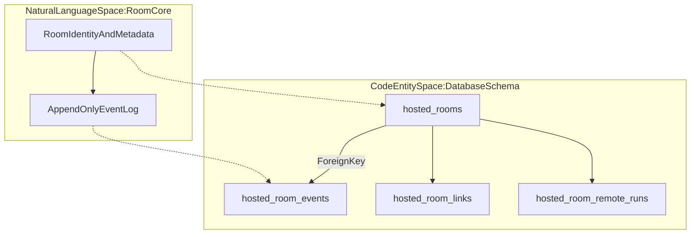
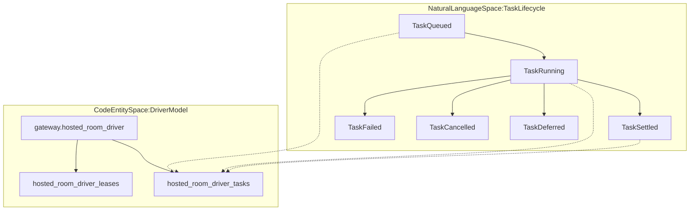
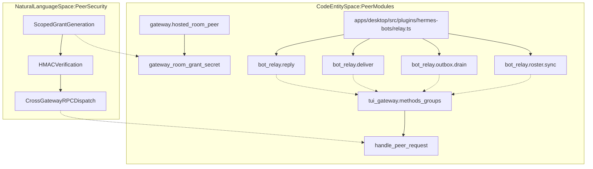
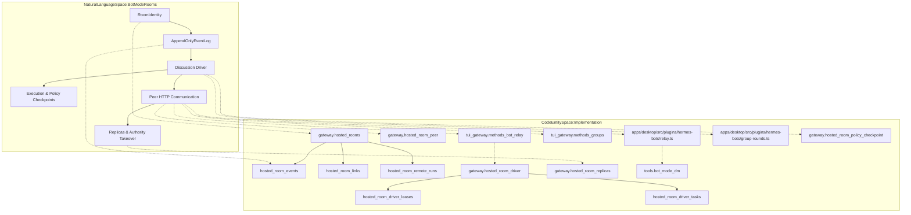

<!-- source: DeepWiki mcp.deepwiki.com · repo nousresearch/hermes-agent · page 7.5 Hosted Rooms and Group Chat · fetched 2026-10-26 -->

# Hosted Rooms and Group Chat

Relevant source files

The following files were used as context for generating this wiki page:

- [agent/turn_author.py](agent/turn_author.py)
- [apps/desktop/e2e/group-turn-integrity.spec.ts](apps/desktop/e2e/group-turn-integrity.spec.ts)
- [apps/desktop/src/app/gateway/hooks/use-gateway-boot-update-hold.test.tsx](apps/desktop/src/app/gateway/hooks/use-gateway-boot-update-hold.test.tsx)
- [apps/desktop/src/plugins/hermes-bots/group-activity.test.ts](apps/desktop/src/plugins/hermes-bots/group-activity.test.ts)
- [apps/desktop/src/plugins/hermes-bots/group-activity.ts](apps/desktop/src/plugins/hermes-bots/group-activity.ts)
- [apps/desktop/src/plugins/hermes-bots/group-chat-view-members.test.ts](apps/desktop/src/plugins/hermes-bots/group-chat-view-members.test.ts)
- [apps/desktop/src/plugins/hermes-bots/group-chat-view-members.tsx](apps/desktop/src/plugins/hermes-bots/group-chat-view-members.tsx)
- [apps/desktop/src/plugins/hermes-bots/group-chat-view.test.ts](apps/desktop/src/plugins/hermes-bots/group-chat-view.test.ts)
- [apps/desktop/src/plugins/hermes-bots/group-chat-view.tsx](apps/desktop/src/plugins/hermes-bots/group-chat-view.tsx)
- [apps/desktop/src/plugins/hermes-bots/group-chat.test.ts](apps/desktop/src/plugins/hermes-bots/group-chat.test.ts)
- [apps/desktop/src/plugins/hermes-bots/group-chat.ts](apps/desktop/src/plugins/hermes-bots/group-chat.ts)
- [apps/desktop/src/plugins/hermes-bots/group-external-writes.test.ts](apps/desktop/src/plugins/hermes-bots/group-external-writes.test.ts)
- [apps/desktop/src/plugins/hermes-bots/group-external-writes.ts](apps/desktop/src/plugins/hermes-bots/group-external-writes.ts)
- [apps/desktop/src/plugins/hermes-bots/group-membership.test.ts](apps/desktop/src/plugins/hermes-bots/group-membership.test.ts)
- [apps/desktop/src/plugins/hermes-bots/group-membership.ts](apps/desktop/src/plugins/hermes-bots/group-membership.ts)
- [apps/desktop/src/plugins/hermes-bots/group-round-members.ts](apps/desktop/src/plugins/hermes-bots/group-round-members.ts)
- [apps/desktop/src/plugins/hermes-bots/group-round-prompt.ts](apps/desktop/src/plugins/hermes-bots/group-round-prompt.ts)
- [apps/desktop/src/plugins/hermes-bots/group-rounds.addressed.test.ts](apps/desktop/src/plugins/hermes-bots/group-rounds.addressed.test.ts)
- [apps/desktop/src/plugins/hermes-bots/group-rounds.primary-alias.test.ts](apps/desktop/src/plugins/hermes-bots/group-rounds.primary-alias.test.ts)
- [apps/desktop/src/plugins/hermes-bots/group-rounds.test.ts](apps/desktop/src/plugins/hermes-bots/group-rounds.test.ts)
- [apps/desktop/src/plugins/hermes-bots/group-rounds.ts](apps/desktop/src/plugins/hermes-bots/group-rounds.ts)
- [apps/desktop/src/plugins/hermes-bots/group-test-utils.ts](apps/desktop/src/plugins/hermes-bots/group-test-utils.ts)
- [apps/desktop/src/plugins/hermes-bots/group-turns.test.ts](apps/desktop/src/plugins/hermes-bots/group-turns.test.ts)
- [apps/desktop/src/plugins/hermes-bots/group-turns.ts](apps/desktop/src/plugins/hermes-bots/group-turns.ts)
- [apps/desktop/src/plugins/hermes-bots/types.ts](apps/desktop/src/plugins/hermes-bots/types.ts)
- [apps/desktop/src/test/fake-gateway-socket.ts](apps/desktop/src/test/fake-gateway-socket.ts)
- [gateway/bot_loop_guard.py](gateway/bot_loop_guard.py)
- [hermes_cli/quiet_single_query.py](hermes_cli/quiet_single_query.py)
- [tests/agent/test_bot_chat_toolset_refresh.py](tests/agent/test_bot_chat_toolset_refresh.py)
- [tests/agent/test_system_prompt_restore.py](tests/agent/test_system_prompt_restore.py)
- [tests/agent/test_turn_author.py](tests/agent/test_turn_author.py)
- [tests/cron/test_cron_live_bot_delivery.py](tests/cron/test_cron_live_bot_delivery.py)
- [tests/gateway/test_bot_loop_guard.py](tests/gateway/test_bot_loop_guard.py)
- [tests/gateway/test_peer_dm_transient_retry.py](tests/gateway/test_peer_dm_transient_retry.py)
- [tests/hermes_cli/test_quiet_turn_author.py](tests/hermes_cli/test_quiet_turn_author.py)
- [tests/tools/test_bot_failure_reasons.py](tests/tools/test_bot_failure_reasons.py)
- [tests/tools/test_bot_live_owner_delivery.py](tests/tools/test_bot_live_owner_delivery.py)
- [tests/tools/test_bot_mode_dm.py](tests/tools/test_bot_mode_dm.py)
- [tests/tools/test_bot_mode_probe.py](tests/tools/test_bot_mode_probe.py)
- [tests/tools/test_bot_mode_refusal_contract.py](tests/tools/test_bot_mode_refusal_contract.py)
- [tests/tools/test_bot_relay.py](tests/tools/test_bot_relay.py)
- [tests/tools/test_bot_relay_windows_paths.py](tests/tools/test_bot_relay_windows_paths.py)
- [tests/tools/test_bot_retry_policy.py](tests/tools/test_bot_retry_policy.py)
- [tests/tools/test_bot_turn_lock.py](tests/tools/test_bot_turn_lock.py)
- [tests/tui_gateway/test_bot_mode_silence_delivery.py](tests/tui_gateway/test_bot_mode_silence_delivery.py)
- [tests/tui_gateway/test_bot_relay_methods.py](tests/tui_gateway/test_bot_relay_methods.py)
- [tests/tui_gateway/test_relay_live_author.py](tests/tui_gateway/test_relay_live_author.py)
- [tools/bot_failure_reasons.py](tools/bot_failure_reasons.py)
- [tools/bot_live_delivery.py](tools/bot_live_delivery.py)
- [tools/bot_mode_dm.py](tools/bot_mode_dm.py)
- [tools/bot_mode_probe.py](tools/bot_mode_probe.py)
- [tools/bot_relay.py](tools/bot_relay.py)
- [tui_gateway/methods_bot_relay.py](tui_gateway/methods_bot_relay.py)
- [website/docs/user-guide/bot-mode.md](website/docs/user-guide/bot-mode.md)

## Purpose and Scope

The gateway-hosted Bot Mode rooms subsystem in Hermes Agent provides a robust foundation for durable group chat rooms, enabling multi-party agent interactions, cross-gateway collaboration, and distributed execution of agent turns. It incorporates durable room identity management, an append-only event log for immutable event history, replica synchronization across gateways, secure peer-to-peer HTTP communication, a deterministic discussion driver for turn ordering, and execution/policy checkpointing to optimize performance and consistency.

This system is crucial for Bot Mode, where named Bots (agent profiles) participate in permanent group conversations ("rooms") managed durably by the gateway. It supports fire-and-forget messaging between agents on the same or different gateways, coordination of group discussions with fine-grained member mentions, and fault-tolerant recovery in distributed environments.

Sources: [website/docs/user-guide/bot-mode.md:3-4]()

---

## Durable Room Identity and Append-Only Event Log

At the core of hosted rooms is a durable identity system with an append-only event log stored in SQLite tables defined in `gateway/hosted_rooms.py`. The following conceptual and schema mapping illustrates the relationship between the natural language concepts and the underlying database:

**Figure 1: Room identity and event log mapped to SQLite schema entities**

- **`hosted_rooms`**: Each row corresponds to a unique room, with fields such as `room_id` (primary key), `name` (canonical room name), `members_json` (JSON list of member identifiers), `authority_gateway_id` (which gateway acts as authority), `authority_epoch` (monotonically increasing version), `next_seq` (sequence number for next event), and timestamps.
- **`hosted_room_events`**: Stores an append-only, strictly ordered sequence of events partitioned by `room_id` and `seq` (sequence number). Each event has a unique `event_id`, a string `kind` identifier, actor metadata in JSON (`actor_json`), the `epoch` version, and the payload in JSON (`payload_json`).
- Additional tables such as `hosted_room_links` and `hosted_room_remote_runs` support cross-room linkage and remote execution metadata (not detailed here).

This schema ensures a canonical authoritative source for room metadata and a durable immutable history of all room events.

Sources: [gateway/hosted_rooms.py:87-130]()

---

## Task State Machine and Driver Lease

Execution of agent turns and background tasks inside rooms is managed via a fenced task state machine and lease-based driver control in `gateway/hosted_room_driver.py`. This design prevents race conditions and stale state updates in a distributed multi-gateway environment.

**Figure 2: Task lifecycle states and underlying driver control tables**

- **Lease Management**: The `hosted_room_driver_leases` table records which gateway currently holds exclusive rights to process tasks in a room, identified by `gateway_id` and scoped by the room's `authority_epoch`. Leases have expiration timestamps to allow failover.
- **Task States and Transitions**: Tasks in the `hosted_room_driver_tasks` table transition through explicit states — `queued`, `running`, `settled`, `failed`, `cancelled`, `indeterminate`, `deferred`, and `stopping` — modeled as a finite state machine. State transitions are guarded by `execution_generation` fencing to prevent stale workers from overwriting newer results.
- This robust control prevents conflicting execution and maintains the integrity of turn processing.

Sources: [gateway/hosted_room_driver.py:25-83]()

---

## Replicas and Authority Takeover

To scale reliability and availability, non-authority gateways maintain local replicas of room state by ingesting event pages asynchronously. The `gateway/hosted_room_replicas.py` module implements transactional ingestion and authority epoch management.

- **Replica Ingestion**: The `ingest_page()` function accepts contiguous ranges of ordered events. It detects gaps in sequence numbers (`ReplicaGapError`) and epoch regressions (`ReplicaEpochRegressionError`), enforcing strict append-only semantics and version monotonicity during ingestion.
- **Authority Epoch Handling**:
  - `promote_replica()`: Used to promote a replica gateway to authority status by incrementing `authority_epoch` and appending a provenance event of kind `authority.claimed`, cementing the authority lineage.
  - `demote_room()`: Restores consistency if a stale authority returns with a lower epoch; the room status is demoted appropriately.

This system ensures seamless authority failover and state synchronization across gateways.

Sources: [gateway/hosted_room_replicas.py:1-51]()

---

## Peer HTTP and Cross-Gateway Communication

Hosted rooms members communicate across gateways using scoped grants authenticated by HMAC and managed peer HTTP requests.

**Figure 3: Peer HTTP security and cross-connection relay architecture**

- **Scoped Grants**: Invitation tokens encapsulate task execution coordinates, target profile, and time-bound validity. These tokens are signed using an installation-level secret, not user API keys, ensuring scope-limited access.
- **Request Verification**: Requests use HMAC signatures and only route through permitted transports (loopback or TLS) before invoking target profile execution.
- **Cross-Gateway Relay via Desktop**:
  - The Desktop application orchestrates a relay with four doors on each gateway: `bot_relay.roster.sync` (pushes other connections' agents), `bot_relay.outbox.drain` (collects envelopes queued for other connections), `bot_relay.deliver` (one-turn Bot Chat delivery on the target gateway), and `bot_relay.reply` (writes the reply/error back on the sender gateway). [tui_gateway/methods_bot_relay.py:1-7]()
  - The `bot_relay.roster.sync` method persists validated roster rows and reports the accepted count. [tui_gateway/methods_bot_relay.py:31-53]()
  - The `bot_relay.outbox.drain` method claims pending cross-connection envelopes, moving them to `claimed/` atomically to prevent double-delivery. [tui_gateway/methods_bot_relay.py:56-65]()
  - The `bot_relay.deliver` method is a legacy transport bridge for canonical admission or explicit refusal. It resolves the target profile's home on the current install and forwards to that profile's authority. [tui_gateway/methods_bot_relay.py:68-122]()
  - The `bot_relay.reply` method writes a relayed reply and/or error for an envelope ID so the sender-side waiter picks it up. [tui_gateway/methods_bot_relay.py:125-127]()
- **`message_agent` Tool**: Injected only into Bot Mode canonical "Bot Chat" sessions on managed installs, this tool allows asynchronous fire-and-forget messages to other agents on the same or registered peer gateways. The reply arrives asynchronously as a completion notification from a background delivery process. The tool's schema is injected, not registered globally, and its authorization is strictly checked against the session title and Bot Mode management status. [tools/bot_mode_dm.py:1-14](), [tools/bot_mode_dm.py:67-120](), [tools/bot_mode_dm.py:123-137]()

Sources: [gateway/hosted_room_peer.py:1-100](), [tui_gateway/methods_groups.py:1-50](), [apps/desktop/src/plugins/hermes-bots/group-test-utils.ts:1-72](), [tools/bot_mode_dm.py:1-14](), [tools/bot_mode_dm.py:67-120](), [tools/bot_mode_dm.py:123-137](), [tui_gateway/methods_bot_relay.py:1-7](), [tui_gateway/methods_bot_relay.py:31-53](), [tui_gateway/methods_bot_relay.py:56-65](), [tui_gateway/methods_bot_relay.py:68-122](), [tui_gateway/methods_bot_relay.py:125-127]()

---

## Discussion Driver and Policy Checkpoints

Group discussion dynamics and policy enforcement are governed by the discussion driver and checkpointing subsystems. They provide deterministic turn ordering, member mention resolution, and scalable replay avoidance.

- **Discussion Policy Driver**:
  - Implemented in [apps/desktop/src/plugins/hermes-bots/group-rounds.ts](), it evaluates room rosters, enumerates turns (capped by `GROUP_CHAT_MAX_ROUNDS`), and parses member mentions (e.g., `@name`, quoted `"two words"`, `@everyone`, `@all`) using `parseGroupChatMentions`. [apps/desktop/src/plugins/hermes-bots/group-rounds.ts:39-53]()
  - The `parseGroupChatMentions` function handles case-insensitive matching against member profile names, display titles, and collapsed no-space forms. It also accounts for renamed members and their previous handles, ensuring mentions resolve correctly even after renames. [apps/desktop/src/plugins/hermes-bots/group-rounds.ts:53-145](), [apps/desktop/src/plugins/hermes-bots/group-rounds.ts:107-119]()
  - The `groupReplyMentionTag` function determines the appropriate `@tag` for a member, considering disambiguation for same-named local and remote twins. [apps/desktop/src/plugins/hermes-bots/group-rounds.ts:147-168]()
  - The `resolveGroupResponders` function identifies which members should take a turn based on mentions in messages since the last user entry. [apps/desktop/src/plugins/hermes-bots/group-rounds.ts:170-176]()
  - The `isGroupPassText` function identifies messages that indicate a member has "passed" their turn. [apps/desktop/src/plugins/hermes-bots/group-turns.ts:38-46]()
  - The `pickGroupTurnReply` and `pickStrandedGroupTurnReply` functions extract the substantive reply from a member's turn, handling cases where a turn might include "pass" messages or fail. [apps/desktop/src/plugins/hermes-bots/group-turns.ts:73-108](), [apps/desktop/src/plugins/hermes-bots/group-turns.ts:118-157]()

- **Policy Checkpoints**:
  - The `HostedRoomPolicyCheckpoint` class (`gateway/hosted_room_policy_checkpoint.py`) maintains active threads, watermarks, publications, and transcripts persisted into specialized tables:
    - `hosted_room_policy_threads`
    - `hosted_room_policy_events`
    - `hosted_room_policy_transcript`
  - These tables allow polling of room state without replaying the entire event log for every query, improving performance on busy rooms.

Sources: [gateway/hosted_room_discussion.py:24-118](), [gateway/hosted_room_policy_checkpoint.py:1-54](), [apps/desktop/src/plugins/hermes-bots/group-rounds.ts:39-53](), [apps/desktop/src/plugins/hermes-bots/group-rounds.ts:53-145](), [apps/desktop/src/plugins/hermes-bots/group-rounds.ts:107-119](), [apps/desktop/src/plugins/hermes-bots/group-rounds.ts:147-168](), [apps/desktop/src/plugins/hermes-bots/group-rounds.ts:170-176](), [apps/desktop/src/plugins/hermes-bots/group-turns.ts:38-46](), [apps/desktop/src/plugins/hermes-bots/group-turns.ts:73-108](), [apps/desktop/src/plugins/hermes-bots/group-turns.ts:118-157]()

---

## TUI Gateway Hosted Room Service

The hosted room subsystem is integrated into the overall gateway JSON-RPC server via [tui_gateway/methods_bot_relay.py]() and [tui_gateway/methods_groups.py]() modules.

- **RPC Methods**: These modules expose hosted room operations such as room creation, deletion, membership changes, event replication (`replica.ingest`), message broadcasting (`send_message`), and roster synchronization to the TUI frontend, desktop app, and web dashboard.
- **Driver Management**: Background loops monitor driver task execution, lease management, and room lifecycle events, ensuring seamless coordination of driving execution and replication.
- **Delivery Handling**: The `bot_relay.deliver` method performs delivery of relayed direct messages into Bot Chat sessions on the host gateway, validating local profile existence and running the one-turn sub-process transport. This delivery process uses `hermes_cli.quiet_single_query.run_reported_turn` to execute the agent's turn, ensuring proper timeout and report handling. [tui_gateway/methods_bot_relay.py:40-48]()

Sources: [tui_gateway/methods_bot_relay.py:1-80](), [tui_gateway/methods_groups.py:1-50](), [tui_gateway/methods_bot_relay.py:40-48]()

---

## Summary Diagram: End-to-End Hosted Rooms Components

*Figure 4: Mapping the conceptual Bot Mode room architecture to major code modules.*

---

## References

- Bot Mode concepts and "message_agent" tool overview: [website/docs/user-guide/bot-mode.md:1-66]()
- Message dispatch and containment in bot_mode_dm: [tools/bot_mode_dm.py:1-140]()
- Cross-gateway relay handling: [tools/bot_relay.py:1-146](), [tui_gateway/methods_bot_relay.py:1-130](), [apps/desktop/src/plugins/hermes-bots/group-test-utils.ts:1-72]()
- Durable storage schema for rooms and events: [gateway/hosted_rooms.py:87-130]()
- Task leasing and state machine: [gateway/hosted_room_driver.py:25-83]()
- Replica ingestion and promotion/demotion: [gateway/hosted_room_replicas.py:1-51]()
- Scoped peer HTTP grants and verification: [gateway/hosted_room_peer.py:1-60](), [tui_gateway/methods_groups.py:1-50]()
- Group discussion rounds and mention parsing: [apps/desktop/src/plugins/hermes-bots/group-rounds.ts:39-53]()
- Policy checkpoint persistence: [gateway/hosted_room_policy_checkpoint.py:1-54]()
- TUI gateway JSON-RPC integration and delivery: [tui_gateway/methods_bot_relay.py:1-80](), [tui_gateway/methods_groups.py:1-50]()

---

This completes the comprehensive technical documentation for the gateway-hosted Bot Mode rooms subsystem in Hermes Agent, detailing the mechanisms for durable room management, multi-gateway collaboration, and group chat orchestration.

---

