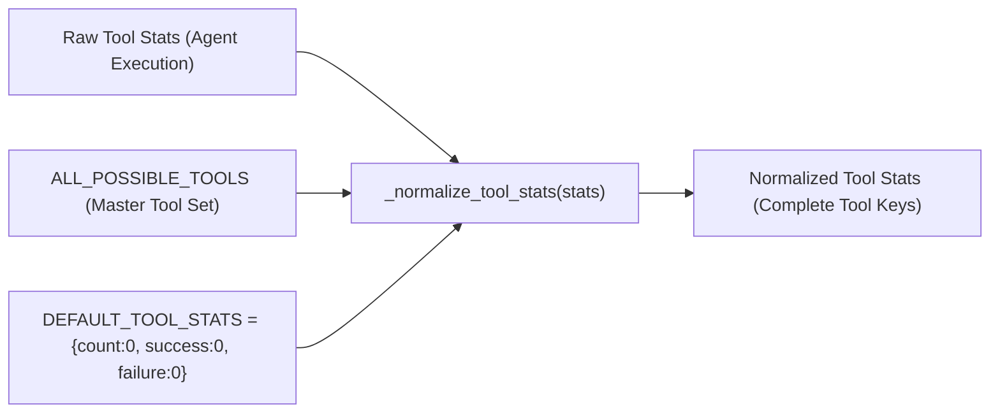
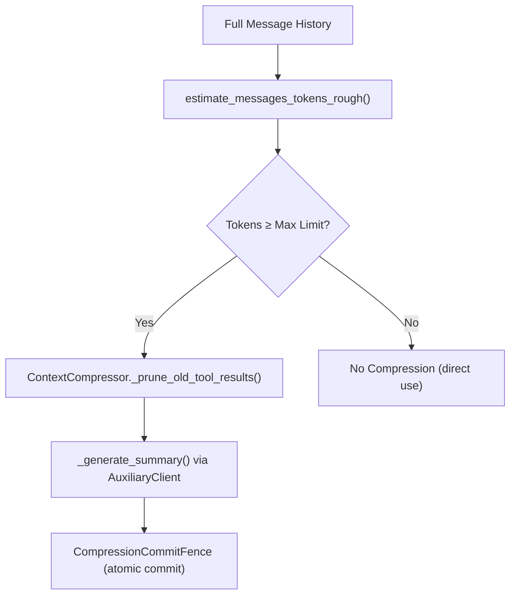
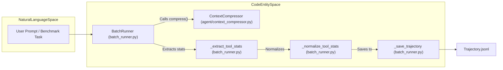
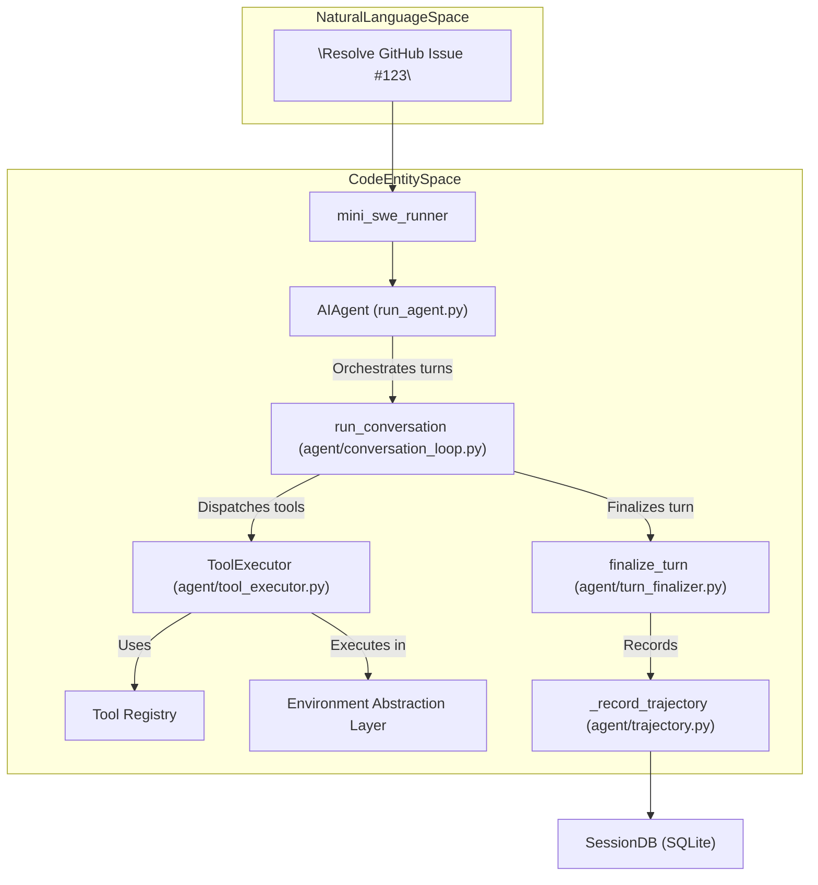

<!-- source: DeepWiki mcp.deepwiki.com · repo nousresearch/hermes-agent · page 9.3 Data Generation and Trajectories · fetched 2026-10-26 -->

# Data Generation and Trajectories

Relevant source files

The following files were used as context for generating this wiki page:

- [agent/agent_init.py](agent/agent_init.py)
- [agent/agent_runtime_helpers.py](agent/agent_runtime_helpers.py)
- [agent/chat_completion_helpers.py](agent/chat_completion_helpers.py)
- [agent/compaction_display.py](agent/compaction_display.py)
- [agent/compression_facade.py](agent/compression_facade.py)
- [agent/context_compressor.py](agent/context_compressor.py)
- [agent/conversation_compression.py](agent/conversation_compression.py)
- [agent/conversation_compression_archive.py](agent/conversation_compression_archive.py)
- [agent/conversation_compression_manual.py](agent/conversation_compression_manual.py)
- [agent/conversation_loop.py](agent/conversation_loop.py)
- [agent/inline_tool_executors.py](agent/inline_tool_executors.py)
- [agent/message_metadata.py](agent/message_metadata.py)
- [agent/micro_compaction.py](agent/micro_compaction.py)
- [agent/session_persistence.py](agent/session_persistence.py)
- [agent/tool_dispatch_helpers.py](agent/tool_dispatch_helpers.py)
- [agent/tool_executor.py](agent/tool_executor.py)
- [agent/transcript_repair.py](agent/transcript_repair.py)
- [agent/turn_context.py](agent/turn_context.py)
- [agent/turn_finalizer.py](agent/turn_finalizer.py)
- [apps/desktop/e2e/core/reply-painted-once.spec.ts](apps/desktop/e2e/core/reply-painted-once.spec.ts)
- [apps/desktop/src/app/session/hooks/use-message-stream/reused-final-after-tool.test.tsx](apps/desktop/src/app/session/hooks/use-message-stream/reused-final-after-tool.test.tsx)
- [apps/desktop/src/app/session/hooks/use-message-stream/test-harness.tsx](apps/desktop/src/app/session/hooks/use-message-stream/test-harness.tsx)
- [hermes_cli/sessions_cmd.py](hermes_cli/sessions_cmd.py)
- [hermes_state_common.py](hermes_state_common.py)
- [hermes_state_compression.py](hermes_state_compression.py)
- [hermes_state_gateway.py](hermes_state_gateway.py)
- [hermes_state_maintenance.py](hermes_state_maintenance.py)
- [hermes_state_messages.py](hermes_state_messages.py)
- [hermes_state_portability.py](hermes_state_portability.py)
- [hermes_state_schema.py](hermes_state_schema.py)
- [hermes_state_search.py](hermes_state_search.py)
- [hermes_state_sessions.py](hermes_state_sessions.py)
- [hermes_state_telegram.py](hermes_state_telegram.py)
- [hermes_state_titles.py](hermes_state_titles.py)
- [hermes_state_usage.py](hermes_state_usage.py)
- [scripts/micro_compaction_report.py](scripts/micro_compaction_report.py)
- [tests/agent/test_compression_commit_fence_race.py](tests/agent/test_compression_commit_fence_race.py)
- [tests/agent/test_compression_concurrent_fork.py](tests/agent/test_compression_concurrent_fork.py)
- [tests/agent/test_compression_stall_fallback.py](tests/agent/test_compression_stall_fallback.py)
- [tests/agent/test_compressor_truncated_summary_guard.py](tests/agent/test_compressor_truncated_summary_guard.py)
- [tests/agent/test_context_compressor.py](tests/agent/test_context_compressor.py)
- [tests/agent/test_context_engine_message_uid.py](tests/agent/test_context_engine_message_uid.py)
- [tests/agent/test_conversation_compression_manual.py](tests/agent/test_conversation_compression_manual.py)
- [tests/agent/test_empty_response_recovery_persistence.py](tests/agent/test_empty_response_recovery_persistence.py)
- [tests/agent/test_in_place_merged_user_rows.py](tests/agent/test_in_place_merged_user_rows.py)
- [tests/agent/test_message_sequence_repair.py](tests/agent/test_message_sequence_repair.py)
- [tests/agent/test_micro_compaction.py](tests/agent/test_micro_compaction.py)
- [tests/agent/test_proactive_prune_rearm_threshold.py](tests/agent/test_proactive_prune_rearm_threshold.py)
- [tests/agent/test_proactive_prune_restart_safety.py](tests/agent/test_proactive_prune_restart_safety.py)
- [tests/agent/test_proactive_tool_result_pruning.py](tests/agent/test_proactive_tool_result_pruning.py)
- [tests/agent/test_setup_beat_card_round.py](tests/agent/test_setup_beat_card_round.py)
- [tests/agent/test_tool_call_args_sanitizer.py](tests/agent/test_tool_call_args_sanitizer.py)
- [tests/agent/test_tool_call_incremental_persistence.py](tests/agent/test_tool_call_incremental_persistence.py)
- [tests/agent/test_tool_dispatch_helpers.py](tests/agent/test_tool_dispatch_helpers.py)
- [tests/agent/test_turn_finalizer_final_response_persistence.py](tests/agent/test_turn_finalizer_final_response_persistence.py)
- [tests/agent/test_turn_finalizer_iteration_limit_exit.py](tests/agent/test_turn_finalizer_iteration_limit_exit.py)
- [tests/agent/test_unicode_ascii_codec.py](tests/agent/test_unicode_ascii_codec.py)
- [tests/gateway/test_api_server_compaction_projection.py](tests/gateway/test_api_server_compaction_projection.py)
- [tests/gateway/test_profile_identity_purge.py](tests/gateway/test_profile_identity_purge.py)
- [tests/gateway/test_rekey_profile_routing.py](tests/gateway/test_rekey_profile_routing.py)
- [tests/hermes_cli/test_kanban_comment_queries.py](tests/hermes_cli/test_kanban_comment_queries.py)
- [tests/hermes_cli/test_profile_identity_purge_cmd.py](tests/hermes_cli/test_profile_identity_purge_cmd.py)
- [tests/hermes_cli/test_sessions_delete.py](tests/hermes_cli/test_sessions_delete.py)
- [tests/hermes_state/test_canonical_title_guard.py](tests/hermes_state/test_canonical_title_guard.py)
- [tests/hermes_state/test_delete_session_write_guards.py](tests/hermes_state/test_delete_session_write_guards.py)
- [tests/hermes_state/test_fts_rebuild_corruption_class.py](tests/hermes_state/test_fts_rebuild_corruption_class.py)
- [tests/hermes_state/test_hermes_state.py](tests/hermes_state/test_hermes_state.py)
- [tests/hermes_state/test_isolation_marker_env.py](tests/hermes_state/test_isolation_marker_env.py)
- [tests/hermes_state/test_live_db_guard_ancestry.py](tests/hermes_state/test_live_db_guard_ancestry.py)
- [tests/hermes_state/test_message_uid.py](tests/hermes_state/test_message_uid.py)
- [tests/hermes_state/test_never_active_keyed_prune.py](tests/hermes_state/test_never_active_keyed_prune.py)
- [tests/hermes_state/test_orphan_gateway_session_repair.py](tests/hermes_state/test_orphan_gateway_session_repair.py)
- [tests/hermes_state/test_pinned_lineage.py](tests/hermes_state/test_pinned_lineage.py)
- [tests/hermes_state/test_purge_profile_state.py](tests/hermes_state/test_purge_profile_state.py)
- [tests/hermes_state/test_rekey_profile_state.py](tests/hermes_state/test_rekey_profile_state.py)
- [tests/hermes_state/test_session_import_keep_flags.py](tests/hermes_state/test_session_import_keep_flags.py)
- [tests/hermes_state/test_session_list_index_choice.py](tests/hermes_state/test_session_list_index_choice.py)
- [tests/hermes_state/test_telegram_topic_selfheal.py](tests/hermes_state/test_telegram_topic_selfheal.py)
- [tests/hermes_state/test_unaddressed_rewrite_identity.py](tests/hermes_state/test_unaddressed_rewrite_identity.py)
- [tests/test_utils_atomic_writers_deleted_profile.py](tests/test_utils_atomic_writers_deleted_profile.py)
- [tests/tools/test_kanban_comment_injection.py](tests/tools/test_kanban_comment_injection.py)
- [tests/tools/test_kanban_persisted_identity.py](tests/tools/test_kanban_persisted_identity.py)
- [tests/tui_gateway/test_manual_compress_history_fence.py](tests/tui_gateway/test_manual_compress_history_fence.py)
- [tests/tui_gateway/test_stranded_session_adoption.py](tests/tui_gateway/test_stranded_session_adoption.py)
- [tests/tui_gateway/test_turn_payload_reused_final.py](tests/tui_gateway/test_turn_payload_reused_final.py)
- [website/docs/developer-guide/context-compression-and-caching.md](website/docs/developer-guide/context-compression-and-caching.md)
- [website/docs/developer-guide/context-engine-plugin.md](website/docs/developer-guide/context-engine-plugin.md)
- [website/docs/developer-guide/session-storage.md](website/docs/developer-guide/session-storage.md)
- [website/docs/user-guide/sessions.md](website/docs/user-guide/sessions.md)
- [website/i18n/zh-Hans/docusaurus-plugin-content-docs/current/guides/tips.md](website/i18n/zh-Hans/docusaurus-plugin-content-docs/current/guides/tips.md)
- [website/i18n/zh-Hans/docusaurus-plugin-content-docs/current/user-guide/messaging/index.md](website/i18n/zh-Hans/docusaurus-plugin-content-docs/current/user-guide/messaging/index.md)
- [website/i18n/zh-Hans/docusaurus-plugin-content-docs/current/user-guide/sessions.md](website/i18n/zh-Hans/docusaurus-plugin-content-docs/current/user-guide/sessions.md)

## Purpose and Scope

This page documents Hermes Agent's mechanisms for generating and managing trajectory data used in training, evaluation, and benchmarking. It covers the trajectory format and detailed schema of conversation data, the extraction and normalization of tool statistics, reasoning metrics tracking, data normalization rules, configuration examples for dataset generation, trajectory compression strategies, and the role of the `mini_swe_runner` utility in software engineering evaluation data collection.

For context on batch execution and toolset sampling, see [9.1 Batch Runner]() and [9.2 Toolset Distributions]().

Sources: [agent/context_compressor.py:1-35](), [agent/conversation_loop.py:1-141](), [agent/agent_runtime_helpers.py:1-141]()

---

## Trajectory Format Overview

Hermes Agent exports conversation trajectories as JSONL objects. Each entry captures a full conversational session's history with annotated tool call interactions, normalized statistics, and metadata. These structured trajectories are consumable by HuggingFace datasets or used for downstream model training and evaluation tasks.

### Trajectory Entry Structure and Data Flow

```mermaid
graph TB
    subgraph "TrajectoryEntryStructure"
        Entry["Trajectory Entry<br/>(JSONL Object)"]
        Entry --> Index["prompt_index: int (Task/Prompt Identifier)"]
        Entry --> Conversations["conversations: List[Dict] (Sequenced Messages)"]
        Entry --> Metadata["metadata: Dict (Run Metadata and Stats)"]
        Entry --> ToolStats["tool_stats: Dict (Tool Usage Counts)"]
        Entry --> ErrorCounts["tool_error_counts: Dict (Tool Error Counts)"]
        Entry --> Status["Completion Info (finished, partial, errors)"]
    end
    
    subgraph "ConversationMessages"
        Conversations --> Msg1["Message 1"]
        Conversations --> MsgN["Message N"]
        
        Msg1 --> From1["from: string ('human', 'gpt', 'system')"]
        Msg1 --> Value1["value: string (Message Text Content)"]
        Msg1 --> ToolCalls1["tool_calls?: List (Optional Tool Calls)"]
        Msg1 --> ToolCallID1["tool_call_id?: string (Optional Tool Call Identifier)"]
    end
    
    subgraph "ToolStatisticsSchema"
        ToolStats --> TS_Terminal["terminal: {count, success, failure}"]
        ToolStats --> TS_ReadFile["read_file: {count: 0, success: 0, failure: 0}"]
        ToolStats --> TS_Others["Other registered tools similarly recorded"]
    end
    
    subgraph "MetadataFields"
        Metadata --> BatchNum["batch_num: int (Batch Run Identifier)"]
        Metadata --> Timestamp["timestamp: ISO 8601 string"]
        Metadata --> ModelName["model: string (Model Used)"]
    end
    
    Status --> Completed["completed: boolean"]
    Status --> Partial["partial: boolean"]
    Status --> APICalls["api_calls: int (Number of API Calls)"]
    Status --> ToolsetsUsed["toolsets_used: List[string]"]
```

Internally, Hermes stores messages as `{role, content}` pairs with roles `"user"`, `"assistant"`, or `"system"`. For trajectory export, these are mapped to the `from` field as:

- `"user"` → `"human"`
- `"assistant"` → `"gpt"`
- `"system"` → `"system"`

Tool invocation details appear embedded as XML `<tool_call>` sections inside assistant message content, with later `<tool_response>` blocks in matching tool messages connected via `tool_call_id`. This nuanced XML encapsulation preserves structured interaction data, essential for training models on agent-tool interaction semantics and function calls. The `_trajectory_tool_call_turn` function in [agent/agent_runtime_helpers.py:122-141]() is responsible for formatting tool calls into this XML structure, including an optional `<think>` block for reasoning.

Sources: [agent/agent_runtime_helpers.py:122-141]()

---

## Tool Statistics Normalization and Extraction

### Purpose

To create consistent, machine-readable datasets with full schema coverage, tool statistics extracted from agent runs are normalized. This ensures all known tools have an entry in `tool_stats` and `tool_error_counts` dictionaries, filling zeros where a tool was not invoked. This stable schema benefits downstream analysis and model training.

### Normalization Workflow

Hermes constructs `ALL_POSSIBLE_TOOLS` from the registered tool definitions in the tool registry to cover every tool that might be used in batch runs. The function `_normalize_tool_stats(stats)` iterates over this master list, injecting zeroed stats for any missing tools to ensure no tool is omitted. Similarly, `_normalize_tool_error_counts` zero-fills error statistics for all tools.

This normalization step guarantees consistent keys in each trajectory's stats section regardless of tools exercised in a particular run.

Sources: [agent/tool_executor.py:1-150]()

---

## Reasoning Metrics and Trajectory Compression

Batch runs frequently produce long-horizon trajectories accumulating tens of thousands of tokens covering complex tool calls and multi-turn dialogs. Hermes monitors reasoning-related data and implements trajectory compression to manage token budget and streamline datasets without losing key details.

### Reasoning Metrics Captured

The system extracts and persists reasoning-related telemetry per trajectory, including:

- Tokens consumed by reasoning blocks in assistant messages.
- Thought signature hashes capturing deductive trace patterns.
- Reasoning effort levels, enumerated as `"low"`, `"medium"`, `"high"`, or `"xhigh"`.

These metrics enable filtering, ranking, and detailed studies of agent cognition and inference effort based on recorded trajectories.

### Trajectory and Context Compression Workflow

The `ContextCompressor` class [agent/context_compressor.py:40-43]() is central to managing context. It prunes old tool call outputs, retaining informative head and tail messages while removing intermediate expansion to fit token limits [agent/context_compressor.py:1-35](). The summarization leverages auxiliary LLM clients (e.g., `call_llm` in [agent/auxiliary_client.py:24-33]()) for creating compressed summaries, which are then stably committed to prevent race conditions [agent/conversation_compression.py:1-35](). The system manages timeouts and cooldown heuristics to avoid excessive compaction attempts, as seen in `_SUMMARY_ROUTE_PIN` and related functions in [agent/context_compressor.py:76-122]().

This strategy balances conversation fidelity, telemetry preservation, and token budget adherence.

Sources: [agent/context_compressor.py:1-35](), [agent/conversation_compression.py:1-35](), [agent/model_metadata.py:40-43](), [agent/auxiliary_client.py:24-33](), [agent/context_compressor.py:76-122]()

---

## Datagen Configuration Examples and Mini SWE Runner

### Datagen Configuration

Batch data generation accepts YAML or JSON configuration profiles specifying:

- Task queues and prompt sets to drive model inputs.
- Model names and provider selections.
- Iteration budgets limiting maximum API calls, managed by `IterationBudget` [agent/iteration_budget.py:29-30]().
- Toolset selections with sampling probabilities.
- Output file paths for trajectories.

This configuration system enables users to define reproducible experimental runs for generating tailored training and evaluation dataset trajectories.

### Mini SWE Runner

The `mini_swe_runner` utility is a specialized harness that facilitates collection of software engineering (SWE) benchmark data by:

- Bootstrapping isolated runtime environments.
- Injecting and preparing code repositories as target tasks.
- Driving turn-based interaction loops simulating coding and reasoning work.
- Extracting structured metrics, test results, and symbolic reasoning data into completed trajectories.

This runner helps produce realistic SWE data under controlled environment and task prompt constraints.

Sources: [agent/iteration_budget.py:29-30]()

---

## Code Entity Space Mapping

### Data Generation Pipeline Mapping

**Explanation:**  
The user-defined prompt or benchmark task initiates `BatchRunner`. During execution, `BatchRunner` interacts with the `ContextCompressor` to manage context window usage. Tool usage statistics are extracted and normalized by internal functions within `batch_runner.py` to ensure stable datasets. Finally, the processed data is saved as serialized JSONL trajectories.

Sources: [agent/context_compressor.py:1-35](), [agent/conversation_loop.py:1-141](), [agent/agent_runtime_helpers.py:1-141]()

### Agent Interaction and Tool Execution Data Flow

**Explanation:**  
A natural language goal, such as resolving a GitHub issue, is handled by the `mini_swe_runner`. This runner instantiates an `AIAgent`, which orchestrates the conversation through `run_conversation` [agent/conversation_loop.py:1-141](). Tool calls are dispatched via `ToolExecutor` [agent/tool_executor.py:1-150]() using the `Tool Registry` and executed within the `Environment Abstraction Layer`. Each turn is finalized by `finalize_turn` [agent/turn_finalizer.py:1-151](), which then records the trajectory data using `_record_trajectory` from `agent/trajectory.py` into the `SessionDB`.

Sources: [agent/conversation_loop.py:1-141](), [agent/tool_executor.py:1-150](), [agent/turn_finalizer.py:1-151](), [agent/trajectory.py]()

---

## Summary

This page presents a comprehensive view of Hermes Agent's data generation and trajectory handling:

- The **trajectory JSONL format** captures full conversations with rich annotations of tool calls and completions.
- **Tool statistics extraction and normalization** ensure consistent analytics-ready schema coverage across datasets.
- **Reasoning telemetry and compression** mechanisms maintain dataset manageability while preserving cognitive effort indicators.
- Configuration-driven **datagen pipelines** and the **mini SWE runner** enable repeatable, targeted dataset production for training and evaluation workflows.

Hermes Agent’s trajectory system supports the creation of robust, structured, and semantically rich datasets that reflect complex multi-turn AI-agent interactions and tool usage patterns.

Sources: [agent/context_compressor.py:1-35](), [agent/conversation_loop.py:1-141](), [agent/agent_runtime_helpers.py:1-141]()

---

