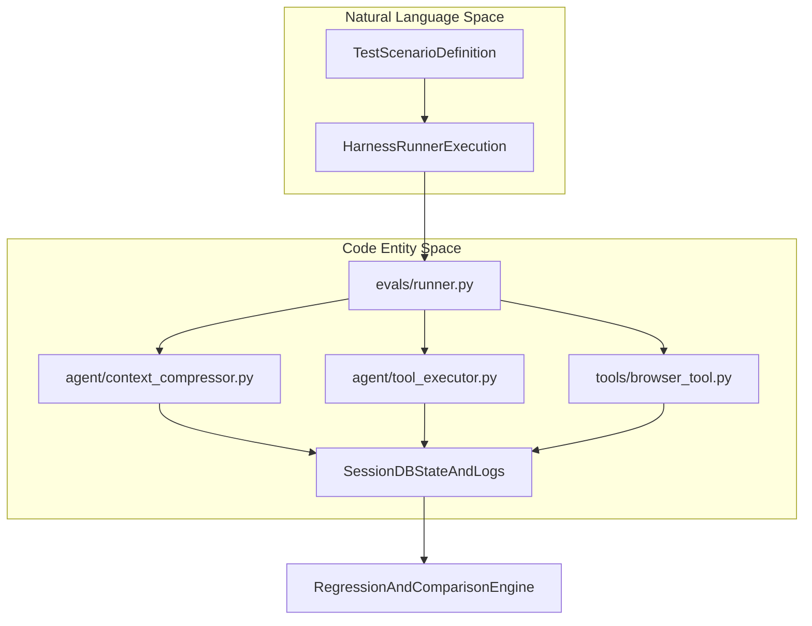
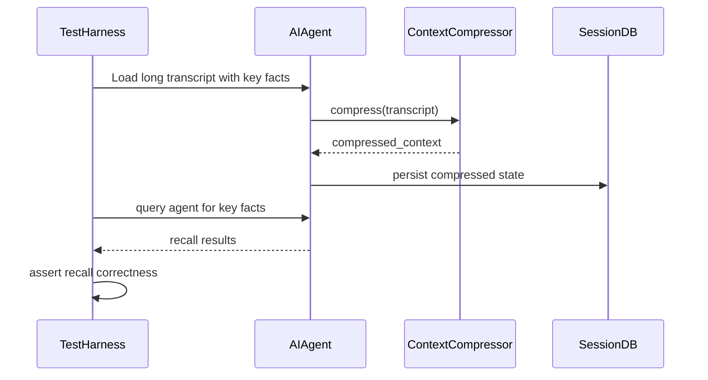
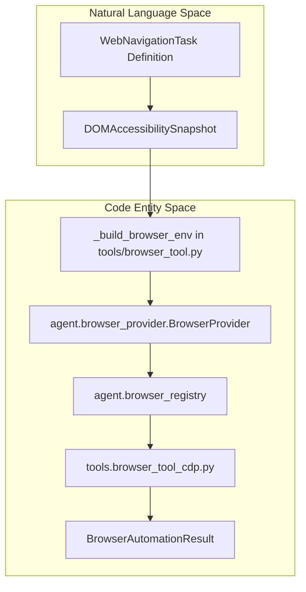
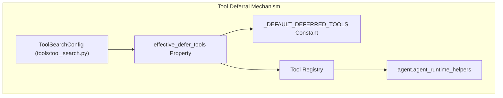
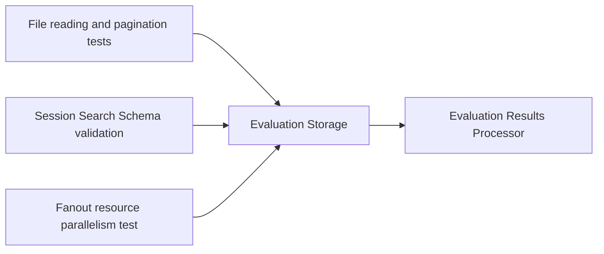
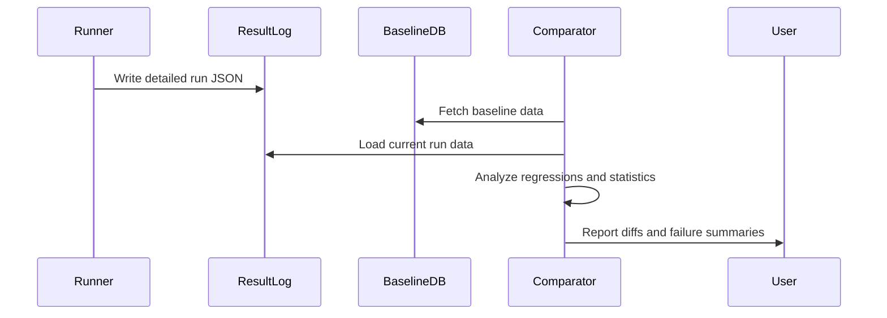

<!-- source: DeepWiki mcp.deepwiki.com · repo nousresearch/hermes-agent · page 9.4 Evaluation Harnesses · fetched 2026-10-26 -->

# Evaluation Harnesses

<details>
<summary>Relevant source files</summary>

The following files were used as context for generating this wiki page:

- [agent/agent_init_params.py](agent/agent_init_params.py)
- [agent/turn_scripted_prelude.py](agent/turn_scripted_prelude.py)
- [apps/desktop/src/app/chat/built-in-tour.ts](apps/desktop/src/app/chat/built-in-tour.ts)
- [contributors/emails/12357213+Halldrix@users.noreply.github.com](contributors/emails/12357213+Halldrix@users.noreply.github.com)
- [contributors/emails/tim@growthpath.com.au](contributors/emails/tim@growthpath.com.au)
- [contributors/emails/yagnavudathu@gmail.com](contributors/emails/yagnavudathu@gmail.com)
- [evals/desktop_bug_campaign/leases_live.py](evals/desktop_bug_campaign/leases_live.py)
- [gateway/session_images.py](gateway/session_images.py)
- [hermes_cli/context_switch_guard.py](hermes_cli/context_switch_guard.py)
- [scripts/check_no_tmp_literals.py](scripts/check_no_tmp_literals.py)
- [tests/agent/test_switch_model_reapplies_config_context_pin.py](tests/agent/test_switch_model_reapplies_config_context_pin.py)
- [tests/agent/test_turn_scripted_prelude.py](tests/agent/test_turn_scripted_prelude.py)
- [tests/gateway/test_session_images.py](tests/gateway/test_session_images.py)
- [tests/gateway/test_session_images_profile.py](tests/gateway/test_session_images_profile.py)
- [tests/hermes_cli/test_auth_lock_timeout_diagnosis.py](tests/hermes_cli/test_auth_lock_timeout_diagnosis.py)
- [tests/hermes_cli/test_context_switch_guard.py](tests/hermes_cli/test_context_switch_guard.py)
- [tests/hermes_cli/test_custom_provider_identity.py](tests/hermes_cli/test_custom_provider_identity.py)
- [tests/hermes_cli/test_model_picker_expensive_confirm.py](tests/hermes_cli/test_model_picker_expensive_confirm.py)
- [tests/hermes_cli/test_web_multi_profile_scope.py](tests/hermes_cli/test_web_multi_profile_scope.py)
- [tests/scripts/test_check_no_tmp_literals.py](tests/scripts/test_check_no_tmp_literals.py)
- [tests/tools/file_ops_fakes.py](tests/tools/file_ops_fakes.py)
- [tests/tools/test_async_delegation_orphan_sweep.py](tests/tools/test_async_delegation_orphan_sweep.py)
- [tests/tools/test_code_execution.py](tests/tools/test_code_execution.py)
- [tests/tools/test_code_execution_file_rpc.py](tests/tools/test_code_execution_file_rpc.py)
- [tests/tools/test_code_execution_hermes_home.py](tests/tools/test_code_execution_hermes_home.py)
- [tests/tools/test_code_execution_pm_runtime.py](tests/tools/test_code_execution_pm_runtime.py)
- [tests/tools/test_code_execution_windows_env.py](tests/tools/test_code_execution_windows_env.py)
- [tests/tools/test_code_kernel.py](tests/tools/test_code_kernel.py)
- [tests/tools/test_code_kernel_remote.py](tests/tools/test_code_kernel_remote.py)
- [tests/tools/test_connector_local_batches.py](tests/tools/test_connector_local_batches.py)
- [tests/tools/test_deferral_fixes.py](tests/tools/test_deferral_fixes.py)
- [tests/tools/test_display_toggles.py](tests/tools/test_display_toggles.py)
- [tests/tools/test_file_ops_single_roundtrip.py](tests/tools/test_file_ops_single_roundtrip.py)
- [tests/tools/test_spill_safety.py](tests/tools/test_spill_safety.py)
- [tests/tools/test_tip_tool.py](tests/tools/test_tip_tool.py)
- [tests/tools/test_todo_tool.py](tests/tools/test_todo_tool.py)
- [tests/tools/test_todo_tool_type_coercion.py](tests/tools/test_todo_tool_type_coercion.py)
- [tests/tools/test_tool_backend_helpers.py](tests/tools/test_tool_backend_helpers.py)
- [tests/tools/test_tool_result_storage.py](tests/tools/test_tool_result_storage.py)
- [tests/tools/test_tool_search.py](tests/tools/test_tool_search.py)
- [tests/tools/test_tool_search_multiquery.py](tests/tools/test_tool_search_multiquery.py)
- [tests/tools/test_tour_tool.py](tests/tools/test_tour_tool.py)
- [tests/tui_gateway/test_auto_continue.py](tests/tui_gateway/test_auto_continue.py)
- [tests/tui_gateway/test_bot_live_owner_delivery.py](tests/tui_gateway/test_bot_live_owner_delivery.py)
- [tests/tui_gateway/test_busy_compression_demotion.py](tests/tui_gateway/test_busy_compression_demotion.py)
- [tests/tui_gateway/test_compression_config_hot_reload.py](tests/tui_gateway/test_compression_config_hot_reload.py)
- [tests/tui_gateway/test_deferred_model_switch_confirm.py](tests/tui_gateway/test_deferred_model_switch_confirm.py)
- [tests/tui_gateway/test_file_attachment_allocation.py](tests/tui_gateway/test_file_attachment_allocation.py)
- [tests/tui_gateway/test_heartbeat_tui_tick.py](tests/tui_gateway/test_heartbeat_tui_tick.py)
- [tests/tui_gateway/test_hosted_room_turn_slot_release.py](tests/tui_gateway/test_hosted_room_turn_slot_release.py)
- [tests/tui_gateway/test_live_config_context_pin_mirror.py](tests/tui_gateway/test_live_config_context_pin_mirror.py)
- [tests/tui_gateway/test_multi_profile_hosting_fail_closed.py](tests/tui_gateway/test_multi_profile_hosting_fail_closed.py)
- [tests/tui_gateway/test_out_of_band_history_adoption.py](tests/tui_gateway/test_out_of_band_history_adoption.py)
- [tests/tui_gateway/test_profile_terminal_scope_entrypoints.py](tests/tui_gateway/test_profile_terminal_scope_entrypoints.py)
- [tests/tui_gateway/test_prompt_accept_logging.py](tests/tui_gateway/test_prompt_accept_logging.py)
- [tests/tui_gateway/test_protocol.py](tests/tui_gateway/test_protocol.py)
- [tests/tui_gateway/test_serve_exit_flush.py](tests/tui_gateway/test_serve_exit_flush.py)
- [tests/tui_gateway/test_shared_session_delivery.py](tests/tui_gateway/test_shared_session_delivery.py)
- [tests/tui_gateway/test_ssh_session_cwd_persistence.py](tests/tui_gateway/test_ssh_session_cwd_persistence.py)
- [tests/tui_gateway/test_submit_time_user_row.py](tests/tui_gateway/test_submit_time_user_row.py)
- [tests/tui_gateway/test_tour_bridge_fail_fast.py](tests/tui_gateway/test_tour_bridge_fail_fast.py)
- [tests/tui_gateway/test_tui_gateway_server.py](tests/tui_gateway/test_tui_gateway_server.py)
- [tests/tui_gateway/test_turn_finished_failure_cause.py](tests/tui_gateway/test_turn_finished_failure_cause.py)
- [tests/tui_gateway/test_user_messages.py](tests/tui_gateway/test_user_messages.py)
- [tests/tui_gateway/test_ws_orphan_races.py](tests/tui_gateway/test_ws_orphan_races.py)
- [tools/code_execution_env.py](tools/code_execution_env.py)
- [tools/code_execution_rpc.py](tools/code_execution_rpc.py)
- [tools/code_execution_tool.py](tools/code_execution_tool.py)
- [tools/code_kernel.py](tools/code_kernel.py)
- [tools/code_kernel_remote.py](tools/code_kernel_remote.py)
- [tools/spill_safety.py](tools/spill_safety.py)
- [tools/tip_tool.py](tools/tip_tool.py)
- [tools/todo_tool.py](tools/todo_tool.py)
- [tools/tool_backend_helpers.py](tools/tool_backend_helpers.py)
- [tools/tool_output_limits.py](tools/tool_output_limits.py)
- [tools/tool_result_storage.py](tools/tool_result_storage.py)
- [tools/tool_search.py](tools/tool_search.py)
- [tools/tool_search_catalog.py](tools/tool_search_catalog.py)
- [tools/tool_search_validation.py](tools/tool_search_validation.py)
- [tools/tour_tool.py](tools/tour_tool.py)
- [tui_gateway/contracts/liveness.py](tui_gateway/contracts/liveness.py)
- [tui_gateway/methods_complete.py](tui_gateway/methods_complete.py)
- [tui_gateway/methods_complete_helpers.py](tui_gateway/methods_complete_helpers.py)
- [tui_gateway/methods_prompt.py](tui_gateway/methods_prompt.py)
- [tui_gateway/methods_session.py](tui_gateway/methods_session.py)
- [tui_gateway/methods_slash.py](tui_gateway/methods_slash.py)
- [tui_gateway/methods_tools.py](tui_gateway/methods_tools.py)
- [tui_gateway/prompt_attachments.py](tui_gateway/prompt_attachments.py)
- [tui_gateway/prompt_turn.py](tui_gateway/prompt_turn.py)
- [tui_gateway/render.py](tui_gateway/render.py)
- [tui_gateway/server.py](tui_gateway/server.py)
- [tui_gateway/server_requests.py](tui_gateway/server_requests.py)
- [tui_gateway/session_auto_continue.py](tui_gateway/session_auto_continue.py)
- [tui_gateway/session_compression.py](tui_gateway/session_compression.py)
- [tui_gateway/session_lifecycle.py](tui_gateway/session_lifecycle.py)
- [tui_gateway/session_notifications.py](tui_gateway/session_notifications.py)
- [tui_gateway/session_reaper.py](tui_gateway/session_reaper.py)
- [tui_gateway/session_transports.py](tui_gateway/session_transports.py)
- [tui_gateway/session_workdir.py](tui_gateway/session_workdir.py)
- [tui_gateway/slash_fuzzy.py](tui_gateway/slash_fuzzy.py)
- [tui_gateway/synthetic_turn.py](tui_gateway/synthetic_turn.py)
- [tui_gateway/turn_marker.py](tui_gateway/turn_marker.py)
- [tui_gateway/user_messages.py](tui_gateway/user_messages.py)
- [website/docs/user-guide/features/tool-search.md](website/docs/user-guide/features/tool-search.md)

</details>


The evaluation harnesses located in the `evals/` directory provide automated benchmarking, regression testing, and capability validation for Hermes Agent. These harnesses rigorously measure core agent functionalities—such as context compression recall, browser automation accuracy, codebase navigability, core tool deferral efficiency, readtool bulk file reading, session search schema integrity, and fanout resource consumption—to ensure that modifications to the core systems do not degrade reasoning quality, context retention, or tool invocation safety.

---

## Evaluation Harness Architecture

The evaluation harness subsystem follows a standardized execution pattern with the following data flow:

- **Test scenarios** are authored in natural language or structured configuration formats describing input conversations, expected tool invocations, and correctness criteria.
- A **HarnessRunner** loads and executes each individual scenario against an isolated and instrumented `AIAgent` instance or a mocked LLM backend.
- The `AIAgent` interacts with real or stubbed tools (such as browser automation or file reading tools) and core subsystems such as the context compressor.
- During runs, the harness captures important metrics including token usage, tool call traces, and snapshots of context state.
- The recorded outcomes are persisted, often as JSON or SQLite states, and then analyzed by regression and comparison tools to track behavioral changes across code versions.



Sources: [agent/context_compressor.py:1-35](), [tools/browser_tool.py:1-154]()

---

## Specific Harnesses

### Compaction Recall Harness

This harness validates the quality and integrity of the context compression subsystem managed by the `ContextCompressor` class in `agent/context_compressor.py` [agent/context_compressor.py:1-35](). It exercises the agent's ability to:

- Process lengthy conversation transcripts annotated with key facts.
- Employ iterative micro or native summarization methods to reduce context size while retaining critical semantic markers.
- Query the compressed representation to verify recall of important facts.
- Detect any loss or degradation of relevant prior context information which may impair downstream reasoning.

This ensures that Hermes's automatic summarization preserves essential conversational state without unbounded growth in memory size. The `_summarize_tool_result` function [tests/agent/test_context_compressor.py:18-19]() and `_sum_clarify` function [tests/agent/test_context_compressor.py:19-20]() are key components in generating summaries for tool outputs and clarification requests. The `_is_summary_access_or_quota_error` function [tests/agent/test_context_compressor.py:20-21]() helps in identifying issues during summary generation.



Sources: [agent/context_compressor.py:1-35](), [tests/agent/test_context_compressor.py:1-134]()

---

### Browser-Use Harness

This harness tests Hermes Agent's browser automation functionality, emphasizing stability and accuracy of web navigation and interaction. Key focus areas include:

- Accessibility tree snapshot parsing with element reference IDs (`@eN`) for reliable agent control of page elements.
- Command sets such as `browser_navigate`, `browser_click`, and `browser_snapshot` verified against real or simulated Chrome DevTools Protocol (CDP) sessions.
- Integration with the Browser Use CLI 3.0 driver and local headless Chromium backends as implemented in `tools/browser_tool.py` [tools/browser_tool.py:1-154]() and `tools/browser_use_cli.py` [tools/browser_use_cli.py:1-165]().
- Testing session management, cleanup, and accurate retrieval of page snapshots critical to visual and interaction contexts.

This ensures the agent can robustly control and extract information from browsers with different backend providers. The `_build_browser_env` function [tools/browser_tool.py:47-77]() is responsible for setting up the environment for the browser subprocess, including credential scrubbing and passthrough keys. The `BrowserProvider` class [tools/browser_tool.py:99-99]() and the browser registry [tools/browser_tool.py:101-106]() manage different browser backends.



Sources: [tools/browser_tool.py:1-154](), [tools/browser_use_cli.py:1-165](), [website/docs/user-guide/features/browser.md:1-95]()

---

### Codebase Navigability Harness

This harness evaluates the agent's ability to navigate complex, multi-file codebases efficiently. It tests:

- Accuracy of symbol lookup among large source trees.
- Directory and file traversal operations.
- Integration with LSP-based semantic diagnostics enhancing file access and edit advisory tooling.
- Preservation of navigability despite token context limits and compression overlays.

It closely hooks into context compression and memory subsystems, ensuring that meaningful cross-file navigation remains feasible within the agent’s constrained context window. The `ContextCompressor` [agent/context_compressor.py:1-35]() plays a crucial role in managing the context window.

Sources: [agent/context_compressor.py:1-35]()

---

### Core Tool Deferral Harness

This harness verifies the behavior of the tool registry’s dynamic discovery and deferred loading mechanisms. It asserts:

- Progressive disclosure of tools to minimize token overhead and expedite initial reasoning steps.
- Correct paging and searching within large toolsets.
- Exposure guarantees for core tools listed in `_HERMES_CORE_TOOLS` [tools/tool_search.py:129-133]() that must always remain accessible early in conversations.
- Interaction correctness with skill and plugin deferral frameworks ensuring responsiveness and low startup costs for tool invocation.

This harness protects the agent’s agility when handling evolving or large tool inventories. The `agent.agent_runtime_helpers` module [agent/agent_runtime_helpers.py:1-141]() is central to tool execution, including concurrent dispatch and lifecycle management. The `AGENT_RUNTIME_POST_HOOK_TOOL_NAMES` constant [agent/agent_runtime_helpers.py:88-93]() defines tools that have post-hook behaviors. The `ToolSearchConfig` class [tools/tool_search.py:40-85]() and its `effective_defer_tools` property [tools/tool_search.py:56-57]() manage which tools are deferred. The `_DEFAULT_DEFERRED_TOOLS` [tools/tool_search.py:141-142]() constant defines the default set of tools that are deferred.



Sources: [agent/agent_runtime_helpers.py:1-141](), [tools/tool_search.py:40-85](), [tools/tool_search.py:56-57](), [tools/tool_search.py:129-133](), [tools/tool_search.py:141-142]()

---

### Readtool, Session Search Schema, and Fanout Resource Benchmarks

- **Readtool Harness:**
  Measures the robustness of file reading utilities with chunked reading, pagination, safety limits on spill, and error recovery during file scans. The `_truncate_stdout_text` function [tools/code_execution_tool.py:56-80]() and `_spill_full_stdout` function [tools/code_execution_tool.py:83-103]() in `tools/code_execution_tool.py` are examples of how output is managed and potentially spilled to disk to handle large outputs.

- **Session Search Schema Harness:**
  Validates correctness of the SQLite FTS5 full-text search schema powering session transcript search, focusing on accurate retrieval and indexing consistency. Found in and around `tools/session_search_tool.py`.

- **Fanout Resource Benchmark:**
  Quantifies concurrency handling and resource contention under heavy parallel workloads, such as subagent task fan-out and context compression parallelism. Monitors thread pool pressure, lock contention, and eventual throughput degradation to ensure multi-threaded stability. The `_SUMMARY_ROUTE_PIN` [agent/context_compressor.py:68-70]() and `_PINNED_ROUTE_FIELDS` [agent/context_compressor.py:73-74]() are relevant to fanout resource management, particularly in how summary calls are routed and managed. The `_sessions_lock` [tui_gateway/server.py:105]() in `tui_gateway/server.py` is a reentrant lock used to manage concurrent access to session data, which is critical for fanout operations. The `_notification_locked_sessions` function [tui_gateway/session_notifications.py:12-19]() uses this lock to safely access session information for notifications.



Sources: [agent/context_compressor.py:68-74](), [tools/code_execution_tool.py:56-80](), [tools/code_execution_tool.py:83-103](), [tui_gateway/server.py:105](), [tui_gateway/session_notifications.py:12-19]()

---

## Results Recording and Comparison

Evaluation harness runs output rich JSON logs detailing:

- Token consumption metrics per turn.
- Latency statistics.
- Tool call counts and argument correctness.
- Heuristic flags assessing output quality and correctness.

Example artifact folder structure:

```
evals/results/
├── run_YYYYMMDD_HHMMSS.json
└── baseline_comparison.json
```

Post-run suites perform baseline comparisons to detect regressions such as:

- Recall failures traced to lossy compression or auxiliary model changes.
- Mismatches in tool invocation or deferral logic.
- Over-budget context windows signaling broken compaction.

The classification of API errors and failures uses the `agent.error_classifier` module. Turn retry and failure handling invoke `agent.chat_completion_helpers.py` [agent/chat_completion_helpers.py:1-159](), and message sanitation preventing skewed error detection is done in `agent.message_sanitization.py`. The `_maybe_inject_run_budget_wrapup` function [agent/conversation_loop.py:124-141]() and `_record_kanban_budget_exhausted` function [agent/turn_finalizer.py:48-85]() are examples of how budget and run-time related metrics are handled. The `_resolve_budget_fallback` function [agent/turn_finalizer.py:124-151]() handles scenarios where the iteration budget is exhausted. The `_record_crash` function [tui_gateway/server.py:65-78]() in `tui_gateway/server.py` is responsible for logging unhandled exceptions to a crash log, which is crucial for debugging evaluation failures. The `_panic_hook` [tui_gateway/server.py:80-82]() sets this as the system-wide exception hook.



Sources: [agent/chat_completion_helpers.py:1-159](), [agent/conversation_loop.py:124-141](), [agent/turn_finalizer.py:48-85](), [agent/turn_finalizer.py:124-151](), [tui_gateway/server.py:65-78](), [tui_gateway/server.py:80-82]()

---

# Summary

Hermes Agent’s evaluation harnesses form a comprehensive and robust safety net guarding key agent capabilities:

- Contextual memory and fact recall under compression.
- Reliable and precise browser interaction automation.
- Navigability and indexing of large multi-file code projects.
- Responsive dynamic and deferred tool invocation.
- Schema integrity of session search indices.
- Controlled concurrent resource usage during high fanout operation.

Together, these automated benchmarks, tests, and regression monitors fortify the quality assurance framework that underpins continuous development and evolution of Hermes.

# End of Section 9.4

---

