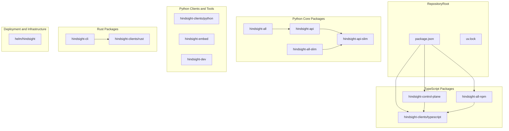
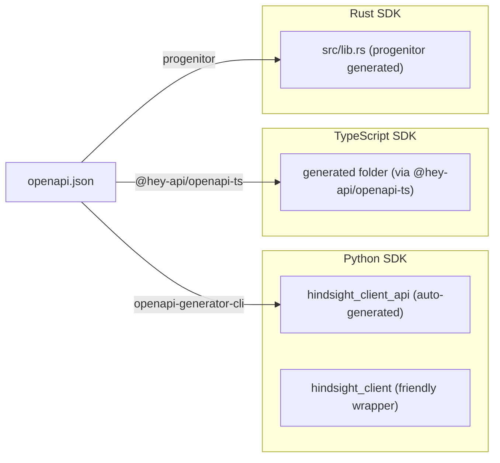
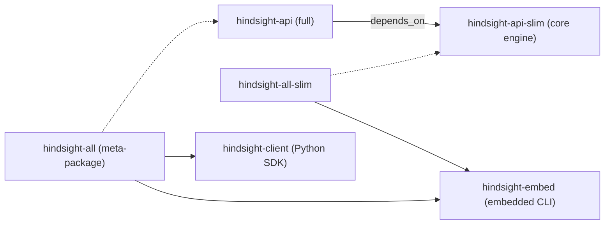
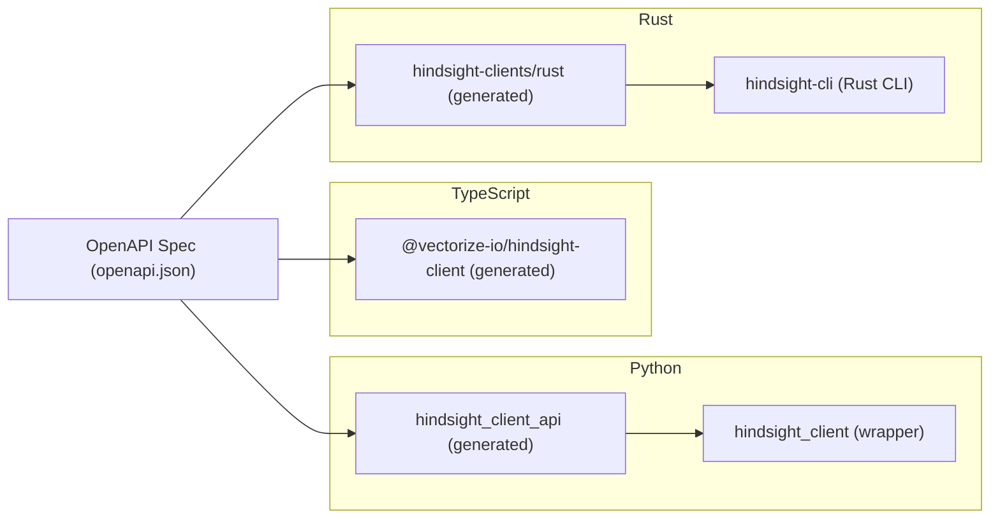

<!-- source: DeepWiki mcp.deepwiki.com · repo vectorize-io/hindsight · page 1.1 Package Structure · fetched 2026-10-26 -->

# Package Structure

Relevant source files

The following files were used as context for generating this wiki page:

- [helm/hindsight/Chart.yaml](helm/hindsight/Chart.yaml)
- [hindsight-all-slim/README.md](hindsight-all-slim/README.md)
- [hindsight-all-slim/pyproject.toml](hindsight-all-slim/pyproject.toml)
- [hindsight-all/README.md](hindsight-all/README.md)
- [hindsight-all/pyproject.toml](hindsight-all/pyproject.toml)
- [hindsight-api-slim/hindsight_api/banner.py](hindsight-api-slim/hindsight_api/banner.py)
- [hindsight-api-slim/tests/test_banner.py](hindsight-api-slim/tests/test_banner.py)
- [hindsight-api/pyproject.toml](hindsight-api/pyproject.toml)
- [hindsight-cli/Cargo.toml](hindsight-cli/Cargo.toml)
- [hindsight-clients/python/pyproject.toml](hindsight-clients/python/pyproject.toml)
- [hindsight-clients/typescript/package.json](hindsight-clients/typescript/package.json)
- [hindsight-control-plane/package.json](hindsight-control-plane/package.json)
- [hindsight-dev/hindsight_dev/generate_llms_full.py](hindsight-dev/hindsight_dev/generate_llms_full.py)
- [hindsight-dev/pyproject.toml](hindsight-dev/pyproject.toml)
- [hindsight-docs/static/llms.txt](hindsight-docs/static/llms.txt)
- [hindsight-embed/hindsight_embed/__init__.py](hindsight-embed/hindsight_embed/__init__.py)
- [hindsight-embed/pyproject.toml](hindsight-embed/pyproject.toml)
- [hindsight-integrations/litellm/pyproject.toml](hindsight-integrations/litellm/pyproject.toml)
- [scripts/release.sh](scripts/release.sh)

This document details the monorepo organization of the Hindsight codebase, explaining the relationships between the core engine, API variants, client SDKs, integrations, control plane, CLI, development tools, extensions, and distribution targets.

## Monorepo Organization

Hindsight uses a hybrid monorepo structure combining Python (managed by `uv` workspaces), TypeScript (managed by `npm` workspaces), and Rust (managed by Cargo). The repository contains multiple independently publishable packages that share common versioning and infrastructure.

### Repository Layout

This graph reflects the multi-language workspace setup:

- Python core packages include the slim and full API variants, and meta-packages bundling these with clients and embedded tools.
- Python clients include the Python SDK, embedded CLI, and development utilities.
- TypeScript packages cover the TypeScript client, the control plane UI, and all-in-one npm meta-packages.
- Rust packages comprise the command-line interface and its Rust client library.
- Helm chart manages Kubernetes deployment configurations.

Sources: [uv.lock:20-28](), [hindsight-api/pyproject.toml:12-14](), [hindsight-control-plane/package.json:80-80](), [hindsight-cli/Cargo.toml:15-15]()

## Core API Packages

### hindsight-api-slim

This is the foundational Python package implementing the core Hindsight memory engine, accessible via a FastAPI HTTP server with background worker support. It focuses on minimal dependencies and uses external cloud providers for ML tasks unless extras are installed.

| Attribute      | Value                                  |
| -------------- | ------------------------------------ |
| **Package Name**  | `hindsight-api-slim`                  |
| **Location**      | `hindsight-api-slim/`                 |
| **Main Scripts**  | `hindsight-api`, `hindsight-worker`, `hindsight-local-mcp`, `hindsight-admin` |

**Key components:**

- API entry point at `hindsight_api.main:main`
- Background worker entry point at `hindsight_api.worker.main:main`
- Model Context Protocol (MCP) server at `hindsight_api.mcp_local:main`
- Admin CLI at `hindsight_api.admin.cli:main`

These are configured as Python console scripts in `pyproject.toml`.

Sources: [hindsight-api/pyproject.toml:19-23]()

### hindsight-api

A "batteries-included" wrapper package that depends on `hindsight-api-slim[all]`. This variant bundles local ML models such as `sentence-transformers` and `flashrank` for embeddings and reranking, removing the need for external ML service dependence.

| Attribute    | Value               |
| ------------ | ------------------- |
| Package Name | `hindsight-api`     |
| Location     | `hindsight-api/`    |
| Dependency  | `hindsight-api-slim[all]==<version>` |

Sources: [hindsight-api/pyproject.toml:6-14]()

### Meta-Packages: hindsight-all, hindsight-all-slim, hindsight-all-npm

- `hindsight-all` bundles the core slim API engine (`hindsight-api-slim`), the Python client package, and the embedded CLI package for ease of installation [hindsight-all/pyproject.toml:12-16]().
- `hindsight-all-slim` is a lighter variant bundling just the slim API and embedded CLI.
- `hindsight-all-npm` is an npm meta-package wrapping the TypeScript client and dependencies for JS ecosystem users.

These meta-packages provide a convenient way to install a full or minimal Hindsight system depending on user requirements, combining multiple sub-packages.

Sources: [hindsight-all/pyproject.toml:6-15](), [scripts/release.sh:68-189]()

## Client SDK Packages

Hindsight follows an API-first philosophy. All clients are generated from the OpenAPI specification (`openapi.json`) ensuring consistent data models and request schemas.

### Client Generation Pipeline

The Python SDK separates the auto-generated API client (`hindsight_client_api`) from the user-friendly high-level wrapper (`hindsight_client`) which offers async helpers and domain abstractions. The TypeScript client builds from the same specification and outputs typings and request wrappers to support browser and Node.js environments. The Rust client is generated by Progenitor for strong typing and command-line integration.

Sources: [hindsight-clients/typescript/package.json:18-18](), [hindsight-dev/pyproject.toml:33-33](), [hindsight-clients/python/pyproject.toml:33-33]()

### Python Client (`hindsight-client`)

- Location: `hindsight-clients/python/`
- Provides both `hindsight_client_api` (auto-generated models and clients) and `hindsight_client` (a developer-friendly wrapper class) [hindsight-clients/python/pyproject.toml:33-33]().
- Dependencies include `aiohttp` for async HTTP calls and `pydantic` for strict model validation [hindsight-clients/python/pyproject.toml:11-19]().
- Supports sync and async; handles token management, connection pooling, and retry logic internally.

Sources: [hindsight-clients/python/pyproject.toml:1-33]()

### TypeScript Client (`@vectorize-io/hindsight-client`)

- Location: `hindsight-clients/typescript/`
- Uses `tsup` for building distributable ESM, CommonJS, and type definitions [hindsight-clients/typescript/package.json:5-14]().
- Also relies on `@hey-api/openapi-ts` for generating fully typed clients from the OpenAPI spec [hindsight-clients/typescript/package.json:18-18]().
- Designed for modern JavaScript/TypeScript development in Node.js, browsers, and frameworks like Next.js.

Sources: [hindsight-clients/typescript/package.json:1-52]()

## Command Line Interface and Embedded Tools

### Rust CLI (`hindsight-cli`)

- Location: `hindsight-cli/`
- Provides the user-facing `hindsight` binary executable [hindsight-cli/Cargo.toml:9-11]().
- Implements numerous commands for bank management, memory operations, document management, and mental models.
- Uses asynchronous runtime Tokio and integrates the Rust client library for API calls [hindsight-cli/Cargo.toml:15-22]().
- Includes terminal UI components based on ratatui and crossterm [hindsight-cli/Cargo.toml:33-34]().

Sources: [hindsight-cli/Cargo.toml:1-63]()

### Embedded CLI and Daemon (`hindsight-embed`)

- Location: `hindsight-embed/`
- Python-based CLI tool for local memory operations in embedded mode without a separate server [hindsight-embed/pyproject.toml:6-8]().
- Provides `DaemonEmbedManager` to manage daemon lifecycle and profiles stored under `~/.hindsight/embed` [hindsight-embed/hindsight_embed/__init__.py:3-10]().
- Bundles a local HTTP server for control center UI, configuration management, and auto-spawning daemon processes.
- Designed for zero-config local development or single-user embedded deployments.

Sources: [hindsight-embed/pyproject.toml:6-18](), [hindsight-embed/hindsight_embed/__init__.py:1-11]()

## Control Plane UI and Documentation

### hindsight-control-plane (Next.js)

- Location: `hindsight-control-plane/`
- Full-featured React-based UI for managing memory banks, viewing memories/entities, configuring operations, and tracing search/debug data.
- Implemented with Next.js including API proxy routes to the backend memory engine [hindsight-control-plane/package.json:15-18]().
- Supports i18n (10 locales) and bundling for standalone deployment [hindsight-control-plane/package.json:16-17]().
- Distribution includes a standalone production build for simplified deployment [hindsight-control-plane/package.json:16-17]().

Sources: [hindsight-control-plane/package.json:1-90]()

### Documentation and Extensions

- `hindsight-dev`: Development utilities and CLI tooling for managing OpenAPI spec generation, changelogs, benchmarks, and experimental features [hindsight-dev/pyproject.toml:6-47]().
- `hindsight-extensions`: Authentication extensions and security add-ons.
- `hindsight-docs` / skills: Reference documentation and AI-agent-consumable skills directories.

Sources: [hindsight-dev/pyproject.toml:6-47]()

## Integration Packages

### hindsight-litellm

- Provides a universal LLM memory integration leveraging LiteLLM, supporting 100+ LLM providers in a unified adapter interface [hindsight-integrations/litellm/pyproject.toml:2-4]().
- Facilitates local and remote LLM access with fallback and batch features.
- Integrates closely with `hindsight-client` and `hindsight-api` for seamless ML operations [hindsight-integrations/litellm/pyproject.toml:36-36]().

Sources: [hindsight-integrations/litellm/pyproject.toml:1-49]()

## Deployment Artifacts

### Helm Chart

- Directory: `helm/hindsight`
- Kubernetes Helm chart for deploying Hindsight with configurable services, including API, control plane, and workers.
- Supports embedding search and reranker services (TEI), model cache volumes, Prometheus monitoring.
- Current chart and app version: `1.1.0` [helm/hindsight/Chart.yaml:5-6]().

Sources: [helm/hindsight/Chart.yaml:1-13]()

### Distribution Targets

| Method           | Packages/Artifacts                                              |
|------------------|----------------------------------------------------------------|
| PyPI             | `hindsight-api`, `hindsight-api-slim`, `hindsight-all`, `hindsight-all-slim`, `hindsight-embed`, `hindsight-dev` [scripts/release.sh:68-68]|
| NPM              | `@vectorize-io/hindsight-client` (TypeScript client), `@vectorize-io/hindsight-control-plane`, `hindsight-all-npm` [scripts/release.sh:152-169]|
| GHCR (Docker)    | Multi-variant container images: `latest` (full), `slim` (minimal), designed for standalone or slim deployments |

All version bumps and packaging are controlled by `scripts/release.sh` which updates version metadata and pins cross-package dependencies appropriately to prevent version drift on upgrades [scripts/release.sh:65-189]().

Sources: [scripts/release.sh:24-189]()

---

# Bridging Natural Language Space to Code Entity Space

### Diagram 1: Core API and Meta-packages

- `hindsight-api-slim` implements the core engine and API server.
- `hindsight-api` adds local ML features by extending `slim` with extras [hindsight-api/pyproject.toml:12-14]().
- `hindsight-all` bundles full API, Python client SDK, and embedded CLI for easy installation [hindsight-all/pyproject.toml:12-16]().
- `hindsight-all-slim` bundles slim API and embedded CLI only.

Sources: [hindsight-api/pyproject.toml:6-14](), [hindsight-all/pyproject.toml:6-16](), [scripts/release.sh:68-105]()

### Diagram 2: Client SDKs and CLI Tooling

- OpenAPI specification drives generation of clients in Python, TypeScript, and Rust.
- Python client includes an auto-generated API client and a higher-level developer wrapper.
- Rust client library is consumed by the `hindsight` CLI [hindsight-cli/Cargo.toml:15-15]().
- TypeScript client powers browser and Node.js applications, including the control plane.

Sources: [hindsight-clients/typescript/package.json:18-18](), [hindsight-dev/pyproject.toml:33-33](), [hindsight-cli/Cargo.toml:15-15]()

---

This package structure supports Hindsight's goals of modularity, multi-language support, optimized deployment strategies, and extensibility via integration packages and control plane UI.

Sources:  
- [hindsight-api/pyproject.toml:6-23]()  
- [hindsight-all/pyproject.toml:5-16]()  
- [hindsight-control-plane/package.json:1-90]()  
- [hindsight-clients/python/pyproject.toml:1-33]()  
- [hindsight-clients/typescript/package.json:1-52]()  
- [hindsight-cli/Cargo.toml:1-63]()  
- [hindsight-embed/pyproject.toml:1-20]()  
- [hindsight-embed/hindsight_embed/__init__.py:1-11]()  
- [hindsight-integrations/litellm/pyproject.toml:1-49]()  
- [hindsight-dev/pyproject.toml:5-47]()  
- [helm/hindsight/Chart.yaml:1-13]()  
- [scripts/release.sh:24-189]()

---

