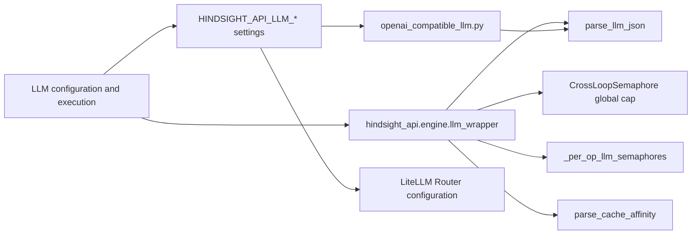
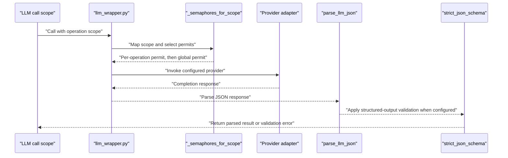
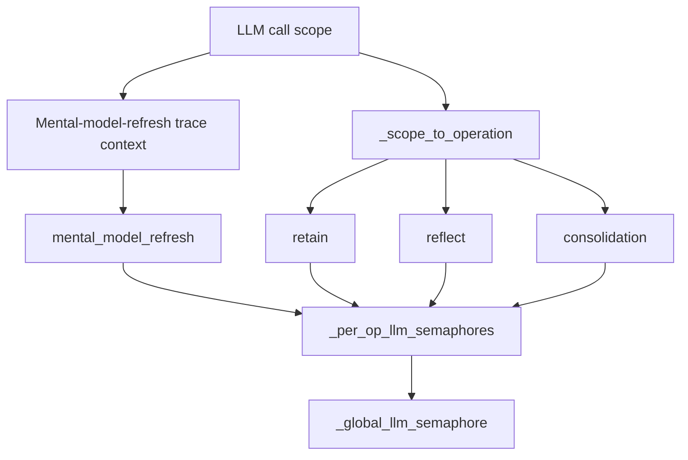

<!-- source: DeepWiki mcp.deepwiki.com · repo vectorize-io/hindsight · page 10.1 LLM Configuration and Wrapper · fetched 2026-10-26 -->

# LLM Configuration and Wrapper

Relevant source files

The following files were used as context for generating this wiki page:

- [.env.example](.env.example)
- [hindsight-api-slim/hindsight_api/_cross_loop.py](hindsight-api-slim/hindsight_api/_cross_loop.py)
- [hindsight-api-slim/hindsight_api/config.py](hindsight-api-slim/hindsight_api/config.py)
- [hindsight-api-slim/hindsight_api/engine/cross_encoder.py](hindsight-api-slim/hindsight_api/engine/cross_encoder.py)
- [hindsight-api-slim/hindsight_api/engine/embeddings.py](hindsight-api-slim/hindsight_api/engine/embeddings.py)
- [hindsight-api-slim/hindsight_api/engine/llm_wrapper.py](hindsight-api-slim/hindsight_api/engine/llm_wrapper.py)
- [hindsight-api-slim/hindsight_api/engine/providers/litellm_llm.py](hindsight-api-slim/hindsight_api/engine/providers/litellm_llm.py)
- [hindsight-api-slim/hindsight_api/engine/providers/openai_compatible_llm.py](hindsight-api-slim/hindsight_api/engine/providers/openai_compatible_llm.py)
- [hindsight-api-slim/hindsight_api/worker/background.py](hindsight-api-slim/hindsight_api/worker/background.py)
- [hindsight-api-slim/tests/test_cross_loop_primitives.py](hindsight-api-slim/tests/test_cross_loop_primitives.py)
- [hindsight-api-slim/tests/test_litellm_sdk_embeddings.py](hindsight-api-slim/tests/test_litellm_sdk_embeddings.py)
- [hindsight-api-slim/tests/test_llm_per_op_concurrency.py](hindsight-api-slim/tests/test_llm_per_op_concurrency.py)
- [hindsight-api-slim/tests/test_llm_stage_breadcrumbs.py](hindsight-api-slim/tests/test_llm_stage_breadcrumbs.py)
- [hindsight-api-slim/tests/test_llm_transport_diagnostics.py](hindsight-api-slim/tests/test_llm_transport_diagnostics.py)
- [hindsight-api-slim/tests/test_openai_compatible_response_hardening.py](hindsight-api-slim/tests/test_openai_compatible_response_hardening.py)
- [hindsight-docs/docs/developer/configuration.mdx](hindsight-docs/docs/developer/configuration.mdx)
- [hindsight-docs/docs/developer/models.mdx](hindsight-docs/docs/developer/models.mdx)
- [hindsight-docs/src/data/llmProviders.json](hindsight-docs/src/data/llmProviders.json)
- [hindsight-embed/hindsight_embed/env.example](hindsight-embed/hindsight_embed/env.example)
- [skills/hindsight-docs/references/developer/configuration.md](skills/hindsight-docs/references/developer/configuration.md)
- [skills/hindsight-docs/references/developer/models.md](skills/hindsight-docs/references/developer/models.md)
- [skills/hindsight-docs/references/faq.md](skills/hindsight-docs/references/faq.md)

## Purpose and scope

This page documents Hindsight’s LLM configuration and wrapper layer: how global and operation-specific settings are selected, how calls are concurrency-limited, and how structured output, cache affinity, timeouts, retries, and provider routing fit together. LLMs are used for fact extraction, reasoning, and generation; embeddings and cross-encoders serve separate vectorization and reranking roles. [skills/hindsight-docs/references/developer/models.md:4-18]()

Sources: `skills/hindsight-docs/references/developer/models.md`

---

## Overview

Hindsight configures an LLM provider and model globally, then supports operation-specific settings for work such as retain, reflect, consolidation, and mental-model refresh. The example configuration documents global and per-operation temperature, strict-schema, and cache-affinity options, as well as separate mental-model-refresh LLM settings. [`.env.example:4-5`]() [`.env.example:25-46`]() [`.env.example:74-97`]()

The wrapper’s visible responsibilities include process-wide and per-operation concurrency control, cache-affinity parsing, and importing `parse_llm_json` for provider use. The provider adapters use that parser when handling JSON responses. [hindsight-api-slim/hindsight_api/engine/llm_wrapper.py:34-47]() [hindsight-api-slim/hindsight_api/engine/llm_wrapper.py:59-105]() [hindsight-api-slim/hindsight_api/engine/providers/openai_compatible_llm.py:47-66]()

Hindsight supports multiple LLM backends, including OpenAI-compatible APIs and LiteLLM. LiteLLM’s router mode can provide ordered fallback, load balancing, weighted routing, per-deployment limits, and cooldowns; those routing features belong to LiteLLM’s Router configuration rather than the wrapper’s semaphore registry. [skills/hindsight-docs/references/developer/models.md:20-53]() [skills/hindsight-docs/references/developer/models.md:97-101]()

Sources: `skills/hindsight-docs/references/developer/models.md`, `.env.example`, `hindsight-api-slim/hindsight_api/engine/llm_wrapper.py`, `hindsight-api-slim/hindsight_api/engine/providers/openai_compatible_llm.py`

---

## LLM wrapper and provider routing

### `llm_wrapper.py`

`llm_wrapper.py` centralizes wrapper behavior around calls to LLM interfaces. It imports `LLMInterface`, tool-choice types, cache-affinity parsing, HTTP logging configuration, and the `CrossLoopSemaphore` primitive. The module configures HTTP logging when imported and builds its concurrency semaphores from raw configuration. [hindsight-api-slim/hindsight_api/engine/llm_wrapper.py:16-47]() [hindsight-api-slim/hindsight_api/engine/llm_wrapper.py:53-68]()

The module creates a global semaphore and a registry of optional per-operation semaphores. A call in a configured operation bucket acquires that operation’s semaphore and the global semaphore; an unclassified call uses the global semaphore alone. [hindsight-api-slim/hindsight_api/engine/llm_wrapper.py:59-105]() [hindsight-api-slim/hindsight_api/engine/llm_wrapper.py:116-158]()

The module imports `parse_cache_affinity` and re-exports `requires_api_key` for callers that have historically imported it from this module. Provider code imports `parse_llm_json` from the wrapper. [hindsight-api-slim/hindsight_api/engine/llm_wrapper.py:34-47]() [hindsight-api-slim/hindsight_api/engine/providers/openai_compatible_llm.py:61-66]()

Sources: `hindsight-api-slim/hindsight_api/engine/llm_wrapper.py`, `hindsight-api-slim/hindsight_api/engine/providers/openai_compatible_llm.py`

### Global and per-operation configuration

The configuration example establishes a global LLM provider, API key, and model. It also documents operation-specific settings, including temperature and strict-schema flags. Per-operation temperature settings take precedence over the global temperature setting; per-operation strict-schema settings can override the global flag in either direction. [`.env.example:4-9`]() [`.env.example:25-46`]()

The configuration example lists separate LLM settings for mental-model refresh. Most of that group falls back to the corresponding reflect setting, which in turn falls back to the global LLM setting; its timeout falls back to the global LLM timeout rather than the reflect timeout. The wrapper also classifies mental-model-refresh calls into a distinct concurrency bucket, including the refresh pass, dry run, and delta operations. [`.env.example:87-97`]() [hindsight-api-slim/hindsight_api/engine/llm_wrapper.py:107-134]() [hindsight-api-slim/hindsight_api/engine/llm_wrapper.py:144-158]()

The global configuration layer distinguishes hierarchical fields, which may be overridden at tenant or bank level, from static server-level fields. `StaticConfigProxy` rejects direct reads of configurable fields and directs callers to resolve bank-specific configuration instead. [hindsight-api-slim/hindsight_api/config.py:56-91]() [hindsight-api-slim/hindsight_api/config.py:93-111]()

| Configuration concern | Global setting | Operation-specific behavior |
|---|---|---|
| Provider, key, and model | `HINDSIGHT_API_LLM_PROVIDER`, `HINDSIGHT_API_LLM_API_KEY`, `HINDSIGHT_API_LLM_MODEL` [`.env.example:4-9`]() | The example documents a separate provider/model group for mental-model refresh. [`.env.example:87-97`]() |
| Sampling temperature | `HINDSIGHT_API_LLM_TEMPERATURE` [`.env.example:25-31`]() | Verification, retain, reflect, consolidation, and mental-model refresh can have their own values. [`.env.example:28-36`]() |
| Strict structured output | `HINDSIGHT_API_LLM_STRICT_SCHEMA` [`.env.example:38-43`]() | Per-operation flags take precedence, including an operation-level opt-out. [`.env.example:40-46`]() |
| Cache affinity | `HINDSIGHT_API_LLM_CACHE_AFFINITY` [`.env.example:74-82`]() | Retain, reflect, and consolidation can override the global mode. [`.env.example:82-85`]() |
| Concurrency | `HINDSIGHT_API_LLM_MAX_CONCURRENT` [hindsight-api-slim/hindsight_api/engine/llm_wrapper.py:59-68]() | Separate caps are supported for retain, reflect, consolidation, and mental-model refresh. [hindsight-api-slim/hindsight_api/engine/llm_wrapper.py:71-105]() |

Sources: `.env.example`, `hindsight-api-slim/hindsight_api/config.py`, `hindsight-api-slim/hindsight_api/engine/llm_wrapper.py`

### `CrossLoopSemaphore` concurrency limits

`CrossLoopSemaphore` is used because the wrapper’s semaphore state is module-level and shared across event loops. The code comments explain that an `asyncio.Semaphore` would bind to the first event loop that waits on it, while the intended limit is process-wide. [hindsight-api-slim/hindsight_api/engine/llm_wrapper.py:59-68]()

The global cap is initialized from `llm_max_concurrent`. `_build_per_op_semaphores()` creates additional semaphores for configured retain, reflect, consolidation, and mental-model-refresh limits. An unset operation cap creates no per-operation semaphore; a configured cap must be a positive integer. [hindsight-api-slim/hindsight_api/engine/llm_wrapper.py:67-105]()

Call scopes are mapped to operation buckets by `_scope_to_operation()`. Refresh-related scopes map to `mental_model_refresh`; prefixes for retain, reflect, and consolidation map to their respective buckets. When the trace context identifies a mental-model refresh, that operation takes precedence over the call’s scope, so the refresh’s internal reflect calls use the refresh bucket rather than the interactive-reflect bucket. [hindsight-api-slim/hindsight_api/engine/llm_wrapper.py:107-134]() [hindsight-api-slim/hindsight_api/engine/llm_wrapper.py:137-158]()

When an operation-specific semaphore exists, `_semaphores_for_scope()` returns it before the global semaphore. This makes a call wait on the narrower operation cap before occupying a global slot. [hindsight-api-slim/hindsight_api/engine/llm_wrapper.py:137-158]()

Sources: `hindsight-api-slim/hindsight_api/engine/llm_wrapper.py`

### JSON parsing and strict schema enforcement

The wrapper imports `repair_json` from `json_repair`; provider adapters import `parse_llm_json` from the wrapper. This establishes the wrapper as the shared entry point for parsing provider-produced JSON. [hindsight-api-slim/hindsight_api/engine/llm_wrapper.py:5-17]() [hindsight-api-slim/hindsight_api/engine/providers/openai_compatible_llm.py:61-66]() [hindsight-api-slim/hindsight_api/engine/providers/litellm_llm.py:23-45]()

The OpenAI-compatible provider includes helpers for testing JSON validity and extracting an outer JSON object or array from a response containing surrounding prose. Its documented fallback only returns that extracted span if it is itself valid JSON. [hindsight-api-slim/hindsight_api/engine/providers/openai_compatible_llm.py:139-160]()

Strict schema enforcement is configurable globally and per operation. The example describes it as grammar-enforced `json_schema strict`, in contrast to a soft schema-in-prompt path. Provider code imports schema helpers, including `provider_json_schema` and `strict_json_schema`; provider-specific support and limitations determine how structured output is sent. [`.env.example:38-46`]() [hindsight-api-slim/hindsight_api/engine/providers/openai_compatible_llm.py:61-66]() [hindsight-api-slim/hindsight_api/engine/providers/litellm_llm.py:43-45]()

Other structured-output settings account for backend differences: some backends reject `maxItems`, some do not honor JSON-object response mode, and some require structured output to be requested through a forced tool call instead of `response_format`. [`.env.example:58-66`]() [`.env.example:99-103`]()

Sources: `hindsight-api-slim/hindsight_api/engine/llm_wrapper.py`, `hindsight-api-slim/hindsight_api/engine/providers/openai_compatible_llm.py`, `hindsight-api-slim/hindsight_api/engine/providers/litellm_llm.py`, `.env.example`

### Cache affinity

Cache affinity is a setting for OpenAI-compatible providers. The example documents four modes: `auto`, `xai_conv_id`, `openai_prompt_cache_key`, and `none`. In `auto` mode, host-based allowlisting selects an xAI header for xAI/Grok hosts, an OpenAI prompt-cache field for OpenAI and Azure OpenAI hosts, and no affinity mechanism for other backends. Operation-specific settings can override the global mode. [`.env.example:74-85`]()

`llm_wrapper.py` imports `parse_cache_affinity`; the OpenAI-compatible adapter imports functions for parsing, resolving, and applying cache affinity. It also imports a separate helper for OpenCode session handling. [hindsight-api-slim/hindsight_api/engine/llm_wrapper.py:34-36]() [hindsight-api-slim/hindsight_api/engine/providers/openai_compatible_llm.py:40-46]()

Cache affinity is intended to keep a conversation on a backend that can reuse its server-side prompt cache. The appropriate affinity mechanism depends on the provider and endpoint; `none` disables affinity. [`.env.example:74-85`]()

Sources: `.env.example`, `hindsight-api-slim/hindsight_api/engine/llm_wrapper.py`, `hindsight-api-slim/hindsight_api/engine/providers/openai_compatible_llm.py`

### Timeouts, retries, and diagnostics

The configuration example documents `HINDSIGHT_API_LLM_CONNECT_TIMEOUT` as a cap on TCP and TLS connection setup. It leaves read, write, and pool phases under the full LLM timeout budget; setting the connect timeout to `0` disables that cap. [`.env.example:48-51`]()

The OpenAI-compatible adapter imports transport timeout builders, error description helpers, and jittered backoff. The LiteLLM adapter sets its effective timeout from the per-call value or configured global timeout and documents that its call path has a bounded `asyncio.wait_for` backstop. [hindsight-api-slim/hindsight_api/engine/providers/openai_compatible_llm.py:56-65]() [hindsight-api-slim/hindsight_api/engine/providers/litellm_llm.py:158-175]()

The OpenAI-compatible adapter also imports retry-related provider errors and a retry/backoff helper. LiteLLM classifies retryable failures using transient-remote-error detection, with `ProviderResponseError.retryable` taking precedence for that error type. [hindsight-api-slim/hindsight_api/engine/providers/openai_compatible_llm.py:47-65]() [hindsight-api-slim/hindsight_api/engine/providers/litellm_llm.py:137-142]()

`HINDSIGHT_API_LLM_HTTP_LOG_LEVEL` controls the `httpx` and `httpcore` logger level. The example describes using `DEBUG` to distinguish transport phases, while `HINDSIGHT_API_LLM_DEBUG_DUMP_4XX` enables diagnostic dumps for rejected requests. [`.env.example:53-56`]() [`.env.example:112-115`]() The OpenAI-compatible and LiteLLM adapters both import `dump_request_on_4xx`. [hindsight-api-slim/hindsight_api/engine/providers/openai_compatible_llm.py:61-66]() [hindsight-api-slim/hindsight_api/engine/providers/litellm_llm.py:31-45]()

Sources: `.env.example`, `hindsight-api-slim/hindsight_api/engine/providers/openai_compatible_llm.py`, `hindsight-api-slim/hindsight_api/engine/providers/litellm_llm.py`

### Multi-provider failover and routing

Hindsight supports multiple provider adapters, including OpenAI-compatible APIs and LiteLLM’s broad provider set. LiteLLM’s router mode can apply ordered fallbacks, load balancing, weighted routing, per-deployment request and token limits, and cooldowns. Hindsight’s model documentation says the LiteLLM Router configuration is passed through for this purpose. [skills/hindsight-docs/references/developer/models.md:20-53]() [skills/hindsight-docs/references/developer/models.md:97-101]()

The LiteLLM adapter uses asynchronous chat completions and determines whether failures are retryable. For `ProviderResponseError`, it consults the error’s `retryable` attribute; otherwise it delegates to transient-remote-error classification. [hindsight-api-slim/hindsight_api/engine/providers/litellm_llm.py:1-13]() [hindsight-api-slim/hindsight_api/engine/providers/litellm_llm.py:137-155]()

These are distinct mechanisms: the wrapper’s semaphore limits concurrent calls within a process, while provider routing and fallback can be supplied by the configured provider stack, such as LiteLLM Router. [hindsight-api-slim/hindsight_api/engine/llm_wrapper.py:59-105]() [skills/hindsight-docs/references/developer/models.md:97-101]()

Sources: `skills/hindsight-docs/references/developer/models.md`, `hindsight-api-slim/hindsight_api/engine/llm_wrapper.py`, `hindsight-api-slim/hindsight_api/engine/providers/litellm_llm.py`

---

## Detailed implementation and data flow

### Concurrency setup and acquisition

At module import, `llm_wrapper.py` reads raw configuration and initializes `_global_llm_semaphore`. It then builds `_per_op_llm_semaphores` for configured operation caps. Those objects are `CrossLoopSemaphore` instances, so the registry is process-level rather than tied to one event loop. [hindsight-api-slim/hindsight_api/engine/llm_wrapper.py:59-105]()

`_scope_to_operation()` converts call-scope prefixes into operation buckets. `_semaphores_for_scope()` selects the operation semaphore, when configured, followed by the global semaphore. It also checks the current trace context so calls made during a background mental-model refresh stay in that operation’s concurrency bucket. [hindsight-api-slim/hindsight_api/engine/llm_wrapper.py:107-158]()

`_acquire_permits()` is defined to enter the selected permits through an `AsyncExitStack`; its docstring says queue-wait time is reported to the caller’s queue-wait sink when one is bound. [hindsight-api-slim/hindsight_api/engine/llm_wrapper.py:161-167]()

Sources: `hindsight-api-slim/hindsight_api/engine/llm_wrapper.py`

### Configuration loading and precedence

The configuration module defines environment-variable names for global LLM provider, key, model, concurrency, retry, backoff, timeout, and connect timeout settings. It also includes dotenv loading for Hindsight’s own entry points, clearing the cached configuration after the environment is updated so later reads use the loaded values. [hindsight-api-slim/hindsight_api/config.py:27-53]() [hindsight-api-slim/hindsight_api/config.py:152-170]()

The example configuration documents operation-specific temperature and strict-schema overrides, as well as cache-affinity overrides. The configuration layer marks fields as hierarchical or static; `StaticConfigProxy` guards against reading bank-configurable values from the global config object. [`.env.example:25-46`]() [`.env.example:74-85`]() [hindsight-api-slim/hindsight_api/config.py:56-111]()

Sources: `hindsight-api-slim/hindsight_api/config.py`, `.env.example`

### JSON and structured-output path

The wrapper imports `repair_json`, and provider adapters import `parse_llm_json`. The OpenAI-compatible adapter has helpers for validating JSON and extracting a valid outer object or array when a response wraps JSON in prose. [hindsight-api-slim/hindsight_api/engine/llm_wrapper.py:5-17]() [hindsight-api-slim/hindsight_api/engine/providers/openai_compatible_llm.py:139-160]()

Strict schema enforcement is controlled by global and per-operation configuration. Provider adapters import schema-construction helpers; the example configuration also documents flags to account for backends that reject particular schema keywords or response formats. [`.env.example:38-46`]() [`.env.example:58-72`]() [`.env.example:99-103`]() [hindsight-api-slim/hindsight_api/engine/providers/openai_compatible_llm.py:61-66]()

Sources: `hindsight-api-slim/hindsight_api/engine/llm_wrapper.py`, `hindsight-api-slim/hindsight_api/engine/providers/openai_compatible_llm.py`, `.env.example`

### Provider timeout and retry path

The OpenAI-compatible adapter imports timeout builders, error description helpers, and jittered backoff; the LiteLLM adapter uses the configured timeout as its fallback and classifies transient failures for retry handling. [hindsight-api-slim/hindsight_api/engine/providers/openai_compatible_llm.py:56-65]() [hindsight-api-slim/hindsight_api/engine/providers/litellm_llm.py:137-175]()

The documented connect timeout is separate from the full request timeout: it limits connection establishment while leaving read, write, and pool phases under the overall LLM timeout. The example also exposes HTTP transport logging and optional 4xx request diagnostics. [`.env.example:48-56`]() [`.env.example:112-115`]()

Sources: `.env.example`, `hindsight-api-slim/hindsight_api/engine/providers/openai_compatible_llm.py`, `hindsight-api-slim/hindsight_api/engine/providers/litellm_llm.py`

### Provider-routing boundary

The provider documentation describes LiteLLM Router as the mechanism for ordered deployment fallbacks, load balancing, weighted selection, deployment limits, and cooldowns. That configuration is distinct from the wrapper’s process-local semaphore limits, which govern how many calls can be in flight. [skills/hindsight-docs/references/developer/models.md:97-101]() [hindsight-api-slim/hindsight_api/engine/llm_wrapper.py:59-105]()

Sources: `skills/hindsight-docs/references/developer/models.md`, `hindsight-api-slim/hindsight_api/engine/llm_wrapper.py`

---

## Diagrams

### Natural-language concepts mapped to code entities

Sources: `hindsight-api-slim/hindsight_api/engine/llm_wrapper.py`, `hindsight-api-slim/hindsight_api/engine/providers/openai_compatible_llm.py`, `skills/hindsight-docs/references/developer/models.md`

### Call path: operation scope to provider and structured output

Sources: `hindsight-api-slim/hindsight_api/engine/llm_wrapper.py`, `hindsight-api-slim/hindsight_api/engine/providers/openai_compatible_llm.py`, `hindsight-api-slim/hindsight_api/engine/providers/litellm_llm.py`

### Concurrency buckets and refresh scope mapping

Sources: `hindsight-api-slim/hindsight_api/engine/llm_wrapper.py`

---

## Key functions and classes

| Symbol | Role | Definition or use |
|---|---|---|
| `CrossLoopSemaphore` | Process-wide semaphore primitive used for the global and per-operation caps. [hindsight-api-slim/hindsight_api/engine/llm_wrapper.py:59-68]() | Imported by the wrapper. [hindsight-api-slim/hindsight_api/engine/llm_wrapper.py:16-16]() |
| `_build_per_op_semaphores()` | Builds operation-specific semaphore instances from configured caps. [hindsight-api-slim/hindsight_api/engine/llm_wrapper.py:71-105]() | Called to create `_per_op_llm_semaphores`. [hindsight-api-slim/hindsight_api/engine/llm_wrapper.py:105-105]() |
| `_scope_to_operation(scope)` | Maps call-scope prefixes and refresh scopes to operation buckets. [hindsight-api-slim/hindsight_api/engine/llm_wrapper.py:107-134]() | Used when choosing permits. [hindsight-api-slim/hindsight_api/engine/llm_wrapper.py:137-158]() |
| `_semaphores_for_scope(scope)` | Selects the relevant operation semaphore and global semaphore. [hindsight-api-slim/hindsight_api/engine/llm_wrapper.py:137-158]() | Determines acquisition order. [hindsight-api-slim/hindsight_api/engine/llm_wrapper.py:153-158]() |
| `_acquire_permits(stack, scope)` | Enters permits asynchronously and reports queue-wait timing when available. [hindsight-api-slim/hindsight_api/engine/llm_wrapper.py:161-167]() | Defined in the wrapper. |
| `parse_llm_json` | Shared JSON parser imported by provider adapters. [hindsight-api-slim/hindsight_api/engine/llm_wrapper.py:5-17]() | Imported by the OpenAI-compatible and LiteLLM adapters. [hindsight-api-slim/hindsight_api/engine/providers/openai_compatible_llm.py:61-66]() [hindsight-api-slim/hindsight_api/engine/providers/litellm_llm.py:31-33]() |
| `StaticConfigProxy` | Prevents direct global-config access to bank-configurable fields. [hindsight-api-slim/hindsight_api/config.py:62-91]() | Defined in the configuration module. |
| `LiteLLMLLM` | LiteLLM-backed provider adapter for models supported by `litellm.acompletion()`. [hindsight-api-slim/hindsight_api/engine/providers/litellm_llm.py:144-156]() | Defined in the LiteLLM adapter. |

Sources: `hindsight-api-slim/hindsight_api/engine/llm_wrapper.py`, `hindsight-api-slim/hindsight_api/config.py`, `hindsight-api-slim/hindsight_api/engine/providers/openai_compatible_llm.py`, `hindsight-api-slim/hindsight_api/engine/providers/litellm_llm.py`

---

## Summary

- Global and operation-specific settings control LLM behavior; the example configuration documents precedence for temperature, strict-schema, and cache-affinity overrides. [`.env.example:25-46`]() [`.env.example:74-85`]()
- `CrossLoopSemaphore` provides a process-wide concurrency cap, with optional operation-specific caps acquired before the global cap. [hindsight-api-slim/hindsight_api/engine/llm_wrapper.py:59-105]() [hindsight-api-slim/hindsight_api/engine/llm_wrapper.py:137-158]()
- Provider adapters share `parse_llm_json`; structured-output behavior also depends on provider capabilities and configuration. [hindsight-api-slim/hindsight_api/engine/llm_wrapper.py:13-17]() [hindsight-api-slim/hindsight_api/engine/providers/openai_compatible_llm.py:61-66]() [`.env.example:38-46`]()
- Cache affinity supports host-sensitive automatic selection and operation-specific overrides for compatible providers. [`.env.example:74-85`]()
- Timeout and diagnostic settings cover connection setup, full provider calls, HTTP transport logging, and optional 4xx request dumps. [`.env.example:48-56`]() [`.env.example:112-115`]()
- LiteLLM Router provides deployment-level fallback and load-balancing capabilities; these are separate from wrapper-level concurrency limits. [skills/hindsight-docs/references/developer/models.md:97-101]() [hindsight-api-slim/hindsight_api/engine/llm_wrapper.py:59-105]()

Sources: `.env.example`, `hindsight-api-slim/hindsight_api/engine/llm_wrapper.py`, `hindsight-api-slim/hindsight_api/engine/providers/openai_compatible_llm.py`, `skills/hindsight-docs/references/developer/models.md`

---

