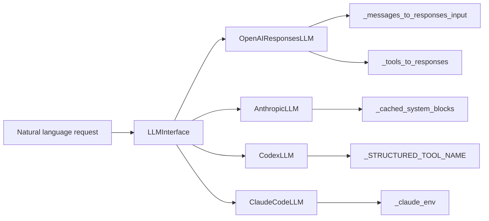
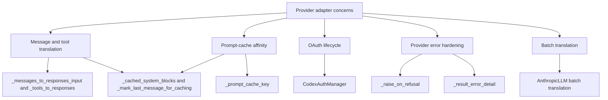

<!-- source: DeepWiki mcp.deepwiki.com · repo vectorize-io/hindsight · page 10.2 LLM Provider Adapters · fetched 2026-10-26 -->

# LLM Provider Adapters

Relevant source files

The following files were used as context for generating this wiki page:

- [hindsight-api-slim/hindsight_api/engine/providers/anthropic_llm.py](hindsight-api-slim/hindsight_api/engine/providers/anthropic_llm.py)
- [hindsight-api-slim/hindsight_api/engine/providers/claude_code_llm.py](hindsight-api-slim/hindsight_api/engine/providers/claude_code_llm.py)
- [hindsight-api-slim/hindsight_api/engine/providers/codex_auth.py](hindsight-api-slim/hindsight_api/engine/providers/codex_auth.py)
- [hindsight-api-slim/hindsight_api/engine/providers/codex_llm.py](hindsight-api-slim/hindsight_api/engine/providers/codex_llm.py)
- [hindsight-api-slim/hindsight_api/engine/providers/cursor_llm.py](hindsight-api-slim/hindsight_api/engine/providers/cursor_llm.py)
- [hindsight-api-slim/hindsight_api/engine/providers/openai_responses_llm.py](hindsight-api-slim/hindsight_api/engine/providers/openai_responses_llm.py)
- [hindsight-api-slim/hindsight_api/engine/providers/xai_oauth_llm.py](hindsight-api-slim/hindsight_api/engine/providers/xai_oauth_llm.py)
- [hindsight-api-slim/tests/test_anthropic_batch.py](hindsight-api-slim/tests/test_anthropic_batch.py)
- [hindsight-api-slim/tests/test_anthropic_prompt_caching.py](hindsight-api-slim/tests/test_anthropic_prompt_caching.py)
- [hindsight-api-slim/tests/test_anthropic_structured_tool_use.py](hindsight-api-slim/tests/test_anthropic_structured_tool_use.py)
- [hindsight-api-slim/tests/test_claude_code_llm_error_result.py](hindsight-api-slim/tests/test_claude_code_llm_error_result.py)
- [hindsight-api-slim/tests/test_claude_code_llm_isolation.py](hindsight-api-slim/tests/test_claude_code_llm_isolation.py)
- [hindsight-api-slim/tests/test_claude_code_llm_tool_round.py](hindsight-api-slim/tests/test_claude_code_llm_tool_round.py)
- [hindsight-api-slim/tests/test_codex_extra_body.py](hindsight-api-slim/tests/test_codex_extra_body.py)
- [hindsight-api-slim/tests/test_codex_home_env.py](hindsight-api-slim/tests/test_codex_home_env.py)
- [hindsight-api-slim/tests/test_codex_oauth_refresh.py](hindsight-api-slim/tests/test_codex_oauth_refresh.py)
- [hindsight-api-slim/tests/test_codex_reasoning_effort.py](hindsight-api-slim/tests/test_codex_reasoning_effort.py)
- [hindsight-api-slim/tests/test_codex_request_headers.py](hindsight-api-slim/tests/test_codex_request_headers.py)
- [hindsight-api-slim/tests/test_codex_strict_schema.py](hindsight-api-slim/tests/test_codex_strict_schema.py)
- [hindsight-api-slim/tests/test_codex_tool_choice.py](hindsight-api-slim/tests/test_codex_tool_choice.py)
- [hindsight-api-slim/tests/test_content_policy_refusal_permanent.py](hindsight-api-slim/tests/test_content_policy_refusal_permanent.py)
- [hindsight-api-slim/tests/test_cursor_llm.py](hindsight-api-slim/tests/test_cursor_llm.py)
- [hindsight-api-slim/tests/test_deepseek_tool_call_compat.py](hindsight-api-slim/tests/test_deepseek_tool_call_compat.py)
- [hindsight-api-slim/tests/test_gpt6_chat_completions_compat.py](hindsight-api-slim/tests/test_gpt6_chat_completions_compat.py)
- [hindsight-api-slim/tests/test_lmstudio_tool_choice.py](hindsight-api-slim/tests/test_lmstudio_tool_choice.py)
- [hindsight-api-slim/tests/test_meta_tool_choice.py](hindsight-api-slim/tests/test_meta_tool_choice.py)
- [hindsight-api-slim/tests/test_openai_compatible_finish_reason_error.py](hindsight-api-slim/tests/test_openai_compatible_finish_reason_error.py)
- [hindsight-api-slim/tests/test_openai_responses_provider.py](hindsight-api-slim/tests/test_openai_responses_provider.py)
- [hindsight-api-slim/tests/test_reasoning_effort_explicit_config.py](hindsight-api-slim/tests/test_reasoning_effort_explicit_config.py)
- [hindsight-api-slim/tests/test_reflect_page_length_decoupling.py](hindsight-api-slim/tests/test_reflect_page_length_decoupling.py)
- [hindsight-api-slim/tests/test_tool_choice_required_downgrade.py](hindsight-api-slim/tests/test_tool_choice_required_downgrade.py)
- [hindsight-api-slim/tests/test_xai_oauth_llm.py](hindsight-api-slim/tests/test_xai_oauth_llm.py)

## Purpose and Scope

This page documents the provider-adapter layer: how selected adapters translate Hindsight’s common LLM inputs and outputs into provider-specific protocols, and how they handle structured output, tool calls, caching, token accounting, authentication, and errors. The available source excerpts establish implementation details for OpenAI Responses, Anthropic, Codex, and Claude Code. Other providers named in the page scope—OpenAI-compatible, Gemini/Vertex, LiteLLM, xAI OAuth, Cursor, and llama.cpp—are identified in the supplied file list, but their implementation contents were not included, so their detailed behavior is not asserted here.

Sources: `hindsight-api-slim/hindsight_api/engine/providers/openai_responses_llm.py:1-32`; `hindsight-api-slim/hindsight_api/engine/providers/anthropic_llm.py:1-9`; `hindsight-api-slim/hindsight_api/engine/providers/codex_llm.py:1-16`; `hindsight-api-slim/hindsight_api/engine/providers/claude_code_llm.py:1-8`

---

## Overview and Scope

Provider adapters implement the boundary between Hindsight’s LLM-facing call contract and provider-specific APIs or SDKs. The visible implementations use shared concepts such as `LLMInterface`, `LLMToolCall`, `TokenUsage`, structured-output schemas, response-usage tracing, and retry/error types; each adapter then translates messages, tools, authentication, and responses as needed. [hindsight-api-slim/hindsight_api/engine/providers/openai_responses_llm.py:42-73](); [hindsight-api-slim/hindsight_api/engine/providers/anthropic_llm.py:19-37](); [hindsight-api-slim/hindsight_api/engine/providers/codex_llm.py:35-54]()

The supplied implementation evidence covers these provider-specific areas:

| Adapter | Demonstrated implementation focus |
|---|---|
| OpenAI Responses | Responses-only requests; chat-shaped message and tool conversion; stateless turn replay. [hindsight-api-slim/hindsight_api/engine/providers/openai_responses_llm.py:1-31]() |
| Anthropic | Message blocks, cache-control markers, usage normalization, refusal classification, and batch translation tested against the engine’s OpenAI-shaped batch request format. [hindsight-api-slim/hindsight_api/engine/providers/anthropic_llm.py:42-112](); [hindsight-api-slim/tests/test_anthropic_batch.py:1-18]() |
| Codex | ChatGPT OAuth-backed Responses-style streaming, structured-output tool use, cache-affinity keys, and OAuth token refresh. [hindsight-api-slim/hindsight_api/engine/providers/codex_llm.py:1-16](); [hindsight-api-slim/hindsight-api/engine/providers/codex_auth.py:101-121]() |
| Claude Code | Claude Agent SDK/CLI authentication, subprocess isolation, usage conversion, and actionable result-error extraction. [hindsight-api-slim/hindsight_api/engine/providers/claude_code_llm.py:1-8](); [hindsight-api-slim/hindsight_api/engine/providers/claude_code_llm.py:44-77](); [hindsight-api-slim/hindsight_api/engine/providers/claude_code_llm.py:80-130]() |

The supplied file list also names OpenAI-compatible, Gemini, LiteLLM, xAI OAuth, Cursor, and llama.cpp provider modules. Their detailed capabilities cannot be established from the excerpts available for this page. [hindsight-api-slim/hindsight_api/engine/providers/codex_llm.py:35-54]()

Sources: `hindsight-api-slim/hindsight_api/engine/providers/openai_responses_llm.py:1-31`; `hindsight-api-slim/hindsight_api/engine/providers/anthropic_llm.py:42-112`; `hindsight-api-slim/hindsight_api/engine/providers/codex_llm.py:1-16`; `hindsight-api-slim/hindsight_api/engine/providers/codex_auth.py:101-121`; `hindsight-api-slim/hindsight_api/engine/providers/claude_code_llm.py:1-8`; `hindsight-api-slim/hindsight_api/engine/providers/claude_code_llm.py:44-130`

---

## 1. OpenAI-Compatible Provider

The supplied excerpts include a DeepSeek compatibility test that constructs `OpenAICompatibleLLM` from `openai_compatible_llm.py`. It demonstrates a first-class `deepseek` provider shortcut that supplies `https://api.deepseek.com` when the base URL is empty, and that requires an API key. [hindsight-api-slim/tests/test_deepseek_tool_call_compat.py:39-67]()

The same tests document DeepSeek tool-call compatibility handling:

- For a named tool choice, the adapter narrows the `tools` list to the requested tool and omits the `tool_choice` request parameter. [hindsight-api-slim/tests/test_deepseek_tool_call_compat.py:119-140]()
- For automatic tool choice, it omits `tool_choice`. [hindsight-api-slim/tests/test_deepseek_tool_call_compat.py:143-161]()
- For a reasoning model, the request omits `temperature`. The test distinguishes `deepseek-v4-pro` as a reasoning model from `deepseek-v4-flash`. [hindsight-api-slim/tests/test_deepseek_tool_call_compat.py:91-116]()
- When replaying assistant tool-call history, the compatibility test checks that a `reasoning_content` fallback is added. [hindsight-api-slim/tests/test_deepseek_tool_call_compat.py:163-193]()

These are DeepSeek-specific tested behaviors, not evidence that every OpenAI-compatible backend follows the same rules. The excerpt does not provide the implementation body of `OpenAICompatibleLLM`, so broader claims about its headers, batch behavior, cache keys, retries, or other providers are not included.

Sources: `hindsight-api-slim/tests/test_deepseek_tool_call_compat.py:39-67`; `hindsight-api-slim/tests/test_deepseek_tool_call_compat.py:91-116`; `hindsight-api-slim/tests/test_deepseek_tool_call_compat.py:119-193`

---

## 2. OpenAI Responses API Adapter

`OpenAIResponsesLLM` is an OpenAI-only adapter that always calls the Responses API; the module explicitly states that it does not fall back to Chat Completions. Its stated reason is that some reasoning models reject combinations of `reasoning_effort` and function tools on the Chat Completions path, while the Responses API represents reasoning as a first-class response item that can coexist with tools. [hindsight-api-slim/hindsight_api/engine/providers/openai_responses_llm.py:1-26]()

The adapter receives chat-shaped engine inputs and translates them into Responses API shapes:

| Engine input | Responses representation |
|---|---|
| Chat messages | `input` items. [hindsight-api-slim/hindsight_api/engine/providers/openai_responses_llm.py:111-119]() |
| Assistant `tool_calls` | `function_call` items. [hindsight-api-slim/hindsight_api/engine/providers/openai_responses_llm.py:111-119]() |
| `role="tool"` results | `function_call_output` items keyed by `call_id`. [hindsight-api-slim/hindsight_api/engine/providers/openai_responses_llm.py:111-130]() |
| Nested Chat Completions function schemas | Flattened Responses function objects with top-level `name`, `parameters`, and optional `description`/`strict`. [hindsight-api-slim/hindsight_api/engine/providers/openai_responses_llm.py:85-108]() |
| `reasoning_effort` scalar | A `reasoning={"effort": ...}` object. [hindsight-api-slim/hindsight_api/engine/providers/openai_responses_llm.py:14-20]() |
| `response_format` | A `text={"format": ...}` object. [hindsight-api-slim/hindsight_api/engine/providers/openai_responses_llm.py:14-20]() |

The conversation is replayed statelessly on each turn using `store=False`; the module states that the adapter does not use `previous_response_id`. [hindsight-api-slim/hindsight_api/engine/providers/openai_responses_llm.py:28-31]()

### Tool and Message Conversion

`_tools_to_responses()` converts nested Chat Completions function definitions into Responses’ flattened function shape and passes through already flattened tools or non-function tools. `_messages_to_responses_input()` maps tool results to `function_call_output`, assistant tool calls to `function_call` items, and ordinary messages to role/content items. [hindsight-api-slim/hindsight_api/engine/providers/openai_responses_llm.py:85-153]()

### Error and Retry Support

The module defines `RetryableResponsesError` for transient failures detected outside an HTTP status, such as a mid-stream failure, so the retry path can handle them like connection errors. It also imports shared retry, timeout, error-description, and request-debug utilities. [hindsight-api-slim/hindsight_api/engine/providers/openai_responses_llm.py:42-80]()

Sources: `hindsight-api-slim/hindsight_api/engine/providers/openai_responses_llm.py:1-31`; `hindsight-api-slim/hindsight_api/engine/providers/openai_responses_llm.py:42-80`; `hindsight-api-slim/hindsight_api/engine/providers/openai_responses_llm.py:85-153`

---

## 3. Anthropic (Claude) Provider

`AnthropicLLM` uses the Anthropic Python SDK. Its documented support includes structured JSON output, tool/function calling, extended thinking, and retry logic with exponential backoff. [hindsight-api-slim/hindsight_api/engine/providers/anthropic_llm.py:1-9]()

### Prompt Caching and Token Accounting

The adapter renders a system prompt as a text block with an ephemeral `cache_control` marker. It can also mark the final content block of the last message, which is intended for multi-turn tool-calling conversations that resend the growing conversation on each iteration. [hindsight-api-slim/hindsight_api/engine/providers/anthropic_llm.py:85-132]()

Anthropic reports cache reads and cache writes separately from `input_tokens`. `_usage_from_anthropic_response()` normalizes those counts to Hindsight’s usage contract by adding cache-read and cache-write tokens to total input tokens, and by reporting cache-read tokens as `cached_tokens`. [hindsight-api-slim/hindsight_api/engine/providers/anthropic_llm.py:67-82]()

### Content Conversion and Refusals

`_to_anthropic_content()` converts OpenAI-style content-part lists into Anthropic block shapes. The visible excerpt shows it recognizes image URL parts and parses base64 data URIs; plain strings pass through unchanged. [hindsight-api-slim/hindsight_api/engine/providers/anthropic_llm.py:134-162]()

`_raise_on_refusal()` treats `refusal` and `content_filter` stop reasons as `ProviderContentPolicyError`, avoiding retries that would repeat the same refusal. [hindsight-api-slim/hindsight_api/engine/providers/anthropic_llm.py:42-64]()

The Messages API requires `max_tokens`; when callers do not specify a completion cap, the adapter’s `_DEFAULT_MAX_TOKENS` is `64000`. [hindsight-api-slim/hindsight_api/engine/providers/anthropic_llm.py:87-97]()

### Batch API Translation

The engine’s batch path uses OpenAI-shaped JSONL entries. The Anthropic batch tests establish that the provider translates those entries to the Message Batches API: system messages are folded into `system`, `max_completion_tokens` becomes `max_tokens`, and `temperature` is dropped. For strict JSON schema output, the adapter uses a forced `tool_use` tool; non-strict schema output injects the schema into the system prompt. [hindsight-api-slim/tests/test_anthropic_batch.py:1-18]()

The batch tests also verify that submitted requests preserve `custom_id`, and that the response batch metadata includes identifiers, status, and request counts. [hindsight-api-slim/tests/test_anthropic_batch.py:111-143]()

Sources: `hindsight-api-slim/hindsight_api/engine/providers/anthropic_llm.py:1-9`; `hindsight-api-slim/hindsight_api/engine/providers/anthropic_llm.py:42-64`; `hindsight-api-slim/hindsight_api/engine/providers/anthropic_llm.py:67-132`; `hindsight-api-slim/hindsight_api/engine/providers/anthropic_llm.py:134-162`; `hindsight-api-slim/tests/test_anthropic_batch.py:1-18`; `hindsight-api-slim/tests/test_anthropic_batch.py:111-173`

---

## 4. Gemini/Vertex AI Provider

The supplied file contents do not include the implementation or tests for Gemini/Vertex. The file list names `hindsight-api-slim/hindsight_api/engine/providers/gemini_llm.py`, but no source excerpt is available to establish its request formats, authentication, batch support, caching, tool use, token accounting, or error behavior. Those details are therefore not specified here.

Sources: `hindsight-api-slim/hindsight_api/engine/providers/openai_responses_llm.py:42-73`

---

## 5. LiteLLM Universal Adapter

The supplied file contents do not include the implementation or tests for LiteLLM. The file list names `hindsight-api-slim/hindsight_api/engine/providers/litellm_llm.py`, but no source excerpt is available to substantiate its SDK calls, supported providers, headers, batch behavior, caching, tool handling, or error policy.

Sources: `hindsight-api-slim/hindsight_api/engine/providers/openai_responses_llm.py:42-73`

---

## 6. xAI OAuth Provider

The supplied file contents do not include the implementation or tests for xAI OAuth. The file list names `hindsight-api-slim/hindsight_api/engine/providers/xai_oauth_llm.py` and `hindsight-api-slim/tests/test_xai_oauth_llm.py`, but no source excerpt is available to establish authentication, token refresh, headers, cache affinity, tool behavior, or quota handling.

Sources: `hindsight-api-slim/hindsight_api/engine/providers/codex_auth.py:39-66`

---

## 7. Codex (ChatGPT Plus/Pro OAuth) Provider

`CodexLLM` accesses the ChatGPT backend using OAuth credentials from Codex’s `auth.json`, rather than a standard OpenAI Platform API key. The provider module describes proactive token refresh before expiry and a single reactive refresh after a backend 401/403. [hindsight-api-slim/hindsight_api/engine/providers/codex_llm.py:1-16]()

### Authentication and Refresh

`CodexAuthManager` owns the access token, refresh token, account ID, and auth-file path. It supports proactive and reactive refresh, with refresh coordination through `oauth_store_lock`. [hindsight-api-slim/hindsight_api/engine/providers/codex_auth.py:101-135]()

The default auth file is `$CODEX_HOME/auth.json`, falling back to `~/.codex/auth.json`. The manager expects `auth_mode="chatgpt"` and an access token. [hindsight-api-slim/hindsight_api/engine/providers/codex_auth.py:69-90](); [hindsight-api-slim/hindsight_api/engine/providers/codex_auth.py:140-177]()

The refresh configuration includes a 60-second expiry skew, a refresh endpoint configurable through `CODEX_REFRESH_TOKEN_URL_OVERRIDE`, and terminal refresh-token errors that should not be retried. [hindsight-api-slim/hindsight_api/engine/providers/codex_auth.py:43-66]()

Tests document the expected behavior: proactive refresh near expiry, reactive refresh after 401/403, terminal refresh errors, single-flight behavior, and atomic persistence with mode `0600`. [hindsight-api-slim/tests/test_codex_oauth_refresh.py:1-20]()

### Responses-Style Tool Calls and Structured Output

Codex uses a Responses-style backend shape. A named tool choice is serialized with the function name at the top level; the test asserts the payload shape `{"type": "function", "name": "recall"}`. [hindsight-api-slim/tests/test_codex_tool_choice.py:1-12](); [hindsight-api-slim/tests/test_codex_tool_choice.py:49-67]()

The provider replays prior tool calls as linked `function_call` and `function_call_output` items, preserving `call_id` relationships. [hindsight-api-slim/tests/test_codex_tool_choice.py:92-138]()

For `strict_schema=True`, Codex uses a forced function tool named `structured_response`, disables parallel tool calls, and reads the structured result from the tool call. [hindsight-api-slim/hindsight_api/engine/providers/codex_llm.py:84-89](); [hindsight-api-slim/tests/test_codex_strict_schema.py:82-119]()

When non-strict model output contains invalid JSON escapes, `_repair_invalid_json_escapes()` doubles invalid backslashes while preserving valid JSON escapes. The tests cover regex escapes, Windows paths, valid escapes, and a trailing backslash. [hindsight-api-slim/hindsight_api/engine/providers/codex_llm.py:91-129](); [hindsight-api-slim/tests/test_codex_strict_schema.py:44-79]()

### Headers and Prompt Affinity

The Codex provider defines a neutral first-party-compatible `originator` and `User-Agent`. It also derives a prompt-cache key using `cache_affinity_id(messages)`, with a UUID fallback when no affinity key is available. [hindsight-api-slim/hindsight_api/engine/providers/codex_llm.py:78-82](); [hindsight-api-slim/hindsight_api/engine/providers/codex_llm.py:132-140]()

Sources: `hindsight-api-slim/hindsight_api/engine/providers/codex_llm.py:1-16`; `hindsight-api-slim/hindsight_api/engine/providers/codex_llm.py:78-89`; `hindsight-api-slim/hindsight_api/engine/providers/codex_llm.py:91-140`; `hindsight-api-slim/hindsight_api/engine/providers/codex_auth.py:39-66`; `hindsight-api-slim/hindsight_api/engine/providers/codex_auth.py:69-90`; `hindsight-api-slim/hindsight_api/engine/providers/codex_auth.py:101-177`; `hindsight-api-slim/tests/test_codex_oauth_refresh.py:1-20`; `hindsight-api-slim/tests/test_codex_tool_choice.py:1-138`; `hindsight-api-slim/tests/test_codex_strict_schema.py:44-119`

---

## 8. Claude Code Provider

`ClaudeCodeLLM` uses the Claude Agent SDK and the `claude` CLI authentication environment. It can use a configured `claude setup-token` token or the host’s `claude auth login` session. [hindsight-api-slim/hindsight_api/engine/providers/claude_code_llm.py:1-8]()

### Subprocess Isolation and Authentication

The adapter redirects the spawned CLI to a temporary `CLAUDE_CONFIG_DIR` so user-installed plugins and hooks do not run inside Hindsight’s LLM-call subprocess. The isolation also pins the working directory to that location and disables settings sources, preventing project settings from reintroducing host configuration. [hindsight-api-slim/hindsight_api/engine/providers/claude_code_llm.py:80-108]()

When a server-held OAuth token is configured, `_claude_env()` sets `CLAUDE_CODE_OAUTH_TOKEN` and removes the secure-storage override so the CLI uses the configured token rather than a host login. [hindsight-api-slim/hindsight_api/engine/providers/claude_code_llm.py:111-130]()

Isolation tests check both `call()` and `call_with_tools()` paths, including the isolated environment, pinned working directory, and empty `setting_sources`. [hindsight-api-slim/tests/test_claude_code_llm_isolation.py:64-80](); [hindsight-api-slim/tests/test_claude_code_llm_isolation.py:82-171]()

### Result Errors and Usage

`_result_error_detail()` prefers the CLI’s `ResultMessage.result`, falling back to its subtype and then a generic message. This avoids losing the actionable error when the CLI marks a result as erroneous but reports a misleading success subtype. [hindsight-api-slim/hindsight_api/engine/providers/claude_code_llm.py:133-145]()

The provider converts SDK usage into `TokenUsage`, adding cache-read and cache-creation tokens to input usage and exposing cache reads as `cached_tokens`. If usage is missing, it estimates token counts as roughly one token per four characters. [hindsight-api-slim/hindsight_api/engine/providers/claude_code_llm.py:44-77]()

The supplied regression tests verify that quota-reset text is surfaced as a rate-limit-reset error and that other CLI error text remains actionable. [hindsight-api-slim/tests/test_claude_code_llm_error_result.py:1-18]()

Sources: `hindsight-api-slim/hindsight_api/engine/providers/claude_code_llm.py:1-8`; `hindsight-api-slim/hindsight_api/engine/providers/claude_code_llm.py:44-77`; `hindsight-api-slim/hindsight_api/engine/providers/claude_code_llm.py:80-145`; `hindsight-api-slim/tests/test_claude_code_llm_isolation.py:64-80`; `hindsight-api-slim/tests/test_claude_code_llm_isolation.py:82-171`; `hindsight-api-slim/tests/test_claude_code_llm_error_result.py:1-18`

---

## 9. Cursor Provider

The supplied file list names `hindsight-api-slim/hindsight_api/engine/providers/cursor_llm.py` and `hindsight-api-slim/tests/test_cursor_llm.py`, but the file contents are not included. No claims about Cursor authentication, request headers, tool calls, cache behavior, reasoning tokens, or errors can be verified from the available excerpts.

Sources: `hindsight-api-slim/hindsight_api/engine/providers/openai_responses_llm.py:42-73`

---

## 10. llama.cpp Provider

The supplied file contents do not include a llama.cpp provider implementation or tests. Consequently, this page does not assert details about local model management, subprocess lifecycle, HTTP endpoints, prompt caching, tool support, or token usage for llama.cpp.

Sources: `hindsight-api-slim/hindsight-api/engine/providers/openai_responses_llm.py:42-73`

---

## Cross-Cutting Implementation Details

### Common Request and Response Concepts

The visible adapters import shared types and utilities for provider calls, tool calls, token usage, structured-output schemas, metrics, and tracing. For example, the Responses and Anthropic adapters use `LLMInterface`, `LLMToolCall`, `TokenUsage`, and response-usage tracing; Codex additionally uses cache-affinity and worker-stage utilities. [hindsight-api-slim/hindsight_api/engine/providers/openai_responses_llm.py:42-73](); [hindsight-api-slim/hindsight_api/engine/providers/anthropic_llm.py:19-37](); [hindsight-api-slim/hindsight_api/engine/providers/codex_llm.py:35-54]()

### Prompt Caching

The visible cache strategies differ by provider:

- Anthropic inserts `cache_control={"type": "ephemeral"}` markers into the system prompt and, on multi-turn tool paths, the final message block. [hindsight-api-slim/hindsight_api/engine/providers/anthropic_llm.py:85-132]()
- Codex derives a stable cache key from message cache affinity, falling back to a UUID. [hindsight-api-slim/hindsight_api/engine/providers/codex_llm.py:132-140]()

These excerpts do not establish prompt-caching behavior for the other adapters.

### Tool Use and Structured Output

The adapters translate the engine’s tool contract into provider-specific formats:

- OpenAI Responses flattens function schemas and maps tool calls/results to `function_call` and `function_call_output` items. [hindsight-api-slim/hindsight_api/engine/providers/openai_responses_llm.py:85-153]()
- Anthropic batch requests use `tool_use` for strict structured output. [hindsight-api-slim/tests/test_anthropic_batch.py:11-18](); [hindsight-api-slim/tests/test_anthropic_batch.py:116-143]()
- Codex uses a forced `structured_response` function tool for strict-schema output. [hindsight-api-slim/hindsight-api/engine/providers/codex_llm.py:84-89](); [hindsight-api-slim/tests/test_codex_strict_schema.py:82-119]()
- DeepSeek compatibility tests show named-tool narrowing and omission of unsupported `tool_choice` parameters. [hindsight-api-slim/tests/test_deepseek_tool_call_compat.py:119-161]()

Sources: `hindsight-api-slim/hindsight_api/engine/providers/openai_responses_llm.py:42-73`; `hindsight-api-slim/hindsight_api/engine/providers/openai_responses_llm.py:85-153`; `hindsight-api-slim/hindsight-api/engine/providers/anthropic_llm.py:85-132`; `hindsight-api-slim/hindsight-api/engine/providers/codex_llm.py:84-140`; `hindsight-api-slim/tests/test_anthropic_batch.py:11-18`; `hindsight-api-slim/tests/test_anthropic_batch.py:116-143`; `hindsight-api-slim/tests/test_codex_strict_schema.py:82-119`; `hindsight-api-slim/tests/test_deepseek_tool_call_compat.py:119-161`

---

## Diagram: Natural Language Calls to Provider Code Entities

This diagram connects an application-level request to the adapter classes and conversion functions present in the supplied excerpts. [hindsight-api-slim/hindsight_api/engine/providers/openai_responses_llm.py:85-153](); [hindsight-api-slim/hindsight_api/engine/providers/anthropic_llm.py:100-132](); [hindsight-api-slim/hindsight_api/engine/providers/codex_llm.py:84-89](); [hindsight-api-slim/hindsight_api/engine/providers/claude_code_llm.py:111-130]()

Sources: `hindsight-api-slim/hindsight-api/engine/providers/openai_responses_llm.py:85-153`; `hindsight-api-slim/hindsight-api/engine/providers/anthropic_llm.py:100-132`; `hindsight-api-slim/hindsight-api/engine/providers/codex_llm.py:84-89`; `hindsight-api-slim/hindsight-api/engine/providers/claude_code_llm.py:111-130`

---

## Diagram: Provider Concerns Mapped to Code Entities

The diagram maps concerns named in this page—message translation, cache markers, OAuth refresh, error classification, and batch translation—to the corresponding code entities evidenced in the excerpts. [hindsight-api-slim/hindsight_api/engine/providers/openai_responses_llm.py:78-153](); [hindsight-api-slim/hindsight_api/engine/providers/anthropic_llm.py:42-132](); [hindsight-api-slim/hindsight_api/engine/providers/codex_auth.py:101-135](); [hindsight-api-slim/hindsight_api/engine/providers/claude_code_llm.py:133-145](); [hindsight-api-slim/tests/test_anthropic_batch.py:111-143]()

Sources: `hindsight-api-slim/hindsight-api/engine/providers/openai_responses_llm.py:78-153`; `hindsight-api-slim/hindsight-api/engine/providers/anthropic_llm.py:42-132`; `hindsight-api-slim/hindsight-api/engine/providers/codex_llm.py:132-140`; `hindsight-api-slim/hindsight-api/engine/providers/codex_auth.py:101-135`; `hindsight-api-slim/tests/test_anthropic_batch.py:111-143`; `hindsight-api-slim/hindsight-api/engine/providers/claude_code_llm.py:133-145`

---

## Summary Table

| Adapter | Request/tool translation | Caching/auth evidence | Batch and error evidence |
|---|---|---|---|
| OpenAI-compatible / DeepSeek | DeepSeek tests cover named-tool narrowing, omitted `tool_choice`, reasoning-model temperature omission, and tool-history fallback. [hindsight-api-slim/tests/test_deepseek_tool_call_compat.py:91-193]() | DeepSeek requires an API key and defaults its base URL when absent. [hindsight-api-slim/tests/test_deepseek_tool_call_compat.py:48-67]() | The supplied tests focus on compatibility behavior; other details are not established by the excerpts. [hindsight-api-slim/tests/test_deepseek_tool_call_compat.py:1-10]() |
| OpenAI Responses | Converts messages and tools to Responses API items. [hindsight-api-slim/hindsight_api/engine/providers/openai_responses_llm.py:85-153]() | Stateless replay; no `previous_response_id`. [hindsight-api-slim/hindsight_api/engine/providers/openai_responses_llm.py:28-31]() | Defines a retryable error for non-HTTP transient failures. [hindsight-api-slim/hindsight_api/engine/providers/openai_responses_llm.py:78-83]() |
| Anthropic | Converts provider messages and uses `tool_use` for strict batch structured output. [hindsight-api-slim/hindsight_api/engine/providers/anthropic_llm.py:134-162](); [hindsight-api-slim/tests/test_anthropic_batch.py:116-143]() | Ephemeral cache markers; input usage includes cache reads and writes. [hindsight-api-slim/hindsight_api/engine/providers/anthropic_llm.py:67-112]() | Batch translation is tested; refusal stop reasons become non-retryable content-policy errors. [hindsight-api-slim/tests/test_anthropic_batch.py:111-143](); [hindsight-api-slim/hindsight_api/engine/providers/anthropic_llm.py:56-64]() |
| Codex | Responses-style function calls and forced `structured_response` tool. [hindsight-api-slim/tests/test_codex_tool_choice.py:49-89](); [hindsight-api-slim/tests/test_codex_strict_schema.py:82-119]() | Cache-affinity key; Codex OAuth auth-file manager and refresh lifecycle. [hindsight-api-slim/hindsight_api/engine/providers/codex_llm.py:132-140](); [hindsight-api-slim/hindsight_api/engine/providers/codex_auth.py:101-135]() | Tests cover refresh behavior and JSON escape repair. [hindsight-api-slim/tests/test_codex_oauth_refresh.py:1-20](); [hindsight-api-slim/tests/test_codex_strict_schema.py:44-79]() |
| Claude Code | Uses Claude Agent SDK; the excerpts establish authentication environment and error handling. [hindsight-api-slim/hindsight_api/engine/providers/claude_code_llm.py:1-8](); [hindsight-api-slim/hindsight_api/engine/providers/claude_code_llm.py:111-145]() | Isolated CLI configuration and optional server-held token. [hindsight-api-slim/hindsight_api/engine/providers/claude_code_llm.py:80-130]() | Tests cover isolation and surfacing CLI error results. [hindsight-api-slim/tests/test_claude_code_llm_isolation.py:82-171](); [hindsight-api-slim/tests/test_claude_code_llm_error_result.py:1-18]() |
| Gemini/Vertex, LiteLLM, xAI OAuth, Cursor, llama.cpp | The supplied file list names these adapters, but implementation excerpts are unavailable. [hindsight-api-slim/hindsight_api/engine/providers/openai_responses_llm.py:42-73]() | Not established by the supplied excerpts. [hindsight-api-slim/hindsight_api/engine/providers/openai_responses_llm.py:42-73]() | Not established by the supplied excerpts. [hindsight-api-slim/hindsight_api/engine/providers/openai_responses_llm.py:42-73]() |

Sources: `hindsight-api-slim/tests/test_deepseek_tool_call_compat.py:48-193`; `hindsight-api-slim/hindsight-api/engine/providers/openai_responses_llm.py:28-31`; `hindsight-api-slim/hindsight-api/engine/providers/openai_responses_llm.py:78-153`; `hindsight-api-slim/hindsight-api/engine/providers/anthropic_llm.py:56-112`; `hindsight-api-slim/tests/test_anthropic_batch.py:111-143`; `hindsight-api-slim/hindsight-api/engine/providers/codex_llm.py:132-140`; `hindsight-api-slim/hindsight-api/engine/providers/codex_auth.py:101-135`; `hindsight-api-slim/tests/test_codex_oauth_refresh.py:1-20`; `hindsight-api-slim/hindsight-api/engine/providers/claude_code_llm.py:80-145`; `hindsight-api-slim/tests/test_claude_code_llm_isolation.py:82-171`; `hindsight-api-slim/tests/test_claude_code_llm_error_result.py:1-18`

---

## Error Hardening

The available provider code demonstrates several distinct hardening strategies:

- **Avoid retrying permanent content-policy refusals:** Anthropic refusal stop reasons raise `ProviderContentPolicyError`. [hindsight-api-slim/hindsight_api/engine/providers/anthropic_llm.py:42-64]()
- **Repair malformed JSON escapes:** Codex’s `_repair_invalid_json_escapes()` repairs invalid backslashes before parsing; strict schema output instead uses a forced function tool. [hindsight-api-slim/hindsight_api/engine/providers/codex_llm.py:84-129](); [hindsight-api-slim/tests/test_codex_strict_schema.py:82-119]()
- **Surface actionable CLI errors:** Claude Code prefers the CLI result text over a potentially misleading subtype. [hindsight-api-slim/hindsight_api/engine/providers/claude_code_llm.py:133-145]()
- **Retry transient stream failures:** OpenAI Responses defines `RetryableResponsesError` for retryable failures detected outside HTTP status codes. [hindsight-api-slim/hindsight_api/engine/providers/openai_responses_llm.py:78-83]()
- **Avoid repeating a known-invalid tool-choice shape:** DeepSeek tests verify that named and automatic tool-choice parameters are omitted, with named-tool selection represented by narrowing the tools list. [hindsight-api-slim/tests/test_deepseek_tool_call_compat.py:119-161]()

Sources: `hindsight-api-slim/hindsight-api/engine/providers/anthropic_llm.py:42-64`; `hindsight-api-slim/hindsight-api/engine/providers/codex_llm.py:84-129`; `hindsight-api-slim/tests/test_codex_strict_schema.py:82-119`; `hindsight-api-slim/hindsight-api/engine/providers/claude_code_llm.py:133-145`; `hindsight-api-slim/hindsight-api/engine/providers/openai_responses_llm.py:78-83`; `hindsight-api-slim/tests/test_deepseek_tool_call_compat.py:119-161`

---

## Conclusion

Provider adapters preserve a common engine-facing interface while translating provider-specific message formats, tool calls, structured outputs, authentication, caching markers, usage accounting, and errors. The excerpts support detailed descriptions of OpenAI Responses, Anthropic, Codex, Claude Code, and tested DeepSeek compatibility behavior. Detailed documentation for Gemini/Vertex, LiteLLM, xAI OAuth, Cursor, and llama.cpp requires their implementation or test contents. [hindsight-api-slim/hindsight-api/engine/providers/openai_responses_llm.py:42-73](); [hindsight-api-slim/hindsight-api/engine/providers/anthropic_llm.py:19-37](); [hindsight-api-slim/hindsight-api/engine/providers/codex_llm.py:35-54](); [hindsight-api-slim/hindsight-api/engine/providers/claude_code_llm.py:23-39](); [hindsight-api-slim/tests/test_deepseek_tool_call_compat.py:39-67]()

Sources: `hindsight-api-slim/hindsight_api/engine/providers/openai_responses_llm.py:42-73`; `hindsight-api-slim/hindsight_api/engine/providers/anthropic_llm.py:19-37`; `hindsight-api-slim/hindsight_api/engine/providers/codex_llm.py:35-54`; `hindsight-api-slim/hindsight_api/engine/providers/claude_code_llm.py:23-39`; `hindsight-api-slim/tests/test_deepseek_tool_call_compat.py:39-67`

---

