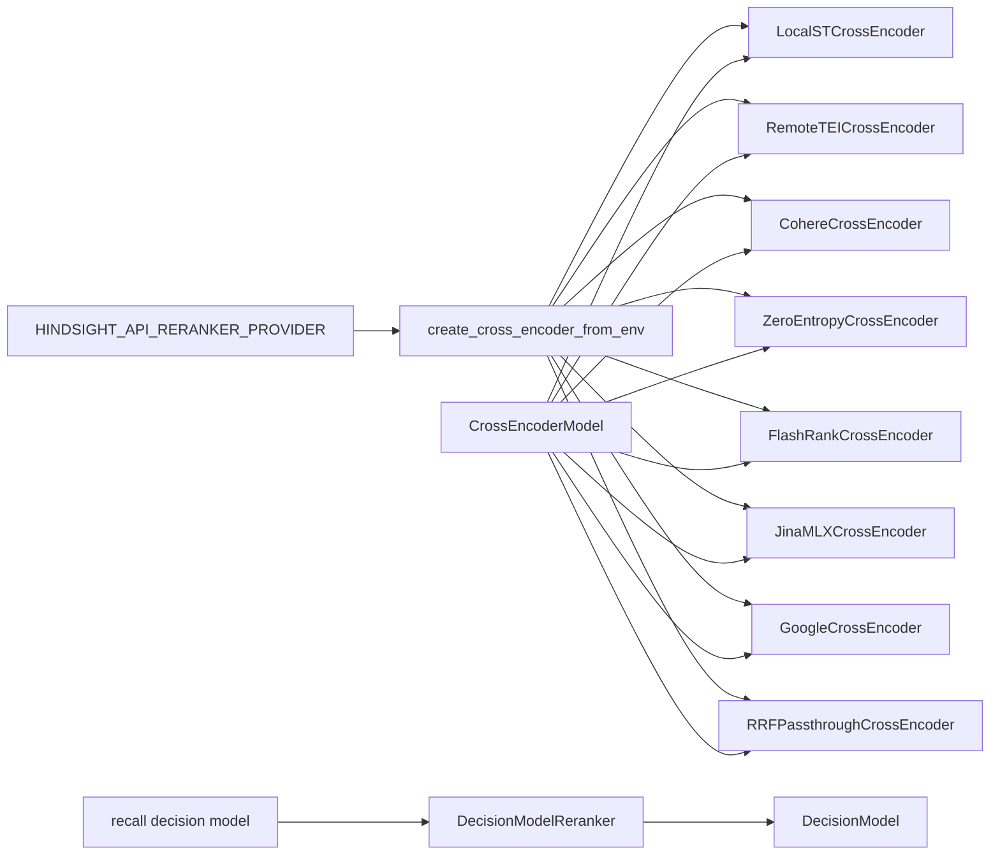
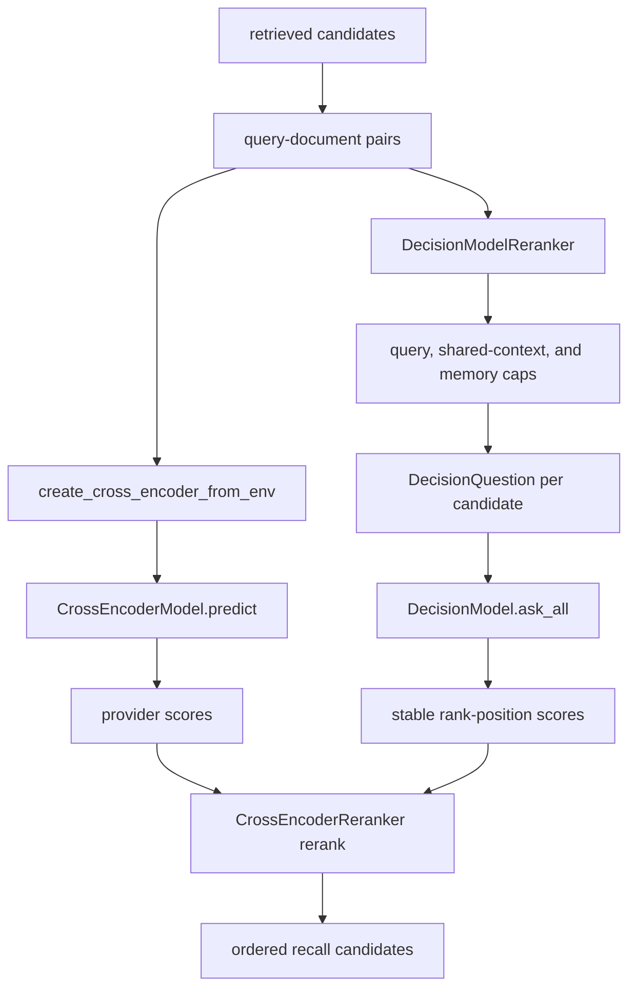
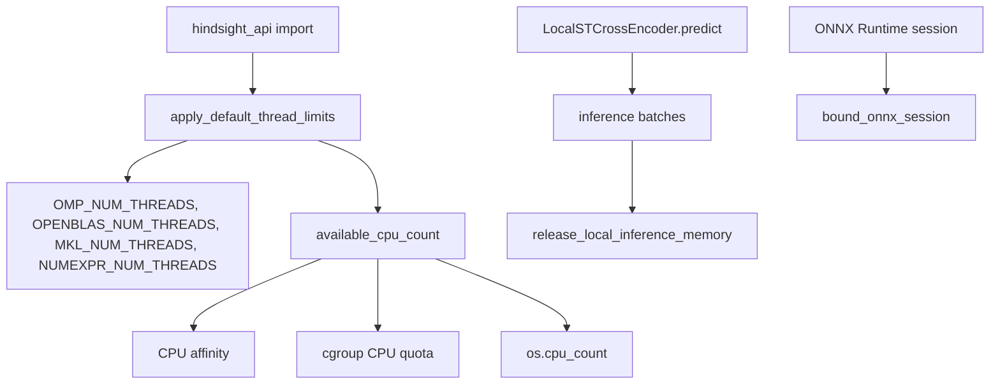

<!-- source: DeepWiki mcp.deepwiki.com · repo vectorize-io/hindsight · page 10.4 Cross-Encoder Rerankers · fetched 2026-10-26 -->

# Cross-Encoder Rerankers

Relevant source files

The following files were used as context for generating this wiki page:

- [hindsight-api-slim/hindsight_api/_thread_limits.py](hindsight-api-slim/hindsight_api/_thread_limits.py)
- [hindsight-api-slim/hindsight_api/engine/decision_model.py](hindsight-api-slim/hindsight_api/engine/decision_model.py)
- [hindsight-api-slim/hindsight_api/engine/search/decision_reranker.py](hindsight-api-slim/hindsight_api/engine/search/decision_reranker.py)
- [hindsight-api-slim/tests/test_decision_model_config.py](hindsight-api-slim/tests/test_decision_model_config.py)
- [hindsight-api-slim/tests/test_decision_reranker.py](hindsight-api-slim/tests/test_decision_reranker.py)
- [hindsight-api-slim/tests/test_local_cross_encoder.py](hindsight-api-slim/tests/test_local_cross_encoder.py)
- [hindsight-api-slim/tests/test_onnx_cuda.py](hindsight-api-slim/tests/test_onnx_cuda.py)
- [hindsight-api-slim/tests/test_onnx_embeddings.py](hindsight-api-slim/tests/test_onnx_embeddings.py)
- [hindsight-api-slim/tests/test_reranker_typesafe.py](hindsight-api-slim/tests/test_reranker_typesafe.py)
- [hindsight-api-slim/tests/test_thread_limits.py](hindsight-api-slim/tests/test_thread_limits.py)

## Purpose and scope

This page describes Hindsight’s recall reranker layer: provider implementations, candidate handling, score treatment, and local inference resource management. It focuses on `CrossEncoderModel` providers and distinguishes the separately configured decision-model reranker from the `HINDSIGHT_API_RERANKER_PROVIDER` family. [hindsight-api-slim/hindsight_api/engine/cross_encoder.py:50-1393](), [hindsight-api-slim/hindsight_api/engine/search/decision_reranker.py:1-12]()

Sources: [hindsight-api-slim/hindsight_api/engine/cross_encoder.py:50-1393](), [hindsight-api-slim/hindsight_api/engine/search/decision_reranker.py:1-12]()

## Purpose and architecture

Reranking takes query–candidate pairs and scores their relevance after retrieval has assembled candidate memories. The provider interface is asynchronous: implementations initialize as needed and expose scoring through `predict`. The search reranking layer coordinates this work and subsequent candidate ordering. [hindsight-api-slim/hindsight_api/engine/cross_encoder.py:71-153](), [hindsight-api-slim/hindsight_api/engine/search/reranking.py:30-156]()

The decision-model path is a distinct alternative. When recall has a decision model configured, `CrossEncoderReranker` can use `DecisionModelReranker`, which asks a help-versus-distract question for each candidate. Its returned values are rank positions rather than model confidences, and its results do not receive the cross-encoder path’s recency, temporal, or proof-count boosts. [hindsight-api-slim/hindsight_api/engine/search/decision_reranker.py:1-11](), [hindsight-api-slim/hindsight_api/engine/search/decision_reranker.py:50-62](), [hindsight-api-slim/tests/test_decision_reranker.py:82-92]()

### Natural-language concepts mapped to code entities

The following diagram links provider names used in configuration to implementation symbols. [hindsight-api-slim/hindsight_api/engine/cross_encoder.py:71-153](), [hindsight-api-slim/hindsight_api/engine/search/decision_reranker.py:50-76]()

**Diagram: Provider names and implementation entities**

Sources: [hindsight-api-slim/hindsight_api/engine/cross_encoder.py:71-153](), [hindsight-api-slim/hindsight_api/engine/cross_encoder.py:156-1282](), [hindsight-api-slim/hindsight_api/engine/search/decision_reranker.py:50-76]()

### Reranking data flow

The conventional reranker receives pairs and returns scores for the search layer. The decision-model reranker groups pairs by query, caps request text, asks one question per candidate, and assigns stable rank-position scores. [hindsight-api-slim/hindsight_api/engine/search/decision_reranker.py:81-120](), [hindsight-api-slim/tests/test_decision_reranker.py:54-80]()

**Diagram: Candidate scoring paths**

Sources: [hindsight-api-slim/hindsight_api/engine/cross_encoder.py:71-153](), [hindsight-api-slim/hindsight_api/engine/search/decision_reranker.py:81-120]()

## Provider implementations

### Local SentenceTransformers (`LocalSTCrossEncoder`)

`LocalSTCrossEncoder` is the SentenceTransformers-backed local provider. Its `predict` path preserves input ordering, supports configured batch size, and can bucket pairs by text length while restoring their original order. It checks the inference time budget between batches; when the budget expires, `RerankTimeoutError` carries scores already produced and `None` for unscored pairs. A zero timeout disables that budget. [hindsight-api-slim/tests/test_local_cross_encoder.py:30-43](), [hindsight-api-slim/tests/test_local_cross_encoder.py:47-149](), [hindsight-api-slim/tests/test_local_cross_encoder.py:120-138]()

The tests use mocked model objects rather than downloading or loading model weights. They verify that post-inference memory cleanup runs after successful scoring and, in the shown test section, begins testing cleanup on exceptions as well. [hindsight-api-slim/tests/test_local_cross_encoder.py:1-8](), [hindsight-api-slim/tests/test_local_cross_encoder.py:156-169]()

Sources: [hindsight-api-slim/tests/test_local_cross_encoder.py:1-8](), [hindsight-api-slim/tests/test_local_cross_encoder.py:30-169]()

### TEI (`RemoteTEICrossEncoder`)

`RemoteTEICrossEncoder` is the TEI provider implementation. Its construction and provider behavior are part of the shared cross-encoder module; provider-specific HTTP retry and batching details are not established by the supplied file excerpts. [hindsight-api-slim/hindsight_api/engine/cross_encoder.py:239-426]()

Sources: [hindsight-api-slim/hindsight_api/engine/cross_encoder.py:239-426]()

### Cohere (`CohereCrossEncoder`)

`CohereCrossEncoder` is the Cohere provider implementation in the cross-encoder module. [hindsight-api-slim/hindsight_api/engine/cross_encoder.py:429-565]()

Sources: [hindsight-api-slim/hindsight_api/engine/cross_encoder.py:429-565]()

### ZeroEntropy (`ZeroEntropyCrossEncoder`)

`ZeroEntropyCrossEncoder` is the ZeroEntropy provider implementation in the cross-encoder module. [hindsight-api-slim/hindsight_api/engine/cross_encoder.py:828-912]()

Sources: [hindsight-api-slim/hindsight_api/engine/cross_encoder.py:828-912]()

### FlashRank (`FlashRankCrossEncoder`)

`FlashRankCrossEncoder` is a local provider. The supplied tests group it with local inference memory cleanup coverage, alongside `LocalSTCrossEncoder`. [hindsight-api-slim/hindsight_api/engine/cross_encoder.py:568-704](), [hindsight-api-slim/tests/test_local_cross_encoder.py:1-8]()

Sources: [hindsight-api-slim/hindsight_api/engine/cross_encoder.py:568-704](), [hindsight-api-slim/tests/test_local_cross_encoder.py:1-8]()

### Jina MLX (`JinaMLXCrossEncoder`)

`JinaMLXCrossEncoder` is the Jina MLX implementation in the cross-encoder module. [hindsight-api-slim/hindsight_api/engine/cross_encoder.py:1285-1393]()

Sources: [hindsight-api-slim/hindsight_api/engine/cross_encoder.py:1285-1393]()

### Google (`GoogleCrossEncoder`)

`GoogleCrossEncoder` is the Google provider implementation in the cross-encoder module. [hindsight-api-slim/hindsight_api/engine/cross_encoder.py:1053-1157]()

Sources: [hindsight-api-slim/hindsight_api/engine/cross_encoder.py:1053-1157]()

### RRF-only (`RRFPassthroughCrossEncoder`)

`RRFPassthroughCrossEncoder` is the no-model path: it uses retrieval’s reciprocal-rank-fusion scores rather than performing learned inference. [hindsight-api-slim/hindsight_api/engine/cross_encoder.py:1160-1167]()

Sources: [hindsight-api-slim/hindsight_api/engine/cross_encoder.py:1160-1167]()

### LiteLLM SDK

`LiteLLMSDKCrossEncoder` is also present in the cross-encoder module. It is separate from the provider list emphasized in this page’s scope, but appears among the implementations described by the existing provider documentation. [hindsight-api-slim/hindsight_api/engine/cross_encoder.py:707-825]()

Sources: [hindsight-api-slim/hindsight_api/engine/cross_encoder.py:707-825]()

## Score handling and candidate limits

The search reranking layer owns the transition from retrieved candidates to reranked results, including score processing and candidate handling. The exact normalization formula and configured candidate-cap defaults are not shown in the supplied source excerpts, so they should be verified against the current `search/reranking.py` and configuration definitions before tuning them. [hindsight-api-slim/hindsight_api/engine/search/reranking.py:30-156]()

The decision-model reranker has explicit caps for query text, shared context, and individual memory text. `_capped` uses the smaller of the configured ceiling and one quarter of the decision client’s `max_request_tokens`; `_state` places shared context in the request state once, followed by the question. [hindsight-api-slim/hindsight_api/engine/search/decision_reranker.py:35-47](), [hindsight-api-slim/hindsight_api/engine/search/decision_reranker.py:81-90]()

For decision-model scoring, each candidate receives a `noul` question asking whether showing its memory would help rather than distract. Missing answers are scored as zero; sorting is stable, so ties retain caller order. The output is a descending sequence of positions from 1.0 rather than the provider’s raw probabilities. [hindsight-api-slim/hindsight_api/engine/search/decision_reranker.py:43-47](), [hindsight-api-slim/hindsight_api/engine/search/decision_reranker.py:91-111]()

Sources: [hindsight-api-slim/hindsight_api/engine/search/reranking.py:30-156](), [hindsight-api-slim/hindsight_api/engine/search/decision_reranker.py:35-47](), [hindsight-api-slim/hindsight_api/engine/search/decision_reranker.py:81-111]()

## Decision-model reranking in recall

`DecisionModelReranker` implements the `CrossEncoderModel` interface but is not the `typesafe` reranker provider configured through `HINDSIGHT_API_RERANKER_PROVIDER`. It is selected through `HindsightConfig.decision_model_config("recall")` and uses the shared `DecisionModel` client. [hindsight-api-slim/hindsight_api/engine/search/decision_reranker.py:1-11](), [hindsight-api-slim/hindsight_api/engine/search/decision_reranker.py:50-79]()

For each query, `_rerank` builds one `DecisionQuestion` per candidate and submits the set through `ask_all` with scope `decision_recall_rerank`. `_predict` groups pairs by query and runs each query group through the async path. [hindsight-api-slim/hindsight_api/engine/search/decision_reranker.py:91-120]()

Shared context is carried once in the state rather than duplicated into every candidate question. This is both a ranking design choice and a request-size safeguard; the query, shared context, and each candidate memory have separate token ceilings. [hindsight-api-slim/hindsight_api/engine/search/decision_reranker.py:26-41](), [hindsight-api-slim/hindsight_api/engine/search/decision_reranker.py:81-102]()

Sources: [hindsight-api-slim/hindsight_api/engine/search/decision_reranker.py:1-11](), [hindsight-api-slim/hindsight_api/engine/search/decision_reranker.py:26-41](), [hindsight-api-slim/hindsight_api/engine/search/decision_reranker.py:81-120]()

## Local device, memory, and CPU handling

Local inference has two resource-management concerns: releasing memory after scoring and preventing native ML libraries from creating oversized thread pools.

The local cross-encoder tests verify the cleanup hook is called after successful prediction and exercise its exception path. [hindsight-api-slim/tests/test_local_cross_encoder.py:156-169]()

At process startup, `_thread_limits.py` bounds OpenMP, OpenBLAS, MKL, and NumExpr thread pools. Its default is capped at 16 threads or the available CPU count, whichever is lower; available CPUs account for affinity, cgroup quota, and host CPU count. Environment variables are set with `setdefault`, preserving operator-provided overrides. [hindsight-api-slim/hindsight_api/_thread_limits.py:1-29](), [hindsight-api-slim/hindsight_api/_thread_limits.py:40-50](), [hindsight-api-slim/hindsight_api/_thread_limits.py:125-153]()

ONNX Runtime does not rely on `OMP_NUM_THREADS` for its CPU pool. The module therefore provides `bound_onnx_session` and `onnx_intra_op_threads` to apply the same CPU-budget principle to ONNX sessions. [hindsight-api-slim/hindsight_api/_thread_limits.py:21-23](), [hindsight-api-slim/tests/test_thread_limits.py:10-22]()

**Diagram: Local inference resource controls**

Sources: [hindsight-api-slim/hindsight_api/_thread_limits.py:1-29](), [hindsight-api-slim/hindsight_api/_thread_limits.py:40-50](), [hindsight-api-slim/hindsight_api/_thread_limits.py:125-153](), [hindsight-api-slim/tests/test_local_cross_encoder.py:156-169](), [hindsight-api-slim/tests/test_thread_limits.py:10-22]()

## Provider configuration and selection

`create_cross_encoder_from_env()` is the factory entry point for environment-driven cross-encoder construction. The existing page documents `HINDSIGHT_API_RERANKER_PROVIDER` and indexed provider members; consult the implementation’s current configuration parsing for supported values and exact per-provider environment variables. [hindsight-api-slim/hindsight_api/engine/cross_encoder.py:1170-1282]()

A recall decision model is configured independently of that reranker-provider setting. The configuration tests demonstrate global decision-model setup, per-operation overrides, and the ability to opt an operation out with provider `none`. [hindsight-api-slim/tests/test_decision_model_config.py:35-81]()

| Selection path | Code entry point | Behavior |
|---|---|---|
| Configured cross-encoder provider | `create_cross_encoder_from_env()` | Constructs a provider from reranker configuration. [hindsight-api-slim/hindsight_api/engine/cross_encoder.py:1170-1282]() |
| RRF-only | `RRFPassthroughCrossEncoder` | Uses retrieval-side ranking without learned model inference. [hindsight-api-slim/hindsight_api/engine/cross_encoder.py:1160-1167]() |
| Recall decision model | `DecisionModelReranker.from_config()` | Builds the decision-model client and uses per-candidate questions. [hindsight-api-slim/hindsight_api/engine/search/decision_reranker.py:67-79](), [hindsight-api-slim/hindsight-api/engine/search/decision_reranker.py:91-120]() |

Sources: [hindsight-api-slim/hindsight_api/engine/cross_encoder.py:1160-1282](), [hindsight-api-slim/hindsight_api/engine/search/decision_reranker.py:67-120](), [hindsight-api-slim/tests/test_decision_model_config.py:35-81]()

## Summary

Hindsight’s reranking code includes local, remote, and RRF-only provider implementations behind a shared model interface. Local inference uses batching and cleanup hooks, while process-level CPU thread limits account for constrained containers. The decision-model recall reranker is a separate path: it caps request text, asks a typed question per candidate, and returns stable rank-position scores rather than confidence values. [hindsight-api-slim/hindsight_api/engine/cross_encoder.py:71-153](), [hindsight-api-slim/tests/test_local_cross_encoder.py:47-169](), [hindsight-api-slim/hindsight_api/_thread_limits.py:1-29](), [hindsight-api-slim/hindsight_api/engine/search/decision_reranker.py:50-120]()

Sources: [hindsight-api-slim/hindsight_api/engine/cross_encoder.py:71-153](), [hindsight-api-slim/tests/test_local_cross_encoder.py:47-169](), [hindsight-api-slim/hindsight_api/_thread_limits.py:1-29](), [hindsight-api-slim/hindsight_api/engine/search/decision_reranker.py:50-120]()

---

