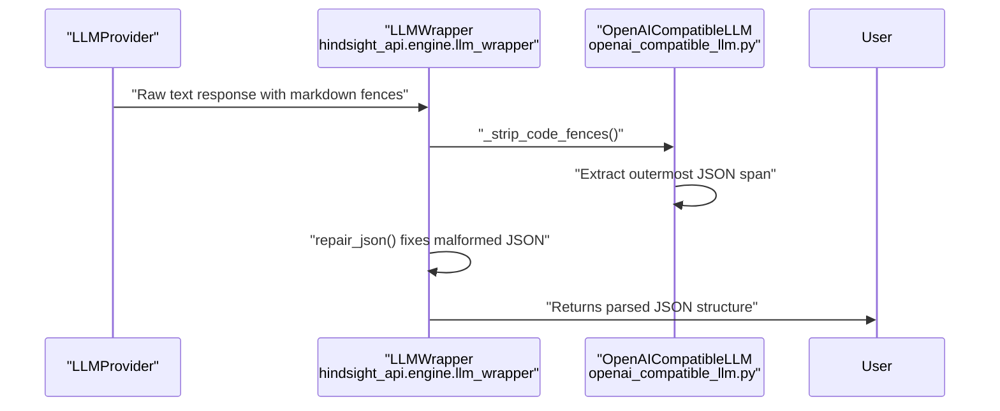

<!-- source: DeepWiki mcp.deepwiki.com · repo vectorize-io/hindsight · page 10.5 Provider Configuration Matrix · fetched 2026-10-26 -->

# Provider Configuration Matrix

Relevant source files

The following files were used as context for generating this wiki page:

- [.env.example](.env.example)
- [hindsight-api-slim/hindsight_api/config.py](hindsight-api-slim/hindsight_api/config.py)
- [hindsight-api-slim/hindsight_api/engine/cross_encoder.py](hindsight-api-slim/hindsight_api/engine/cross_encoder.py)
- [hindsight-api-slim/hindsight_api/engine/embeddings.py](hindsight-api-slim/hindsight_api/engine/embeddings.py)
- [hindsight-api-slim/hindsight_api/engine/llm_wrapper.py](hindsight-api-slim/hindsight_api/engine/llm_wrapper.py)
- [hindsight-api-slim/hindsight_api/engine/providers/litellm_llm.py](hindsight-api-slim/hindsight_api/engine/providers/litellm_llm.py)
- [hindsight-api-slim/hindsight_api/engine/providers/openai_compatible_llm.py](hindsight-api-slim/hindsight_api/engine/providers/openai_compatible_llm.py)
- [hindsight-api-slim/tests/test_litellm_sdk_embeddings.py](hindsight-api-slim/tests/test_litellm_sdk_embeddings.py)
- [hindsight-api-slim/tests/test_openai_compatible_response_hardening.py](hindsight-api-slim/tests/test_openai_compatible_response_hardening.py)
- [hindsight-docs/docs/developer/configuration.mdx](hindsight-docs/docs/developer/configuration.mdx)
- [hindsight-docs/docs/developer/models.mdx](hindsight-docs/docs/developer/models.mdx)
- [hindsight-docs/src/data/llmProviders.json](hindsight-docs/src/data/llmProviders.json)
- [hindsight-embed/hindsight_embed/env.example](hindsight-embed/hindsight_embed/env.example)
- [skills/hindsight-docs/references/developer/configuration.md](skills/hindsight-docs/references/developer/configuration.md)
- [skills/hindsight-docs/references/developer/models.md](skills/hindsight-docs/references/developer/models.md)
- [skills/hindsight-docs/references/faq.md](skills/hindsight-docs/references/faq.md)

This page provides a comprehensive matrix of AI provider options in Hindsight, covering support for operations (`retain`, `recall`, `reflect`, `consolidate`), latency, cost trade-offs, local versus cloud deployment considerations, and recommendations for development and production setups. It bridges the gap between Hindsight's natural language operation concepts and the internal code entities implementing provider integrations.

---

## Provider Architecture Overview

Hindsight modularizes its AI/ML capabilities into three independent provider systems implemented via abstract interfaces: **LLM** for reasoning and generation [hindsight-api-slim/hindsight_api/engine/llm_interface.py:47-52](), **Embeddings** for vectorization [hindsight-api-slim/hindsight_api/engine/embeddings.py:146-152](), and **Cross-Encoder Rerankers** for precision ranking [hindsight-api-slim/hindsight_api/engine/cross_encoder.py:141-147](). This architecture allows independent optimization of latency, cost, and feature support according to the operation context orchestrated by `MemoryEngine` [hindsight-api-slim/hindsight_api/engine/memory_engine.py:2-10]().

### Provider Interaction Flow Diagram

```mermaid
graph TB
    subgraph "Core Operations"
        RETAIN["retain_pipeline<br/>hindsight_api.engine.retain"]
        RECALL["recall<br/>hindsight_api.engine.search"]
        REFLECT["run_reflect_agent<br/>hindsight_api.engine.reflect.agent"]
        CONSOLIDATE["consolidate<br/>hindsight_api.engine.consolidation"]
    end

    subgraph "LLM Providers [LLMInterface]"
        LLM_OPENAI["OpenAICompatibleLLM<br/>engine.providers.openai_compatible_llm"]
        LLM_ANTHROPIC["AnthropicLLM<br/>engine.providers.anthropic_llm"]
        LLM_LITELLM["LiteLLMLLM<br/>engine.providers.litellm_llm"]
        LLM_GEMINI["GeminiLLM<br/>engine.providers.gemini_llm"]
    end

    subgraph "Embedding Providers [Embeddings]"
        EMB_LOCAL["LocalSTEmbeddings<br/>engine.embeddings.LocalSTEmbeddings"]
        EMB_TEI["TEIEmbeddings<br/>engine.embeddings.TEIEmbeddings"]
        EMB_OPENAI["OpenAIEmbeddings<br/>engine.embeddings.OpenAIEmbeddings"]
    end

    subgraph "Cross-Encoder Rerankers [CrossEncoderModel]"
        RERANK_LOCAL["LocalSTCrossEncoder<br/>engine.cross_encoder.LocalSTCrossEncoder"]
        RERANK_COHERE["CohereCrossEncoder<br/>engine.cross_encoder.CohereCrossEncoder"]
        RERANK_FLASH["FlashRankCrossEncoder<br/>engine.cross_encoder.FlashRankCrossEncoder"]
    end

    RETAIN -->|Uses| LLM_OPENAI & LLM_ANTHROPIC & LLM_LITELLM & LLM_GEMINI
    REFLECT -->|Uses| LLM_OPENAI & LLM_ANTHROPIC & LLM_LITELLM & LLM_GEMINI
    CONSOLIDATE -->|Uses| LLM_OPENAI & LLM_ANTHROPIC & LLM_LITELLM & LLM_GEMINI

    RECALL -->|Semantic search vectors from| EMB_LOCAL & EMB_OPENAI & EMB_TEI
    RECALL -->|Rerank results with| RERANK_LOCAL & RERANK_COHERE & RERANK_FLASH

    RETAIN -.->|Embeds stored facts with| EMB_LOCAL & EMB_OPENAI
```

Sources:  
[hindsight-api-slim/hindsight_api/engine/memory_engine.py:2-10](),  
[hindsight-api-slim/hindsight_api/engine/llm_interface.py:47-55](),  
[hindsight-api-slim/hindsight_api/engine/embeddings.py:146-152](),  
[hindsight-api-slim/hindsight_api/engine/cross_encoder.py:141-147]()

---

## LLM Provider Matrix

LLM providers handle fact extraction during `retain` [skills/hindsight-docs/references/developer/models.md:8-18](), multi-step reasoning during `reflect` [skills/hindsight-docs/references/developer/models.md:8-18](), and mental model consolidation in the background worker [skills/hindsight-docs/references/developer/models.md:8-18](). Global configuration and provider selection are managed via environment variables defined in [hindsight-api-slim/hindsight_api/config.py:152-170]() and `.env.example:4-12]().

| Provider | Code Entity | Auth Method | Typical Latency | Special Features |
|---|---|---|---|---|
| `openai` | `OpenAICompatibleLLM` [hindsight-api-slim/hindsight_api/engine/providers/openai_compatible_llm.py:1-20]() | API Key | Medium | Strict JSON schema, Azure-compatible, batch API support [skills/hindsight-docs/references/developer/models.md:106-112]() |
| `openai-responses` | `OpenAICompatibleLLM` [hindsight-api-slim/hindsight_api/engine/providers/openai_compatible_llm.py:1-20]() | API Key | Medium | Responses API supports reasoning with tools coexistence [skills/hindsight-docs/references/developer/models.md:64-70]() |
| `anthropic` | `AnthropicLLM` | API Key | Medium | Extended thinking, prompt caching, function tool calls [skills/hindsight-docs/references/developer/models.md:106-112]() |
| `gemini` | `GeminiLLM` | API Key | Low-Medium | Google Gemini & Vertex AI support, batch API, prompt caching [skills/hindsight-docs/references/developer/models.md:106-112]() |
| `litellm` | `LiteLLMLLM` [hindsight-api-slim/hindsight_api/engine/providers/litellm_llm.py:144-156]() | Various | Variable | Supports 100+ cloud providers including Bedrock and Azure [skills/hindsight-docs/references/developer/models.md:51-55]() |
| `llamacpp` | `LlamaCppLLM` | Local (no key) | Low | Fully local GGUF model, zero external dependencies [skills/hindsight-docs/references/developer/models.md:85-90]() |

### Concurrency and Rate Limiting

To prevent resource exhaustion and rate-limit violations, Hindsight enforces concurrency limits via a layered semaphore system implemented in [hindsight-api-slim/hindsight_api/engine/llm_wrapper.py:59-102]():
- **Global Concurrency Semaphore**: Bounded by `HINDSIGHT_API_LLM_MAX_CONCURRENT` across all tasks [hindsight-api-slim/hindsight_api/engine/llm_wrapper.py:60-68]().
- **Per-Operation Semaphores**: Configured via `_build_per_op_semaphores()` for `retain`, `reflect`, `consolidation`, and `mental_model_refresh` to reserve pipeline headroom [hindsight-api-slim/hindsight_api/engine/llm_wrapper.py:71-102]().

Sources:  
[hindsight-api-slim/hindsight_api/config.py:152-170](),  
[hindsight-api-slim/hindsight_api/engine/llm_wrapper.py:59-105](),  
[skills/hindsight-docs/references/developer/models.md:8-112](),  
[.env.example:4-12]()

---

## Embedding Provider Matrix

Embedding providers convert raw text chunks and recall queries into semantic vector representations [hindsight-api-slim/hindsight_api/engine/embeddings.py:146-152]().

| Provider | Code Entity | Default Model | Embedding Dimension | Use Case |
|---|---|---|---|---|
| `local` | `LocalSTEmbeddings` [hindsight-api-slim/hindsight_api/engine/embeddings.py:1-10]() | `BAAI/bge-small-en-v1.5` [skills/hindsight-docs/references/developer/models.md:9-10]() | 384 | Zero-cost local embedding for development and embedded mode |
| `openai` | `OpenAIEmbeddings` [hindsight-api-slim/hindsight_api/engine/embeddings.py:1-10]() | `text-embedding-3-small` | 1536 | Production default, robust API |
| `tei` | `TEIEmbeddings` [hindsight-api-slim/hindsight_api/engine/embeddings.py:1-10]() | Custom TEI remote endpoint | Variable | GPU-backed local cluster with scalable throughput |
| `gemini` | `GeminiEmbeddings` [hindsight-api-slim/hindsight_api/engine/embeddings.py:1-10]() | `text-embedding-004` | 768 | Low-latency native GCP embeddings |

Sources:  
[hindsight-api-slim/hindsight_api/engine/embeddings.py:146-188](),  
[skills/hindsight-docs/references/developer/models.md:7-18]()

---

## Cross-Encoder Reranker Matrix

Cross-encoder rerankers score query-document candidate pairs to reorder retrieval results by precision [hindsight-api-slim/hindsight_api/engine/cross_encoder.py:141-147]().

| Provider | Code Entity | Default Model | Latency | Use Case |
|---|---|---|---|---|
| `local` | `LocalSTCrossEncoder` [hindsight-api-slim/hindsight_api/engine/cross_encoder.py:1-8]() | `ms-marco-MiniLM-L-6-v2` [skills/hindsight-docs/references/developer/models.md:13-14]() | Low (~80ms / 100 pairs) | On-device CPU reranking for development |
| `cohere` | `CohereCrossEncoder` [hindsight-api-slim/hindsight_api/engine/cross_encoder.py:1-8]() | Multiple Cohere models | Medium | Cloud-based high-precision reranking |
| `flashrank` | `FlashRankCrossEncoder` [hindsight-api-slim/hindsight_api/engine/cross_encoder.py:1-8]() | `ms-marco-MiniLM-L-6-v2` | Very Low (CPU only) | Fast local reranker for high throughput |

Sources:  
[hindsight-api-slim/hindsight_api/engine/cross_encoder.py:141-175](),  
[skills/hindsight-docs/references/developer/models.md:10-14]()

---

## LLM Response Normalization and Provider Quirks

Hindsight unifies diverse LLM provider outputs into strict schemas through normalization routines in `llm_wrapper.py` and `openai_compatible_llm.py` [hindsight-api-slim/hindsight_api/engine/llm_wrapper.py:1-15](), [hindsight-api-slim/hindsight_api/engine/providers/openai_compatible_llm.py:1-20]().

### LLM Response Normalization Flow

Key normalization steps include removing markdown fences, isolating JSON spans, and repairing truncated or invalid syntax via `json_repair` [hindsight-api-slim/hindsight_api/engine/llm_wrapper.py:13-15]().

Sources:  
[hindsight-api-slim/hindsight_api/engine/llm_wrapper.py:1-15](),  
[hindsight-api-slim/hindsight_api/engine/providers/openai_compatible_llm.py:1-20]()

---

## Configuration Recommendations and Trade-offs

### Development Setup (Local-First)
- **LLM**: `ollama` or `lmstudio` (e.g., Qwen 2.5) with `HINDSIGHT_API_LLM_MAX_CONCURRENT=1` [hindsight-api-slim/hindsight_api/config.py:152-170]().
- **Embeddings**: `local` (`BAAI/bge-small-en-v1.5`) [skills/hindsight-docs/references/developer/models.md:9-10]().
- **Reranker**: `local` (`ms-marco-MiniLM-L-6-v2`) [skills/hindsight-docs/references/developer/models.md:13-14]().

### Production Setup (Scalable Cloud)
- **LLM Retain**: `openai` (`gpt-4o-mini`) for fast and reliable fact extraction [skills/hindsight-docs/references/developer/models.md:18-24]().
- **LLM Reflect**: `anthropic` (`claude-3-5-sonnet`) or `openai-responses` for advanced reasoning [skills/hindsight-docs/references/developer/models.md:22-26]().
- **Embeddings**: `openai` (`text-embedding-3-small`) or `tei` cluster.
- **Reranker**: `cohere` or `tei` reranker.

Sources:  
[hindsight-api-slim/hindsight_api/config.py:152-170](),  
[skills/hindsight-docs/references/developer/models.md:8-55]()

---

## Summary Table of Provider Operation Support

| Provider Type | Supported Operations | Local vs Cloud | Typical Latency | Recommended Use Case |
|---|---|---|---|---|
| **LLM** | `retain`, `reflect`, `consolidate` [skills/hindsight-docs/references/developer/models.md:8-18]() | Both | Low to Medium | Production (OpenAI, Anthropic), Dev (Ollama, LM Studio) |
| **Embedding** | `recall` vector search [hindsight-api-slim/hindsight_api/engine/embeddings.py:146-188]() | Both | Low | Production (OpenAI, TEI), Dev (LocalSTEmbeddings) |
| **Cross-Encoder** | `recall` reranking [hindsight-api-slim/hindsight_api/engine/cross_encoder.py:141-147]() | Both | Low to Medium | Production high-precision (Cohere), Dev local (LocalSTCrossEncoder) |

Sources:  
[skills/hindsight-docs/references/developer/models.md:8-18](),  
[hindsight-api-slim/hindsight_api/engine/embeddings.py:146-188](),  
[hindsight-api-slim/hindsight_api/engine/cross_encoder.py:141-147]()

---

