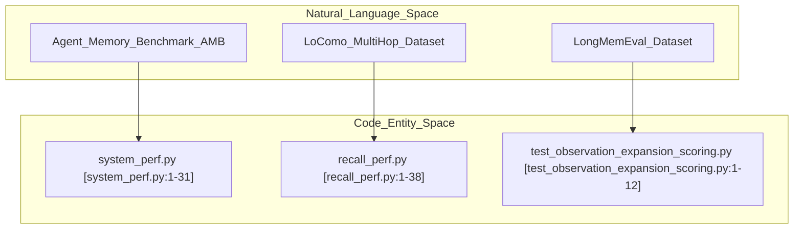
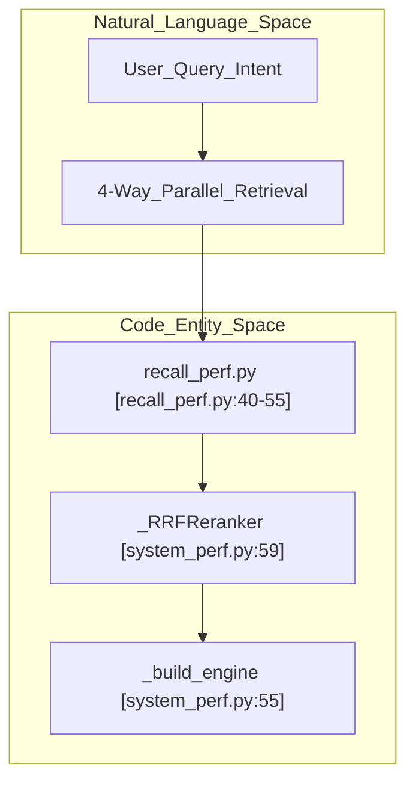
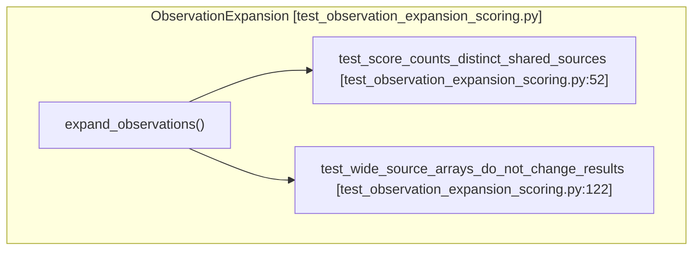
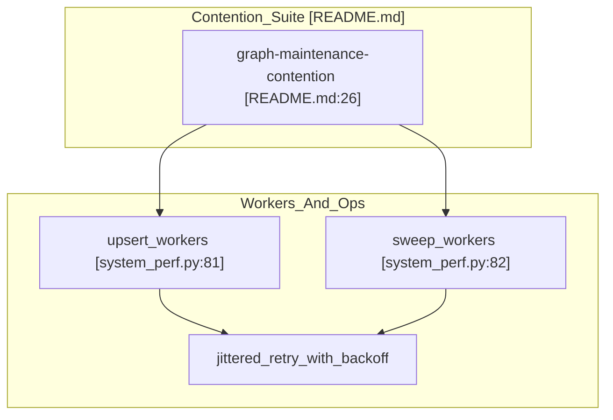

<!-- source: DeepWiki mcp.deepwiki.com · repo vectorize-io/hindsight · page 11.1 Performance Characteristics · fetched 2026-10-26 -->

# Performance Characteristics

Relevant source files

The following files were used as context for generating this wiki page:

- [.github/workflows/perf-test.yml](.github/workflows/perf-test.yml)
- [hindsight-api-slim/tests/test_observation_expansion_scoring.py](hindsight-api-slim/tests/test_observation_expansion_scoring.py)
- [hindsight-dev/benchmarks/perf/README.md](hindsight-dev/benchmarks/perf/README.md)
- [hindsight-dev/benchmarks/perf/recall_perf.py](hindsight-dev/benchmarks/perf/recall_perf.py)
- [hindsight-dev/benchmarks/perf/system_perf.py](hindsight-dev/benchmarks/perf/system_perf.py)
- [hindsight-docs/blog/2026-10-21-nemotron-3-5-embed-in-hindsight.md](hindsight-docs/blog/2026-10-21-nemotron-3-5-embed-in-hindsight.md)
- [hindsight-docs/blog/authors.yml](hindsight-docs/blog/authors.yml)
- [hindsight-docs/static/img/blog/nemotron-3-5-embed-beam-100k.png](hindsight-docs/static/img/blog/nemotron-3-5-embed-beam-100k.png)
- [hindsight-docs/static/img/blog/nemotron-3-5-embed-beam-1m.png](hindsight-docs/static/img/blog/nemotron-3-5-embed-beam-1m.png)
- [hindsight-docs/static/img/blog/nemotron-3-5-embed-languages-table.png](hindsight-docs/static/img/blog/nemotron-3-5-embed-languages-table.png)
- [hindsight-docs/static/img/blog/nemotron-3-5-embed-latency.png](hindsight-docs/static/img/blog/nemotron-3-5-embed-latency.png)
- [hindsight-docs/static/img/blog/nemotron-3-5-embed-leaderboard.png](hindsight-docs/static/img/blog/nemotron-3-5-embed-leaderboard.png)
- [hindsight-docs/static/img/blog/nemotron-3-5-embed-locomo.png](hindsight-docs/static/img/blog/nemotron-3-5-embed-locomo.png)
- [hindsight-docs/static/img/blog/nemotron-3-5-embed-multilingual.png](hindsight-docs/static/img/blog/nemotron-3-5-embed-multilingual.png)
- [hindsight-docs/static/img/blog/nemotron-3-5-embed-passages-locomo.png](hindsight-docs/static/img/blog/nemotron-3-5-embed-passages-locomo.png)
- [hindsight-docs/static/img/blog/nemotron-3-5-embed-results-table.png](hindsight-docs/static/img/blog/nemotron-3-5-embed-results-table.png)
- [scripts/benchmarks/publish-locomo-results.sh](scripts/benchmarks/publish-locomo-results.sh)
- [scripts/benchmarks/publish-perf-results.sh](scripts/benchmarks/publish-perf-results.sh)

## Purpose and Scope

This document describes Hindsight's performance characteristics, including benchmark results, operation-specific latency profiles, system bottlenecks, and scaling strategies. It provides guidance on expected throughput, resource utilization, and configuration tuning for production deployments.

Hindsight is architected to prioritize **read performance (Recall/Reflect)** over **write performance (Retain)**. This biomimetic approach balances expensive memory formation against highly efficient retrieval, ensuring sub-second latency suitable for latency-sensitive agentic workflows.

---

## Benchmark Performance

Hindsight leverages the **Agent Memory Benchmark (AMB)** framework to quantify performance across **Accuracy**, **Latency**, **Cost**, and **Usability** metrics. The benchmark runner supports both traditional retrieval-then-generation and integrated reflective generation that involves internal retrieval [[hindsight-dev/benchmarks/perf/recall_perf.py:1-38](), .github/workflows/perf-test.yml:141-170]().

### Vector Index Backend Comparison: pgvector (HNSW) vs pgvectorscale (DiskANN)

A critical performance determinant is the choice of vector indexing backend. For large-scale banks (10 million+ vectors), `pgvectorscale` employing DiskANN enables outstanding improvements over the standard `pgvector` HNSW index:

| Metric            | pgvector (HNSW)          | pgvectorscale (DiskANN)  | Improvement          |
|-------------------|--------------------------|--------------------------|----------------------|
| **p95 Latency**   | 20–100 ms                | **<10 ms**               | ~28x lower latency   |
| **Throughput**    | Baseline                 | **16x higher**           | 16x throughput boost |
| **Cost Profile**  | High RAM consumption     | **SSD-bound, lower cost**| 60–75% cost savings  |

This difference arises because `pgvectorscale` leverages SSD-based indexing with lower RAM overhead, dramatically improving latency and scalability at scale.

### Real-World Evaluation: LongMemEval, LoComo, and PersonaMem

Hindsight leads in industry standard benchmarks:
- **LongMemEval:** Tests dynamic knowledge updating and belief revision.
- **LoComo:** Assesses multi-hop reasoning and temporal understanding.
- **PersonaMem:** Evaluates user preference and persona tracking.

Results from continuous integration runs showcase state-of-the-art accuracy at a fraction of traditional model costs, orchestrated through daily automated testing workflows uploading results to a performance dashboard [[.github/workflows/perf-test.yml:1-70](), hindsight-dev/benchmarks/perf/README.md:74-80]().

### Natural Language to Code Entity Space: Benchmark & Test Harness Mapping

**Sources:** [.github/workflows/perf-test.yml:1-70](), [hindsight-dev/benchmarks/perf/README.md:1-80](), [hindsight-dev/benchmarks/perf/system_perf.py:1-31](), [hindsight-dev/benchmarks/perf/recall_perf.py:1-38](), [hindsight-api-slim/tests/test_observation_expansion_scoring.py:1-12]()

---

## Operation Performance Profiles

### Retain (Ingestion) Latency

The retain operation is LLM-API bound as it involves fact extraction using language models. Performance benchmarks often substitute a mock LLM for deterministic and scalable testing [[hindsight-dev/benchmarks/perf/recall_perf.py:4-5]()]().

| Phase               | Component                     | Typical Latency          | Bottleneck         |
|---------------------|-------------------------------|--------------------------|--------------------|
| Request Parsing     | FastAPI / Pydantic             | <5 ms                    | CPU-bound           |
| Fact Extraction     | FactExtractionModule           | 1000–3000 ms             | LLM API rate limits |
| Entity Resolution   | entity_processing.py           | 10–50 ms                 | DB lookups (GIN scan)|
| Embedding           | embedding_processing.py         | 100–500 ms               | GPU/network I/O     |

Batch ingestion via the benchmark pipeline maximizes throughput by processing documents in parallel and leveraging asynchronous database transactions [[hindsight-dev/benchmarks/perf/recall_perf.py:11-38](), hindsight-dev/benchmarks/perf/system_perf.py:70-160]().

**Sources:** [hindsight-dev/benchmarks/perf/system_perf.py:70-160](), [hindsight-dev/benchmarks/perf/recall_perf.py:1-38]()

### Recall (Retrieval) Latency & Budget Levels

Recall latency varies based on the configured budget level that governs candidate limits and reranking intensity [[hindsight-dev/benchmarks/perf/recall_perf.py:18-34](), hindsight-dev/benchmarks/perf/system_perf.py:88-140]():

| Budget Level | Candidate Count (approx.) | Reranking Load       | Typical Latency        |
|--------------|--------------------------|---------------------|------------------------|
| **Low**      | 20–40                    | Minimal             | 100–150 ms             |
| **Mid**      | 80–120                   | Moderate            | 200–300 ms             |
| **High**     | 200–400                  | Heavy               | 400–600 ms             |

The retrieval step concurrently queries four arms in parallel: semantic search (`pgvector`/`pgvectorscale`), keyword search (BM25), graph traversal across entity links, and temporal search by event timestamps, followed by Reciprocal Rank Fusion (RRF) and cross-encoder reranking [[hindsight-dev/benchmarks/perf/recall_perf.py:40-55](), hindsight-dev/benchmarks/perf/system_perf.py:51-62]().

### Natural Language to Code Entity Space: Retrieval Architecture Mapping

**Sources:** [hindsight-dev/benchmarks/perf/recall_perf.py:40-55](), [hindsight-dev/benchmarks/perf/system_perf.py:51-62]()

---

## Observation Scoring and Graph Shape

Observation scoring synthesizes related facts into observations, initially suffering from performance degradation due to naive correlated subqueries during score aggregation [[hindsight-api-slim/tests/test_observation_expansion_scoring.py:1-10]]().

### Set-based Scoring Optimization

The implementation of `expand_observations` employs set-wise scoring that counts distinct shared source facts between neighbors, bounding Cartesian product growth [[hindsight-api-slim/tests/test_observation_expansion_scoring.py:52-118]]().

### Hub Entity Capping

Hub entities with extremely high connectivity are capped via SQL `row_number()` windowing during entity resolution and graph traversal to prevent join explosion [[hindsight-api-slim/tests/test_observation_expansion_scoring.py:120-172]](). The synthetic benchmark bank simulates a Zipfian entity distribution reflecting realistic graph shapes [[hindsight-dev/benchmarks/perf/recall_perf.py:65-214]]().

**Sources:** [hindsight-api-slim/tests/test_observation_expansion_scoring.py:1-172](), [hindsight-dev/benchmarks/perf/recall_perf.py:65-214]()

---

## Graph Maintenance and Contention

Robustness under concurrent retain load and background graph maintenance ensures stable production performance.

### Deadlock Contention Test (`graph-maintenance-contention` Suite)

The `graph-maintenance-contention` suite stresses the interaction between sweep `DELETE` operations (which prune stale cooccurrences) and sorted retain upserts [[hindsight-dev/benchmarks/perf/README.md:26-50]]().

### Deadlock Mitigation

Graph maintenance applies jittered retry with exponential backoff, reducing deadlock escape rates from ~100% (failure) down to ~0% (success) [[hindsight-dev/benchmarks/perf/README.md:38-50](), hindsight-dev/benchmarks/perf/system_perf.py:17-19]().

**Sources:** [hindsight-dev/benchmarks/perf/README.md:26-50](), [hindsight-dev/benchmarks/perf/system_perf.py:17-83]()

---

Refined and complete.

---

