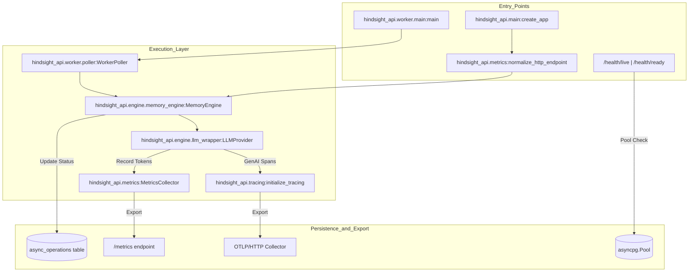
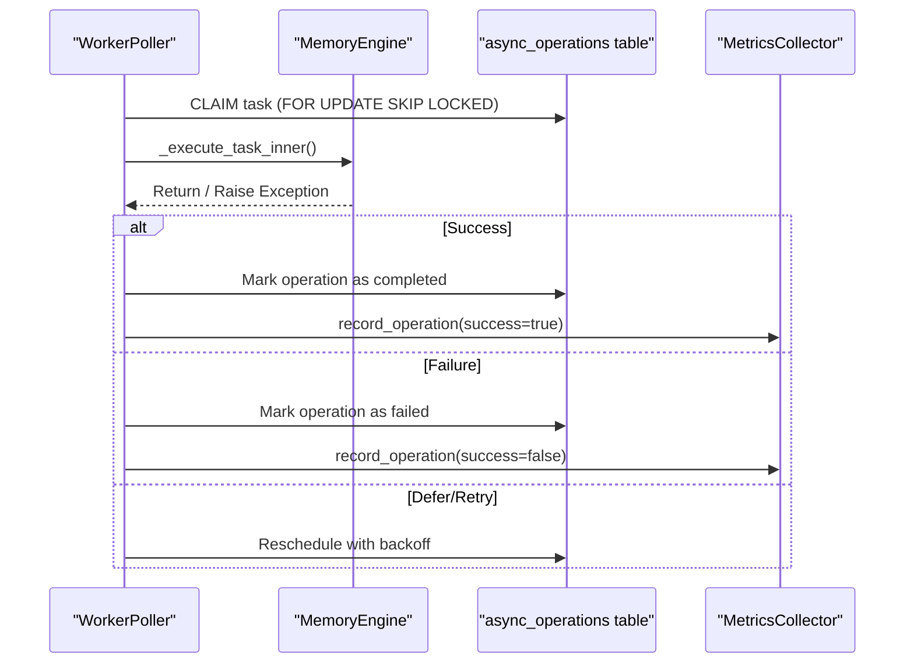

<!-- source: DeepWiki mcp.deepwiki.com · repo vectorize-io/hindsight · page 11.2 Monitoring and Observability · fetched 2026-10-26 -->

# Monitoring and Observability

Relevant source files

The following files were used as context for generating this wiki page:

- [hindsight-api-slim/hindsight_api/alembic/versions/e4a7c1b9d2f6_drop_memory_units_access_count.py](hindsight-api-slim/hindsight_api/alembic/versions/e4a7c1b9d2f6_drop_memory_units_access_count.py)
- [hindsight-api-slim/hindsight_api/engine/audit.py](hindsight-api-slim/hindsight_api/engine/audit.py)
- [hindsight-api-slim/hindsight_api/engine/background_writes.py](hindsight-api-slim/hindsight_api/engine/background_writes.py)
- [hindsight-api-slim/hindsight_api/engine/db/optional_routines.py](hindsight-api-slim/hindsight_api/engine/db/optional_routines.py)
- [hindsight-api-slim/hindsight_api/engine/llm_trace.py](hindsight-api-slim/hindsight_api/engine/llm_trace.py)
- [hindsight-api-slim/hindsight_api/engine/task_backend.py](hindsight-api-slim/hindsight_api/engine/task_backend.py)
- [hindsight-api-slim/hindsight_api/metrics.py](hindsight-api-slim/hindsight_api/metrics.py)
- [hindsight-api-slim/hindsight_api/tracing.py](hindsight-api-slim/hindsight_api/tracing.py)
- [hindsight-api-slim/hindsight_api/worker/main.py](hindsight-api-slim/hindsight_api/worker/main.py)
- [hindsight-api-slim/hindsight_api/worker/poller.py](hindsight-api-slim/hindsight_api/worker/poller.py)
- [hindsight-api-slim/tests/conftest.py](hindsight-api-slim/tests/conftest.py)
- [hindsight-api-slim/tests/test_async_batch_retain.py](hindsight-api-slim/tests/test_async_batch_retain.py)
- [hindsight-api-slim/tests/test_audit_per_bank.py](hindsight-api-slim/tests/test_audit_per_bank.py)
- [hindsight-api-slim/tests/test_background_writes.py](hindsight-api-slim/tests/test_background_writes.py)
- [hindsight-api-slim/tests/test_backlog_metrics.py](hindsight-api-slim/tests/test_backlog_metrics.py)
- [hindsight-api-slim/tests/test_llm_provider.py](hindsight-api-slim/tests/test_llm_provider.py)
- [hindsight-api-slim/tests/test_llm_trace.py](hindsight-api-slim/tests/test_llm_trace.py)
- [hindsight-api-slim/tests/test_metrics.py](hindsight-api-slim/tests/test_metrics.py)
- [hindsight-api-slim/tests/test_migration_drop_access_count.py](hindsight-api-slim/tests/test_migration_drop_access_count.py)
- [hindsight-api-slim/tests/test_tracing.py](hindsight-api-slim/tests/test_tracing.py)
- [hindsight-api-slim/tests/test_tracing_context_propagation.py](hindsight-api-slim/tests/test_tracing_context_propagation.py)
- [hindsight-api-slim/tests/test_tracing_task_handoff.py](hindsight-api-slim/tests/test_tracing_task_handoff.py)
- [hindsight-api-slim/tests/test_worker.py](hindsight-api-slim/tests/test_worker.py)
- [hindsight-api-slim/tests/test_worker_main.py](hindsight-api-slim/tests/test_worker_main.py)
- [hindsight-docs/docs/developer/monitoring.md](hindsight-docs/docs/developer/monitoring.md)
- [skills/hindsight-docs/references/developer/monitoring.md](skills/hindsight-docs/references/developer/monitoring.md)

Hindsight provides a comprehensive technical observability suite designed for high-reliability agentic memory. This includes OpenTelemetry-based metrics, health probes for orchestration, distributed tracing, and specialized monitoring for LLM token usage, background worker health, and database performance. The system integrates metrics and tracing from the API entry points through the memory engine and LLM interaction layers to the async task workers and exports these for visualization and alerting.

---

## Observability Architecture

The observability stack is integrated directly into `MemoryEngine`, the FastAPI service layer (`hindsight_api.main`), and the standalone worker process (`hindsight_api.worker.main`). It captures data from the request entry point through background task execution and external provider calls.

**Observability Data Flow**

This diagram illustrates the flow of observability signals:

- The **API server** (`create_app`) and the **worker CLI** (`main`) serve HTTP endpoints for health and metrics [hindsight-api-slim/hindsight_api/worker/main.py:77-166]().
- Requests pass through metrics normalization and collection middleware [hindsight-api-slim/hindsight_api/metrics.py:1-12]().
- The `MemoryEngine` orchestrates memory operations, invoking LLM calls wrapped with tracing and metrics [hindsight-api-slim/hindsight_api/metrics.py:45-60]().
- Async operations are tracked in the `async_operations` Postgres table as a persistent source of truth.
- LLM API call details and token usage are captured for latency and cost analysis [hindsight-api-slim/hindsight_api/engine/llm_trace.py:1-27]().
- Prometheus-compatible `/metrics` endpoints export aggregated metrics for scraping [hindsight-api-slim/hindsight_api/worker/main.py:160-170]().
- Tracing exports flows to OTLP-compatible backends (e.g., Langfuse) [hindsight-api-slim/hindsight_api/tracing.py:10-210]().
- Health endpoints probe the database connection pool to monitor availability [hindsight-api-slim/hindsight_api/worker/main.py:107-136]().

**Sources:**  
[hindsight-api-slim/hindsight_api/metrics.py:1-12](),  
[hindsight-api-slim/hindsight_api/worker/main.py:55-170](),  
[hindsight-api-slim/hindsight_api/tracing.py:1-11](),  
[hindsight-docs/docs/developer/monitoring.md:50-62]()

---

## Metrics and Instrumentation

Hindsight uses OpenTelemetry (OTel) for metrics instrumentation visible in both API and worker processes. Metrics are exposed via a Prometheus-compatible endpoint at `/metrics` in both API and worker HTTP services.

### Metrics Initialization

The `initialize_metrics` function sets up the global OTel meter provider, including custom histogram views with explicit buckets tailored to Hindsight's operation latency profiles. It also configures the `PrometheusMetricReader` to expose metrics for scraping [hindsight-api-slim/hindsight_api/metrics.py:173-190]().

Metrics are configured to include latency histograms and counters across multiple dimensions, such as operation type (`retain`, `recall`, `reflect`), source (`api`, `worker`, `reflect`), and optionally per bank.

### Key Metrics Tracked

- **Operation Latency and Totals:** Instrumentation tracks durations and counts for key operations such as `retain`, `recall`, `reflect`, and asynchronous worker tasks like `consolidation`. Metrics include labels:

  - `operation`: e.g., `retain`, `reflect`
  - `bank_id`: optional, excluded by default to avoid high-cardinality OTel growth [hindsight-api-slim/hindsight_api/metrics.py:105-106]()
  - `source`: origin of the operation call (`api`, `reflect`, `internal`, `worker`)
  - `budget` and `max_tokens`: operation budget metadata
  - `success`: whether operation succeeded (`true` or `false`) [hindsight-api-slim/hindsight_api/metrics.py:107-138]()

- **LLM Call Metrics:** LLM invocations record latency, input/output token counts, cache hits, and error/success status per scope (`memory`, `reflect`, `consolidation`) and provider details.

- **HTTP Request Metrics:** Latency, count, and status code per HTTP method and normalized endpoint path are tracked while replacing path parameters with tokens to limit cardinality.

- **Database Connection Pool:** Connection counts and usage stats from `asyncpg` pools are captured.

- **Process Metrics:** Resident Set Size (RSS) memory is sampled using Linux `/proc/self/statm` for memory leak and saturation alerts [hindsight-api-slim/hindsight_api/worker/poller.py:115-129]().

- **Worker Backlog Gauges:** Cached counts of pending async operations in the `async_operations` table give quick insights into task queue sizes [hindsight-api-slim/hindsight_api/metrics.py:103-108]().

### Token Usage Bucketing

Token usage metrics employ bucketing to reduce metric label cardinality:

| Token Count Range | Bucket Label |
|-------------------|--------------|
| 0 - 100           | `0-100`      |
| 100 - 500         | `100-500`    |
| 500 - 1,000       | `500-1k`     |
| 1,000 - 5,000     | `1k-5k`      |
| 5,000 - 10,000    | `5k-10k`     |
| 10,000 - 50,000   | `10k-50k`    |
| 50,000+           | `50k+`       |

These buckets map token counts to categorical labels used as metric attributes for LLM calls and token usage analysis [hindsight-api-slim/hindsight_api/metrics.py:126-160]().

**Sources:**  
[hindsight-api-slim/hindsight_api/metrics.py:6-190](), [hindsight-api-slim/hindsight_api/worker/main.py:61-150]()

---

## Grafana Dashboards

Pre-built Grafana dashboards are located in `monitoring/grafana/dashboards/` and are automatically provisioned when using the local development monitoring stack (`./scripts/dev/start-monitoring.sh`) [hindsight-docs/docs/developer/monitoring.md:7-40]().

| Dashboard | Description |
|-----------|-------------|
| **Hindsight Operations** | Operation rates, latency percentiles, per-bank metrics |
| **Hindsight LLM Metrics** | LLM calls, token usage, latency by scope/provider |
| **Hindsight API Service** | HTTP requests, error rates, DB pool, process metrics |

**Sources:**  
[hindsight-docs/docs/developer/monitoring.md:30-40]()

---

## Distributed Tracing and Context Propagation

Hindsight integrates OpenTelemetry distributed tracing with optional OTLP export to support detailed request and LLM call analysis.

### Tracing Features

- LLM calls are traced as spans using the OpenTelemetry GenAI semantic conventions [hindsight-api-slim/hindsight_api/tracing.py:103-130](), capturing:
  - Provider and model names
  - Input prompt and output completion contents (safely truncated)
  - Token usage (input, output, cached, and totals)
  - Finish reasons and errors if any
  - Tool call metadata when applicable

- Tracing context is propagated through async call chains via `ContextVar` instances (`LLMTraceContext`) [hindsight-api-slim/hindsight_api/engine/llm_trace.py:70-96](). The tracing recorder is registered centrally and captures every LLM call without explicit instrumentation across business logic.

- Tracing can be enabled via environment variables such as `HINDSIGHT_API_OTEL_TRACES_ENABLED` and configured for OTLP endpoint export [hindsight-docs/docs/developer/monitoring.md:20-25]().

- When tracing is disabled, a `NoOpTracer` is used to minimize overhead while maintaining interface compatibility [hindsight-api-slim/hindsight_api/tracing.py:52-92]().

- Internal provider names (e.g., `gemini`, `openai`) are mapped to GenAI-compliant names (`google`, `openai`) for interoperability [hindsight-api-slim/hindsight_api/tracing.py:131-147]().

**Sources:**  
[hindsight-api-slim/hindsight_api/engine/llm_trace.py:1-161](), [hindsight-api-slim/hindsight_api/tracing.py:10-210]()

---

## LLM Trace Capture

Hindsight captures detailed traces of every model call through its integration with the OpenTelemetry GenAI tracing conventions and `LLMTraceRecorder` [hindsight-api-slim/hindsight_api/engine/llm_trace.py:1-27]().

- `LLMTraceRecorder` records spans with enriched metadata including bank ID, operation type, tokens used, error details, and prompt/response content [hindsight-api-slim/hindsight_api/engine/llm_trace.py:73-92]().
- Context propagation is managed by context variables (`_trace_ctx`, `_request_ctx`, `_call_metadata_ctx`) to associate calls with their originating bank and operation [hindsight-api-slim/hindsight_api/engine/llm_trace.py:95-107]().
- Traces are buffered and written in batches into the `llm_requests` PostgreSQL table, enabling per-bank token use and cost analysis [hindsight-api-slim/hindsight_api/engine/llm_trace.py:12-16]().
- This feature is controlled by `HINDSIGHT_API_LLM_TRACE_ENABLED`, and scopes can be allowlisted or excluded [hindsight-api-slim/hindsight_api/engine/llm_trace.py:9-10]().
- Failure traces include partial data such as tokens consumed before errors occurred [hindsight-api-slim/hindsight_api/engine/llm_trace.py:110-125]().

**Sources:**  
[hindsight-api-slim/hindsight_api/engine/llm_trace.py:1-161](), [hindsight-api-slim/tests/test_llm_trace.py:1-135]()

---

## Health and Readiness Endpoints

Both the Hindsight API server and each worker expose three HTTP endpoints designed for orchestration health checks [hindsight-docs/docs/developer/monitoring.md:50-62]():

| Endpoint       | Checks Database? | Use Case             |
|----------------|------------------|----------------------|
| `/health/live` | No               | Liveness probes      |
| `/health/ready`| Yes              | Readiness probes     |
| `/health`      | Yes              | Alias for readiness  |

### `/health/live`

- Returns HTTP 200 OK whenever the process event loop is responsive [hindsight-docs/docs/developer/monitoring.md:63-68]().
- Does not perform any I/O, database calls, or external service calls to avoid false failure detection [hindsight-api-slim/hindsight_api/worker/main.py:140-148]().
- Workers add extended information: `worker_id`, `is_shutdown` status, and `seconds_since_last_poll` (time since the last task poll cycle completed) [hindsight-docs/docs/developer/monitoring.md:72-76]().

### `/health/ready` and `/health`

- Perform pooled database connection checks by executing a simple `SELECT 1` [hindsight-docs/docs/developer/monitoring.md:78-85]().
- Return HTTP 200 if the database is reachable and responsive, otherwise 503 [hindsight-docs/docs/developer/monitoring.md:78-80]().
- Payload details include database connection acquisition time (`db_acquire_ms`) and pool waiting count (`db_pool_waiting`) to help diagnose saturation or exhaustion [hindsight-docs/docs/developer/monitoring.md:80-85]().

### Best Practice Warning

Do not point liveness probes at readiness endpoints that check database connectivity. Restarting on transient slowdowns cascades failures and reduces availability. Use readiness probes for dependency health and liveness for process responsiveness [hindsight-docs/docs/developer/monitoring.md:87-99]().

**Sources:**  
[hindsight-api-slim/hindsight_api/worker/main.py:85-135](),  
[hindsight-docs/docs/developer/monitoring.md:52-100]()

---

## Operations and Async Task Tracking

Hindsight employs a database-backed async operations system to manage background tasks including batch retention, file conversion, and consolidation [hindsight-api-slim/hindsight_api/worker/poller.py:1-9]().

### `async_operations` Table

- Stores task metadata: type, status (`pending`, `processing`, `failed`, `completed`, etc.), retry counts, payloads, timestamps, and results.
- Acts as the source of truth for distributed task execution coordination.

### Worker Poller

- `WorkerPoller` claims pending operations from the database using SQL with `FOR UPDATE SKIP LOCKED` semantics to safely claim tasks for processing without duplication or contention across multiple workers [hindsight-api-slim/hindsight_api/worker/poller.py:4-6]().
- Supports concurrency and safe distributed execution by locking rows invisibly to other workers.

### Wall-Clock Timeouts

- The poller enforces wall-clock time ceilings on task execution per operation type (`retain`, `consolidation`, `refresh_mental_model`) [hindsight-api-slim/hindsight_api/worker/poller.py:99-112]().
- If a task exceeds its time budget or appears stalled, the worker logs detailed stack traces to aid debugging of deadlocks or hung calls [hindsight-api-slim/hindsight_api/worker/poller.py:149-162]().

### Task Execution Flow

**Sources:**  
[hindsight-api-slim/hindsight_api/worker/poller.py:1-170](),  
[hindsight-api-slim/tests/test_worker.py:1-40]()

---

## Control Plane Operations View

The Control Plane UI presents real-time and historical status of async operations:

- Views for async task status including lists filtered by status (`pending`, `processing`, `completed`, `failed`, `cancelled`).
- Shows retry counts, timestamps, and operation types.
- UI components auto-refresh to keep operations dashboard up to date.
- Powered by async operations API endpoints that provide comprehensive operation metadata in JSON.

**Sources:**  
[hindsight-api-slim/tests/test_operation_status.py:1-50]()

---

## Summary Table: Observability Components

| Feature                 | Code Entity(s)                         | Description                                         |
|-------------------------|---------------------------------------|-----------------------------------------------------|
| Metrics endpoint         | `hindsight_api.metrics:initialize_metrics`  Worker: `/metrics` in `worker.main:create_worker_app` | Prometheus exposition for API and Worker            |
| Health probes            | `/health/live`, `/health/ready`  `worker.main:create_worker_app` | Separate liveness (no DB) and readiness (with DB)   |
| Distributed tracing      | `hindsight_api.tracing:initialize_tracing`, `engine.llm_trace:LLMTraceRecorder` | OTLP tracing of LLM calls with GenAI semantic conventions |
| Async operations table   | `async_operations` table  `worker.poller.WorkerPoller` | Task claiming, status tracking, retry & completion  |
| Token usage bucketing    | `hindsight_api.metrics:get_token_bucket` | Token counts bucketed for metric label cardinality  |
| Worker backpressure      | `worker.poller` backpressure logic   | Detect and defer tasks under store backpressure     |
| Metrics label normalization | `MetricsCollector`  `metrics:normalize_http_endpoint` | Low-cardinality endpoints, bank/tenant label control|
| Stack dumps on stuck tasks | `worker.poller` on long wall timeouts | Debug deadlocks and hung calls                       |

**Sources:**  
[hindsight-api-slim/hindsight_api/metrics.py:1-190](),  
[hindsight-api-slim/hindsight_api/worker/main.py:55-165](),  
[hindsight-api-slim/hindsight_api/worker/poller.py:1-170](),  
[hindsight-api-slim/hindsight_api/tracing.py:1-210]()

---

