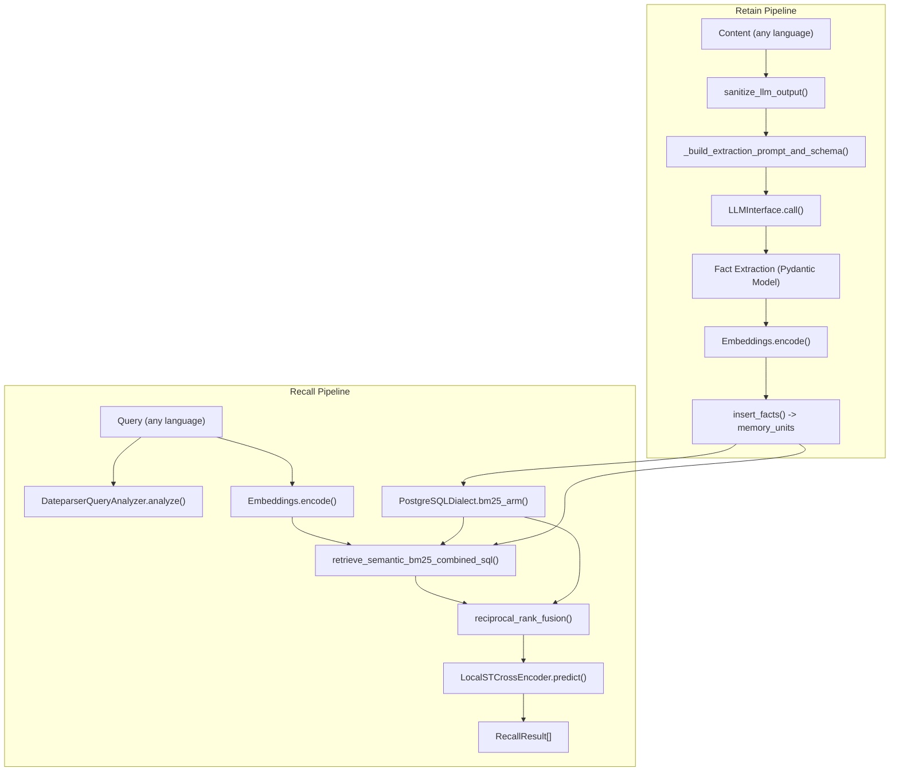
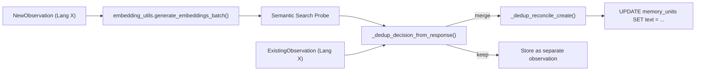

<!-- source: DeepWiki mcp.deepwiki.com · repo vectorize-io/hindsight · page 11.3 Multilingual Support · fetched 2026-10-26 -->

# Multilingual Support

Relevant source files

The following files were used as context for generating this wiki page:

- [hindsight-api-slim/hindsight_api/engine/chinese_temporal_periods.py](hindsight-api-slim/hindsight_api/engine/chinese_temporal_periods.py)
- [hindsight-api-slim/hindsight_api/engine/local_device.py](hindsight-api-slim/hindsight_api/engine/local_device.py)
- [hindsight-api-slim/hindsight_api/engine/query_analyzer.py](hindsight-api-slim/hindsight_api/engine/query_analyzer.py)
- [hindsight-api-slim/hindsight_api/engine/search/temporal_extraction.py](hindsight-api-slim/hindsight_api/engine/search/temporal_extraction.py)
- [hindsight-api-slim/hindsight_api/engine/temporal_language_detection.py](hindsight-api-slim/hindsight_api/engine/temporal_language_detection.py)
- [hindsight-api-slim/hindsight_api/engine/temporal_periods.py](hindsight-api-slim/hindsight_api/engine/temporal_periods.py)
- [hindsight-api-slim/tests/data/query_analyzer_golden.json](hindsight-api-slim/tests/data/query_analyzer_golden.json)
- [hindsight-api-slim/tests/query_analyzer_bench.py](hindsight-api-slim/tests/query_analyzer_bench.py)
- [hindsight-api-slim/tests/query_analyzer_corpus.py](hindsight-api-slim/tests/query_analyzer_corpus.py)
- [hindsight-api-slim/tests/test_jina_mlx_release.py](hindsight-api-slim/tests/test_jina_mlx_release.py)
- [hindsight-api-slim/tests/test_local_device.py](hindsight-api-slim/tests/test_local_device.py)
- [hindsight-api-slim/tests/test_local_model_alignment.py](hindsight-api-slim/tests/test_local_model_alignment.py)
- [hindsight-api-slim/tests/test_local_model_build_lock.py](hindsight-api-slim/tests/test_local_model_build_lock.py)
- [hindsight-api-slim/tests/test_query_analyzer.py](hindsight-api-slim/tests/test_query_analyzer.py)
- [hindsight-api-slim/tests/test_temporal_default_reference_utc.py](hindsight-api-slim/tests/test_temporal_default_reference_utc.py)
- [hindsight-api-slim/tests/test_temporal_extraction.py](hindsight-api-slim/tests/test_temporal_extraction.py)
- [hindsight-api-slim/tests/test_temporal_language_detection_threading.py](hindsight-api-slim/tests/test_temporal_language_detection_threading.py)

The multilingual support layer in Hindsight ensures that content input in any language (English, Chinese, Japanese, Spanish, etc.) is processed natively without forced translation. The system thereby maintains semantic fidelity to the original source. Queries in the same language naturally retrieve relevant memories in the appropriate language, while output language can also be controlled explicitly.

---

## Overview and Purpose

This page explains multilingual capabilities: language detection, multilingual BM25 and temporal period parsing (including Chinese), multilingual embeddings, cross-lingual recall, and output language control.

This capability spans multiple subsystems:

- Language detection via LLM-assisted prompt engineering
- Multilingual embedding models and vector search
- Textual BM25 search with language-sensitive tokenization
- Temporal period parsing supporting both whitespace-separated and CJK languages
- Consolidation with language-aware merging and deduplication
- Reasoning and reflection prompt design with output language directives

The support is implemented with a cross-layer architecture involving prompt templates, retrieval pipelines, and data normalization, detailed below.

---

## Data Flow: Multilingual Pipeline and Key Code Entities

- `sanitize_llm_output()` ensures the input text is clean of problematic Unicode or control characters for multilingual compatibility `[hindsight-api-slim/hindsight_api/engine/llm_wrapper.py:117-136]()`.
- `_build_extraction_prompt_and_schema()` in `retain/fact_extraction.py` composes extraction prompts with language preservation instructions `[hindsight-api-slim/hindsight_api/engine/retain/fact_extraction.py:20-40]()`.
- `LLMInterface.call()` executes fact extraction, respecting language directives `[hindsight-api-slim/hindsight_api/engine/llm_wrapper.py:117-136]()`.
- Embedding generation uses configured multilingual embedding models `[hindsight-api-slim/hindsight_api/engine/search/retrieval.py:33-40]()`.
- Query parsing and temporal extraction use `DateparserQueryAnalyzer.analyze()` with specialized handling for CJK languages `[hindsight-api-slim/hindsight_api/engine/query_analyzer.py:10-60]()`.
- BM25 textual search leverages multilingual tokenization and PostgreSQL dictionary selection (`bm25_arm()` in `engine/search/retrieval.py`) `[hindsight-api-slim/hindsight_api/engine/search/retrieval.py:123-139]()`.
- Cross-encoder reranking (`LocalSTCrossEncoder.predict()`) is applied on candidate results.
- Reciprocal rank fusion combines semantic and textual results for final recall.

Sources:  
`[hindsight-api-slim/hindsight_api/engine/llm_wrapper.py:117-136]()`,  
`[hindsight-api-slim/hindsight_api/engine/search/retrieval.py:33-40,123-139]()`,  
`[hindsight-api-slim/hindsight_api/engine/retain/fact_extraction.py:20-40]()`,  
`[hindsight-api-slim/hindsight_api/engine/query_analyzer.py:10-60]()`

---

## Language Detection and Output Control via Prompt Engineering

### Mechanism

Language detection primarily leverages large language models prompted with explicit instructions. The key function `output_language_directive(llm_output_language)` injects a directive controlling the language of LLM outputs. This enables either:

- Automatic detection and response in the question's language by default, or
- Forcing a specified output language via configuration such as `HINDSIGHT_API_LLM_OUTPUT_LANGUAGE`.

### Prompt Templates

- The reflect agent uses system and user prompts that include language rules ensuring answer language consistency.
- In `engine/reflect/prompts.py`, the constant `_TOOLS_LANGUAGE_RULE` defines the default fallback language behavior to "respond in the same language as the user's question."
- The `build_agent_user_prompt(query, llm_output_language)` appends the output language directive directly to the user's question prompt to take precedence over system defaults.
- Consolidation prompts (`engine/consolidation/prompts.py`) also embed language rules for observations, specifying that observations should be written in the source facts' own language.

### Directive Priority

- Directives specifying output language are of higher priority than default rules.
- The system ensures that these instructions percolate through prompt construction, reflection, consolidation, and fact extraction.

Sources:  
`[hindsight-api-slim/hindsight_api/engine/reflect/prompts.py:127-133,136-149]()`,  
`[hindsight-api-slim/hindsight_api/engine/consolidation/prompts.py:28-38]()`,  
`[hindsight-api-slim/hindsight_api/prompt_utils.py:40-60]()` (implicit)

---

## Multilingual BM25 and Temporal Period Parsing

### BM25 Text Search Adaptations

- BM25 search queries are tokenized by `tokenize_query()` in `engine/search/retrieval.py` by stripping punctuation and lowercasing, sensitive to the configured language dictionary.
- The PostgreSQL dialect supports custom text search dictionaries (`native_language`) selectable per tenant/bank.
- The `bm25_arm` method applies language-specific full-text indices adjusted for language morphology.
- Multilingual BM25 allows search across languages, typical for supported languages like English, German, French, Spanish, and simple tokenization for others.

### Temporal Period Parsing with Language Awareness

- Temporal parsing uses a layered approach:
  - The main logic resides in `engine/query_analyzer.py` and `engine/temporal_periods.py`, which extract temporal constraints `[hindsight-api-slim/hindsight_api/engine/query_analyzer.py:10-120]()`, `[hindsight-api-slim/hindsight_api/engine/temporal_periods.py:20-160]()`.
  - Chinese and CJK-specific temporal period parsing is implemented separately in `engine/chinese_temporal_periods.py` because Chinese date expressions have distinct boundary and tokenization behavior `[hindsight-api-slim/hindsight_api/engine/chinese_temporal_periods.py:1-140]()`.
  - The method `is_embedded_cjk_dateparser_match()` is employed to delegate relevant matches in CJK queries to the specialized Chinese handler `[hindsight-api-slim/hindsight_api/engine/temporal_periods.py:20-39]()`.
- Complex patterns such as relative dates ("last week", "yesterday") and range extraction are supported with regex and rule-based logic across multiple languages.
- The parsing results translate queries into temporal constraints used during recall filtering.

Sources:  
`[hindsight-api-slim/hindsight_api/engine/search/retrieval.py:33-40,123-139]()`,  
`[hindsight-api-slim/hindsight_api/engine/query_analyzer.py:10-120]()`,  
`[hindsight-api-slim/hindsight_api/engine/temporal_periods.py:20-160]()`,  
`[hindsight-api-slim/hindsight_api/engine/chinese_temporal_periods.py:1-140]()`

---

## Multilingual Embeddings and Cross-Lingual Recall

### Embedding Models

- The embedding pipeline supports multiple providers including multilingual-capable ones (e.g., OpenAI embeddings, SentenceTransformers).
- Embedding providers are configurable via environment and bank-specific configuration.
- Hindsight automatically detects embedding vector dimension and adjusts accordingly to support model migration or multilingual embedding sets.

### Cross-Lingual Recall Strategy

- Recall employs a multi-strategy retrieval approach combining:
  - Semantic vector similarity search using multilingual embeddings.
  - BM25 textual keyword search based on the query language.
  - Temporal and graph-based expansion strategies.
  
- The fusion of semantic and BM25 results uses reciprocal rank fusion (RRF), improving recall especially for multilingual content.
- Cross-encoder reranking further filters and reranks candidates considering query language context.

### Data Flow Integration

Cross-lingual recall is achieved by mapping both queries and indexed memories into a shared semantic space, allowing retrieval despite language differences. BM25 adds complementary fuzzy keyword matches where pure semantics may miss subtle tokens.

Sources:  
`[hindsight-api-slim/hindsight_api/engine/search/retrieval.py:123-139]()`,  
`[hindsight-api-slim/hindsight_api/engine/retain/embedding_utils.py]()` (implied),  
`[hindsight-api-slim/hindsight_api/engine/reflect/agent.py:10-166]()`

---

## Consolidation with Multilingual Deduplication and Language-Aware Merging

### Language Preservation in Consolidation

- The consolidation system prompt includes the `_DEFAULT_LANGUAGE_RULE` that mandates observations be written in the source facts’ original language, preventing unintended translations.
- This is critical to preserving semantic fidelity and maintaining multilingual consistency.

### Deduplication Logic

- Semantic deduplication to detect textually similar observations uses embedding similarity probes (`embedding_utils.generate_embeddings_batch()`).
- The function `_dedup_decision_from_response()` interprets the LLM's merge/keep decision by prompting on similarity and language.
- Text normalization `_norm_obs_text()` collapses whitespace but keeps casing, ensuring acronyms and proper nouns are preserved as distinct tokens to aid language sensitivity.

### Merging Behavior

- If the existing observation's language diverges from the new facts’ language, the system discards the old text and generates the observation anew in the new language.
- This behavior avoids mixing languages or displaying stale translations.

### Consolidation Deduplication Logic Diagram

Sources:  
`[hindsight-api-slim/hindsight_api/engine/consolidation/consolidator.py:120-180]()`,  
`[hindsight-api-slim/hindsight_api/engine/consolidation/prompts.py:25-40]()`,  
`[hindsight-api-slim/tests/test_multilingual_bm25.py:40-60]()` (tests)

---

## Data Sanitization and Unicode Handling

- Input text is sanitized via `sanitize_llm_output()` before being passed to LLMs and stored `[hindsight-api-slim/hindsight_api/engine/llm_wrapper.py:117-136]()`.
- This function removes:
  - ASCII control characters except tab, newline, and carriage return, preventing JSON parsing errors and PostgreSQL insertion issues.
  - Unicode surrogate pairs (U+D800–U+DFFF), which are invalid in UTF-8.
- This sanitization ensures robust multilingual text handling across diverse languages and scripts.

Sources:  
`[hindsight-api-slim/hindsight_api/engine/llm_wrapper.py:117-136]()`

---

## Summary Table of Key Multilingual Components

| Feature                 | Technique / Code Entity                              | Details                                                          |
|-------------------------|-----------------------------------------------------|------------------------------------------------------------------|
| Language Detection      | LLM prompt instructions (`output_language_directive`) | Detects query language automatically or forces fixed language   |
| Fact Extraction         | `_build_extraction_prompt_and_schema()`, `LLMInterface.call()` | Guided LLM extraction preserving source language                 |
| Embedding Model         | `Embeddings.encode()`                               | Configurable multilingual embeddings with dimension auto-detect |
| BM25 Text Search        | `tokenize_query()`, `PostgreSQLDialect.bm25_arm()` | Language-dictionary-aware tokenization and index selection       |
| Temporal Parsing        | `DateparserQueryAnalyzer.analyze()`, `temporal_periods.py` | Language-specific parsing including Chinese periods              |
| Consolidation & Dedup   | `_dedup_decision_from_response()`, `_norm_obs_text()` | Semantic deduplication, language-aware observation merge         |
| Output Language Control | Prompts in `reflect/prompts.py` and `consolidation/prompts.py` | Directives injected to control LLM output language               |
| Sanitization            | `sanitize_llm_output()`                             | Unicode normalization and control character stripping            |

Sources:  
`[hindsight-api-slim/hindsight_api/engine/llm_wrapper.py:117-136]()`,  
`[hindsight-api-slim/hindsight_api/engine/search/retrieval.py:33-40,123-139]()`,  
`[hindsight-api-slim/hindsight_api/engine/retain/fact_extraction.py:20-40]()`,  
`[hindsight-api-slim/hindsight_api/engine/query_analyzer.py:10-120]()`,  
`[hindsight-api-slim/hindsight_api/engine/temporal_periods.py:20-160]()`,  
`[hindsight-api-slim/hindsight_api/engine/chinese_temporal_periods.py:1-140]()`,  
`[hindsight-api-slim/hindsight_api/engine/reflect/prompts.py:127-133,136-149]()`,  
`[hindsight-api-slim/hindsight_api/engine/consolidation/prompts.py:28-38]()`,  
`[hindsight-api-slim/hindsight_api/engine/consolidation/consolidator.py:120-180]()`,  
`[hindsight-api-slim/tests/test_multilingual_bm25.py:40-60]()`

---

