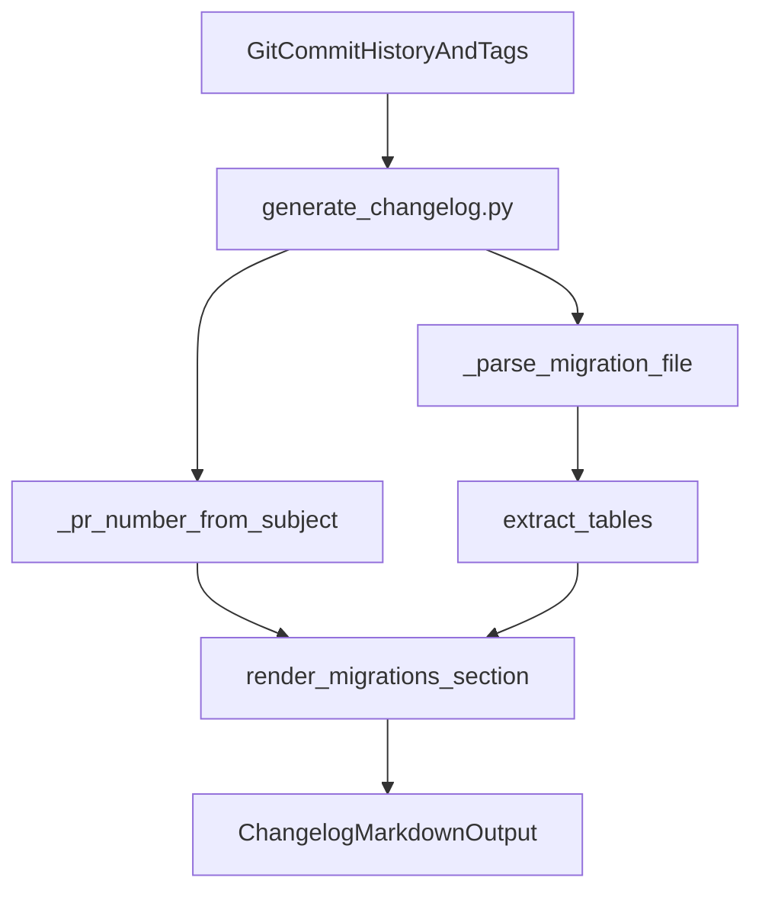
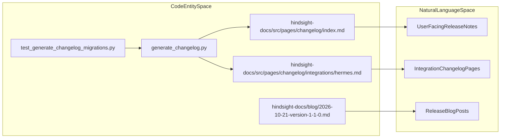

<!-- source: DeepWiki mcp.deepwiki.com · repo vectorize-io/hindsight · page 12.2 Changelog and Release Notes · fetched 2026-10-26 -->

# Changelog and Release Notes

<details>
<summary>Relevant source files</summary>

The following files were used as context for generating this wiki page:

- [.claude/skills/hs-release/SKILL.md](.claude/skills/hs-release/SKILL.md)
- [hindsight-dev/tests/test_generate_changelog_migrations.py](hindsight-dev/tests/test_generate_changelog_migrations.py)
- [hindsight-docs/blog/2026-04-28-version-0-5-5.md](hindsight-docs/blog/2026-04-28-version-0-5-5.md)
- [hindsight-docs/blog/2026-06-09-version-0-8-1.md](hindsight-docs/blog/2026-06-09-version-0-8-1.md)
- [hindsight-docs/blog/2026-10-21-version-1-1-0.md](hindsight-docs/blog/2026-10-21-version-1-1-0.md)
- [hindsight-docs/src/pages/changelog/index.md](hindsight-docs/src/pages/changelog/index.md)
- [hindsight-docs/src/pages/changelog/integrations/hermes.md](hindsight-docs/src/pages/changelog/integrations/hermes.md)
- [hindsight-docs/static/img/blog/version-1-1-0-chatgpt-login.jpg](hindsight-docs/static/img/blog/version-1-1-0-chatgpt-login.jpg)
- [hindsight-docs/static/img/blog/version-1-1-0-chatgpt-login.mp4](hindsight-docs/static/img/blog/version-1-1-0-chatgpt-login.mp4)
- [hindsight-docs/static/img/blog/version-1-1-0-document-history.jpg](hindsight-docs/static/img/blog/version-1-1-0-document-history.jpg)
- [hindsight-docs/static/img/blog/version-1-1-0-document-history.mp4](hindsight-docs/static/img/blog/version-1-1-0-document-history.mp4)
- [hindsight-docs/static/img/blog/version-1-1-0-document-search.jpg](hindsight-docs/static/img/blog/version-1-1-0-document-search.jpg)
- [hindsight-docs/static/img/blog/version-1-1-0-document-search.mp4](hindsight-docs/static/img/blog/version-1-1-0-document-search.mp4)
- [hindsight-docs/static/img/blog/version-1-1-0-observation-scopes.jpg](hindsight-docs/static/img/blog/version-1-1-0-observation-scopes.jpg)
- [hindsight-docs/static/img/blog/version-1-1-0-observation-scopes.mp4](hindsight-docs/static/img/blog/version-1-1-0-observation-scopes.mp4)
- [hindsight-docs/static/img/blog/version-1-1-0-page-downloads.jpg](hindsight-docs/static/img/blog/version-1-1-0-page-downloads.jpg)
- [hindsight-docs/static/img/blog/version-1-1-0-page-downloads.mp4](hindsight-docs/static/img/blog/version-1-1-0-page-downloads.mp4)
- [hindsight-integrations/hermes/plugin.yaml](hindsight-integrations/hermes/plugin.yaml)
- [hindsight-integrations/hermes/pyproject.toml](hindsight-integrations/hermes/pyproject.toml)
- [skills/hindsight-docs/references/changelog/index.md](skills/hindsight-docs/references/changelog/index.md)
- [skills/hindsight-docs/references/changelog/integrations/hermes.md](skills/hindsight-docs/references/changelog/integrations/hermes.md)

</details>


This page documents the Hindsight changelog and release notes system, detailing how changes for the core system and individual integrations are published, organized, and automated. It covers per-integration changelog pages, the main docs changelog index, blog release posts, the `generate_changelog.py` automation script, migration volume tiering, and versioned documentation snapshots.

---

## 1. Overview of the Changelog System

Hindsight maintains a user-facing changelog that tracks user-visible improvements and bug fixes across its core components (API, CLI, control plane) and ecosystem integrations. Internal maintenance and infrastructure updates are omitted from user-facing logs.

- Each integration maintains its own independent changelog page under the documentation directory `hindsight-docs/src/pages/changelog/integrations/` [hindsight-docs/src/pages/changelog/integrations/hermes.md:1-12]().
- The central documentation changelog index aggregates core system updates [hindsight-docs/src/pages/changelog/index.md:1-11]().
- Blog posts provide narrative release announcements under `hindsight-docs/blog/` [hindsight-docs/blog/2026-10-21-version-1-1-0.md:1-8]().
- The `generate_changelog.py` script automates release notes generation, parsing migration revisions and commit history [hindsight-dev/tests/test_generate_changelog_migrations.py:1-20]().

Sources: `hindsight-docs/src/pages/changelog/index.md:1-11]`, `hindsight-docs/blog/2026-10-21-version-1-1-0.md:1-8]`, `hindsight-dev/tests/test_generate_changelog_migrations.py:1-20`

---

## 2. Per-Integration Changelog Pages

Integrations such as Hermes (`hermes-plugin-hindsight`), Pipecat, and coding-agent plugins release on independent cadences. Their respective metadata and requirements are declared in files like `pyproject.toml` and `plugin.yaml` [hindsight-integrations/hermes/pyproject.toml:1-20] [hindsight-integrations/hermes/plugin.yaml:1-8]().

- Integration changelogs record features, improvements, and bug fixes specific to that wrapper [hindsight-docs/src/pages/changelog/integrations/hermes.md:13-40]().
- Each entry includes commit hashes and contributor tags pointing back to the core repository [hindsight-docs/src/pages/changelog/integrations/hermes.md:13-20]().

```markdown
## [1.2.3](https://github.com/vectorize-io/hindsight/tree/integrations/hermes/v1.2.3)

**Bug Fixes**
- Default Hermes observations to the shared scope so memories merge across sessions. · @nicoloboschi · [61213351b]()
```

Sources: `hindsight-integrations/hermes/pyproject.toml:1-20]`, `hindsight-integrations/hermes/plugin.yaml:1-9]`, `hindsight-docs/src/pages/changelog/integrations/hermes.md:13-40`

---

## 3. The Docs Changelog Index Page

The core changelog index page (`hindsight-docs/src/pages/changelog/index.md`) documents updates to the Hindsight API, CLI, and Control Plane.

- Uses Docusaurus layout components such as `<PageHero>` [hindsight-docs/src/pages/changelog/index.md:1-8]().
- Categorizes changes into explicit groups: **Breaking Changes**, **Features**, and **Bug Fixes** [hindsight-docs/src/pages/changelog/index.md:12-26]().
- Injects GitHub avatar links and commit hash references directly into the markdown nodes [hindsight-docs/src/pages/changelog/index.md:16-26]().

Sources: `hindsight-docs/src/pages/changelog/index.md:1-26`

---

## 4. Release Blog Posts

Major releases are accompanied by long-form blog posts located in `hindsight-docs/blog/` (e.g., version release announcements) [hindsight-docs/blog/2026-10-21-version-1-1-0.md:1-8] [hindsight-docs/blog/2026-04-28-version-0-5-5.md:1-15]().

- Formatted with structured YAML frontmatter containing title, description, authors, date, and `[release]` tags [hindsight-docs/blog/2026-10-21-version-1-1-0.md:1-8]().
- Provide deep dives into feature additions (e.g., document change history, observation scopes, file parsers) [hindsight-docs/blog/2026-10-21-version-1-1-0.md:16-23] [hindsight-docs/blog/2026-04-28-version-0-5-5.md:19-24]().
- Integrate media elements via `<ZoomableMedia>` components and video/image walkthroughs [hindsight-docs/blog/2026-10-21-version-1-1-0.md:28-30]().

Sources: `hindsight-docs/blog/2026-10-21-version-1-1-0.md:1-82]`, `hindsight-docs/blog/2026-04-28-version-0-5-5.md:1-83`

---

## 5. `generate_changelog.py` Automation and Migration Parsing

The automation engine `generate_changelog.py` extracts change metadata, parses database migration volumes, and formats release markdowns [hindsight-dev/tests/test_generate_changelog_migrations.py:1-20]().

### Key Mechanisms
- **Git Range Extraction:** Scans commit logs and PR subjects between release tags using subprocess git interfaces [hindsight-dev/tests/test_generate_changelog_migrations.py:33-44]().
- **Migration Enumeration:** Parses Alembic migration files to extract revision identifiers, docstrings, and modified schema tables via `_parse_migration_file` and `extract_tables` [hindsight-dev/tests/test_generate_changelog_migrations.py:67-78] [hindsight-dev/tests/test_generate_changelog_migrations.py:151-165]().
- **PR Number Resolution:** Resolves merge PR numbers from commit subjects (e.g., `(#3622)`) via `_pr_number_from_subject` [hindsight-dev/tests/test_generate_changelog_migrations.py:61-65]().


Sources: `hindsight-dev/tests/test_generate_changelog_migrations.py:1-184`

---

## 6. Versioned Documentation Snapshots

Hindsight leverages Docusaurus versioning to archive historical release documentation.

- Each stable release takes a snapshot of `/docs` and corresponding sidebars.
- Historical changelog files are preserved so users running older versions of the API or client SDKs can consult the exact documentation state active at that release.

Sources: `hindsight-docs/src/pages/changelog/index.md:1-26`

---

## 7. Code and Docs Space Bridging

To connect the human-readable release notes to underlying code repositories and scripts, the following mapping defines the translation from Natural Language Space to Code Entity Space.


Sources: `hindsight-docs/src/pages/changelog/index.md:1-26]`, `hindsight-dev/tests/test_generate_changelog_migrations.py:1-20]`, `hindsight-docs/blog/2026-10-21-version-1-1-0.md:1-8`

---

## Sources
- `hindsight-docs/src/pages/changelog/index.md:1-26`
- `skills/hindsight-docs/references/changelog/index.md:1-27`
- `hindsight-integrations/hermes/pyproject.toml:1-20`
- `hindsight-integrations/hermes/plugin.yaml:1-9`
- `hindsight-docs/src/pages/changelog/integrations/hermes.md:1-40`
- `skills/hindsight-docs/references/changelog/integrations/hermes.md:1-40`
- `hindsight-docs/blog/2026-10-21-version-1-1-0.md:1-82`
- `hindsight-docs/blog/2026-04-28-version-0-5-5.md:1-83`
- `hindsight-dev/tests/test_generate_changelog_migrations.py:1-184`

---

