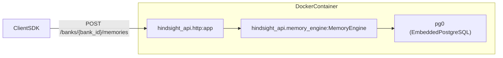
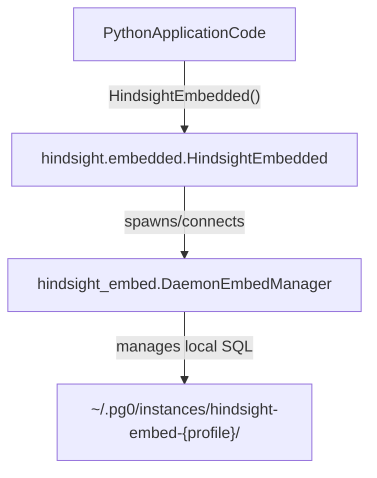
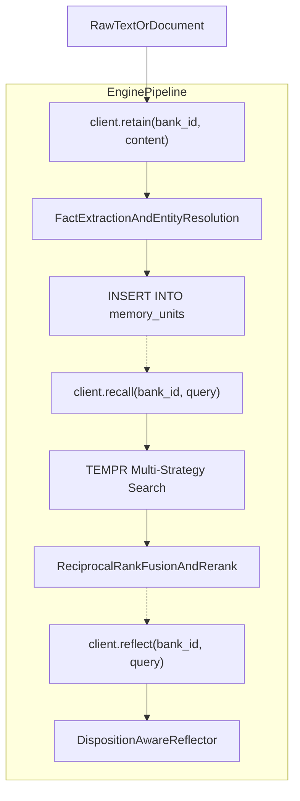
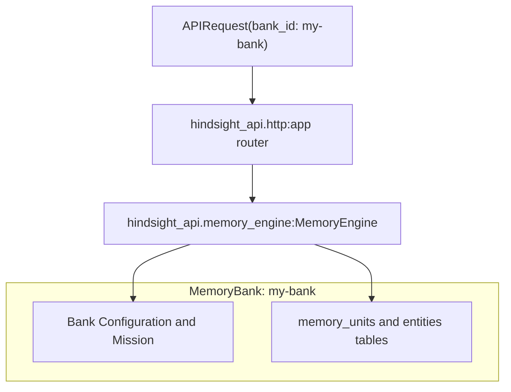

<!-- source: DeepWiki mcp.deepwiki.com · repo vectorize-io/hindsight · page 2 Getting Started · fetched 2026-10-26 -->

# Getting Started

<details>
<summary>Relevant source files</summary>

The following files were used as context for generating this wiki page:

- [README.md](README.md)
- [docker/standalone/start-all.sh](docker/standalone/start-all.sh)
- [docker/standalone/test-start-all.sh](docker/standalone/test-start-all.sh)
- [hindsight-api-slim/hindsight_api/http_probe.py](hindsight-api-slim/hindsight_api/http_probe.py)
- [hindsight-api-slim/tests/test_http_probe.py](hindsight-api-slim/tests/test_http_probe.py)
- [hindsight-control-plane/bin/cli.js](hindsight-control-plane/bin/cli.js)
- [hindsight-control-plane/tests/lib/cli-bind-host.test.ts](hindsight-control-plane/tests/lib/cli-bind-host.test.ts)
- [hindsight-docs/docs/developer/api/quickstart.mdx](hindsight-docs/docs/developer/api/quickstart.mdx)
- [hindsight-docs/docs/developer/installation.md](hindsight-docs/docs/developer/installation.md)
- [hindsight-docs/versioned_docs/version-0.8/developer/installation.md](hindsight-docs/versioned_docs/version-0.8/developer/installation.md)
- [hindsight-docs/versioned_docs/version-0.9/developer/api/quickstart.mdx](hindsight-docs/versioned_docs/version-0.9/developer/api/quickstart.mdx)
- [hindsight-docs/versioned_docs/version-0.9/developer/installation.md](hindsight-docs/versioned_docs/version-0.9/developer/installation.md)
- [skills/hindsight-docs/references/developer/api/quickstart.md](skills/hindsight-docs/references/developer/api/quickstart.md)
- [skills/hindsight-docs/references/developer/installation.md](skills/hindsight-docs/references/developer/installation.md)

</details>


Hindsight provides multiple quick-start paths tailored to different user types: API users deploying via Docker, embedded SDK users wanting zero-config local memory, and framework integrators connecting via client libraries. This page outlines the core getting started workflows and introduces the three fundamental memory operations (**retain**, **recall**, **reflect**).

**Choose Your Path:**

| User Type           | Method                         | Time to Start | Best For                         |
|---------------------|--------------------------------|---------------|---------------------------------|
| **API Users**        | Docker container               | 30 seconds    | Testing, development, local demos|
| **Python Developers**| `pip install hindsight-api`    | 1 minute      | Python applications, custom servers|
| **Embedded SDK Users**| `hindsight-all` / `hindsight-embed` | 1 minute      | Zero-config local memory, single-user apps|

For detailed installation procedures including Kubernetes charts, pip variants, and production requirements, see [Installation](#2.1). For complete code walkthroughs across Python, TypeScript, and CLI, see [Quick Start Guide](#2.2). For local daemon and profile management, see [Embedded Mode Setup](#2.3).

Sources: [README.md:62-117](), [hindsight-docs/docs/developer/installation.md:1-68]()

---

## Quick-Start Paths

### 1. API Users (Docker)

Run the Hindsight API server and Control Plane UI in a single container with embedded PostgreSQL (`pg0`) [hindsight-docs/docs/developer/installation.md:37-87]().

```bash
export OPENAI_API_KEY=sk-xxx

docker run -it --pull always --name hindsight --restart unless-stopped -p 8888:8888 -p 9999:9999 \
  -e HINDSIGHT_API_LLM_API_KEY=$OPENAI_API_KEY \
  -v hindsight-data:/home/hindsight/.pg0 \
  ghcr.io/vectorize-io/hindsight:latest
```

- **API Server:** `http://localhost:8888` (FastAPI application in `hindsight_api.http:app`) [hindsight-docs/docs/developer/installation.md:86]()
- **Control Plane UI:** `http://localhost:9999` (Next.js web interface) [hindsight-docs/docs/developer/installation.md:87]()

**Diagram: API Deployment Architecture (Natural Language to Code Entities)**


Sources: [README.md:64-75](), [hindsight-docs/docs/developer/installation.md:71-103](), [docker/standalone/start-all.sh:132-133]()

---

### 2. Python Developers (pip)

Install the API package directly and run the server locally, or use embedded mode [hindsight-docs/docs/developer/installation.md:11-18]().

```bash
pip install hindsight-api
export HINDSIGHT_API_LLM_API_KEY=sk-xxx
hindsight-api
```

To use Hindsight inside Python applications without managing a standalone server, leverage the embedded client API with `HindsightEmbedded` from `hindsight-all` [README.md:128-136]():

```python
from hindsight import HindsightEmbedded

with HindsightEmbedded(profile="myapp", llm_provider="openai") as client:
    client.retain(bank_id="my-bank", content="Alice works at Google")
    results = client.recall(bank_id="my-bank", query="Where does Alice work?")
```

**Diagram: Embedded SDK Architecture (Natural Language to Code Entities)**


Sources: [hindsight-docs/docs/developer/installation.md:11-18](), [README.md:128-136]()

---

### 3. Framework Integrators

Hindsight exposes a rich HTTP API and generated client SDKs to integrate memory capabilities into agents and frameworks (Python, TypeScript, Go, Rust). Clients interact with core operations to store and retrieve memories and reason with them.

- The Python SDK (`hindsight-client`) provides synchronous and asynchronous methods: `retain`, `recall`, and `reflect`.
- The TypeScript SDK offers asynchronous client classes for browser, Node.js, and Next.js environments.
- The Rust CLI and client enable direct command-line usage and integration.
- The embedded SDK can be controlled programmatically or via command-line tools within the same process.

For detailed SDK usage and advanced integration patterns, see [Quick Start Guide](#2.2) and [Embedded Mode Setup](#2.3).

Sources: [README.md:119-136](), [hindsight-docs/docs/developer/api/quickstart.mdx:5-134]()

---

## Core Operations

Hindsight centers around three fundamental operations: **retain** (storing structured facts and entities), **recall** (multi-strategy retrieval), and **reflect** (disposition-aware reasoning) [hindsight-docs/docs/developer/api/quickstart.mdx:116-120]().

**Diagram: Core Operations Pipeline (Natural Language to Code Entities)**


Sources: [hindsight-docs/docs/developer/api/quickstart.mdx:116-120](), [hindsight-docs/docs/developer/observations.mdx:13-21]()

---

### Minimal Example

All operations are organized around isolated **memory banks** (`bank_id`), which isolate data and configuration [hindsight-docs/src/pages/best-practices.mdx:24-32]().

```python
from hindsight_client import Hindsight

client = Hindsight(base_url="http://localhost:8888")

# 1. Retain: Extract facts and entities from raw content
client.retain(bank_id="my-bank", content="Alice works at Google as a software engineer.")

# 2. Recall: Retrieve relevant facts related to a query
results = client.recall(bank_id="my-bank", query="What does Alice do?")

# 3. Reflect: Generate a disposition-aware answer consolidating knowledge
answer = client.reflect(bank_id="my-bank", query="Tell me about Alice's career.")
print(answer.text)
```

**Diagram: Memory Bank Isolation**


Sources: [hindsight-docs/docs/developer/api/quickstart.mdx:61-73](), [hindsight-docs/src/pages/best-practices.mdx:24-32]()

---

## Detailed Guides & Child Pages

For comprehensive deep dives into setup and configuration, explore the child pages:

- **[Installation](#2.1)** — Covering all installation methods including Docker images (full and slim), pip packages (`hindsight-api`, `hindsight-api-slim`, `hindsight-all`), Helm charts for Kubernetes deployment, and local development configurations including the embedded database.

- **[Quick Start Guide](#2.2)** — A step-by-step tutorial walking through a full cycle: creating a memory bank, retaining memories from text and files, recalling relevant information using multi-strategy retrieval, and reflecting to generate intelligent answers. Includes Python, TypeScript, and CLI examples side-by-side.

- **[Embedded Mode Setup](#2.3)** — Explains the `hindsight-embed` zero-config daemon architecture, managing multiple profiles, the control center UI, idle timeout behavior, and how the `HindsightServer` and `HindsightEmbedded` classes in `hindsight-all` work together. Also covers the `hindsight-all-npm` Node.js package for embedded client use.

Sources: [hindsight-docs/docs/developer/installation.md:1-118](), [hindsight-docs/docs/developer/api/quickstart.mdx:1-134]()

---

