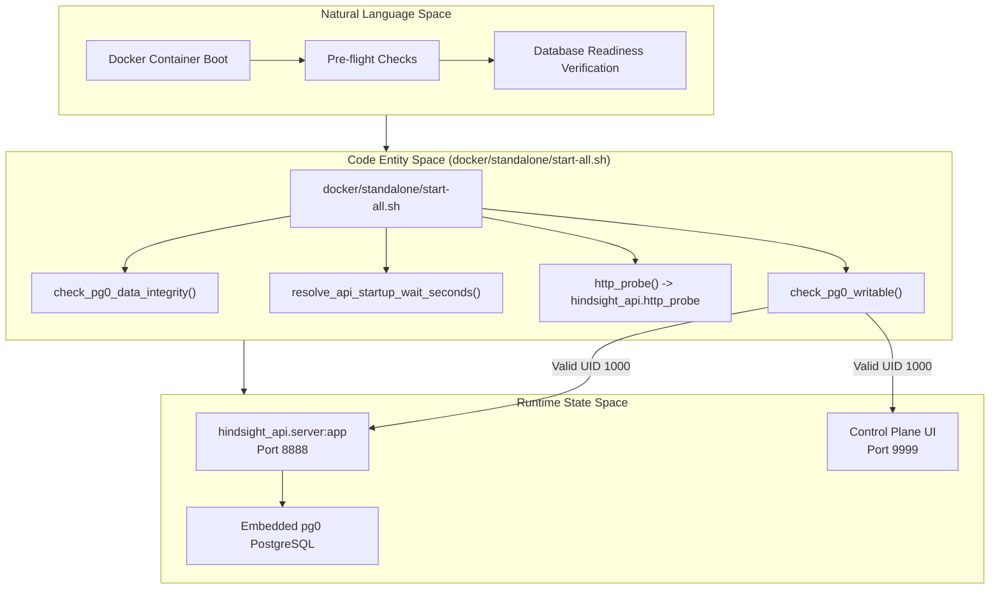
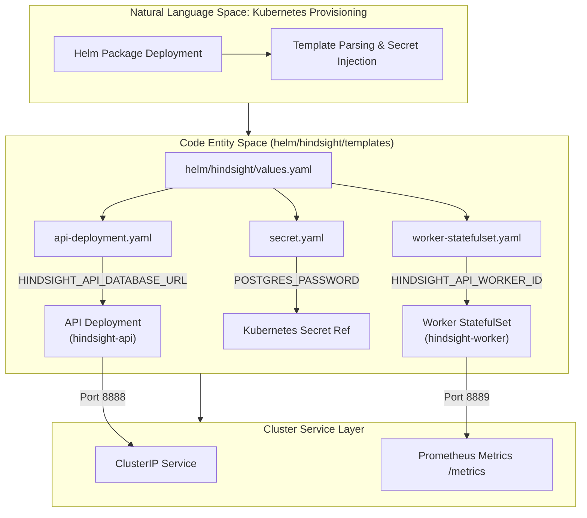

<!-- source: DeepWiki mcp.deepwiki.com · repo vectorize-io/hindsight · page 2.1 Installation · fetched 2026-10-26 -->

# Installation

<details>
<summary>Relevant source files</summary>

The following files were used as context for generating this wiki page:

- [README.md](README.md)
- [docker/standalone/start-all.sh](docker/standalone/start-all.sh)
- [docker/standalone/test-start-all.sh](docker/standalone/test-start-all.sh)
- [helm/hindsight/README.md](helm/hindsight/README.md)
- [helm/hindsight/templates/_helpers.tpl](helm/hindsight/templates/_helpers.tpl)
- [helm/hindsight/templates/api-deployment.yaml](helm/hindsight/templates/api-deployment.yaml)
- [helm/hindsight/templates/controlplane-deployment.yaml](helm/hindsight/templates/controlplane-deployment.yaml)
- [helm/hindsight/templates/extra-objects.yaml](helm/hindsight/templates/extra-objects.yaml)
- [helm/hindsight/templates/httproute.yaml](helm/hindsight/templates/httproute.yaml)
- [helm/hindsight/templates/postgresql-statefulset.yaml](helm/hindsight/templates/postgresql-statefulset.yaml)
- [helm/hindsight/templates/tei-embedding-deployment.yaml](helm/hindsight/templates/tei-embedding-deployment.yaml)
- [helm/hindsight/templates/tei-reranker-deployment.yaml](helm/hindsight/templates/tei-reranker-deployment.yaml)
- [helm/hindsight/templates/worker-statefulset.yaml](helm/hindsight/templates/worker-statefulset.yaml)
- [helm/hindsight/values.yaml](helm/hindsight/values.yaml)
- [hindsight-api-slim/hindsight_api/http_probe.py](hindsight-api-slim/hindsight_api/http_probe.py)
- [hindsight-api-slim/tests/test_http_probe.py](hindsight-api-slim/tests/test_http_probe.py)
- [hindsight-control-plane/bin/cli.js](hindsight-control-plane/bin/cli.js)
- [hindsight-control-plane/tests/lib/cli-bind-host.test.ts](hindsight-control-plane/tests/lib/cli-bind-host.test.ts)
- [hindsight-docs/docs/developer/api/quickstart.mdx](hindsight-docs/docs/developer/api/quickstart.mdx)
- [hindsight-docs/docs/developer/installation.md](hindsight-docs/docs/developer/installation.md)
- [hindsight-docs/versioned_docs/version-0.8/developer/installation.md](hindsight-docs/versioned_docs/version-0.8/developer/installation.md)
- [hindsight-docs/versioned_docs/version-0.9/developer/api/quickstart.mdx](hindsight-docs/versioned_docs/version-0.9/developer/api/quickstart.mdx)
- [hindsight-docs/versioned_docs/version-0.9/developer/installation.md](hindsight-docs/versioned_docs/version-0.9/developer/installation.md)
- [skills/hindsight-docs/references/developer/api/quickstart.md](skills/hindsight-docs/references/developer/api/quickstart.md)
- [skills/hindsight-docs/references/developer/installation.md](skills/hindsight-docs/references/developer/installation.md)

</details>


## Purpose and Scope

This document provides complete technical installation instructions for Hindsight across all supported deployment methods and environments. It covers:
- **Supported Platforms** — Operating systems, hardware footprints, and memory considerations [hindsight-docs/docs/developer/installation.md:9-68]().
- **Prerequisites** — PostgreSQL vector extension requirements (`pgvector`, `pgvectorscale`, `vchord`, `scann`) and embedded `pg0` bootstrap [hindsight-docs/docs/developer/installation.md:26-46]().
- **Docker Deployment** — Standalone and slim image variants, volume mounts, non-root user security (UID 1000), and startup coordination scripts [hindsight-docs/docs/developer/installation.md:71-118](), [docker/standalone/start-all.sh:1-125]().
- **Pip Installation** — Modular package distribution (`hindsight-api`, `hindsight-api-slim`, and `hindsight-all`) [hindsight-docs/docs/developer/installation.md:141-152](), [README.md:95-102]().
- **Kubernetes and Helm** — Chart configuration, StatefulSet workers, and secret interpolation [helm/hindsight/values.yaml:1-218](), [helm/hindsight/templates/api-deployment.yaml:1-138](), [helm/hindsight/templates/worker-statefulset.yaml:1-149]().
- **Embedded Mode** — Zero-config local development (`hindsight-embed`) and daemon process supervision [hindsight-docs/docs/developer/installation.md:37-37](), [README.md:124-128]().

Sources: [hindsight-docs/docs/developer/installation.md:1-68](), [docker/standalone/start-all.sh:1-125](), [helm/hindsight/values.yaml:1-218]()

---

## Supported Platforms

Hindsight runs on **Linux**, **macOS**, and **Windows**, supporting both local embedded databases (`pg0`) for development and production-grade external database clusters [hindsight-docs/docs/developer/installation.md:9-21]().

| Platform | Docker | Bare Metal (pip) | Embedded DB (pg0) | Notes |
|----------|--------|------------------|--------------------|-------|
| **Linux** (x86_64, ARM64) | ✅ | ✅ | ✅ | Fully supported, recommended for production [hindsight-docs/docs/developer/installation.md:15-15]() |
| **macOS** (Apple Silicon / arm64) | ✅ | ✅ | ✅ | Fully supported [hindsight-docs/docs/developer/installation.md:16-16]() |
| **macOS** (Intel / x86_64) | ✅ | ⚠️ slim only | ✅ | Use `hindsight-all-slim` / `hindsight-api-slim`. Local ML wheels (PyTorch/MLX) are absent for Intel-Mac [hindsight-docs/docs/developer/installation.md:17-17](). |
| **Windows** (x86_64) | ✅ | ✅ | ✅ | Fully supported with external PostgreSQL or pg0 [hindsight-docs/docs/developer/installation.md:18-20]() |

Sources: [hindsight-docs/docs/developer/installation.md:9-21]()

---

## Prerequisites

### PostgreSQL and Vector Extensions

Hindsight requires PostgreSQL 14+ with an active vector similarity extension [hindsight-docs/docs/developer/installation.md:26-28](). The supported backends configured via `HINDSIGHT_API_VECTOR_EXTENSION` include:
- **pgvector** (default) [hindsight-docs/docs/developer/installation.md:30-30]()
- **pgvectorscale** [hindsight-docs/docs/developer/installation.md:31-31]()
- **vchord** [hindsight-docs/docs/developer/installation.md:32-32]()
- **scann** (AlloyDB) [hindsight-docs/docs/developer/installation.md:33-33]()

For local development, **pg0** provides an embedded PostgreSQL instance that starts automatically [hindsight-docs/docs/developer/installation.md:37-37](). For production, managed or self-hosted PostgreSQL instances (Supabase, Neon, AWS RDS, Azure Database for PostgreSQL, Google AlloyDB) are recommended [hindsight-docs/docs/developer/installation.md:39-45]().

### Hardware and Resource Footprint

The memory footprint depends on whether the **full** package/image (bundling local embedding models and cross-encoders) or the **slim** package/image is deployed [hindsight-docs/docs/developer/installation.md:53-61]().

| Component | Minimum RAM | Recommended RAM | Notes |
|-----------|-------------|-----------------|-------|
| **API — Full image** | 1.5 GB | 2 GB | Loads local BGE embedder (~130 MB) and MiniLM cross-encoder (~90 MB) into PyTorch/ONNX runtime [hindsight-docs/docs/developer/installation.md:57-57](). |
| **API — Slim image** | 512 MB | 1 GB | No local models; requires external embedding and reranker endpoints (TEI, OpenAI, Cohere) [hindsight-docs/docs/developer/installation.md:58-58](). |
| **Control Plane (UI)** | 128 MB | 256 MB | Next.js process [hindsight-docs/docs/developer/installation.md:59-59](). |
| **Worker Service** | Matches API variant | Matches API variant | Loads model weights identical to the API server [hindsight-docs/docs/developer/installation.md:60-60](). |
| **PostgreSQL** | 512 MB | 1 GB+ | Scales with memory volume and HNSW index size [hindsight-docs/docs/developer/installation.md:61-61](). |

Sources: [hindsight-docs/docs/developer/installation.md:24-68]()

---

## Docker Deployment (Standalone and Slim Variants)

### Deployment Architecture & Startup Flow



**Diagram: Docker Startup Sequence Bridging Natural Language to Code Entities (`docker/standalone/start-all.sh`)**
Sources: [docker/standalone/start-all.sh:13-144](), [hindsight-docs/docs/developer/installation.md:71-88]()

### Running Standalone Container

```bash
export OPENAI_API_KEY=sk-xxx

docker run -it --pull always --name hindsight --restart unless-stopped --shm-size=1g -p 8888:8888 -p 9999:9999 \
  -e HINDSIGHT_API_LLM_API_KEY=$OPENAI_API_KEY \
  -v hindsight-data:/home/hindsight/.pg0 \
  ghcr.io/vectorize-io/hindsight:latest
```

The standalone script `docker/standalone/start-all.sh` performs pre-flight checks:
- **Data Integrity (`check_pg0_data_integrity`)**: Verifies the presence of `PG_VERSION` across known database layouts to detect wipe or corruption events [docker/standalone/start-all.sh:13-44]().
- **Writability Check (`check_pg0_writable`)**: Ensures the unprivileged `hindsight` user (UID 1000) can write to the data directory, preventing opaque permission failures when using host bind mounts [docker/standalone/start-all.sh:49-91]().
- **Startup Timeout (`resolve_api_startup_wait_seconds`)**: Synchronizes wrapper termination timeouts with `HINDSIGHT_API_MODEL_INIT_TIMEOUT` for first-time model downloads [docker/standalone/start-all.sh:104-125]().

Sources: [hindsight-docs/docs/developer/installation.md:71-114](), [docker/standalone/start-all.sh:1-155]()

---

## Pip Installation (hindsight-api, hindsight-api-slim, hindsight-all)

For bare metal environments, Hindsight provides modular packages via PyPI:

| Package Name | Description | Target Environment |
|--------------|-------------|--------------------|
| `hindsight-api-slim` | Core FastAPI engine, data access layer, and HTTP routes without local ML weights [hindsight-docs/docs/developer/installation.md:58-58](). | Production clusters utilizing external embedding providers [hindsight-docs/docs/developer/installation.md:58-58](). |
| `hindsight-api` | Full API server bundling SentenceTransformers and cross-encoder weights. | Standalone servers with local acceleration [hindsight-docs/docs/developer/installation.md:57-57](). |
| `hindsight-all` | Meta-package bundling API, Python client SDK, and embedded daemon tools. | Local development and CLI toolsets [README.md:124-128](). |

```bash
# Install the core slim engine
pip install hindsight-api-slim

# Install the full engine with local ML models
pip install hindsight-api

# Start the server directly
export HINDSIGHT_API_LLM_API_KEY=sk-xxx
hindsight-api
```

Sources: [hindsight-docs/docs/developer/installation.md:141-152](), [README.md:95-102]()

---

## Kubernetes and Helm Charts

### Chart Architecture and Secret Interception



**Diagram: Kubernetes Chart Workload and Secret Injection Mapping**
Sources: [helm/hindsight/values.yaml:1-218](), [helm/hindsight/templates/api-deployment.yaml:40-95](), [helm/hindsight/templates/worker-statefulset.yaml:35-95]()

### Installation via Helm

```bash
helm repo add hindsight https://ghcr.io/vectorize-io/charts
helm install hindsight oci://ghcr.io/vectorize-io/charts/hindsight \
  --set api.llm.provider=openai \
  --set api.llm.apiKey=sk-xxx \
  --set postgresql.enabled=true
```

Key configuration features in the chart:
- **Worker Segregation**: When `worker.enabled: true`, dedicated StatefulSet pods run `hindsight-worker` while disabling the API server's internal worker thread via `HINDSIGHT_API_WORKER_ENABLED=false` [helm/hindsight/values.yaml:135-138](), [helm/hindsight/templates/api-deployment.yaml:62-66]().
- **Stable Worker Identities**: Workers inherit their pod names via Kubernetes `fieldRef` (`metadata.name`), ensuring task ownership persistence across restarts [helm/hindsight/templates/worker-statefulset.yaml:62-66]().

Sources: [helm/hindsight/values.yaml:1-218](), [helm/hindsight/templates/api-deployment.yaml:1-138](), [helm/hindsight/templates/worker-statefulset.yaml:1-149]()

---

## Embedded Mode and Zero-Config Local Development (`hindsight-embed`)

For local agent workflows requiring zero infrastructure setup, Hindsight provides embedded execution:
- **In-Process Initialization**: The `HindsightEmbedded` class initializes an embedded PostgreSQL instance (`pg0`) and boots the FastAPI server in a background thread or process.
- **CLI Daemon Management (`hindsight-embed`)**: Automatically handles daemon discovery, port binding, and profile management stored under `~/.hindsight/embed` [README.md:125-128]().

```bash
# Install client and embed tools
pip install hindsight-all

# Initialize embedded local profile
hindsight-embed configure
```

Sources: [hindsight-docs/docs/developer/installation.md:37-37](), [README.md:124-128]()

---

