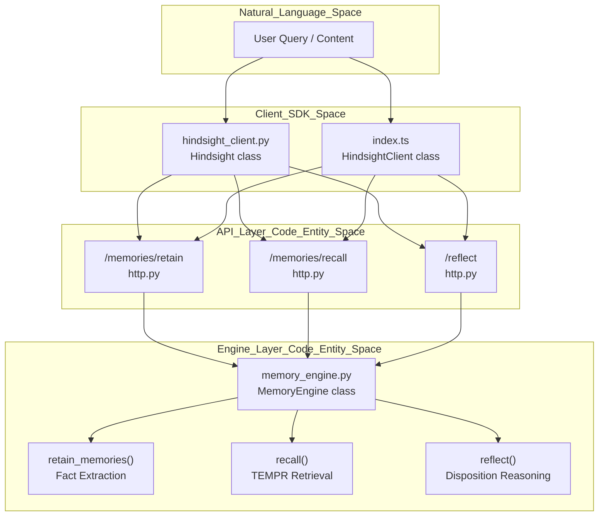
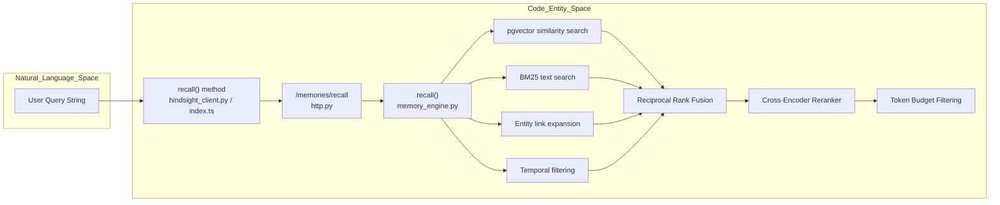
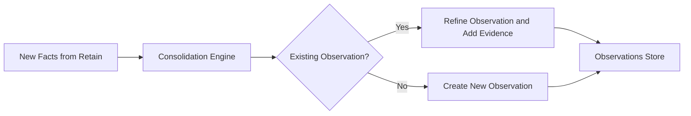

<!-- source: DeepWiki mcp.deepwiki.com · repo vectorize-io/hindsight · page 2.2 Quick Start Guide · fetched 2026-10-26 -->

# Quick Start Guide

<details>
<summary>Relevant source files</summary>

The following files were used as context for generating this wiki page:

- [README.md](README.md)
- [docker/standalone/start-all.sh](docker/standalone/start-all.sh)
- [docker/standalone/test-start-all.sh](docker/standalone/test-start-all.sh)
- [hindsight-api-slim/hindsight_api/http_probe.py](hindsight-api-slim/hindsight_api/http_probe.py)
- [hindsight-api-slim/tests/test_format_facts_for_prompt.py](hindsight-api-slim/tests/test_format_facts_for_prompt.py)
- [hindsight-api-slim/tests/test_http_probe.py](hindsight-api-slim/tests/test_http_probe.py)
- [hindsight-clients/python/hindsight_client/__init__.py](hindsight-clients/python/hindsight_client/__init__.py)
- [hindsight-clients/python/hindsight_client/hindsight_client.py](hindsight-clients/python/hindsight_client/hindsight_client.py)
- [hindsight-clients/python/tests/test_main_operations.py](hindsight-clients/python/tests/test_main_operations.py)
- [hindsight-clients/python/tests/test_prompt_formatting.py](hindsight-clients/python/tests/test_prompt_formatting.py)
- [hindsight-clients/python/tests/test_version.py](hindsight-clients/python/tests/test_version.py)
- [hindsight-clients/typescript/src/index.ts](hindsight-clients/typescript/src/index.ts)
- [hindsight-clients/typescript/tests/prompt_formatting.test.ts](hindsight-clients/typescript/tests/prompt_formatting.test.ts)
- [hindsight-control-plane/bin/cli.js](hindsight-control-plane/bin/cli.js)
- [hindsight-control-plane/tests/lib/cli-bind-host.test.ts](hindsight-control-plane/tests/lib/cli-bind-host.test.ts)
- [hindsight-docs/docs/developer/api/quickstart.mdx](hindsight-docs/docs/developer/api/quickstart.mdx)
- [hindsight-docs/docs/developer/installation.md](hindsight-docs/docs/developer/installation.md)
- [hindsight-docs/versioned_docs/version-0.8/developer/installation.md](hindsight-docs/versioned_docs/version-0.8/developer/installation.md)
- [hindsight-docs/versioned_docs/version-0.9/developer/api/quickstart.mdx](hindsight-docs/versioned_docs/version-0.9/developer/api/quickstart.mdx)
- [hindsight-docs/versioned_docs/version-0.9/developer/installation.md](hindsight-docs/versioned_docs/version-0.9/developer/installation.md)
- [skills/hindsight-docs/references/developer/api/quickstart.md](skills/hindsight-docs/references/developer/api/quickstart.md)
- [skills/hindsight-docs/references/developer/installation.md](skills/hindsight-docs/references/developer/installation.md)

</details>


This page walks through a complete Hindsight workflow: creating a memory bank, storing information from text and files, searching memories, and generating contextual responses. Examples are shown side-by-side across Python, TypeScript, and CLI environments [hindsight-docs/docs/developer/api/quickstart.mdx:1-134](). For zero-config embedded usage, see [Embedded Mode Setup](#2.3).

---

## Core Operations Flow

The following diagram bridges high-level Natural Language operations to the internal Code Entity space, mapping user interactions through client SDKs down to API routes and core engine classes.

**Diagram: Request Flow from Client to Engine**

**Sources:** [hindsight-clients/python/hindsight_client/hindsight_client.py:84-150](), [hindsight-clients/typescript/src/index.ts:110-155](), [hindsight-api-slim/hindsight_api/api/http.py:1-6]()

---

## Step 1: Create a Memory Bank

A **bank** is an isolated memory namespace with its own configuration, mission, and disposition traits like skepticism, literalism, and empathy. Banks are managed via the `BanksApi` which exposes methods for listing, creating, updating, and deleting banks [hindsight-clients/python/hindsight_client/hindsight_client.py:458-482]().

| Language | Code Snippet |
| :--- | :--- |
| **Python** | ```python\nclient.create_bank(bank_id="demo", name="Demo Bank", mission="Helpful AI assistant")\n``` [hindsight-clients/python/hindsight_client/hindsight_client.py:463-477]() |
| **TypeScript** | ```typescript\nawait client.createBank("demo", { name: "Demo Bank", mission: "Helpful AI assistant" })\n``` [hindsight-clients/typescript/src/index.ts:620-650]() |
| **CLI** | ```bash\nhindsight bank create demo --mission "Helpful AI assistant"\n``` [hindsight-docs/docs/developer/api/quickstart.mdx:103-104]() |

**Sources:** [hindsight-clients/python/hindsight_client/hindsight_client.py:458-482](), [hindsight-clients/typescript/src/index.ts:620-650](), [hindsight-docs/docs/developer/api/quickstart.mdx:103-104]()

---

## Step 2: Retain Memories from Text

The `retain` operation accepts raw content (text, structured multimodal blocks) and processes it through fact extraction, entity resolution, and embedding to store it as memories [hindsight-clients/python/hindsight_client/hindsight_client.py:188-221](). This operation supports synchronous and asynchronous modes for scalability.

### Side-by-Side Implementation

| Feature              | Python Example                                                                                                                                                                                  | TypeScript Example                                                                                                                          | CLI Example                                                           |
|----------------------|-------------------------------------------------------------------------------------------------------------------------------------------------------------------------------------------------|--------------------------------------------------------------------------------------------------------------------------------------------|-----------------------------------------------------------------------|
| **Single Retain**     | ```python\nclient.retain(bank_id="demo", content="Alice works at Google")\n``` [hindsight-clients/python/hindsight_client/hindsight_client.py:188-221]()                                              | ```typescript\nawait client.retain("demo", "Alice works at Google")\n``` [hindsight-clients/typescript/src/index.ts:214-239]()             | `hindsight memory retain demo "Alice works at Google"` [hindsight-docs/docs/developer/api/quickstart.mdx:104]()            |
| **With Context**      | ```python\nclient.retain(bank_id="demo", content="Bob likes hiking", context="outdoor")\n```                                                                                                    | ```typescript\nawait client.retain("demo", "Bob likes hiking", { context: "outdoor" })\n```                                               | `hindsight memory retain demo "Bob likes hiking" --context outdoor`  |
| **Async Retain**      | ```python\nclient.retain(bank_id="demo", content="Async retain example", retain_async=True)\n```                                                                                               | ```typescript\nawait client.retain("demo", "Async retain example", { async: true })\n```                                                   | `hindsight memory retain demo "Async retain example" --async`        |

**Sources:** [hindsight-clients/python/hindsight_client/hindsight_client.py:188-221](), [hindsight-clients/typescript/src/index.ts:214-239](), [hindsight-docs/docs/developer/api/quickstart.mdx:104]()

---

## Step 3: Retain Memories from Files

Hindsight supports retaining facts from files such as PDFs, Office documents, and images. The process is asynchronous and handled via the `FilesApi`. Files are parsed into chunks, facts are extracted, and knowledge graph entities are linked behind the scenes [hindsight-clients/python/hindsight_client/hindsight_client.py:135-182]().

### Python Example to Retain a PDF
```python
response = client.files.file_retain(
    bank_id="demo",
    files=["policy.pdf"],
    context="company policies"
)
print(response.operation_ids)
```

### TypeScript Example
```typescript
const response = await client.files.fileRetain("demo", {
  files: ["policy.pdf"],
  context: "company policies"
});
console.log(response.operationIds);
```

**Sources:** [hindsight-clients/python/hindsight_client/hindsight_client.py:135-182](), [hindsight-clients/typescript/src/index.ts:270-311]()

---

## Step 4: Recall Relevant Information

The `recall` operation performs multi-strategy retrieval to find memories relevant to a query using semantic search, keyword search, graph traversal, and temporal filtering [hindsight-clients/python/hindsight_client/hindsight_client.py:284-318](), [hindsight-clients/typescript/src/index.ts:321-353]().

The following diagram bridges the user query space to the core engine retrieval code entities executing the TEMPR multi-strategy pipeline.

**Diagram: TEMPR Retrieval Pipeline and Code Execution**

**Sources:** [hindsight-clients/python/hindsight_client/hindsight_client.py:284-318](), [hindsight-clients/typescript/src/index.ts:321-353]()

### Python Example
```python
response = client.recall(
    bank_id="demo",
    query="What does Alice do?",
    budget="high",
    max_tokens=2048,
    types=["world", "experience"],
    trace=True
)
for result in response.results:
    print(result.text)
```

### TypeScript Example
```typescript
const response = await client.recall("demo", "What does Alice do?", {
  budget: "high",
  maxTokens: 2048,
  types: ["world", "experience"],
  trace: true,
});
console.log(response.results?.map(r => r.text));
```

**Sources:** [hindsight-clients/python/hindsight_client/hindsight_client.py:284-318](), [hindsight-clients/typescript/src/index.ts:321-353]()

---

## Step 5: Reflect to Generate Answers

The `reflect` operation synthesizes an answer by reasoning over retrieved memories, using the bank’s dispositions, mental models, and directives to generate a disposition-aware and coherent response [hindsight-clients/python/hindsight_client/hindsight_client.py:320-373]().

### Python Example
```python
response = client.reflect(
    bank_id="demo",
    query="Tell me about Alice's career",
    budget="high"
)
print(response.text)
```

### TypeScript Example
```typescript
const response = await client.reflect("demo", "Tell me about Alice's career", {
  budget: "high"
});
console.log(response.text);
```

### CLI Example
```bash
hindsight memory reflect demo "Tell me about Alice's career" --budget high
```

**Sources:** [hindsight-clients/python/hindsight_client/hindsight_client.py:320-373](), [hindsight-clients/typescript/src/index.ts:387-416](), [hindsight-docs/docs/developer/api/quickstart.mdx:110]()

---

## Knowledge Consolidation: Observations

After `retain()` completes, Hindsight automatically triggers a background **consolidation** process that synthesizes observations from related facts [hindsight-docs/docs/developer/observations.mdx:13-21]().

**Diagram: Consolidation Engine**

**Sources:** [hindsight-docs/docs/developer/observations.mdx:13-21](), [hindsight-docs/docs/developer/observations.mdx:46-54]()

---

## Summary

This guide covered the full cycle to quickly get started with Hindsight:
1. Create an isolated **memory bank** for namespace separation.
2. **Retain** structured memories from text or files.
3. **Recall** relevant information via multi-strategy retrieval.
4. **Reflect** using memories and dispositions to generate contextual answers.
5. Benefit from asynchronous **consolidation** into higher-order observations.

**Sources:**  
[hindsight-clients/python/hindsight_client/hindsight_client.py:188-373, 458-482](),  
[hindsight-clients/typescript/src/index.ts:110-155, 214-239, 270-311, 321-416, 620-650](),  
[hindsight-api-slim/hindsight_api/api/http.py:1-6](),  
[hindsight-docs/docs/developer/api/quickstart.mdx:1-134](),  
[hindsight-docs/docs/developer/observations.mdx:13-54]()

---

