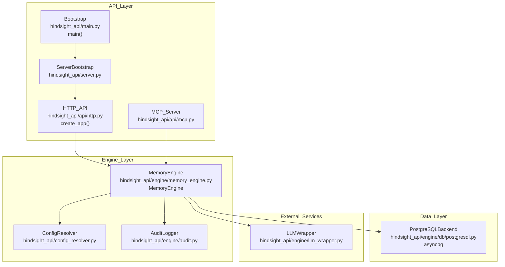
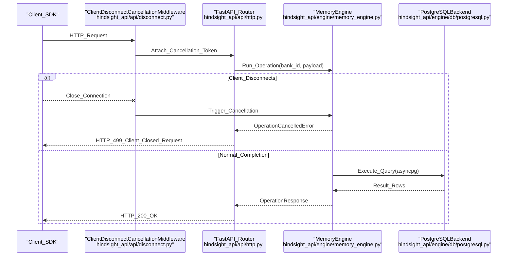

<!-- source: DeepWiki mcp.deepwiki.com · repo vectorize-io/hindsight · page 3.1 Component Overview · fetched 2026-10-26 -->

# Component Overview

Relevant source files

The following files were used as context for generating this wiki page:

- [hindsight-api-slim/hindsight_api/api/http.py](hindsight-api-slim/hindsight_api/api/http.py)
- [hindsight-api-slim/hindsight_api/engine/memory_engine.py](hindsight-api-slim/hindsight_api/engine/memory_engine.py)
- [hindsight-api-slim/hindsight_api/main.py](hindsight-api-slim/hindsight_api/main.py)
- [hindsight-api-slim/hindsight_api/server.py](hindsight-api-slim/hindsight_api/server.py)
- [hindsight-api-slim/tests/test_daemon_host_resolution.py](hindsight-api-slim/tests/test_daemon_host_resolution.py)
- [hindsight-api-slim/tests/test_dotenv_loading.py](hindsight-api-slim/tests/test_dotenv_loading.py)
- [hindsight-api-slim/tests/test_extension_context.py](hindsight-api-slim/tests/test_extension_context.py)
- [hindsight-api-slim/tests/test_main_module.py](hindsight-api-slim/tests/test_main_module.py)
- [hindsight-api-slim/tests/test_server_module.py](hindsight-api-slim/tests/test_server_module.py)
- [hindsight-cli/src/api.rs](hindsight-cli/src/api.rs)
- [hindsight-clients/go/api/openapi.yaml](hindsight-clients/go/api/openapi.yaml)
- [hindsight-clients/python/.openapi-generator/FILES](hindsight-clients/python/.openapi-generator/FILES)
- [hindsight-clients/python/hindsight_client_api/__init__.py](hindsight-clients/python/hindsight_client_api/__init__.py)
- [hindsight-clients/python/hindsight_client_api/models/__init__.py](hindsight-clients/python/hindsight_client_api/models/__init__.py)
- [hindsight-clients/typescript/generated/sdk.gen.ts](hindsight-clients/typescript/generated/sdk.gen.ts)
- [hindsight-clients/typescript/generated/types.gen.ts](hindsight-clients/typescript/generated/types.gen.ts)
- [hindsight-control-plane/src/lib/api.ts](hindsight-control-plane/src/lib/api.ts)
- [hindsight-docs/static/openapi.json](hindsight-docs/static/openapi.json)
- [skills/hindsight-docs/references/openapi.json](skills/hindsight-docs/references/openapi.json)

This page maps the major architectural components of Hindsight: the **API layer** (`hindsight_api/api/http.py`, `hindsight_api/api/mcp.py`, `hindsight_api/main.py`, `hindsight_api/server.py`), **engine layer** (`MemoryEngine` orchestrator in `hindsight_api/engine/memory_engine.py`), **data layer** (PostgreSQL schema and backends), and **external services** (LLM, embedding, and reranking providers). It details request execution flows, context propagation via `contextvars`, and client cancellation monitoring.

For data model specifics, see [Data Model and Schema](). For internal memory orchestration logic, see [Memory Engine]().

---

## Architectural Layers and Code Mapping

Hindsight separates execution into distinct architectural layers. The diagram below bridges natural language architectural concepts to concrete code entities in the codebase.

### System Architecture and Code Entities

**Sources**: [hindsight-api-slim/hindsight_api/main.py:1-68]() [], [hindsight-api-slim/hindsight_api/api/http.py:1-6]() [], [hindsight-api-slim/hindsight_api/engine/memory_engine.py:1-120]() []

---

## API Layer Implementation

The API layer is responsible for ingress, request validation, authentication context initialization, and cancellation monitoring.

### Components and Entry Points
*   **`hindsight_api/api/http.py`**: Defines the FastAPI application factory function `create_app()` [hindsight-api-slim/hindsight_api/api/http.py:4-6](), custom routing via `ExcludeNoneRoute` [hindsight-api-slim/hindsight_api/api/http.py:162-163](), and observability/cancellation middleware.
*   **`hindsight_api/api/mcp.py`**: Implements the Model Context Protocol server, mapping MCP tool invocations to engine actions.
*   **`hindsight_api/main.py`**: Provides the command-line interface (`main()`) [hindsight-api-slim/hindsight_api/main.py:2-11](), daemon spawning [hindsight-api-slim/hindsight_api/main.py:39-43](), pre-flight port binding checks via `_wait_for_port()` [hindsight-api-slim/hindsight_api/main.py:171-178](), and resource cleanup routines (`_cleanup()`) [hindsight-api-slim/hindsight_api/main.py:92-103]().
*   **`hindsight_api/server.py`**: Sets up uvicorn server parameters and application bootstrapping hooks.

| Module | Core Symbol | Responsibility |
| :--- | :--- | :--- |
| `hindsight_api/api/http.py` | `create_app()` | FastAPI app assembly, routing, and middleware injection [hindsight-api-slim/hindsight_api/api/http.py:4-6]() |
| `hindsight_api/api/http.py` | `ClientDisconnectCancellationMiddleware` | Intercepts client hangups to trigger operation cancellation [hindsight-api-slim/hindsight_api/api/http.py:28-28]() |
| `hindsight_api/main.py` | `main()` | CLI argument parsing, port probes, and process supervision [hindsight-api-slim/hindsight_api/main.py:2-11]() |
| `hindsight_api/main.py` | `_wait_for_port()` | Pre-flight TCP bind verification to avoid restart loops [hindsight-api-slim/hindsight_api/main.py:171-178]() |

**Sources**: [hindsight-api-slim/hindsight_api/api/http.py:1-32]() [], [hindsight-api-slim/hindsight_api/main.py:1-180]() []

---

## Engine Layer Orchestrator

The engine layer coordinates all memory transactions. The primary orchestrator class is `MemoryEngine` defined in `hindsight_api/engine/memory_engine.py` [hindsight-api-slim/hindsight_api/engine/memory_engine.py:1-10]().

### Context Isolation
`MemoryEngine` relies on Python `contextvars` to manage multi-tenancy and bank-level attribution across asynchronous boundaries safely:
*   `_current_schema`: Stores the active PostgreSQL schema name per task [hindsight-api-slim/hindsight_api/engine/memory_engine.py:110-112]().
*   `_current_bank_id`: Tracks the target memory bank identifier for cost tracking and provider metadata [hindsight-api-slim/hindsight_api/engine/memory_engine.py:114-118]().

**Sources**: [hindsight-api-slim/hindsight_api/engine/memory_engine.py:1-120]() []

---

## Request Flow and Cancellation Handling

When a client initiates an HTTP request, FastAPI passes execution through observability and cancellation middleware. If a client disconnects prematurely, `ClientDisconnectCancellationMiddleware` signals cancellation down the request stack, raising `OperationCancelledError` [hindsight-api-slim/hindsight_api/cancellation.py:1-40]().

### Request Execution and Cancellation Flow

**Sources**: [hindsight-api-slim/hindsight_api/api/http.py:24-28]() [], [hindsight-api-slim/hindsight_api/cancellation.py:1-40]() [], [hindsight-api-slim/hindsight_api/engine/memory_engine.py:85-120]() []

---

