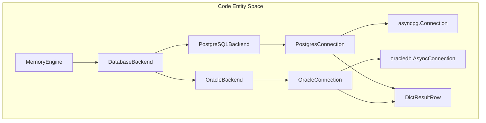
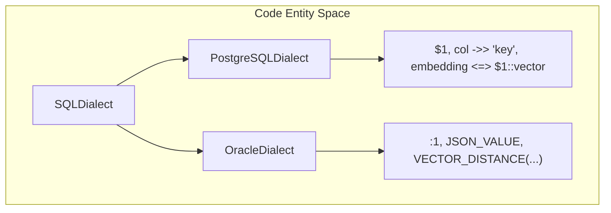
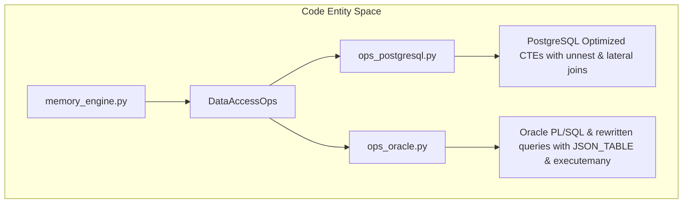
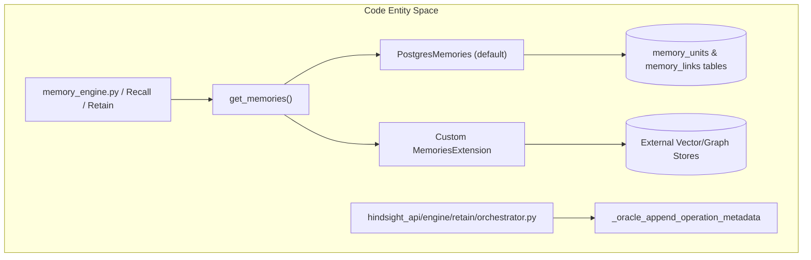
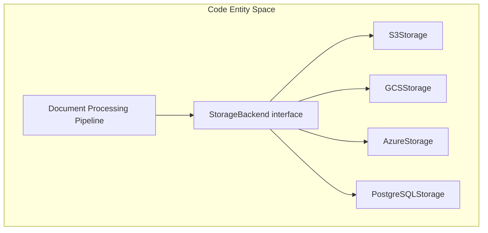

<!-- source: DeepWiki mcp.deepwiki.com · repo vectorize-io/hindsight · page 3.10 Database Abstraction and Oracle Support · fetched 2026-10-26 -->

# Database Abstraction and Oracle Support

Relevant source files

The following files were used as context for generating this wiki page:

- [hindsight-api-slim/hindsight_api/engine/db/ops.py](hindsight-api-slim/hindsight_api/engine/db/ops.py)
- [hindsight-api-slim/hindsight_api/engine/db/ops_oracle.py](hindsight-api-slim/hindsight_api/engine/db/ops_oracle.py)
- [hindsight-api-slim/hindsight_api/engine/db/ops_postgresql.py](hindsight-api-slim/hindsight_api/engine/db/ops_postgresql.py)
- [hindsight-api-slim/hindsight_api/engine/graph_maintenance.py](hindsight-api-slim/hindsight_api/engine/graph_maintenance.py)
- [hindsight-api-slim/hindsight_api/engine/memories/base.py](hindsight-api-slim/hindsight_api/engine/memories/base.py)
- [hindsight-api-slim/hindsight_api/engine/memories/pg/consolidation.py](hindsight-api-slim/hindsight_api/engine/memories/pg/consolidation.py)
- [hindsight-api-slim/hindsight_api/engine/memories/pg/graph.py](hindsight-api-slim/hindsight_api/engine/memories/pg/graph.py)
- [hindsight-api-slim/hindsight_api/engine/memories/pg/reads.py](hindsight-api-slim/hindsight_api/engine/memories/pg/reads.py)
- [hindsight-api-slim/hindsight_api/engine/memories/postgres.py](hindsight-api-slim/hindsight_api/engine/memories/postgres.py)
- [hindsight-api-slim/hindsight_api/engine/retain/bank_utils.py](hindsight-api-slim/hindsight_api/engine/retain/bank_utils.py)
- [hindsight-api-slim/hindsight_api/engine/retain/fact_storage.py](hindsight-api-slim/hindsight_api/engine/retain/fact_storage.py)
- [hindsight-api-slim/hindsight_api/engine/retain/orchestrator.py](hindsight-api-slim/hindsight_api/engine/retain/orchestrator.py)
- [hindsight-api-slim/hindsight_api/engine/retain/types.py](hindsight-api-slim/hindsight_api/engine/retain/types.py)
- [hindsight-api-slim/hindsight_api/engine/transfer/__init__.py](hindsight-api-slim/hindsight_api/engine/transfer/__init__.py)
- [hindsight-api-slim/hindsight_api/engine/transfer/export.py](hindsight-api-slim/hindsight_api/engine/transfer/export.py)
- [hindsight-api-slim/hindsight_api/engine/transfer/importer.py](hindsight-api-slim/hindsight_api/engine/transfer/importer.py)
- [hindsight-api-slim/hindsight_api/engine/transfer/schema.py](hindsight-api-slim/hindsight_api/engine/transfer/schema.py)
- [hindsight-api-slim/tests/test_admin_bank_transfer.py](hindsight-api-slim/tests/test_admin_bank_transfer.py)
- [hindsight-api-slim/tests/test_consolidation_current_tags.py](hindsight-api-slim/tests/test_consolidation_current_tags.py)
- [hindsight-api-slim/tests/test_delta_retain.py](hindsight-api-slim/tests/test_delta_retain.py)
- [hindsight-api-slim/tests/test_document_body_accumulation.py](hindsight-api-slim/tests/test_document_body_accumulation.py)
- [hindsight-api-slim/tests/test_document_transfer.py](hindsight-api-slim/tests/test_document_transfer.py)
- [hindsight-api-slim/tests/test_ensure_bank_exists_optimization.py](hindsight-api-slim/tests/test_ensure_bank_exists_optimization.py)
- [hindsight-api-slim/tests/test_full_recall_temporal_window.py](hindsight-api-slim/tests/test_full_recall_temporal_window.py)
- [hindsight-api-slim/tests/test_graph_maintenance.py](hindsight-api-slim/tests/test_graph_maintenance.py)
- [hindsight-api-slim/tests/test_graph_maintenance_queue_race.py](hindsight-api-slim/tests/test_graph_maintenance_queue_race.py)
- [hindsight-api-slim/tests/test_graph_maintenance_submit_dedup.py](hindsight-api-slim/tests/test_graph_maintenance_submit_dedup.py)
- [hindsight-api-slim/tests/test_memories_extension.py](hindsight-api-slim/tests/test_memories_extension.py)
- [hindsight-api-slim/tests/test_retain_consolidation_deadlock.py](hindsight-api-slim/tests/test_retain_consolidation_deadlock.py)
- [hindsight-api-slim/tests/test_retain_store_owned_no_connection.py](hindsight-api-slim/tests/test_retain_store_owned_no_connection.py)
- [hindsight-api-slim/tests/test_store_owned_retain_parity.py](hindsight-api-slim/tests/test_store_owned_retain_parity.py)
- [hindsight-api-slim/tests/test_transfer_observation_source_liveness.py](hindsight-api-slim/tests/test_transfer_observation_source_liveness.py)
- [hindsight-api-slim/tests/test_transfer_restore_rows_oracle.py](hindsight-api-slim/tests/test_transfer_restore_rows_oracle.py)
- [hindsight-api-slim/tests/test_transfer_store_owned_import.py](hindsight-api-slim/tests/test_transfer_store_owned_import.py)
- [hindsight-api-slim/tests/test_transfer_streaming_import.py](hindsight-api-slim/tests/test_transfer_streaming_import.py)
- [hindsight-clients/go/model_create_bank_alias_request.go](hindsight-clients/go/model_create_bank_alias_request.go)
- [hindsight-clients/python/hindsight_client_api/models/create_bank_alias_request.py](hindsight-clients/python/hindsight_client_api/models/create_bank_alias_request.py)
- [hindsight-system-tests/tests/test_50_banks_and_config.py](hindsight-system-tests/tests/test_50_banks_and_config.py)

This section documents Hindsight's architectural separation between core business logic and underlying database and storage layers. Specifically, it covers the database connection abstraction (`engine/db`), the SQL dialect translation layer (`engine/sql`), the `DataAccessOps` strategy pattern, the pluggable memories store seam (`engine/memories`), and file storage backends (`engine/storage`).

---

## 1. Database Abstraction Layer (`engine/db`)

Hindsight decouples database driver execution from the engine orchestration layer using abstract base classes defined in `hindsight_api/engine/db/base.py` and implemented for specific relational engines.

### Key Classes and Interfaces
* **`DatabaseBackend`**: Abstract base class defining connection pool creation, health checking, and transaction lifecycle management [hindsight_api-slim/hindsight_api/engine/db/base.py]() (lines 1-50).
* **`DatabaseConnection`**: Abstract interface wrapping transactional execution methods (`execute`, `executemany`, `fetch`, `fetchrow`, `fetchval`, `copy_records_to_table`) [hindsight_api-slim/hindsight_api/engine/db/base.py]() (lines 51-110).
* **`DictResultRow` / `ResultRow`**: Provides unified dictionary and attribute access over database rows without redundant Python-level mapping overhead [hindsight_api-slim/hindsight_api/engine/db/result.py]() (entire file).

### Backends

* **PostgreSQL (`PostgreSQLBackend`)**:  
  Implemented via `asyncpg`, returning native `asyncpg.Record` objects that satisfy the `ResultRow` protocol directly in C to avoid interpreter overhead (~570K `__getitem__` calls per 20-query benchmark). It supports batched session setup with `apply_session_settings` to minimize roundtrips per connection acquire ([hindsight_api-slim/hindsight_api/engine/db/postgresql.py:1-139](), [hindsight_api-slim/hindsight_api/engine/db/postgresql.py:42-96]()).

* **Oracle 23ai (`OracleBackend`)**:  
  Implemented via `python-oracledb` in thin mode, which requires no Oracle client installation ([hindsight_api-slim/hindsight_api/engine/db/oracle.py:1-170]()). Features transparent query rewriting of PostgreSQL-specific SQL syntax (e.g., positional `$1` parameters, `::type` casts, `ON CONFLICT`, `RETURNING` clauses) into Oracle-compatible syntax. It also auto-converts `uuid.UUID` Python objects into Oracle `RAW(16)` format and handles JSON and LOB bindings seamlessly. Connection pools and sessions support multi-tenant schema isolation via `ALTER SESSION SET CURRENT_SCHEMA`.

*Sources: `hindsight_api-slim/hindsight_api/engine/db/base.py`, `hindsight_api-slim/hindsight_api/engine/db/postgresql.py`, `hindsight_api-slim/hindsight_api/engine/db/oracle.py`, `hindsight_api-slim/hindsight_api/engine/db/result.py`*

---

## 2. SQL Dialect Layer (`engine/sql`)

The `SQLDialect` interface (`hindsight_api/engine/sql/base.py`) abstracts the syntax variations in SQL fragments, including parameter markers, JSON operators, vector similarity computations, and text-search query construction.

### Key Methods and Behavior

* `param(index: int) -> str`: Returns parameter binding syntax — e.g., `$1` for PostgreSQL, `:1` for Oracle.  
* `cast(expr: str, target_type: str) -> str`: Produces a cast expression, such as `$1::jsonb` (PG) or appropriate Oracle cast.  
* `vector_distance(column: str, param: str) -> str`: SQL snippet for vector distance comparisons using `embedding <=> $1::vector` in Postgres or appropriate equivalent in Oracle.  
* `json_extract_text(column: str, key: str) -> str`: JSON property access — `col ->> 'key'` in PostgreSQL, `JSON_VALUE(col, '$.key')` in Oracle.  
* `text_search_score(text_col: str, param: str, index_name: str = None) -> str`: Builds backend-specific full-text search ranking expressions. E.g., `ts_rank_cd` in PostgreSQL, `SCORE()` with `CONTAINS()` in Oracle.

The dialect also encapsulates complex patterns for UPSERT (`ON CONFLICT DO UPDATE` in PostgreSQL vs. `MERGE` in Oracle), bulk array unnesting, and row-locking semantics.

*Sources: `hindsight_api-slim/hindsight_api/engine/sql/base.py`, `hindsight_api-slim/hindsight_api/engine/sql/postgresql.py`, `hindsight_api-slim/hindsight_api/engine/sql/oracle.py`*

---

## 3. DataAccessOps Strategy Pattern

Hindsight encapsulates complex multi-statement database operations within the `DataAccessOps` strategy pattern to separate backend-agnostic business logic from engine-specific SQL implementation. This pattern abstracts batch inserts, graph traversals, link expansions, and consolidation queries that differ substantially between PostgreSQL and Oracle.

### Overview

* Defined in `hindsight_api/engine/db/ops.py`, `DataAccessOps` is an abstract base class enumerating key database operations used throughout the engine [hindsight_api-slim/hindsight_api/engine/db/ops.py:1-145]().  
* PostgreSQL-specific implementation uses powerful native features such as `unnest()`, `LATERAL JOIN`, and `DISTINCT ON` for batched, set-oriented queries [hindsight_api-slim/hindsight_api/engine/db/ops_postgresql.py:1-152]().  
* Oracle-specific implementation adapts using `executemany()`, JSON_TABLE, `ROW_NUMBER()`, and workarounds for Oracle's lack of some PostgreSQL features [hindsight_api-slim/hindsight_api/engine/db/ops_oracle.py:1-170]().  
* The memory engine (`memory_engine.py`) resolves the runtime database backend type and dispatches to the appropriate `DataAccessOps` subclass transparently.

### Example: Bulk Chunk Upsert

| Backend       | Implementation Detail                                                         |
|---------------|-------------------------------------------------------------------------------|
| PostgreSQL    | Uses `INSERT ... SELECT FROM unnest(...) ON CONFLICT (chunk_id)` with a bank_id check [hindsight_api-slim/hindsight_api/engine/db/ops_postgresql.py:118-152](). |
| Oracle        | Uses `executemany` on array parameters via thin driver, efficient batching with Oracle's native driver capabilities [hindsight_api-slim/hindsight_api/engine/db/ops_oracle.py:75-102](). |

*Sources: `hindsight_api-slim/hindsight_api/engine/db/ops.py`, `hindsight_api-slim/hindsight_api/engine/db/ops_postgresql.py`, `hindsight_api-slim/hindsight_api/engine/db/ops_oracle.py`*

---

## 4. Memories Store Seam (`engine/memories`)

Hindsight supports pluggable backends for storing, indexing, and recalling memory units. This seam permits future alternative databases or vector search engines without modifying the core engine.

### Architecture

* Defined via the abstract interface `MemoriesExtension` [hindsight_api-slim/hindsight_api/engine/memories/base.py:1-36]().  
* The default backend, `PostgresMemories`, implements the interface using the relational tables: `memory_units` (fact storage), `memory_links` (graph edges), and `unit_entities` (entities associated with memory units) [hindsight_api-slim/hindsight_api/engine/memories/postgres.py]().  
* Custom extensions can take full control (`store_owned = True`), managing their own persistence and search structures outside the PostgreSQL store tables. The engine interacts with them by calling exposed methods [hindsight_api-slim/tests/test_memories_extension.py:40-70]().  
* Unit IDs allocation is explicit via the `allocate_unit_ids` method instead of relying solely on database RETURNING clauses, enabling backends without native `RETURNING` support to conform [hindsight_api-slim/hindsight_api/engine/memories/base.py:22-27]().
* The `_oracle_append_operation_metadata` function in the retain orchestrator [hindsight_api-slim/hindsight_api/engine/retain/orchestrator.py:61-97]() and `_persist_facts_committed_checkpoint` [hindsight_api-slim/hindsight_api/engine/retain/orchestrator.py:100-136]() and `_persist_operation_document_id` [hindsight_api-slim/hindsight_api/engine/retain/orchestrator.py:139-169]() functions demonstrate specific Oracle handling for JSON metadata updates, where PostgreSQL's `jsonb_set` and `||` operators are not directly translatable. Oracle requires locking the row, merging JSON in Python, and writing it back in a transaction.

*Sources: `hindsight_api-slim/hindsight_api/engine/memories/base.py`, `hindsight_api-slim/hindsight_api/engine/memories/postgres.py`, `hindsight_api-slim/tests/test_memories_extension.py`, `hindsight_api-slim/hindsight_api/engine/retain/orchestrator.py`*

---

## 5. File Storage Backends (`engine/storage`)

Hindsight abstracts file attachment storage behind pluggable backends implementing a common `StorageBackend` interface (`engine/storage/base.py`).

### Supported Backends

* **S3 (`S3Storage`)**: Amazon S3-compatible storage buckets, including MinIO and Cloudflare R2 [hindsight_api-slim/hindsight_api/engine/storage/s3.py]().
* **Google Cloud Storage (`GCSStorage`)**: Google Cloud Storage buckets integration [hindsight_api-slim/hindsight_api/engine/storage/gcs.py]().
* **Azure Blob Storage (`AzureStorage`)**: Azure blob containers for attachments [hindsight_api-slim/hindsight_api/engine/storage/azure.py]().
* **PostgreSQL (`PostgreSQLStorage`)**: Attachments stored directly as binary blobs in PostgreSQL tables for self-hosted, zero-infrastructure setups [hindsight_api-slim/hindsight_api/engine/storage/postgresql.py]().

These backends provide uniform APIs for upload, download, delete, and metadata management operations consumed by the document ingest and retain pipelines.

*Sources: `hindsight_api-slim/hindsight_api/engine/storage/base.py`, `hindsight_api-slim/hindsight_api/engine/storage/s3.py`, `hindsight_api-slim/hindsight_api/engine/storage/gcs.py`, `hindsight_api-slim/hindsight_api/engine/storage/azure.py`, `hindsight_api-slim/hindsight_api/engine/storage/postgresql.py`*

---

# Summary

Hindsight achieves database backend independence and flexibility through carefully designed layers of abstraction:

1. **Database abstraction (`engine/db`)** standardizes connection and transaction APIs across PostgreSQL and Oracle, hiding driver details and query execution specifics.

2. **SQL dialect modules (`engine/sql`)** encapsulate the divergent syntax and functions between backends, enabling query generation without scattering dialect conditionals.

3. **`DataAccessOps` strategy pattern (`engine/db/ops.py`)** provides optimized, backend-specific multi-statement workflows while the engine orchestrator remains agnostic.

4. **Memories store seam (`engine/memories`)** abstracts memory persistence and index strategies, supporting customizable vector/graph stores beyond PostgreSQL. Specific Oracle JSON handling is implemented where direct PostgreSQL feature translation is not possible.

5. **File storage backends (`engine/storage`)** allow configurable, pluggable attachment storage via cloud or database native mechanisms.

Together, these components maintain code clarity and encourage extensibility, enabling Hindsight to support PostgreSQL and Oracle backends transparently and prepare for alternative storage technologies in the future.

# References

- `hindsight_api-slim/hindsight_api/engine/db/base.py`  
- `hindsight_api-slim/hindsight_api/engine/db/postgresql.py`  
- `hindsight_api-slim/hindsight_api/engine/db/oracle.py`  
- `hindsight_api-slim/hindsight_api/engine/db/ops.py`  
- `hindsight_api-slim/hindsight_api/engine/db/ops_postgresql.py`  
- `hindsight_api-slim/hindsight_api/engine/db/ops_oracle.py`  
- `hindsight_api-slim/hindsight_api/engine/db/result.py`  
- `hindsight_api-slim/hindsight_api/engine/sql/base.py`  
- `hindsight_api-slim/hindsight_api/engine/sql/postgresql.py`  
- `hindsight_api-slim/hindsight_api/engine/sql/oracle.py`  
- `hindsight_api-slim/hindsight_api/engine/memories/base.py`  
- `hindsight_api-slim/hindsight_api/engine/memories/postgres.py`  
- `hindsight_api-slim/hindsight_api/engine/storage/base.py`  
- `hindsight_api-slim/hindsight_api/engine/storage/s3.py`  
- `hindsight_api-slim/hindsight_api/engine/storage/gcs.py`  
- `hindsight_api-slim/hindsight_api/engine/storage/azure.py`  
- `hindsight_api-slim/hindsight_api/engine/storage/postgresql.py`
- `hindsight_api-slim/hindsight_api/engine/retain/orchestrator.py`

---

