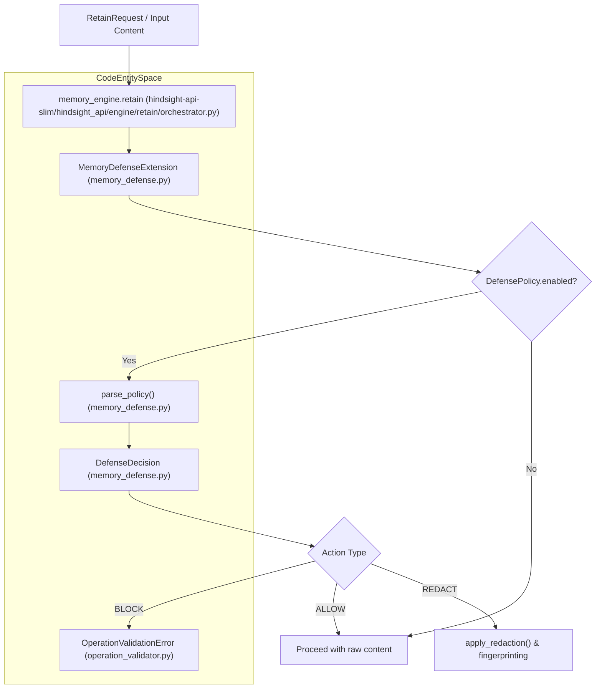
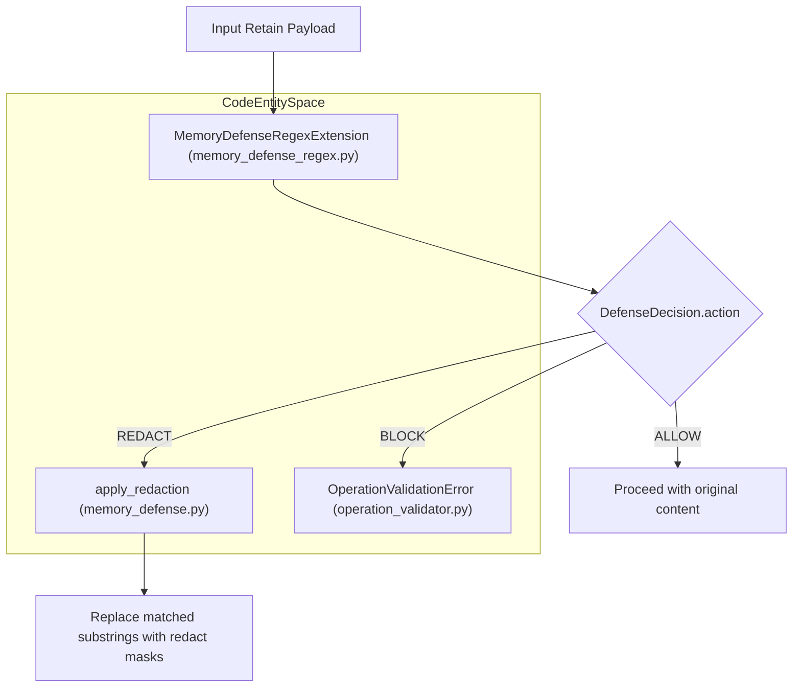
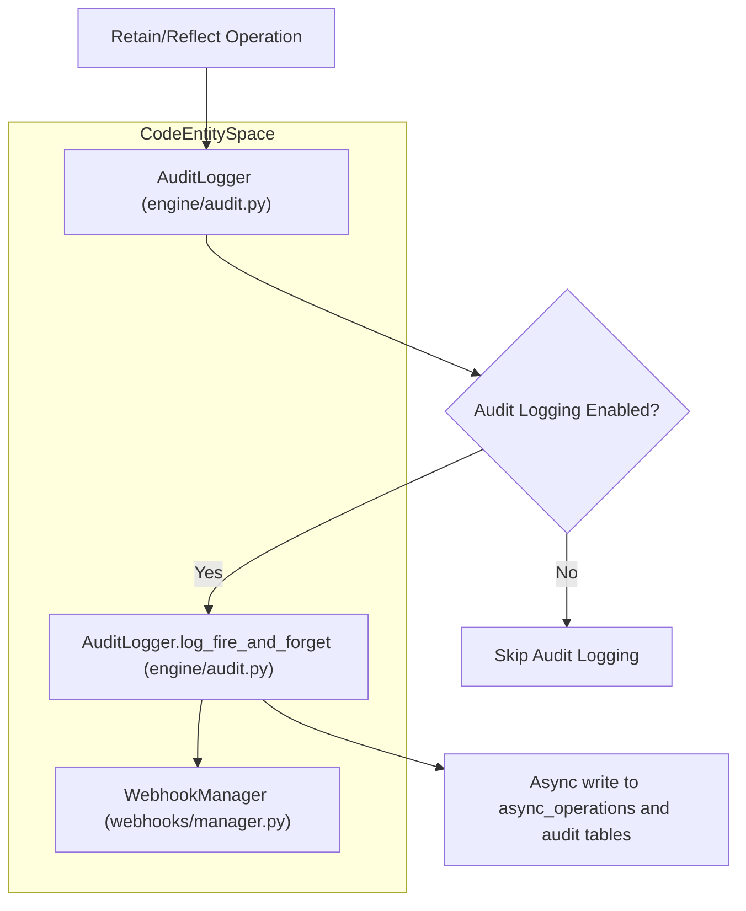
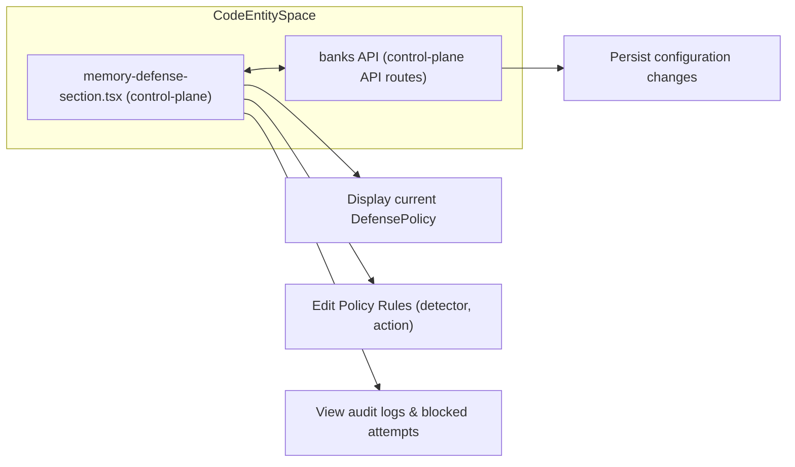

<!-- source: DeepWiki mcp.deepwiki.com · repo vectorize-io/hindsight · page 3.11 Memory Defense and Security · fetched 2026-10-26 -->

# Memory Defense and Security

<details>
<summary>Relevant source files</summary>

The following files were used as context for generating this wiki page:

- [hindsight-api-slim/hindsight_api/extensions/builtin/memory_defense_regex.py](hindsight-api-slim/hindsight_api/extensions/builtin/memory_defense_regex.py)
- [hindsight-api-slim/hindsight_api/extensions/memory_defense.py](hindsight-api-slim/hindsight_api/extensions/memory_defense.py)
- [hindsight-api-slim/hindsight_api/webhooks/__init__.py](hindsight-api-slim/hindsight_api/webhooks/__init__.py)
- [hindsight-api-slim/tests/test_memory_defense.py](hindsight-api-slim/tests/test_memory_defense.py)
- [hindsight-control-plane/src/components/memory-defense-section.tsx](hindsight-control-plane/src/components/memory-defense-section.tsx)

</details>


This page documents Hindsight's Memory Defense extension system, covering content inspection for credential and PII secret leaks, prompt injection detection, size anomaly controls, built-in regex-based policies, action disposition routing (`allow`, `redact`, `block`), audit logging pipelines, and the Next.js control plane memory defense UI.

---

## 3.11.1 Extension Contract and Architecture

The Memory Defense subsystem is structured around an extensible extension contract defined in `hindsight_api.extensions.memory_defense` `[hindsight-api-slim/hindsight_api/extensions/memory_defense.py:1-78]()`. It decouples core memory ingestion and retrieval pipelines from concrete screening algorithms.

The primary protocol, `MemoryDefenseExtension`, processes input payloads against a bank's configured `DefensePolicy` `[hindsight-api-slim/hindsight_api/extensions/memory_defense.py:48-52]()`. Policies consist of a boolean `enabled` flag and a sequence of `PolicyRule` entities mapping a detector target (`on`) to a `DefenseAction` `[hindsight-api-slim/hindsight_api/extensions/memory_defense.py:42-46]`.

The retain pipeline's orchestrator invokes the Memory Defense extension during text ingestion by calling its `screen` method, which returns a `DefenseDecision` describing the action to take on the content (`allow`, `redact`, or `block`). Redaction transforms the text to mask suspected secrets, while blocking immediately rejects the operation with an error.



*Figure: Memory Defense Request Inspection Pipeline bridging natural language evaluation to `MemoryDefenseExtension` and `DefenseDecision` execution.*

Sources: `[hindsight-api-slim/hindsight_api/extensions/memory_defense.py:1-78]()`, `[hindsight-api-slim/hindsight_api/extensions/operation_validator.py:15-35]()`, `[hindsight-api-slim/hindsight_api/engine/retain/orchestrator.py:19-57]()`.

---

## 3.11.2 Built-in Regex Policy and Pattern Screening

The default OSS memory defense implementation is `MemoryDefenseRegexExtension`, located in `hindsight_api.extensions.builtin.memory_defense_regex` `[hindsight-api-slim/hindsight_api/extensions/builtin/memory_defense_regex.py:1-57]()`.

It applies a set of high-confidence regular expression patterns targeting API keys, private keys, tokens, and PII to detect secret leaks. Because standard regex `\b` word boundaries treat CJK (Chinese/Japanese/Korean) characters as word constituents—causing boundary mismatches—the extension uses custom ASCII token boundaries to reliably find secrets even when embedded adjacently to CJK text `[hindsight-api-slim/hindsight_api/extensions/memory_defense.py:133-149]()`.

The ASCII token boundaries are implemented as follows:

```python
_ASCII_TOKEN_START = r"(?<![A-Za-z0-9_])"
_ASCII_TOKEN_END = r"(?![A-Za-z0-9_])"
```

This means a secret must not be immediately preceded or followed by an ASCII alphanumeric or underscore character, but can sit next to CJK or other Unicode characters without losing detection `[hindsight-api-slim/hindsight_api/extensions/memory_defense.py:133-149]()`.

Matched secret substrings are fingerprinted via `_fingerprint_value()` to generate safe, privacy-preserving summaries for audit logs and visualizations `[hindsight-api-slim/hindsight_api/extensions/memory_defense.py:79-106]()`:

- For secrets shorter than 6 characters, mask entirely as `[redacted]` `[hindsight-api-slim/hindsight_api/extensions/memory_defense.py:101-102]()`.
- For secrets 6 to 15 characters long, show the first 2 and last 2 characters with an ellipsis `[hindsight-api-slim/hindsight_api/extensions/memory_defense.py:103-104]()`.
- For longer secrets, show the first 4 and last 4 characters with an ellipsis `[hindsight-api-slim/hindsight_api/extensions/memory_defense.py:105-105]`.

These redaction rules ensure operators can identify the type and asset without leaking full secrets. The extension replaces detected values with redaction placeholders on retention `[hindsight-api-slim/hindsight_api/extensions/memory_defense.py:71-77]()`.

Sources: `[hindsight-api-slim/hindsight_api/extensions/memory_defense.py:79-173]()`, `[hindsight-api-slim/tests/test_memory_defense.py:1-178]()`, `[hindsight-api-slim/hindsight_api/extensions/builtin/memory_defense_regex.py:1-57]()`.

---

## 3.11.3 Action Modes: Allow, Redact, and Block

The `DefenseAction` enumeration defines three disposition modes returned inside a `DefenseDecision` object `[hindsight-api-slim/hindsight_api/extensions/memory_defense.py:24-28]`, `[hindsight-api-slim/hindsight_api/extensions/memory_defense.py:55-68]()`:

| Action    | Behavior                                                                                                                                    |
|-----------|---------------------------------------------------------------------------------------------------------------------------------------------|
| ALLOW     | Content passes unchanged through retention and storage. The system may still record audit metrics or events for monitoring.                  |
| REDACT    | Detected secrets are replaced/masked within the stored content. Actions include fingerprinting matched secrets to emit safe previews.       |
| BLOCK     | Incoming operation is immediately aborted by raising `OperationValidationError` with a 403 error. The suspicious content is never stored.    |

During retain processing, if a block action is returned for any item in a batch, those items are prevented from storing, and the retain request is rejected with a detailed error including the detected violation types `[hindsight-api-slim/hindsight_api/extensions/memory_defense.py:24-28]()`.

Redaction is handled by `apply_redaction` and the extension's `screen` method, returning a `DefenseDecision` containing matched patterns, actions, and sanitized content `[hindsight-api-slim/hindsight_api/extensions/builtin/memory_defense_regex.py:25-57]()`.



*Figure: Action routing logic within the retain middleware.*

Sources: `[hindsight-api-slim/hindsight_api/extensions/memory_defense.py:24-78]()`, `[hindsight-api-slim/hindsight_api/extensions/operation_validator.py:15-35]()`, `[hindsight-api-slim/hindsight_api/engine/retain/orchestrator.py:19-185]()`.

---

## 3.11.4 Audit Logging and Event Tracing

Memory Defense events—whether allows, redactions, or blocks—are logged comprehensively to an audit system interfaced by `AuditLogger` in the engine's audit module `[hindsight-api-slim/hindsight_api/engine/audit.py:124-185]()`. This includes operations, security policy hits, and redaction details for later review.

Audit logging evaluates hierarchical policies—global, tenant, and bank-level—before performing asynchronous writes to the `async_operations` store, preventing blocking retention latency `[hindsight-api-slim/hindsight_api/engine/audit.py:124-185]()`.

In the case of blocks or notable hits, configured webhooks are triggered via `WebhookManager` `[hindsight-api-slim/hindsight_api/webhooks/manager.py:1-50]` with event payloads structured as models in `hindsight_api.webhooks.models` `[hindsight-api-slim/hindsight_api/webhooks/models.py:1-38]()`. This integration facilitates real-time alerts or automated response integrations.



*Figure: Audit logging and webhook dispatch flow.*

Sources: `[hindsight-api-slim/hindsight_api/engine/audit.py:124-185]()`, `[hindsight-api-slim/hindsight_api/webhooks/models.py:1-38]()`, `[hindsight-api-slim/tests/test_memory_defense.py:180-300]()`.

---

## 3.11.5 Control Plane Memory Defense UI

The Memory Defense policy and its audit trail can be managed and inspected through the Hindsight control plane UI, implemented as a Next.js React component in `hindsight-control-plane/src/components/memory-defense-section.tsx` `[hindsight-control-plane/src/components/memory-defense-section.tsx:1-425]()`.

Key UI features include:

- Viewing and toggling the Memory Defense policy enablement status per bank `[hindsight-control-plane/src/components/memory-defense-section.tsx:202-210]()`.
- Managing the list of detection rules with actions (`allow`, `redact`, or `block`) `[hindsight-control-plane/src/components/memory-defense-section.tsx:135-156]()`.
- Visualizing blocked events and redaction fingerprints in real time for operators.
- Integration with audit logs and detailed event traces `[hindsight-control-plane/src/components/memory-defense-section.tsx:111-130]()`.

The UI interacts with the bank configuration API endpoints to update and fetch policy states and rules, reflecting changes live `[hindsight-control-plane/src/components/memory-defense-section.tsx:176-188]()`.



*Figure: Operator interaction flow for Memory Defense policies via the control plane UI.*

Sources: `[hindsight-control-plane/src/components/memory-defense-section.tsx:1-425]()`, `[hindsight-api-slim/hindsight_api/extensions/memory_defense.py:42-53]()`.

---

# Summary

Hindsight's Memory Defense subsystem provides extensible, policy-driven inspection of retained content for secret leaks and prompt injection risks. The core OSS policy uses regex-based detection with rigorous token boundary handling in multilingual environments. Actions include allowing, redacting sensitive data with safe fingerprinting, or blocking operation requests outright to prevent pollution of the memory store.

Extensible audit logging and webhook event pipelines integrate with broader operational tooling for monitoring and response. The control plane UI empowers operators to visualize policy configurations, violations, and redaction results, maintaining security governance over memory ingestion.

This architecture balances extensibility, strong security guarantees, performance, and operator visibility.

---

Sources:

- `[hindsight-api-slim/hindsight_api/extensions/memory_defense.py:1-185]()`
- `[hindsight-api-slim/hindsight_api/extensions/builtin/memory_defense_regex.py:1-57]()`
- `[hindsight-api-slim/hindsight_api/extensions/operation_validator.py:15-35]()`
- `[hindsight-api-slim/hindsight_api/engine/retain/orchestrator.py:19-185]()`
- `[hindsight-api-slim/hindsight_api/engine/audit.py:124-185]()`
- `[hindsight-api-slim/hindsight_api/webhooks/models.py:1-38]()`
- `[hindsight-control-plane/src/components/memory-defense-section.tsx:1-425]()`
- `[hindsight-api-slim/tests/test_memory_defense.py:1-178]()`

---

