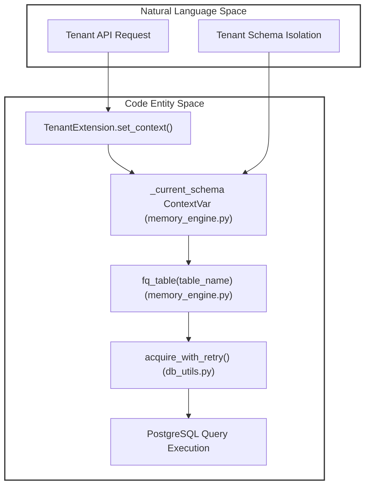
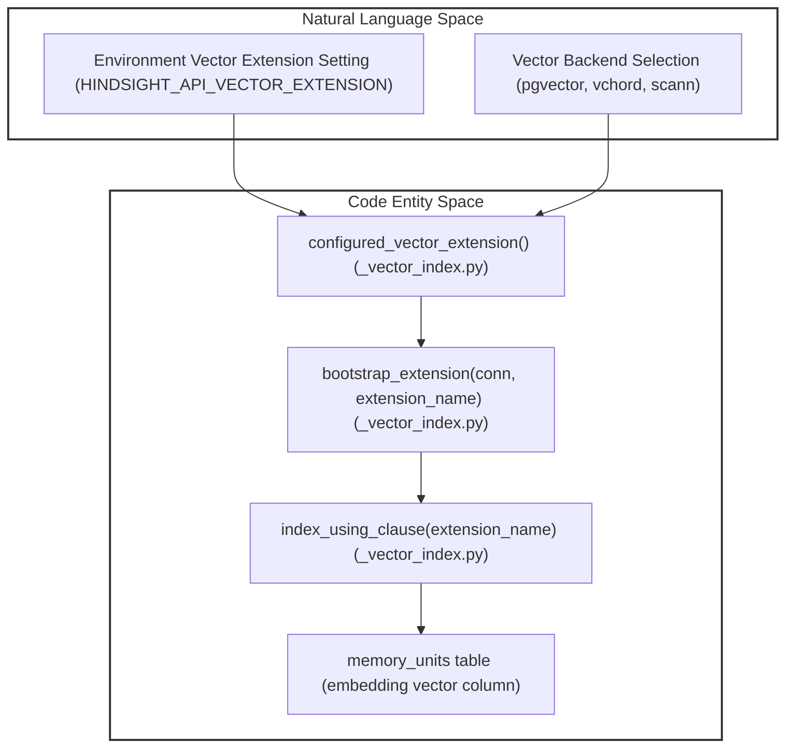
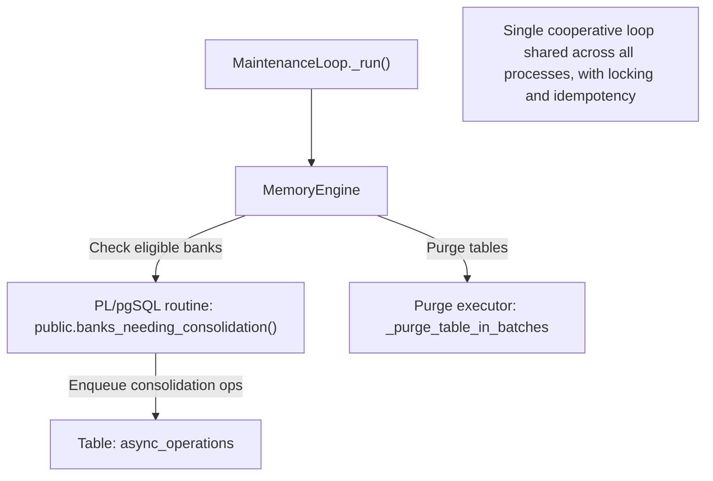

<!-- source: DeepWiki mcp.deepwiki.com · repo vectorize-io/hindsight · page 3.3 Data Model and Schema · fetched 2026-10-26 -->

# Data Model and Schema

Relevant source files

The following files were used as context for generating this wiki page:

- [hindsight-api-slim/hindsight_api/_vector_index.py](hindsight-api-slim/hindsight_api/_vector_index.py)
- [hindsight-api-slim/hindsight_api/alembic/_owned.py](hindsight-api-slim/hindsight_api/alembic/_owned.py)
- [hindsight-api-slim/hindsight_api/alembic/versions/2eee35aa3cfc_case_insensitive_entities_trgm_index.py](hindsight-api-slim/hindsight_api/alembic/versions/2eee35aa3cfc_case_insensitive_entities_trgm_index.py)
- [hindsight-api-slim/hindsight_api/alembic/versions/5a366d414dce_initial_schema.py](hindsight-api-slim/hindsight_api/alembic/versions/5a366d414dce_initial_schema.py)
- [hindsight-api-slim/hindsight_api/alembic/versions/a2b3c4d5e6f7_add_text_signals_column.py](hindsight-api-slim/hindsight_api/alembic/versions/a2b3c4d5e6f7_add_text_signals_column.py)
- [hindsight-api-slim/hindsight_api/alembic/versions/a4b5c6d7e8f9_fix_per_bank_vector_index_type.py](hindsight-api-slim/hindsight_api/alembic/versions/a4b5c6d7e8f9_fix_per_bank_vector_index_type.py)
- [hindsight-api-slim/hindsight_api/alembic/versions/b2429c65cc20_banks_needing_consolidation_hybrid_probe.py](hindsight-api-slim/hindsight_api/alembic/versions/b2429c65cc20_banks_needing_consolidation_hybrid_probe.py)
- [hindsight-api-slim/hindsight_api/alembic/versions/b2d4f6a8c1e3_repair_maintenance_routines_public.py](hindsight-api-slim/hindsight_api/alembic/versions/b2d4f6a8c1e3_repair_maintenance_routines_public.py)
- [hindsight-api-slim/hindsight_api/alembic/versions/b6d2f8a4c1e7_maintenance_routines_schema_local.py](hindsight-api-slim/hindsight_api/alembic/versions/b6d2f8a4c1e7_maintenance_routines_schema_local.py)
- [hindsight-api-slim/hindsight_api/alembic/versions/b8c9d0e1f2a3_vchord_cosine_opclass.py](hindsight-api-slim/hindsight_api/alembic/versions/b8c9d0e1f2a3_vchord_cosine_opclass.py)
- [hindsight-api-slim/hindsight_api/alembic/versions/c7e9f1a3b5d2_maintenance_routines_skip_vanished_schemas.py](hindsight-api-slim/hindsight_api/alembic/versions/c7e9f1a3b5d2_maintenance_routines_skip_vanished_schemas.py)
- [hindsight-api-slim/hindsight_api/alembic/versions/c8b4e2a71f95_maintenance_routines_skip_locked_schemas.py](hindsight-api-slim/hindsight_api/alembic/versions/c8b4e2a71f95_maintenance_routines_skip_locked_schemas.py)
- [hindsight-api-slim/hindsight_api/alembic/versions/d5e6f7a8b9c0_add_bank_internal_id_and_per_bank_hnsw.py](hindsight-api-slim/hindsight_api/alembic/versions/d5e6f7a8b9c0_add_bank_internal_id_and_per_bank_hnsw.py)
- [hindsight-api-slim/hindsight_api/alembic/versions/d6e7f8a9b0c1_drop_documents_metadata_column.py](hindsight-api-slim/hindsight_api/alembic/versions/d6e7f8a9b0c1_drop_documents_metadata_column.py)
- [hindsight-api-slim/hindsight_api/alembic/versions/d7b2f8a1c934_add_schemas_with_expired_operations_routine.py](hindsight-api-slim/hindsight_api/alembic/versions/d7b2f8a1c934_add_schemas_with_expired_operations_routine.py)
- [hindsight-api-slim/hindsight_api/alembic/versions/e5f6a7b8c9d0_add_maintenance_routines.py](hindsight-api-slim/hindsight_api/alembic/versions/e5f6a7b8c9d0_add_maintenance_routines.py)
- [hindsight-api-slim/hindsight_api/alembic/versions/f4d1c2b3a5e6_add_scheduled_mental_model_refresh_routine.py](hindsight-api-slim/hindsight_api/alembic/versions/f4d1c2b3a5e6_add_scheduled_mental_model_refresh_routine.py)
- [hindsight-api-slim/hindsight_api/alembic/versions/h3i4j5k6l7m8_merge_heads_and_add_unit_entities_index.py](hindsight-api-slim/hindsight_api/alembic/versions/h3i4j5k6l7m8_merge_heads_and_add_unit_entities_index.py)
- [hindsight-api-slim/hindsight_api/alembic/versions/n9i0j1k2l3m4_learnings_and_pinned_reflections.py](hindsight-api-slim/hindsight_api/alembic/versions/n9i0j1k2l3m4_learnings_and_pinned_reflections.py)
- [hindsight-api-slim/hindsight_api/engine/db_utils.py](hindsight-api-slim/hindsight_api/engine/db_utils.py)
- [hindsight-api-slim/hindsight_api/engine/memories/pg/transfer.py](hindsight-api-slim/hindsight_api/engine/memories/pg/transfer.py)
- [hindsight-api-slim/hindsight_api/engine/retain/embedding_utils.py](hindsight-api-slim/hindsight_api/engine/retain/embedding_utils.py)
- [hindsight-api-slim/hindsight_api/engine/search/reranking.py](hindsight-api-slim/hindsight_api/engine/search/reranking.py)
- [hindsight-api-slim/hindsight_api/engine/token_encoding.py](hindsight-api-slim/hindsight_api/engine/token_encoding.py)
- [hindsight-api-slim/tests/test_coarse_date_spans.py](hindsight-api-slim/tests/test_coarse_date_spans.py)
- [hindsight-api-slim/tests/test_combined_scoring.py](hindsight-api-slim/tests/test_combined_scoring.py)
- [hindsight-api-slim/tests/test_db_utils.py](hindsight-api-slim/tests/test_db_utils.py)
- [hindsight-api-slim/tests/test_embeddings_max_input_tokens.py](hindsight-api-slim/tests/test_embeddings_max_input_tokens.py)
- [hindsight-api-slim/tests/test_externally_owned_routines.py](hindsight-api-slim/tests/test_externally_owned_routines.py)
- [hindsight-api-slim/tests/test_graph_entity_fanout_cap.py](hindsight-api-slim/tests/test_graph_entity_fanout_cap.py)
- [hindsight-api-slim/tests/test_graph_maintenance_deadlock.py](hindsight-api-slim/tests/test_graph_maintenance_deadlock.py)
- [hindsight-api-slim/tests/test_knowledge_base.py](hindsight-api-slim/tests/test_knowledge_base.py)
- [hindsight-api-slim/tests/test_link_utils.py](hindsight-api-slim/tests/test_link_utils.py)
- [hindsight-api-slim/tests/test_maintenance_routines.py](hindsight-api-slim/tests/test_maintenance_routines.py)
- [hindsight-api-slim/tests/test_reflections.py](hindsight-api-slim/tests/test_reflections.py)
- [hindsight-api-slim/tests/test_reranker_failover_chain.py](hindsight-api-slim/tests/test_reranker_failover_chain.py)
- [hindsight-api-slim/tests/test_reranker_score_normalization.py](hindsight-api-slim/tests/test_reranker_score_normalization.py)
- [hindsight-api-slim/tests/test_reranking_proof_count.py](hindsight-api-slim/tests/test_reranking_proof_count.py)
- [hindsight-api-slim/tests/test_retain_orchestrator_mapping.py](hindsight-api-slim/tests/test_retain_orchestrator_mapping.py)
- [hindsight-api-slim/tests/test_vector_index.py](hindsight-api-slim/tests/test_vector_index.py)

This page documents the PostgreSQL database schema used by Hindsight for storing memories, entities, relationships, metadata, and background operations. It covers the following key aspects:

- Multi-tenancy via PostgreSQL schema isolation.
- Key tables: `banks`, `memory_units` (pgvector embeddings), `entities`, `entity_links`, `documents`, `chunks`, `observations`, `mental_models`, `directives`, `async_operations`.
- Per-bank partial HNSW vector indexes and support for multiple backend vector extensions (`pgvector`, `pgvectorscale`, `vchord`, `scann`).
- Alembic migration architecture with schema-aware migrations and extension pinning.
- Recurring maintenance routines coordinating consolidation, retention, and mental model refresh.

For retrieval system architecture and background worker details, see [3.4 Retrieval System (TEMPR Multi-Strategy)]() and [3.5 Background Worker and Task System](). For vector and text search backend configuration, see [3.8 Vector and Text Search Backends]().

---

## Schema Isolation and Multi-Tenancy

Hindsight achieves multi-tenancy by segregating each tenant into a dedicated PostgreSQL schema. For example, there can be the default `public` schema as well as tenant-specific schemas like `tenant_acme` or `tenant_xyz`. This provides strict storage isolation while sharing a physical database.

### Tenant Schema Context Management

Tenant schema context is centrally managed using an asynchronous Python context variable `_current_schema` maintained in the memory engine. Every SQL access uses fully-qualified table names via the helper function `fq_table()` which resolves the current schema context to prefix table names [hindsight-api-slim/hindsight_api/engine/memory_engine.py:50-61](). This ensures tenant separation at the SQL level.

Migrations executed by Alembic are also schema-aware, setting the `target_schema` option and guarded by advisory locks named after the schema hash to prevent concurrent migrations on the same schema [hindsight-api-slim/hindsight_api/migrations.py:61-70]().

At runtime, validation ensures no unqualified access to sensitive tables occurs to prevent accidental cross-tenant leaks [hindsight-api-slim/hindsight_api/engine/memory_engine.py:113-126]().

### Tenant Schema Resolution Flow (Natural Language to Code Entity Space)

Title: Tenant Schema Resolution Flow
Sources:
- [hindsight-api-slim/hindsight_api/engine/memory_engine.py:50-61]()
- [hindsight-api-slim/hindsight_api/engine/db_utils.py:125-150]()
- [hindsight-api-slim/hindsight_api/migrations.py:61-70]()

---

## Alembic Migration Layout and Maintenance

Hindsight manages database schema changes via Alembic migrations without relying on an `alembic.ini` file, instead configuring migrations programmatically at runtime [hindsight-api-slim/hindsight_api/migrations.py:1-16]().

### Extension Installation and Pinning to `public`

PostgreSQL extensions needed (e.g., `vector`, `vchord`, `pg_trgm`, `btree_gin`) require installation in the `public` schema. Because migrations run with the tenant schema on the search path in schema mode, naïvely running `CREATE EXTENSION` installs extensions into tenant schemas, which breaks runtime extension resolution.

Hindsight wraps extension creation in a helper `create_extension()` that temporarily sets the search path to `public` for the extension install statement, thus pinning all extensions there [hindsight-api-slim/hindsight_api/_pg_extensions.py:72-100](). Misplaced extensions detected in schemas other than `public` are relocated automatically using `relocate_extension_to_public()` [hindsight-api-slim/hindsight_api/_pg_extensions.py:129-170]().

This approach ensures tenant schemas rely on the extensions in `public` and prevents extension duplication.

Sources:
- [hindsight-api-slim/hindsight_api/migrations.py:1-56]()
- [hindsight-api-slim/hindsight_api/_pg_extensions.py:50-100]()
- [hindsight-api-slim/hindsight_api/_pg_extensions.py:129-170]()

---

## Core Tables and Data Model

The Hindsight schema spans several core tables that collectively store bank configurations, memories, entity graphs, documents, observations, mental models, directives, and async background operations.

| Table Name       | Description                                                           | Key Columns / Usage                                                    |
|------------------|-----------------------------------------------------------------------|-----------------------------------------------------------------------|
| `banks`          | Stores memory bank configurations, mission statements, aliases, and disposition traits | `bank_id` PK (text), `internal_id` UUID for indexing, `config` JSONB  |
| `memory_units`   | Atomic memory facts including world, experience, observation facts, with text and vector embeddings | `id` UUID PK, `bank_id`, `text`, `fact_type`, `embedding` vector column, timestamps, tags JSONB |
| `entities`       | Canonical entities with frequency counts and classification by kind   | `id` UUID PK, `bank_id`, `canonical_name`, `entity_kind`             |
| `entity_links`   | Links between entities or facts such as temporal, semantic, or causal links | `from_unit_id`, `to_unit_id`, `link_type`, `weight`, `entity_id`      |
| `unit_entities`  | Junction table mapping entities mentioned in units                    | `unit_id`, `entity_id`, `bank_id`                                    |
| `documents`      | Metadata and state for ingested documents and their processing state  | `id` UUID PK, `bank_id`, `original_text`, `retain_params`, `tags`     |
| `chunks`         | Text chunks produced by document chunking and conversion              | `id`, `document_id`, `bank_id`, `chunk_index`, `text`                 |
| `observations`   | Synthesized semantic observations derived from associated facts       | `id`, `bank_id`, `scope`, `content`                                  |
| `mental_models`  | Cached knowledge pages and automated reflective queries, with scheduling triggers | `id`, `bank_id`, `name`, `content`, `source_query`, `trigger` JSONB  |
| `directives`     | Hard rules injected into reflective prompt contexts, prioritizing behavior | `id`, `bank_id`, `content`, `priority`, `enabled`                    |
| `async_operations` | Tracks background tasks (e.g., consolidation, refresh) with status  | `operation_id` UUID PK, `bank_id`, `operation_type`, `status`, `task_payload` JSONB |

Sources:
- [hindsight-api-slim/hindsight_api/alembic/versions/5a366d414dce_initial_schema.py:1-160]()
- [hindsight-api-slim/hindsight_api/alembic/versions/n9i0j1k2l3m4_learnings_and_pinned_reflections.py:1-120]()

---

## Per-Bank Vector Indexes and Backend Vector Extension Dispatch

Vector search in Hindsight is implemented with multiple supported PostgreSQL vector extensions:

- **pgvector** (default): Uses HNSW topologies indexed per bank.
- **pgvectorscale**: DiskANN backend variant.
- **vchord**: VectorChord vector index.
- **scann**: AlloyDB ScaNN vector search.

The choice is determined by the environment variable `HINDSIGHT_API_VECTOR_EXTENSION` and verified/installed at runtime [hindsight-api-slim/hindsight_api/_vector_index.py:1-49]().

### Partial Indexes per Bank on Embeddings

For extensions that support partial indexes (`pgvector`, `pgvectorscale`, `vchord`), Hindsight creates a set of deterministic partial vector indexes per bank internal UUID and fact type (`world`, `experience`, `observation`). This localizes index maintenance and targeting, improving search performance and concurrency.

Each index is a partial index defined on the `memory_units` table embedding column, filtered by `bank_id` and `fact_type` [hindsight-api-slim/hindsight_api/alembic/versions/a4b5c6d7e8f9_fix_per_bank_vector_index_type.py:72-126]().

### Vector Extension Dispatch Flow (Natural Language to Code Entity Space)

Title: Vector Extension Dispatch Flow
Sources:
- [hindsight-api-slim/hindsight_api/_vector_index.py:1-49]()
- [hindsight-api-slim/hindsight_api/alembic/versions/a4b5c6d7e8f9_fix_per_bank_vector_index_type.py:72-126]()

---

## Background Maintenance Routines

Housekeeping is implemented via a centralized `MaintenanceLoop` class that runs inside each API or worker process with no leader election. It periodically runs multiple jobs with configurable intervals, all driven by a shared asynchronous loop [hindsight-api-slim/hindsight_api/engine/maintenance.py:1-53](), [hindsight-api-slim/hindsight_api/engine/maintenance.py:114-135]().

### Maintenance Jobs Overview

1. **Retention Sweep**  
   Deletes aged-out rows from tables like `audit_log` and `llm_requests` across all tenant schemas. Deletes are chunked with `FOR UPDATE SKIP LOCKED` to avoid long locks and ensure contention-free pruning.

2. **Consolidation Reconcile**  
   Uses a PL/pgSQL routine `public.banks_needing_consolidation()` to find banks with facts eligible for consolidation but no current in-flight consolidation operation, and enqueues consolidation tasks for them [hindsight-api-slim/tests/test_maintenance_routines.py:84-126]().

3. **Scheduled Mental Model Refresh**  
   Runs refresh tasks for mental models (cached reflections) with scheduled cron triggers whose last refreshes are stale compared to newly added memories.

### Maintenance Loop Architecture Diagram

Title: Maintenance Loop Architecture
Sources:
- [hindsight-api-slim/hindsight_api/engine/maintenance.py:1-53]()
- [hindsight-api-slim/hindsight_api/engine/maintenance.py:114-135]()
- [hindsight-api-slim/tests/test_maintenance_routines.py:84-126]()

# End of 3.3 Data Model and Schema

---

