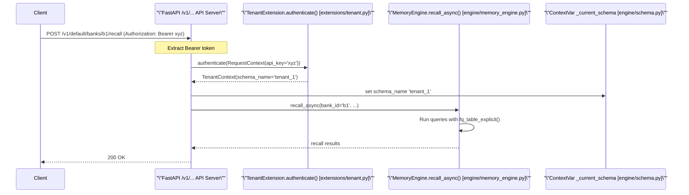

<!-- source: DeepWiki mcp.deepwiki.com · repo vectorize-io/hindsight · page 3.6 Multi-tenancy and Authentication · fetched 2026-10-26 -->

# Multi-tenancy and Authentication

<details>
<summary>Relevant source files</summary>

The following files were used as context for generating this wiki page:

- [CONTRIBUTING.md](CONTRIBUTING.md)
- [hindsight-api-slim/hindsight_api/extensions/__init__.py](hindsight-api-slim/hindsight_api/extensions/__init__.py)
- [hindsight-api-slim/hindsight_api/extensions/builtin/__init__.py](hindsight-api-slim/hindsight_api/extensions/builtin/__init__.py)
- [hindsight-api-slim/hindsight_api/extensions/operation_validator.py](hindsight-api-slim/hindsight_api/extensions/operation_validator.py)
- [hindsight-api-slim/hindsight_api/models.py](hindsight-api-slim/hindsight_api/models.py)
- [hindsight-api-slim/tests/test_extension_unbundling.py](hindsight-api-slim/tests/test_extension_unbundling.py)
- [hindsight-api-slim/tests/test_extensions.py](hindsight-api-slim/tests/test_extensions.py)
- [hindsight-api-slim/tests/test_mcp_endpoint_routing.py](hindsight-api-slim/tests/test_mcp_endpoint_routing.py)
- [hindsight-docs/docs/developer/development.md](hindsight-docs/docs/developer/development.md)
- [hindsight-docs/docs/developer/extensions.md](hindsight-docs/docs/developer/extensions.md)
- [hindsight-extensions/.gitignore](hindsight-extensions/.gitignore)
- [hindsight-extensions/README.md](hindsight-extensions/README.md)
- [hindsight-extensions/supabase-tenant/Dockerfile](hindsight-extensions/supabase-tenant/Dockerfile)
- [hindsight-system-tests/server_extensions/tag_scope_validator.py](hindsight-system-tests/server_extensions/tag_scope_validator.py)
- [hindsight-system-tests/tests/test_83_bank_scoped_import.py](hindsight-system-tests/tests/test_83_bank_scoped_import.py)
- [hindsight-system-tests/tests/test_84_import_gate.py](hindsight-system-tests/tests/test_84_import_gate.py)
- [hindsight-system-tests/uv.lock](hindsight-system-tests/uv.lock)
- [scripts/dev/setup.sh](scripts/dev/setup.sh)
- [skills/hindsight-docs/references/developer/development.md](skills/hindsight-docs/references/developer/development.md)
- [skills/hindsight-docs/references/developer/extensions.md](skills/hindsight-docs/references/developer/extensions.md)

</details>


This page explains Hindsight's multi-tenancy architecture via PostgreSQL schemas, the `TenantExtension` interface for custom authentication, the official `hindsight-extensions` packages (`static-keys-tenant`, `supabase-tenant`), Bearer token authorization, and bank-level access control.

---

## PostgreSQL Schema-Based Isolation

Hindsight enforces multi-tenancy through **PostgreSQL schemas**, isolating data at the database level by tenant. Each tenant is assigned a dedicated schema name (e.g., `tenant_abc`, `tenant_xyz`), while common global metadata (like bank configurations) reside in the `public` schema.

The active tenant schema is dynamically determined and injected into query execution using Python's asynchronous `ContextVar`. This schema context guides all data accesses, ensuring tenant isolation.

### Data Isolation Architecture

- **Active schema context** is tracked with the `_current_schema` ContextVar and set during request authentication.
- SQL queries use a explicit schema routing helper that injects schema-qualified table names dynamically.
- Tenant-specific audit logs are stored in the tenant schema's audit tables.
- Extensions can add `BankScopedTable` instances tied to the bank; these are cleared upon bank deletion to prevent orphan data [hindsight-api-slim/hindsight_api/extensions/bank_tables.py:34-55]().

#### Natural Language Request to Code-Level Schema Isolation

```mermaid
graph TB
    Request["HTTP Request<br/>\"Authorization: Bearer sk-abc123\""]
    
    subgraph "Authentication_and_Context_Code_Entity_Space"
        TenantExt["TenantExtension interface<br/>[hindsight-api-slim/hindsight_api/extensions/tenant.py:74-97]()"]
        RequestContext["RequestContext object<br/>[hindsight-api-slim/hindsight_api/models.py:15-66]()"]
        CtxVar["_current_schema ContextVar<br/>[hindsight-api-slim/hindsight_api/engine/memory_engine.py:27-27]()"]
    end
    
    subgraph "Data_Access_Layer"
        FQTable["fq_table_explicit() helper<br/>[hindsight-api-slim/hindsight_api/engine/schema.py:23-23]()"]
        SQL["SQL: SELECT * FROM tenant_abc.memory_units"]
    end
    
    subgraph "PostgreSQL_Instance"
        PublicSchema["\"public\" schema<br/>(Global banks and config)"]
        TenantA["\"tenant_abc\" schema<br/>(Private memories)"]
        TenantB["\"tenant_xyz\" schema<br/>(Private memories)"]
    end
    
    Request --> TenantExt
    TenantExt --> RequestContext
    RequestContext --> CtxVar
    CtxVar --> FQTable
    FQTable --> SQL
    SQL --> TenantA
```

Sources:
[hindsight-api-slim/hindsight_api/engine/memory_engine.py:27-27](),
[hindsight-api-slim/hindsight_api/extensions/tenant.py:74-97](),
[hindsight-api-slim/hindsight_api/models.py:15-66](),
[hindsight-api-slim/hindsight_api/extensions/bank_tables.py:34-55]()

---

## TenantExtension Interface for Custom Authentication

Hindsight uses the `TenantExtension` abstraction to implement custom multi-tenant authentication and authorization. This extension is responsible for validating incoming credentials and determining which PostgreSQL schema should be used to isolate the tenant's data.

### Core Responsibilities

- **`authenticate(context: RequestContext) -> TenantContext`**: Given the incoming request context (which includes API key, headers, etc.), returns a `TenantContext` that specifies the active schema name [hindsight-api-slim/hindsight_api/extensions/tenant.py:84-97]()  
- **`list_tenants() -> list[Tenant]`**: Returns a list of all known tenants with their schema names; used by background workers and admin functions [hindsight-api-slim/hindsight_api/extensions/tenant.py:99-111]()  

These lifetime hooks allow multiple authentication strategies and tenant schema naming conventions.

Sources:
[hindsight-api-slim/hindsight_api/extensions/tenant.py:70-111]()

---

## Available Tenant Extensions (`hindsight-extensions`)

Three main tenant extension implementations are commonly used:

| Extension Name           | Description                                                                                                    | Location / Usage                                                                                                                  |
|-------------------------|----------------------------------------------------------------------------------------------------------------|----------------------------------------------------------------------------------------------------------------------------------|
| **ApiKeyTenantExtension**  | Simple static API key validation, always uses the `public` schema. Useful for single-tenant setups with fixed keys. | Built-in extension, configured with environment variables `HINDSIGHT_API_TENANT_EXTENSION=hindsight_api.extensions.builtin.tenant:ApiKeyTenantExtension` and `HINDSIGHT_API_TENANT_API_KEY` [hindsight-docs/docs/developer/extensions.md:13-20]() |
| **SupabaseTenantExtension** | Validates Supabase JWT tokens and creates a separate PostgreSQL schema per user tenant. Supports per-user isolation. | Available as an external extension in the `hindsight-extensions/supabase-tenant` directory. Must be added to images explicitly and configured with `HINDSIGHT_API_TENANT_EXTENSION=hindsight_ext_supabase_tenant:SupabaseTenantExtension` [hindsight-docs/docs/developer/extensions.md:22-28]() |
| **StaticKeysTenantExtension** | Fully self-hosted multi-user mode using API keys defined in environment variables, mapping users to schemas with prefix. Supports lazy schema provisioning. Userids normalize case and dashes to underscores. | Available in `hindsight-extensions/static-keys-tenant`. Adds strict schema-level isolation without external identity provider [hindsight-docs/docs/developer/extensions.md:30-36]() |

Sources:
[hindsight-docs/docs/developer/extensions.md:13-38](),
[hindsight-extensions/README.md:17-22]()

---

## OperationValidatorExtension and Bank-Level Access Control

The `OperationValidatorExtension` interface hooks into core operations—retain, recall, reflect, consolidation, etc.—to perform validation, quota enforcement, permission checks, and policy enrichment.

Key capabilities:

- **PrecheckContext**: A lightweight hook before full request body parsing, giving early hints like `content_length` to optimize decision-making [hindsight-api-slim/hindsight_api/extensions/operation_validator.py:99-126]()  
- **Validation hooks**: `validate_retain()`, `validate_recall()`, `validate_reflect()` receive detailed contextual payloads with user parameters, bank_id, and request context [hindsight-api-slim/hindsight_api/extensions/operation_validator.py:135-183]()  
- **Enrichment**: Validators can accept or reject operations. When accepting, they may inject or override request parameters (e.g., tags, tag groups, memory contents) to enforce policies transparently [hindsight-api-slim/hindsight_api/extensions/operation_validator.py:54-73]()  
- **Bank Write Validation**: Validates whether a given API key or user token is permitted to write to a specific bank ID [hindsight-system-tests/server_extensions/tag_scope_validator.py:44-48]()  

Sources:
[hindsight-api-slim/hindsight_api/extensions/operation_validator.py:1-183](),
[hindsight-system-tests/server_extensions/tag_scope_validator.py:34-65]()

---

## Bearer Token Auth and Execution Flow

Hindsight supports Bearer token authentication both for REST API operations and the Model Context Protocol (MCP), the latter used by AI assistants and coding agents.

### MCP Server Authentication

- MCP server is mounted at `/mcp/{bank_id}/` by default.
- By default, MCP endpoints are open, but deploying an authentication tenant extension enforces validation.
- Clients include the API key as a Bearer token in the `Authorization` header.
- Bank is resolved from the URL path or the `X-Bank-Id` request header.

### Execution Sequence Diagram for Authentication and Request Routing



Sources:
[hindsight-api-slim/hindsight_api/extensions/tenant.py:84-97](),
[hindsight-api-slim/hindsight_api/engine/memory_engine.py:27-27](),
[hindsight-api-slim/tests/test_mcp_endpoint_routing.py:17-136]()

---

## Summary Matrix

| Concept                     | Description                                                                                                          | Relevant Code Entities / Paths                                      |
|-----------------------------|----------------------------------------------------------------------------------------------------------------------|--------------------------------------------------------------------|
| Multi-tenancy isolation      | PostgreSQL schema per tenant; `_current_schema` ContextVar controls schema for queries                                | `memory_engine.py`<br>`schema.py`<br>DB schemas                    |
| TenantExtension interface    | Authenticates requests; resolves tenant schema; custom extensions possible                                           | `extensions/tenant.py:70-111`                                      |
| Available Tenant Extensions  | Built-in `ApiKeyTenantExtension`; external `StaticKeysTenantExtension`, `SupabaseTenantExtension`                    | `hindsight-extensions/` registry                                    |
| Bearer token authentication  | Supported for MCP and HTTP API; token passed in `Authorization` header; enforced by tenant extension                 | `api/mcp.py`, `extensions/tenant.py`                              |
| OperationValidatorExtension  | Enforces bank-level access control, quotas, and validates operation parameters                                       | `extensions/operation_validator.py`                               |
| Bank-Level granularity       | Banks isolate memory and permissions within tenants; access enforced by operation validators                        | `extensions/operation_validator.py`                               |

Sources:
[hindsight-api-slim/hindsight_api/extensions/tenant.py](),
[hindsight-api-slim/hindsight_api/extensions/operation_validator.py](),
[hindsight-api-slim/hindsight_api/engine/memory_engine.py](),
[hindsight-docs/docs/developer/extensions.md]()

---

