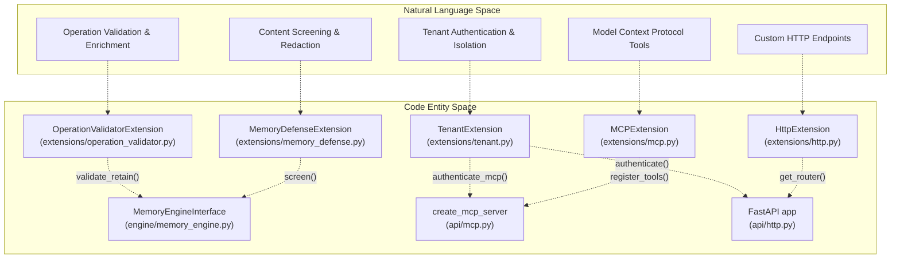
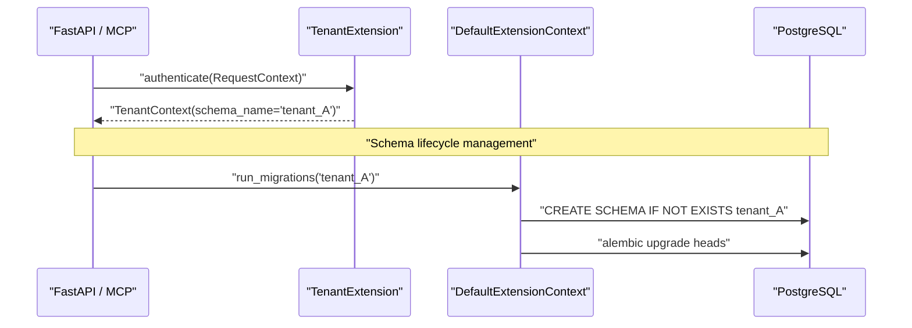

<!-- source: DeepWiki mcp.deepwiki.com · repo vectorize-io/hindsight · page 3.7 Extension System · fetched 2026-10-26 -->

# Extension System

<details>
<summary>Relevant source files</summary>

The following files were used as context for generating this wiki page:

- [CONTRIBUTING.md](CONTRIBUTING.md)
- [hindsight-api-slim/hindsight_api/admin/cli.py](hindsight-api-slim/hindsight_api/admin/cli.py)
- [hindsight-api-slim/hindsight_api/alembic/versions/e8c1a4f7b2d9_drop_global_memory_units_vector_indexes.py](hindsight-api-slim/hindsight_api/alembic/versions/e8c1a4f7b2d9_drop_global_memory_units_vector_indexes.py)
- [hindsight-api-slim/hindsight_api/engine/vector_index_health.py](hindsight-api-slim/hindsight_api/engine/vector_index_health.py)
- [hindsight-api-slim/hindsight_api/extensions/__init__.py](hindsight-api-slim/hindsight_api/extensions/__init__.py)
- [hindsight-api-slim/hindsight_api/extensions/base.py](hindsight-api-slim/hindsight_api/extensions/base.py)
- [hindsight-api-slim/hindsight_api/extensions/builtin/__init__.py](hindsight-api-slim/hindsight_api/extensions/builtin/__init__.py)
- [hindsight-api-slim/hindsight_api/extensions/context.py](hindsight-api-slim/hindsight_api/extensions/context.py)
- [hindsight-api-slim/hindsight_api/extensions/loader.py](hindsight-api-slim/hindsight_api/extensions/loader.py)
- [hindsight-api-slim/hindsight_api/extensions/operation_validator.py](hindsight-api-slim/hindsight_api/extensions/operation_validator.py)
- [hindsight-api-slim/hindsight_api/migrations.py](hindsight-api-slim/hindsight_api/migrations.py)
- [hindsight-api-slim/hindsight_api/models.py](hindsight-api-slim/hindsight_api/models.py)
- [hindsight-api-slim/tests/test_admin_backup_restore.py](hindsight-api-slim/tests/test_admin_backup_restore.py)
- [hindsight-api-slim/tests/test_admin_rename_bank.py](hindsight-api-slim/tests/test_admin_rename_bank.py)
- [hindsight-api-slim/tests/test_ann_iterative_scan.py](hindsight-api-slim/tests/test_ann_iterative_scan.py)
- [hindsight-api-slim/tests/test_consolidation_embedding_validation.py](hindsight-api-slim/tests/test_consolidation_embedding_validation.py)
- [hindsight-api-slim/tests/test_ensure_vector_no_global_index.py](hindsight-api-slim/tests/test_ensure_vector_no_global_index.py)
- [hindsight-api-slim/tests/test_extension_alembic_tree.py](hindsight-api-slim/tests/test_extension_alembic_tree.py)
- [hindsight-api-slim/tests/test_extension_unbundling.py](hindsight-api-slim/tests/test_extension_unbundling.py)
- [hindsight-api-slim/tests/test_extensions.py](hindsight-api-slim/tests/test_extensions.py)
- [hindsight-api-slim/tests/test_hnsw_indexes.py](hindsight-api-slim/tests/test_hnsw_indexes.py)
- [hindsight-api-slim/tests/test_hnsw_indexes_store_owned.py](hindsight-api-slim/tests/test_hnsw_indexes_store_owned.py)
- [hindsight-api-slim/tests/test_mcp_endpoint_routing.py](hindsight-api-slim/tests/test_mcp_endpoint_routing.py)
- [hindsight-api-slim/tests/test_migrations_parallel_schemas.py](hindsight-api-slim/tests/test_migrations_parallel_schemas.py)
- [hindsight-api-slim/tests/test_observation_expansion_single_fetch.py](hindsight-api-slim/tests/test_observation_expansion_single_fetch.py)
- [hindsight-api-slim/tests/test_repair_bank_vector_indexes.py](hindsight-api-slim/tests/test_repair_bank_vector_indexes.py)
- [hindsight-docs/docs/developer/admin-cli.md](hindsight-docs/docs/developer/admin-cli.md)
- [hindsight-docs/docs/developer/development.md](hindsight-docs/docs/developer/development.md)
- [hindsight-docs/docs/developer/extensions.md](hindsight-docs/docs/developer/extensions.md)
- [hindsight-extensions/.gitignore](hindsight-extensions/.gitignore)
- [hindsight-extensions/README.md](hindsight-extensions/README.md)
- [hindsight-extensions/supabase-tenant/Dockerfile](hindsight-extensions/supabase-tenant/Dockerfile)
- [hindsight-system-tests/server_extensions/tag_scope_validator.py](hindsight-system-tests/server_extensions/tag_scope_validator.py)
- [hindsight-system-tests/tests/test_83_bank_scoped_import.py](hindsight-system-tests/tests/test_83_bank_scoped_import.py)
- [hindsight-system-tests/tests/test_84_import_gate.py](hindsight-system-tests/tests/test_84_import_gate.py)
- [hindsight-system-tests/uv.lock](hindsight-system-tests/uv.lock)
- [scripts/dev/setup.sh](scripts/dev/setup.sh)
- [skills/hindsight-docs/references/developer/admin-cli.md](skills/hindsight-docs/references/developer/admin-cli.md)
- [skills/hindsight-docs/references/developer/development.md](skills/hindsight-docs/references/developer/development.md)
- [skills/hindsight-docs/references/developer/extensions.md](skills/hindsight-docs/references/developer/extensions.md)

</details>


The Extension System in Hindsight provides modular customization points that allow deployments to adapt the platform’s behavior without modifying the core codebase. These extensions support key capabilities like multi-tenant authentication, operation validation, audit logging, database migrations, file processing hooks, and content screening. Extensions are loaded dynamically at server startup using environment variables, and can optionally ship their own Alembic migration trees.

Sources: [hindsight-api-slim/hindsight_api/extensions/__init__.py:1-22](), [hindsight-docs/docs/developer/extensions.md:1-4]()

---

## Extension Types and Code Entity Mapping

Hindsight’s extensions are categorized by concern and interface, enabling seamless interoperability with the core `MemoryEngine`, HTTP API, and worker background tasks.

### Extension Architecture Mapping

This diagram maps natural language system extension concepts to their concrete code entities and execution runtimes in the Hindsight codebase.


Sources: [hindsight-api-slim/hindsight_api/extensions/__init__.py:24-93](), [hindsight-docs/docs/developer/extensions.md:7-113]()

### Primary Extension Points

- **TenantExtension**  
  Responsible for authenticating requests and resolving the tenant's PostgreSQL schema, enabling per-tenant data isolation. Common implementations include `ApiKeyTenantExtension` and external packages like `StaticKeysTenantExtension`.  
  Sources: [hindsight-docs/docs/developer/extensions.md:9-38](), [hindsight-api-slim/hindsight_api/extensions/tenant.py:50-138]()

- **OperationValidatorExtension**  
  Hooks into memory operations (`retain`, `recall`, `reflect`, `consolidate`) for validation, enrichment, and auditing. Supports rejecting requests (e.g., rate limiting), injecting additional tags or contexts, and modifying request parameters.  
  Sources: [hindsight-api-slim/hindsight_api/extensions/operation_validator.py:1-171](), [hindsight-api-slim/tests/test_extensions.py:120-185]()

- **MemoryDefenseExtension**  
  Screens retained content for sensitive data such as secrets or PII, applying allow/redact/block policies and generating identifiable fingerprints for redacted secrets.  
  Sources: [hindsight-api-slim/hindsight_api/extensions/memory_defense.py:1-185](), [hindsight-api-slim/hindsight_api/extensions/builtin/memory_defense_regex.py:14-25]()

- **HttpExtension**  
  Adds custom HTTP endpoints mounted at `/ext/` or at the root, allowing custom domain-specific APIs integrated with the memory engine.  
  Sources: [hindsight-docs/docs/developer/extensions.md:42-50]()

- **MCPExtension**  
  Registers additional Model Context Protocol (MCP) tools with the Hindsight MCP server.  
  Sources: [hindsight-api-slim/hindsight_api/api/mcp.py:171-174]()

---

## Extension Loader and Alembic Migration Trees

Extensions that maintain their own database state can declare Alembic migration version directories that are applied alongside core migrations at startup.

### Migration Orchestration Flow

```mermaid
graph TB
    subgraph "Migration Orchestration"
        RUNNER[""run_migrations()<br/>(migrations.py)""]
        COLLECT[""collect_alembic_version_locations()<br/>(extensions/loader.py)""]
        EXT_CLASS[""Extension.alembic_version_locations()""]
        ALEMBIC[""Alembic Engine<br/>(version_locations)""]
        
        RUNNER --> COLLECT
        COLLECT --> EXT_CLASS
        EXT_CLASS -. "version paths" .-> COLLECT
        COLLECT --> ALEMBIC
    end
```

- Extension Alembic trees have independent branch labels and base revisions (`down_revision = None`), ensuring no conflict or ordering dependency on core migrations.  
- Missing or misconfigured version directories are logged as warnings and skipped safely without causing startup failures.  
Sources: [hindsight-api-slim/hindsight_api/extensions/loader.py:156-185](), [hindsight-docs/docs/developer/extensions.md:113-140]()

---

## TenantExtension & Schema Isolation

The `TenantExtension` interface maps incoming requests (`RequestContext`) to a `TenantContext`, defining the PostgreSQL schema where that tenant's data resides.

### Schema Resolution & Lifecycle Diagram



### Additional Features

- Operators can configure HTTP headers to forward to the tenant extension for richer authentication contexts via `HINDSIGHT_API_EXTENSION_PASSTHROUGH_HEADERS`.  
- Extensions can expose bank-scoped custom tables, allowing core to include them in bank deletion or backup operations using the `extra_bank_tables()` method and `BankScopedTable` dataclass.  
Sources: [hindsight-api-slim/hindsight_api/extensions/tenant.py:50-90, 160-185](), [hindsight-api-slim/hindsight_api/extensions/context.py:25-50]()

---

## OperationValidatorExtension

The `OperationValidatorExtension` interface provides hooks for pre-operation validation, post-operation auditing, file processing post-conversion hooks, and observation scope customization across all core memory operations.

### Validation Flow and Enrichment

Validators receive rich pre-operation context objects (`PrecheckContext`, `RetainContext`, `RecallContext`, `ConsolidateContext`) containing all user parameters and can accept, enrich, or reject requests [hindsight-api-slim/hindsight_api/extensions/operation_validator.py:82-195]().

Validators return a `ValidationResult` which may:
- Accept the operation unchanged (`ValidationResult.accept()`) [hindsight-api-slim/hindsight_api/extensions/operation_validator.py:49-51]()
- Accept with enriched parameters, e.g. injected tags or modified content (`ValidationResult.accept_with(...)`) [hindsight-api-slim/hindsight_api/extensions/operation_validator.py:54-73]()
- Reject with a reason and HTTP status code (`ValidationResult.reject(reason)`) [hindsight-api-slim/hindsight_api/extensions/operation_validator.py:76-78]()

### Post-Conversion Hooks for File Processing

File retain operations trigger post-conversion hooks where parsed Markdown or loaded documents can be inspected by extensions via `FileConvertResult`, allowing validation of parsing success or content properties after initial file retention.  
Sources: [hindsight-api-slim/hindsight_api/extensions/operation_validator.py:51-53]()

### Observation Scope Customization

Extensions and operation validators can adjust the scope of memory observations created from facts during consolidation (`observation_scopes`), enabling domain-specific control of which facts contribute to observations and their visibility.  
Sources: [hindsight-api-slim/hindsight_api/extensions/operation_validator.py:250-260]()

---

## Memory Defense and Redaction

The `MemoryDefenseExtension` scans retained content for sensitive data based on configurable policies.

### Policy Enforcement Pipeline

```mermaid
graph LR
    subgraph "Policy Pipeline"
        INPUT[""RetainContent""]
        POLICY[""DefensePolicy<br/>(bank config)""]
        SCREEN[""screen()<br/>(MemoryDefenseExtension)""]
        DECISION[""DefenseDecision""]
        ACTIONS[""Allow / Redact / Block""]
        STORE[""StoredContent<br/>(sanitized)""]
        
        INPUT --> SCREEN
        POLICY --> SCREEN
        SCREEN --> DECISION
        DECISION --> ACTIONS
        ACTIONS --> STORE
    end
```

- Policies can apply regexes with assigned confidence scores to decide actions: **allow**, **redact**, or **block**.  
- Redaction replaces secrets with fingerprints (e.g., `ghp_...AAAA`) to enable audit without leaking secrets.  
- The built-in `MemoryDefenseRegexExtension` detects common secret patterns for OpenAI, AWS, GitHub tokens, and others.  
Sources: [hindsight-api-slim/hindsight_api/extensions/memory_defense.py:20-68](), [hindsight-api-slim/hindsight_api/extensions/builtin/memory_defense_regex.py:14-25]()

---

## Audit Logging

Hindsight provides audit logging mechanisms that record activity across all transports (HTTP, MCP, background worker) for observability and compliance.

### Audit Architecture & Code Entity Mapping

This diagram maps the audit monitoring subsystem from conceptual entities to codebase components.

```mermaid
graph LR
    subgraph "Natural Language Space"
        AUDIT_DESC[""Fire-and-Forget Audit Logging""]
        METRICS_DESC[""Operation Telemetry & Metrics""]
    end

    subgraph "Code Entity Space"
        ENGINE[""MemoryEngine<br/>(engine/memory_engine.py)""]
        AUDIT_LOGGER[""AuditLogger<br/>(engine/audit.py)""]
        DB[""PostgreSQL audit_log table""]
        WORKER[""WorkerPoller<br/>(worker/poller.py)""]
        
        AUDIT_DESC -.-> AUDIT_LOGGER
        METRICS_DESC -.-> ENGINE
        ENGINE -- "log_fire_and_forget()" --> AUDIT_LOGGER
        WORKER -- "task tracking" --> AUDIT_LOGGER
        AUDIT_LOGGER --> DB
    end
```
Sources: [hindsight-api-slim/hindsight_api/engine/audit.py:1-50, 140-200](), [hindsight-api-slim/hindsight_api/worker/poller.py:1-40]()

- Audit logging is configurable per bank with the `audit_log_enabled` flag.  
- Entries include metadata such as transport type (`http`, `mcp`, `system`), timestamp, and user identity.  
Sources: [hindsight-api-slim/hindsight_api/engine/audit.py:1-50, 140-200](), [hindsight-api-slim/tests/test_audit_per_bank.py:1-15]()

---

# Summary Table: Extension Points and Responsibilities

| Extension Point             | Main Purpose                                       | Key Methods / Concepts                                      | Built-in Example                   |
|----------------------------|--------------------------------------------------|------------------------------------------------------------|----------------------------------|
| TenantExtension            | Multi-tenancy, API key validation, tenant schema | `authenticate()`, `extra_bank_tables()`, schema resolution | `ApiKeyTenantExtension`          |
| OperationValidatorExtension | Validate, enrich, reject retain/recall/reflect  | `validate_retain()`, `validate_recall()`, post hooks       | None built-in                    |
| MemoryDefenseExtension     | Screen retained content for secrets/PII          | `screen()`, `DefenseDecision`, redaction                   | `MemoryDefenseRegexExtension`    |
| HttpExtension              | Add custom HTTP API endpoints                      | `get_router(memory)`, `get_root_router(memory)`             | None                            |
| MCPExtension               | Add MCP server tools                               | `register_tools()`                                          | None                            |

Sources: [hindsight-api-slim/hindsight_api/extensions/__init__.py:24-169](), [hindsight-docs/docs/developer/extensions.md:9-113]()

---

