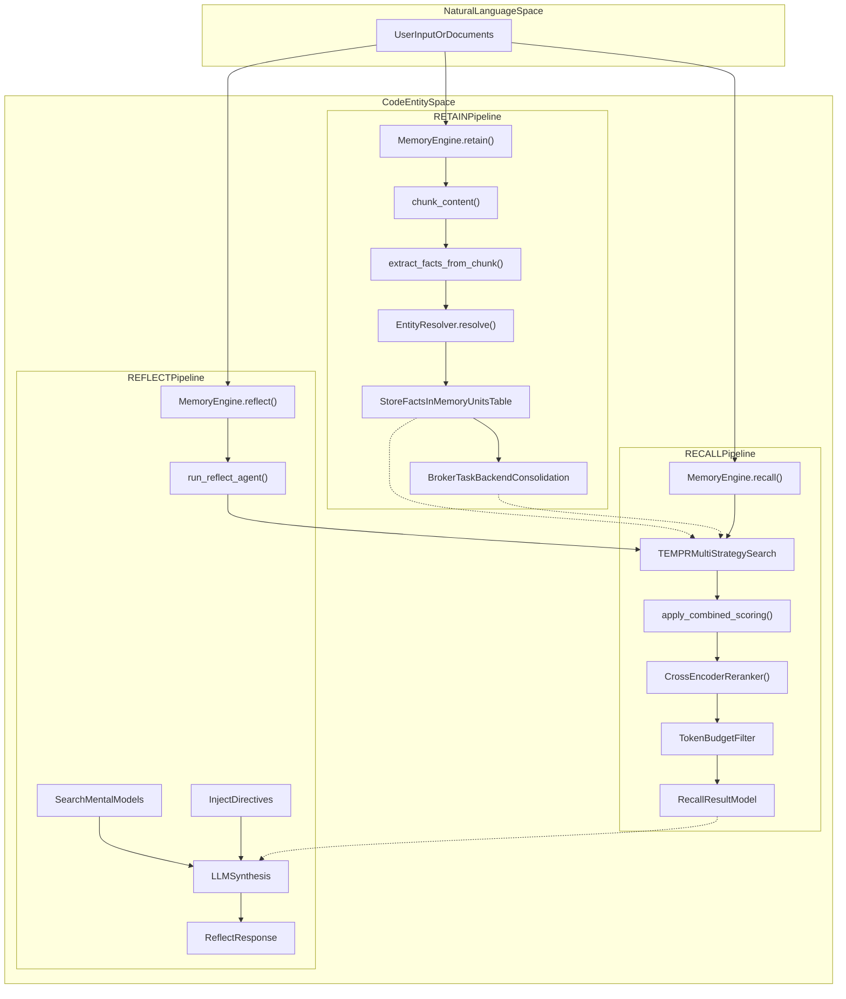
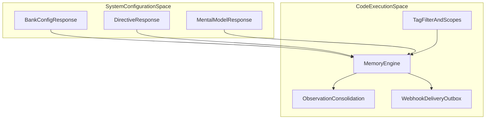

<!-- source: DeepWiki mcp.deepwiki.com · repo vectorize-io/hindsight · page 4 Core Operations · fetched 2026-10-26 -->

# Core Operations

Relevant source files

The following files were used as context for generating this wiki page:

- [hindsight-api-slim/hindsight_api/api/http.py](hindsight-api-slim/hindsight_api/api/http.py)
- [hindsight-api-slim/hindsight_api/engine/memory_engine.py](hindsight-api-slim/hindsight_api/engine/memory_engine.py)
- [hindsight-cli/src/api.rs](hindsight-cli/src/api.rs)
- [hindsight-clients/go/api/openapi.yaml](hindsight-clients/go/api/openapi.yaml)
- [hindsight-clients/python/.openapi-generator/FILES](hindsight-clients/python/.openapi-generator/FILES)
- [hindsight-clients/python/hindsight_client_api/__init__.py](hindsight-clients/python/hindsight_client_api/__init__.py)
- [hindsight-clients/python/hindsight_client_api/models/__init__.py](hindsight-clients/python/hindsight_client_api/models/__init__.py)
- [hindsight-clients/typescript/generated/sdk.gen.ts](hindsight-clients/typescript/generated/sdk.gen.ts)
- [hindsight-clients/typescript/generated/types.gen.ts](hindsight-clients/typescript/generated/types.gen.ts)
- [hindsight-control-plane/src/lib/api.ts](hindsight-control-plane/src/lib/api.ts)
- [hindsight-docs/static/openapi.json](hindsight-docs/static/openapi.json)
- [skills/hindsight-docs/references/openapi.json](skills/hindsight-docs/references/openapi.json)

This page introduces the three fundamental memory operations in Hindsight—**Retain**, **Recall**, and **Reflect**—and describes the supporting features that enable an intelligent, context-aware memory system. These core operations form the complete memory lifecycle: storing structured facts, retrieving them through a sophisticated multi-search system, and generating disposition-aware, grounded responses.

These operations are coordinated by the central `MemoryEngine` which orchestrates data flow between the database, LLM providers, and background worker services [hindsight-api-slim/hindsight_api/engine/memory_engine.py:1-164](). Supporting features such as memory banks, mental models, directives, observations, tagging, entity resolution, and webhooks complement these operations to provide a rich, customizable platform for agent memory.

For usage examples in client SDKs, see the Python Client ([Python Client](#5.1)) and TypeScript Client ([TypeScript Client](#5.2)). For detailed HTTP API reference, see [API Reference](#9) and `skills/hindsight-docs/references/openapi.json` [skills/hindsight-docs/references/openapi.json:1-50](). For LLM provider configuration and AI component details, see [ML and AI Components](#10).

---

## Operation Flow Overview

Hindsight’s three core operations build upon each other and compose into powerful workflows supporting autonomous reasoning agents and memory management.

The diagram below illustrates the main components involved in each operation and how they map to key code entities and database tables, bridging natural language concepts to the codebase.

### System Interaction Diagram

Sources: [hindsight-api-slim/hindsight_api/engine/memory_engine.py:1-164](), [skills/hindsight-docs/references/openapi.json:1-50]()

---

## Composition and Supporting Features Architecture

The second architectural view illustrates how supporting features (such as banks, directives, mental models, observations, and tags) compose during execution within the engine layer.

### Composition and Supporting Features Architecture

Sources: [hindsight-api-slim/hindsight_api/engine/memory_engine.py:1-164](), [hindsight-clients/typescript/generated/types.gen.ts:1-120]()

---

## Operation Characteristics

| Operation | Purpose | Async Support | LLM Usage | Key Components |
|-----------|---------|---------------|-----------|----------------|
| **Retain** | Ingest raw content (text/files), extract structured facts and entities | Yes (flagged async batch mode) | Fact extraction, entity resolution during retain | `MemoryItem`, `extract_facts_from_chunk()`, `EntityResolver` [hindsight-api-slim/hindsight_api/engine/memory_engine.py:1-164]() |
| **Recall** | Retrieve relevant memories via 4-way parallel search | No (direct sync call) | N/A (pure retrieval) | `TEMPR` Search (Semantic, BM25, Graph, Temporal), CrossEncoder reranker [hindsight-api-slim/hindsight_api/engine/memory_engine.py:1-164]() |
| **Reflect** | Autonomous multi-step reasoning loop to generate grounded responses | No | Full LLM reasoning with prompt construction | `Mental Models`, `Directives`, `Reflect Agent` [hindsight-api-slim/hindsight_api/engine/memory_engine.py:1-164]() |

Sources: [hindsight-api-slim/hindsight_api/engine/memory_engine.py:1-164]()

---

## Retain - Storing Memories

The **retain** operation ingests raw input—such as natural language documents, chat transcripts, or uploaded files—and transforms them into structured, searchable memories:

- Content is chunked and optionally cached for reuse.
- LLM-based extractors parse chunks into `world` and `experience` facts in multiple modes (concise, verbose, verbatim, chunk-wise, or custom extraction).
- Entities are resolved and canonicalized, linking related facts for graph search.
- Embeddings are computed and facts stored to the PostgreSQL `memory_units` table with vector indexes.
- Retain supports append and delta modes for editable documents.
- Async consolidation jobs are triggered post-retain to synthesize higher-level observations.

A "mission" guides the focus of extraction to relevant domains or topics.

For complete details, see [Retain - Storing Memories](#4.1).

Sources: [hindsight-api-slim/hindsight_api/engine/memory_engine.py:1-164]()

---

## Recall - Retrieving Memories

The **recall** operation provides a unified retrieval interface combining multiple strategies in parallel, known as **TEMPR** (Temporal, Entity, Meaning, Proximity, Rank):

- Four search arms run concurrently: dense semantic vector search, BM25 text search, entity graph traversal, and temporal recency filtering.
- Reciprocal Rank Fusion (RRF) combines ranked lists from each arm into a consensus result.
- Optional cross-encoder reranking refines top candidates for precision.
- Results are filtered by token budget, types (world/experience/observation), and tags.
- Recall returns a ranked list of facts with metadata about source documents and validity.

For complete details, see [Recall - Retrieving Memories](#4.2).

Sources: [hindsight-api-slim/hindsight_api/engine/memory_engine.py:1-164]()

---

## Reflect - Generating Responses

The **reflect** operation performs autonomous, multi-step reasoning with the following features:

- Invokes a multi-turn agent loop implemented in `reflect/agent.py` that uses instances of recall.
- Includes specialized mental models—cached, refined knowledge pages—to inject reliable domain knowledge quickly.
- Respects directives—hard rules configured per bank—to constrain output and enforce policies.
- Utilizes bank personality traits (disposition) affecting reasoning style (skepticism, literalism, empathy).
- Outputs structured, citation-rich responses with incremental updates (deltas).
- Supports extensible tools and plugins integration.

For complete details, see [Reflect - Generating Responses](#4.3).

Sources: [hindsight-api-slim/hindsight_api/engine/memory_engine.py:1-164]()

---

# Supporting Features

## Memory Banks and Personality

Memory banks act as isolated, multi-tenant containers defining agent personalities:

- Each bank has configuration, mission statements, and aliases.
- Disposition traits (skepticism, literalism, empathy) shape reasoning behavior in `reflect`.
- Banks support cloning and stats caching.
- Multi-tenancy is enforced via PostgreSQL schema isolation, isolating data and configuration per bank.

For complete details see [Memory Banks and Personality](#4.4).

Sources: [hindsight-api-slim/hindsight_api/engine/memory_engine.py:1-164]()

---

## Mental Models and Knowledge Pages

Mental models are cached reflections of common knowledge or processed memories:

- They are created, updated, and refreshed both manually and automatically.
- Support delta updates and maintain history with diffs.
- Serve as lightweight knowledge pages that the reflect phase can inject directly into reasoning prompts, improving efficiency.

For complete details see [Mental Models and Knowledge Pages](#4.5).

Sources: [hindsight-api-slim/hindsight_api/engine/memory_engine.py:1-164]()

---

## Directives

Directives are hard-coded rules injected into reflect prompts to enforce policies or constraints:

- CRUD operations let users create, update, and delete directives.
- Directives are prioritized and take precedence over memories and mental models.
- Commonly used for guardrails, required styles, or compliance enforcement.

For complete details see [Directives](#4.6).

Sources: [hindsight-api-slim/hindsight_api/engine/memory_engine.py:1-164]()

---

## Observations and Consolidation

Observation consolidation synthesizes individual extracted facts into higher-level summarized or inferred facts:

- Consolidation is mostly automatic and background, triggered after retain operations.
- Deduplication, retry budgets, and invalidation policies mitigate noise and stale data.
- Consolidation manages temporal evolution to track trends or belief changes.
- Observation missions guide scope and synthesis strategy.
- Managed via the worker service with an outbox pattern for reliable event delivery.

For complete details see [Observations and Consolidation](#4.7).

Sources: [hindsight-api-slim/hindsight_api/engine/memory_engine.py:1-164]()

---

## Tags and Visibility Scoping

Tags provide flexible scoping and filtering of memories:

- Tags are attached at retain time and can be retroactively modified.
- Filters support simple logical operations (any, all, strict) and compound tag groups with boolean logic.
- Tags enable multi-user data isolation and context-aware recall/reflect scoping.

For complete details see [Tags and Visibility Scoping](#4.8).

Sources: [hindsight-api-slim/hindsight_api/engine/memory_engine.py:1-164]()

---

## Documents, Attachments and File Processing

Hindsight supports uploading various file formats and converting them into memory facts:

- Supported formats include markdown, PDFs, and rich text.
- Parsers such as Markitdown, Iris, and LlamaParse transform files into markdown chunks.
- Attachments are managed with lifecycle policies, supporting inline images/files as content blocks.
- Documents and chunks relate to memories, linking extracted facts semantically.

For complete details see [Documents, Attachments and File Processing](#4.9).

Sources: [hindsight-api-slim/hindsight_api/engine/memory_engine.py:1-164]()

---

## Entity Resolution and Graph Maintenance

Entity resolution links references from facts to canonical entities:

- Entity names are normalized using trigram matching and merge floors.
- Entities link by co-occurrence and causal relations, maintaining a knowledge graph.
- Graph maintenance queues prune orphan entities and optimize retrieval.
- Entities enhance semantic retrieval and contextual reasoning.

For complete details see [Entity Resolution and Graph Maintenance](#4.10).

Sources: [hindsight-api-slim/hindsight_api/engine/memory_engine.py:1-164]()

---

## Webhooks and Event Notifications

Webhooks notify external systems about memory events:

- Configurable per bank with URL, secret, and event type filters.
- Delivery uses exponential backoff retry for reliability.
- Outbox pattern ensures durable and ordered event emission.
- Supports management operations including creation, listing, and deletion.

For complete details see [Webhooks and Event Notifications](#4.11).

Sources: [hindsight-api-slim/hindsight_api/engine/memory_engine.py:1-164]()

---

# Summary

Hindsight's memory system combines **Retain**, **Recall**, and **Reflect** operations orchestrated by the `MemoryEngine` [hindsight-api-slim/hindsight_api/engine/memory_engine.py:1-164]() with supporting infrastructure including banks, mental models, directives, observations, tagging, entity resolution, and webhooks. Together, these components enable powerful, efficient, and flexible construction and use of long-term, structured agent memories.

Sources: [hindsight-api-slim/hindsight_api/engine/memory_engine.py:1-164]()

---

