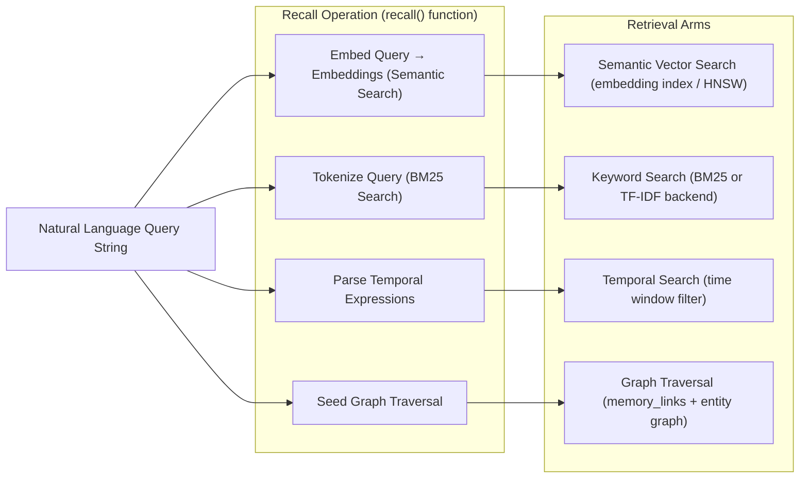
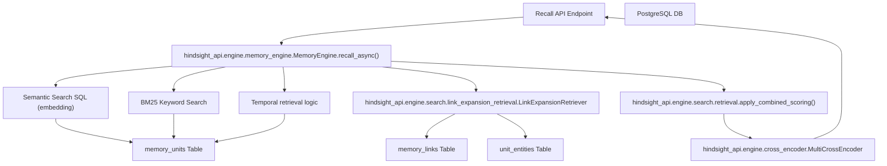

<!-- source: DeepWiki mcp.deepwiki.com · repo vectorize-io/hindsight · page 4.2 Recall - Retrieving Memories · fetched 2026-10-26 -->

# Recall - Retrieving Memories

<details>
<summary>Relevant source files</summary>

The following files were used as context for generating this wiki page:

- [hindsight-api-slim/hindsight_api/engine/response_models.py](hindsight-api-slim/hindsight_api/engine/response_models.py)
- [hindsight-api-slim/tests/store_seed.py](hindsight-api-slim/tests/store_seed.py)
- [hindsight-api-slim/tests/test_list_banks_ordered_page.py](hindsight-api-slim/tests/test_list_banks_ordered_page.py)
- [hindsight-api-slim/tests/test_list_banks_pagination.py](hindsight-api-slim/tests/test_list_banks_pagination.py)
- [hindsight-api-slim/tests/test_memory_curation.py](hindsight-api-slim/tests/test_memory_curation.py)
- [hindsight-api-slim/tests/test_mental_model_scheduled_refresh.py](hindsight-api-slim/tests/test_mental_model_scheduled_refresh.py)
- [hindsight-api-slim/tests/test_op_cancellation.py](hindsight-api-slim/tests/test_op_cancellation.py)
- [hindsight-api-slim/tests/test_recall_min_score.py](hindsight-api-slim/tests/test_recall_min_score.py)
- [hindsight-api-slim/tests/test_recall_pipeline_toggles.py](hindsight-api-slim/tests/test_recall_pipeline_toggles.py)
- [hindsight-api-slim/tests/test_tag_scope.py](hindsight-api-slim/tests/test_tag_scope.py)
- [hindsight-docs/docs/developer/api/memories.mdx](hindsight-docs/docs/developer/api/memories.mdx)
- [hindsight-docs/docs/developer/api/recall.mdx](hindsight-docs/docs/developer/api/recall.mdx)
- [hindsight-docs/docs/developer/observations.mdx](hindsight-docs/docs/developer/observations.mdx)
- [hindsight-docs/examples/api/memories.go](hindsight-docs/examples/api/memories.go)
- [hindsight-docs/examples/api/memories.mjs](hindsight-docs/examples/api/memories.mjs)
- [hindsight-docs/examples/api/memories.py](hindsight-docs/examples/api/memories.py)
- [hindsight-docs/examples/api/memories.sh](hindsight-docs/examples/api/memories.sh)
- [skills/hindsight-docs/references/developer/api/memories.md](skills/hindsight-docs/references/developer/api/memories.md)
- [skills/hindsight-docs/references/developer/api/recall.md](skills/hindsight-docs/references/developer/api/recall.md)
- [skills/hindsight-docs/references/developer/observations.md](skills/hindsight-docs/references/developer/observations.md)

</details>


## Purpose and Scope

This page documents the **recall** operation, which is responsible for retrieving relevant memories from a memory bank using a sophisticated multi-strategy retrieval pipeline. Recall is one of the three fundamental core memory operations in Hindsight alongside **retain** (storing memories) and **reflect** (generating responses using memories).

Recall executes synchronously, returning matching results immediately (`HTTP 200 OK`). It orchestrates four parallel retrieval strategies, applies reciprocal rank fusion (RRF) to merge their results, reranks candidates using a neural cross-encoder model, and returns a ranked list of structured fact memories (not raw documents). This ensures robust, diverse, and contextually relevant memory results for downstream AI agents.

Sources: `[hindsight-docs/docs/developer/api/recall.mdx:5-10]()`

---

## Recall Request Parameters & Query Composition

The recall API request uses the `RecallRequest` Pydantic model with the following key parameters:

| Parameter | Type | Description | Default |
|---|---|---|---|
| `query` | `string` | Natural language query input driving all four retrieval strategies. Maximum 500 tokens. | **Required** |
| `types` | `list[string]` | List of fact types to restrict search: `world` (objective facts), `experience` (agent events), `observation` (consolidated beliefs). When omitted, all types queried. | `null` (all) |
| `prefer_observations` | `bool` | When true, suppresses raw facts superseded by observations, backfilling slots with next-best results. | `false` |
| `budget` | `Budget` enum | Search depth level: `low`, `mid` (default), or `high`. Controls retrieval breadth and indirect reasoning. | `mid` |
| `max_tokens` | `int` | Limits the sum of tokens for fact `text` fields in results; memory content is truncated or skipped to fit budget. | `4096` |
| `trace` | `bool` | Include detailed debug trace and performance metrics in the response. | `false` |
| `query_timestamp` | `string` (ISO 8601) | Anchor time for temporal interpretation, filtering, and recency boosts. | `null` |
| `tags` | `list[string]` | Simple flat list of tags that candidate memories must match according to `tags_match`. | `null` |
| `tags_match` | `TagsMatch` enum | Tag filtering mode: `any` (default), `all`, `any_strict`, `all_strict`, `exact`. | `any` |
| `tag_groups` | `list[TagGroup]` | Compound boolean logic for nested tag filter expressions, supporting `AND`, `OR`, `NOT`. | `null` |
| `include` | `list[string]` | Elements to include in each result: `entities` (default), `chunks`, `source_facts`. | `entities` |
| `min_scores` | `MinScores` | Minimum scores for `final`, `reranker`, `semantic`, and `keyword` to filter results. | `null` |

**Query Composition:** The input natural language query is tokenized and embedded for different retrieval arms:

- Embedded vector for semantic search,
- Tokenized for BM25 keyword search,
- Parsed for temporal expressions,
- Used as seed nodes for graph traversal (link expansion).

After candidate facts are retrieved, the raw query string is also passed along to the cross-encoder reranker for fine-grained relevance scoring.

Sources: `[hindsight-docs/docs/developer/api/recall.mdx:50-58]()`, `[hindsight-api-slim/hindsight_api/engine/response_models.py:690-700]()`

---

## Memory Type Filtering & Observation Preferences

The `types` parameter defines which memory fact categories are included in the recall search. Valid types are defined by `VALID_RECALL_FACT_TYPES` [hindsight-api-slim/hindsight_api/engine/response_models.py:16-16]():

- `world`: Objective facts about entities, places, and events.
- `experience`: The agent's own events and observations.
- `observation`: Automatically consolidated facts representing durable, evidence-backed beliefs synthesized from multiple raw facts.

When multiple types are requested, the full four-strategy retrieval pipeline runs independently per type, and the results are merged downstream.

### Prefer Observations

The `prefer_observations` flag (`false` by default) improves result quality when both `observation` and raw fact types are requested:

- If an observation is returned that was synthesized from certain raw facts, those raw facts are removed from the results to avoid duplication.
- The freed result slots are backfilled with subsequent relevant facts, maintaining coverage.

This enables users to retrieve comprehensive consolidated knowledge while not losing fresh or less-consolidated facts.

Sources: `[hindsight-docs/docs/developer/api/recall.mdx:55-89]()`, `[hindsight-api-slim/hindsight_api/engine/response_models.py:16-16]()`

---

## Budget Levels & Token Budget Filtering (`max_tokens`)

### Budget Levels (`budget`)

The `budget` parameter controls the internal query limits and retrieval depth for the recall operation:

- `low`: Fast, shallow retrieval, optimized for quick lookups.
- `mid` (default): Balanced retrieval, suitable for common queries.
- `high`: Deep retrieval, including extensions such as multi-hop link expansion in the knowledge graph, recommended for indirect or exhaustive searches.

### Token Budget (`max_tokens`)

The `max_tokens` parameter (default `4096`) caps the total token count of the **fact text fields** returned:

- After reranking, candidate facts are included in relevance order until the token budget is exhausted.
- If a fact is too large to fit the remaining budget, it is **skipped** so the budget is efficiently packed with smaller facts.
- The agent client can vary this budget to fit its LLM context window constraints.

At least one fact is always returned even if its length exceeds the token budget (except if explicitly set to zero).

Sources: `[hindsight-docs/docs/developer/api/recall.mdx:91-113]()`

---

## Include Options

The `include` parameter allows callers to add extra detailed data structures to each recalled fact result:

- `entities` (default): Include list of linked entity names associated with each fact.
- `chunks`: Include the original raw document chunks that produced the memory unit.
- `source_facts`: For observations, include the raw evidence fact memories that support them.

This is specified as a list of strings in the `RecallRequest`. Omitting this returns a lean result with only the fact and basic metadata.

Sources: `[hindsight-docs/docs/developer/api/recall.mdx:110-127]()`

---

## Advanced Tag Filtering and Compound Tag Groups

Recall supports fine-grained **visibility scoping** of memories using tags attached during retain and observation:

- Simple tag filters (`tags`) as a list of strings.
- Compound boolean tag expressions (`tag_groups`) for nesting AND / OR / NOT logic.

### Simple Tag Matching (`tags_match`)

| Mode | Behavior | Untagged Memories Included? |
|---|---|---|
| `any` (default) | Match at least one of the tags | Yes |
| `all` | Match all listed tags | Yes |
| `any_strict` | Match any listed tags, exclude untagged memories | No |
| `all_strict` | Match all listed tags exactly, no untagged | No |
| `exact` | Require exact tag set equality | No |

### Compound Tag Groups (`tag_groups`)

Allows expressive filtering composed of multiple tag sets connected by boolean operators:

- AND groups require all subgroups to match.
- OR groups require at least one subgroup match.
- NOT groups exclude memories matching contained tags.

The complex filter expression is compiled internally to optimized SQL predicates in the retrieval query.

Sources: `[hindsight-docs/docs/developer/api/recall.mdx:138-150]()`

---

## Retrieval Pipeline Architecture

Recall operates by passing input queries through multiple coordinated components interacting with distinct parts of the PostgreSQL data schema:

```mermaid
flowchart TB
    Query["Input Query String<br/>(RecallRequest.query)"]
    
    subgraph Engine["Engine Layer: hindsight_api.engine.search"]
        direction TB
        Semantic["Semantic Search<br/>`retrieve_semantic_bm25_combined_sql`"]
        BM25["BM25 Search<br/>`tokenize_query` + text_search"]
        Graph["Graph Traversal<br/>`LinkExpansionRetriever.retrieve`"]
        Temporal["Temporal Search<br/>`retrieve_temporal_combined`"]
    end

    subgraph Database["PostgreSQL Data Layer"]
        MU["`memory_units` Table (facts)"]
        ML["`memory_links` Table (graph edges)"]
        UE["`unit_entities` Table (entity links)"]
    end
    
    Query --> Semantic
    Query --> BM25
    Query --> Graph
    Query --> Temporal
    
    Semantic -.-> MU
    BM25 -.-> MU
    Graph -.-> ML
    Graph -.-> UE
    
    subgraph Fusion["Fusion & Reranking"]
        RRF["Reciprocal Rank Fusion<br/>`apply_combined_scoring()`"]
        CE["Cross-Encoder Reranker<br/>neural model"]
    end
    
    Engine --> RRF
    RRF --> CE
    CE --> RecallResponse["RecallResponse (list of RecallResult)"]
```

- The initial query triggers parallel searches: vector similarity, keyword, graph relations, and temporal windows.
- Each arm queries its own set of tables/indexes tuned for the type of retrieval.
- The candidate sets are merged using Reciprocal Rank Fusion based on rank consensus.
- Finally, a cross-encoder model rescopes results considering query-fact interaction, providing the final ranking.

Sources: `[hindsight-docs/docs/developer/api/recall.mdx:5-10]()`

---

## Four Parallel Retrieval Strategies

Recall uses four complementary retrieval strategies simultaneously to overcome the limitations of any single method:

### 1. Semantic Vector Search

- The input query is embedded using a vector model.
- Similarity is computed between the query embedding and memory fact embeddings (`memory_units.embedding`) using cosine distance (`<=>` operator).
- Utilizes per-bank HNSW indexes, sharded by fact type (`world`, `experience`, `observation`).
- Captures conceptual similarities, paraphrases, and synonyms.

### 2. BM25 Keyword Search

- The query is tokenized with language-specific analyzers (configurable backend: `native`, `vchord`, `pg_search`, etc).
- Performs exact and fuzzy token matching for high precision.
- Excels at retrieving proper nouns, technical terms, and identifiers.
- Selection is based on keyword relevance scores.

### 3. Graph Traversal (`LinkExpansionRetriever`)

- Operates on the `memory_links` graph representing relationships between memories.
- Traverses connections such as entity co-occurrence, semantic similarity, temporal proximity, and causality.
- Enables multi-hop reasoning and indirect connections.
- Especially useful for answering "Why?" or "Who relates to whom?" queries.

### 4. Temporal Retrieval

- Parses temporal expressions in the query to extract date ranges.
- Filters memories by `occurred_start` and `occurred_end` timestamps overlapping the range.
- Performs bucketed selection across the time window for coverage, not just recency.
- Applications include historical reasoning and timeline queries.

Sources: `[hindsight-docs/docs/developer/api/recall.mdx:5-10]()`

---

## Result Ordering and Cross-Encoder Reranking

- Results from all four retrieval strategies are merged using **Reciprocal Rank Fusion (RRF)**: consensus across strategies improves a fact's rank.
- Result scores are adjusted by:
  - Recency boosts (time proximity to the query timestamp)
  - Temporal window coverage
  - Proof count (number of supporting evidences for observations)
- Candidates are then reranked and rescored by a neural **cross-encoder reranker model** that evaluates query-memory semantic interaction.
- Final results are packed into the token budget, preserving full sentences (skipping overly large facts).

This staged ranking yields precise, contextually relevant, diverse recall results that are robust against noisy or partial queries.

Sources: `[hindsight-api-slim/tests/test_recall_min_score.py:114-118]()`

---

## Memory Curation, Invalidation, and Recall Exclusion

Fact memories can be corrected, retired, or invalidated through **memory curation** APIs (`PATCH /v1/default/banks/{bank}/memories/{id}`):

- **Invalidation** moves memories out of the main `memory_units` table into the cold archive table `invalidated_memory_units`.
- Invalidated memories become invisible to recall operations and queries.
- All associated metadata, entity links, and graph relationships are preserved for audit and possible revert.
- A memory edit can replace the fact text or metadata while preserving association.
- Recall pipelines never see invalidated memories, ensuring data correctness and avoiding stale or erroneous facts.

### Diagram: Curation and Invalidation Flow
```mermaid
flowchart TB
    API["PatchMemoryAPI (PATCH /memories/{id})"]
    Store["MemoryEngine.update_memory()"]
    Check{"Is memory invalidated?"}
    Live["`memory_units` (Live Memories)"]
    Arch["`invalidated_memory_units` Archive"]
    Recall["Recall Hot-Path<br/>(`retrieve_semantic_bm25_combined_sql`)"]

    API --> Store
    Store --> Check
    Check -->|Yes| Arch
    Check -->|No| Live
    Arch -.->|"Excluded from recall"| Recall
    Live -.->|"Queried by recall"| Recall
```

Memory curation includes guards against premature deletion, maintaining consistency across entity graphs and multiple retrieval strategies.

Sources: `[hindsight-api-slim/tests/test_memory_curation.py:1-65]()`, `[skills/hindsight-docs/references/developer/api/memories.md:1-22]()`

---

# Summary

Recall in Hindsight is a powerful, multi-faceted memory retrieval system that supports natural language queries with configurable search depth, memory type filtering, token budgeting, and tag-scoped visibility. Its core principles are:

- Combining multiple search methods (semantic, keyword, temporal, graph) in parallel.
- Merging results with rank fusion and neural reranking for precision and recall.
- Supporting fine-grained query filtering by fact types, tags, and sophisticated tag groups.
- Respecting user curation by excluding archived invalidated memories from recall.
- Providing flexible include options for richer memory context like linked entities and source text chunks.

Together, these capabilities enable AI agents and applications to query long-term memory banks efficiently, reliably, and with rich semantic understanding.

---

# References and Key Code Locations

| Topic | Source File / Lines |
|---|---|
| Recall API & Params | `hindsight-api-slim/hindsight_api/engine/response_models.py:690-700` |
| Recall Core Strategy | `hindsight-docs/docs/developer/api/recall.mdx:5-10` |
| Memory Curation | `hindsight-api-slim/tests/test_memory_curation.py:1-65` |
| Recall Documentation | `hindsight-docs/docs/developer/api/recall.mdx` |

---

# Additional Diagrams Illustrating Recall Mapping

### Diagram: Natural Language Query to Code Components



### Diagram: Code Modules Relationship in Recall Pipeline



Sources: `[hindsight-api-slim/tests/test_memory_curation.py:1-65]()`, `[hindsight-api-slim/tests/test_recall_min_score.py:1-157]()`, `[hindsight-api-slim/tests/test_recall_pipeline_toggles.py:1-174]()`

---

