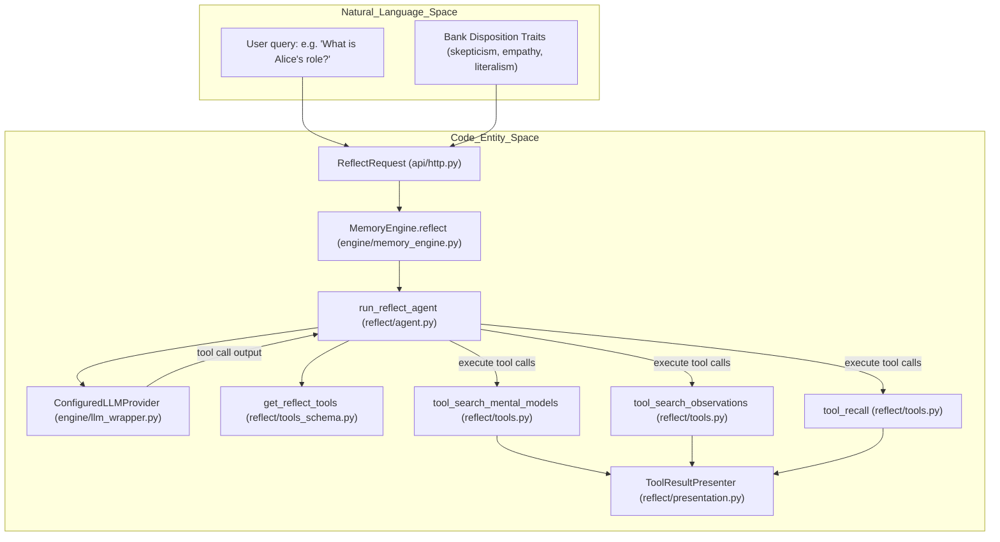
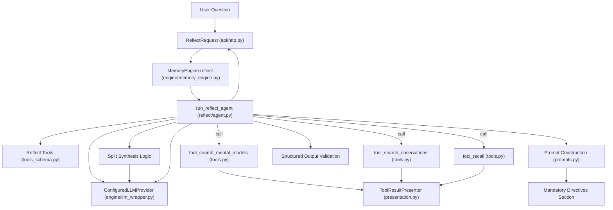

<!-- source: DeepWiki mcp.deepwiki.com · repo vectorize-io/hindsight · page 4.3 Reflect - Generating Responses · fetched 2026-10-26 -->

# Reflect - Generating Responses

Relevant source files

The following files were used as context for generating this wiki page:

- [hindsight-api-slim/hindsight_api/engine/llm_interface.py](hindsight-api-slim/hindsight_api/engine/llm_interface.py)
- [hindsight-api-slim/hindsight_api/engine/memories/pg/expand.py](hindsight-api-slim/hindsight_api/engine/memories/pg/expand.py)
- [hindsight-api-slim/hindsight_api/engine/providers/gemini_cache.py](hindsight-api-slim/hindsight_api/engine/providers/gemini_cache.py)
- [hindsight-api-slim/hindsight_api/engine/providers/gemini_llm.py](hindsight-api-slim/hindsight_api/engine/providers/gemini_llm.py)
- [hindsight-api-slim/hindsight_api/engine/reflect/__init__.py](hindsight-api-slim/hindsight_api/engine/reflect/__init__.py)
- [hindsight-api-slim/hindsight_api/engine/reflect/agent.py](hindsight-api-slim/hindsight_api/engine/reflect/agent.py)
- [hindsight-api-slim/hindsight_api/engine/reflect/delta_ops.py](hindsight-api-slim/hindsight_api/engine/reflect/delta_ops.py)
- [hindsight-api-slim/hindsight_api/engine/reflect/presentation.py](hindsight-api-slim/hindsight_api/engine/reflect/presentation.py)
- [hindsight-api-slim/hindsight_api/engine/reflect/prompts.py](hindsight-api-slim/hindsight_api/engine/reflect/prompts.py)
- [hindsight-api-slim/hindsight_api/engine/reflect/structured_doc.py](hindsight-api-slim/hindsight_api/engine/reflect/structured_doc.py)
- [hindsight-api-slim/hindsight_api/engine/reflect/tokenization.py](hindsight-api-slim/hindsight_api/engine/reflect/tokenization.py)
- [hindsight-api-slim/hindsight_api/engine/reflect/tools.py](hindsight-api-slim/hindsight_api/engine/reflect/tools.py)
- [hindsight-api-slim/hindsight_api/engine/reflect/tools_schema.py](hindsight-api-slim/hindsight_api/engine/reflect/tools_schema.py)
- [hindsight-api-slim/tests/test_delta_operation_parse.py](hindsight-api-slim/tests/test_delta_operation_parse.py)
- [hindsight-api-slim/tests/test_delta_prompt_schema_parity.py](hindsight-api-slim/tests/test_delta_prompt_schema_parity.py)
- [hindsight-api-slim/tests/test_gemini_cache.py](hindsight-api-slim/tests/test_gemini_cache.py)
- [hindsight-api-slim/tests/test_gemini_implicit_cache_ratio.py](hindsight-api-slim/tests/test_gemini_implicit_cache_ratio.py)
- [hindsight-api-slim/tests/test_input_robustness.py](hindsight-api-slim/tests/test_input_robustness.py)
- [hindsight-api-slim/tests/test_mental_model_no_answer_preserved.py](hindsight-api-slim/tests/test_mental_model_no_answer_preserved.py)
- [hindsight-api-slim/tests/test_multilingual.py](hindsight-api-slim/tests/test_multilingual.py)
- [hindsight-api-slim/tests/test_named_result_stubs.py](hindsight-api-slim/tests/test_named_result_stubs.py)
- [hindsight-api-slim/tests/test_reflect_agent.py](hindsight-api-slim/tests/test_reflect_agent.py)
- [hindsight-api-slim/tests/test_reflect_cites_real_ids.py](hindsight-api-slim/tests/test_reflect_cites_real_ids.py)
- [hindsight-api-slim/tests/test_reflect_document_answer.py](hindsight-api-slim/tests/test_reflect_document_answer.py)
- [hindsight-api-slim/tests/test_reflect_expand_store_reads.py](hindsight-api-slim/tests/test_reflect_expand_store_reads.py)
- [hindsight-api-slim/tests/test_reflect_presentation.py](hindsight-api-slim/tests/test_reflect_presentation.py)
- [hindsight-api-slim/tests/test_reflect_prompt_builder.py](hindsight-api-slim/tests/test_reflect_prompt_builder.py)
- [hindsight-api-slim/tests/test_reflect_split_synthesis.py](hindsight-api-slim/tests/test_reflect_split_synthesis.py)
- [hindsight-api-slim/tests/test_reflect_tools.py](hindsight-api-slim/tests/test_reflect_tools.py)
- [hindsight-api-slim/tests/test_retain_reflect_output_language.py](hindsight-api-slim/tests/test_retain_reflect_output_language.py)
- [hindsight-api-slim/tests/test_retain_result_shape.py](hindsight-api-slim/tests/test_retain_result_shape.py)
- [hindsight-api-slim/tests/test_structured_doc.py](hindsight-api-slim/tests/test_structured_doc.py)
- [hindsight-system-evals/evals/test_03_retain_language.py](hindsight-system-evals/evals/test_03_retain_language.py)
- [hindsight-system-tests/tests/test_39_refresh_document_shape.py](hindsight-system-tests/tests/test_39_refresh_document_shape.py)
- [hindsight-system-tests/tests/test_42_disposition.py](hindsight-system-tests/tests/test_42_disposition.py)

## Purpose and Scope

The `reflect` operation in Hindsight enables an autonomous, iterative reasoning loop powered by a large language model (LLM) agent. Unlike a simple retrieval (`recall`), `reflect` involves multi-step querying, tool invocations, and a fusion of various knowledge layers — including mental models, consolidated observations, and base facts — to produce reflective, informed responses.

This page explains the implementation of the reflect agent loop (`run_reflect_agent`), including:
- Hierarchical retrieval tools and native function calls.
- Prompt construction with mental model and directive integration.
- Disposition-aware reasoning that modifies response style.
- Structured output generation with retries and schema validation.
- Techniques to handle token budget overflow via split synthesis.
- Citation tracking and alias management to ensure traceable references.

Sources: [hindsight-api-slim/hindsight_api/engine/reflect/agent.py:1-164](), [hindsight-api-slim/hindsight_api/engine/reflect/prompts.py:1-168](), [hindsight-api-slim/hindsight_api/engine/reflect/tools.py:1-150](), [hindsight-api-slim/tests/test_reflect_agent.py:1-162](), [hindsight-api-slim/tests/test_reflect_split_synthesis.py:1-144]()

---

## Agent Architecture and Autonomous Multi-Step Search Loop

The core reflection engine is implemented in the `run_reflect_agent` coroutine inside `hindsight_api/engine/reflect/agent.py`. It orchestrates an LLM-driven agent loop that repeatedly:
1. Reads the current conversation prompt and state.
2. Calls a retrieval or expansion tool based on the model's directive.
3. Updates the conversation with returned data.
4. Continues until a `done` tool call signals completion or a maximum iteration count is reached.

The agent employs **hierarchical retrieval**, prioritizing:
- **`search_mental_models`** — user-curated mental model documents containing high-quality synthesized knowledge.
- **`search_observations`** — consolidated, fresh knowledge observations.
- **`recall`** — raw factual memories from the vector and text search backends.

### Key Classes and Functions

| Class/Function | Description | Location |
|---|---|---|
| `run_reflect_agent` | Main async reflect loop; processes LLM responses and tools | `hindsight-api-slim/hindsight_api/engine/reflect/agent.py` |
| `ReflectToolTokenLimits` (dataclass)| Holds token budgets for tool call arguments | `hindsight-api-slim/hindsight_api/engine/reflect/agent.py:96-102` |
| `_execute_tool` | Executes reflect tools (`recall`, `search_mental_models`, ...) | `hindsight-api-slim/hindsight_api/engine/reflect/agent.py` |
| `get_reflect_tools` | Registers tool schemas and names exposed to the agent | `hindsight-api-slim/hindsight_api/engine/reflect/tools_schema.py:200` |
| Tools like `tool_search_mental_models`, `tool_search_observations`, `tool_recall` | Retrieval tool implementations | `hindsight-api-slim/hindsight_api/engine/reflect/tools.py` |
| `ToolResultPresenter` | Tracks item aliases and presents tool results for prompts | `hindsight-api-slim/hindsight_api/engine/reflect/presentation.py:10-12` |

### Call Flow Diagram Connecting Natural Language to Code Entities

Sources: [hindsight-api-slim/hindsight_api/engine/reflect/agent.py:1-164](), [hindsight-api-slim/hindsight_api/engine/reflect/tools_schema.py:200](), [hindsight-api-slim/hindsight_api/engine/reflect/tools.py:1-150](), [hindsight-api-slim/hindsight_api/engine/reflect/presentation.py:10-12]()

### Token Budgets and Tool Call Limits

The agent manages per-tool and per-call token budgets with careful limits enforced by the helper `_resolve_tool_arg_ceiling` [hindsight-api-slim/hindsight_api/engine/reflect/agent.py:104-118](), considering the remaining prompt context tokens and concurrency to prevent budget overflow. Default token limits and minimums (e.g., `_TOOL_ARG_MIN_TOKENS` [hindsight-api-slim/hindsight_api/engine/reflect/agent.py:67] to `_TOOL_ARG_MAX_TOKENS` [hindsight-api-slim/hindsight_api/engine/reflect/agent.py:68] tokens per tool argument) are applied consistently.

Sources: [hindsight-api-slim/hindsight_api/engine/reflect/agent.py:67-68](), [hindsight-api-slim/hindsight_api/engine/reflect/agent.py:104-118]()

---

## Disposition-Aware Reasoning and Prompt Construction

Reflect queries honor **disposition traits** configured on memory banks. These three traits (`skepticism`, `literalism`, `empathy`) influence how the agent reasons and presents answers, encoded as levels from 1 (low) to 5 (high). The reflect prompt construction adapts instructions accordingly.

### Disposition Traits and Their Impact

| Trait | Symbol | Description | Reflect Impact |
|---|---|---|---|
| Skepticism | `disposition_skepticism` | Degree of trust/doubt in data | High skepticism makes the agent question conflicting facts more rigorously. |
| Literalism | `disposition_literalism` | Adherence to literal text | High literalism forces strict interpretation without inference or embellishment. |
| Empathy | `disposition_empathy` | Consideration for emotional context | Higher empathy makes the agent prioritize emotional tone and human factors in answers. |

### Prompt Sections

- **System Prompt:** Sets agent role, reasoning rules, language rules, critical logic (e.g. temporal supersession), and instructions to never hallucinate.
- **Directives Section:** Injected as **MANDATORY** hard constraints (see separate section).
- **Disposition Description:** Generated by `build_disposition_description` [hindsight-api-slim/hindsight_api/engine/reflect/prompts.py:22]() considering trait values.
- **Current DateTime:** Provided with minute precision to support time-relative reasoning by `_current_utc_datetime` [hindsight-api-slim/hindsight_api/engine/reflect/prompts.py:35-42]().
- **Instructions on Temporal Reasoning:** Explain how the agent uses timestamps (`mentioned_at`, `occurred_start/end`) to resolve conflicts and ambiguity.
- **Rules for Inference:** Specifies when to infer and when to avoid extrapolation or invented data.
- **Synthesis Guidance:** Notes on how to incorporate multiple memories, resolve conflicting facts, and show reasoning with bullet points.

### Key Functions

| Function | Purpose | Location |
|---|---|---|
| `build_system_prompt_for_tools` | Builds system prompt with disposition, directives, temporal rules, etc. | `hindsight-api-slim/hindsight_api/engine/reflect/prompts.py` |
| `build_agent_user_prompt` | Appends user query with output language directives | `hindsight-api-slim/hindsight_api/engine/reflect/prompts.py:136-160` |
| `build_directives_section` | Renders mandatory directives as a prompt section | `hindsight-api-slim/hindsight_api/engine/reflect/prompts.py:60-89` |

Sources: [hindsight-api-slim/hindsight_api/engine/reflect/prompts.py:10-168](), [hindsight-api-slim/hindsight_api/engine/reflect/prompts.py:22](), [hindsight-api-slim/hindsight_api/engine/reflect/prompts.py:35-42](), [hindsight-api-slim/hindsight_api/engine/reflect/prompts.py:60-89](), [hindsight-api-slim/hindsight_api/engine/reflect/prompts.py:136-160](), [hindsight-api-slim/tests/test_reflect_prompt_builder.py:1-99]()

---

## Tool System: Retrieval, Expansion, and Pruning

The reflect agent uses native tooling calls to access memory data. Tools appear as callable functions the model invokes via function-call semantics (OpenAI style or Anthropic style) for structured, stepwise reasoning.

### Tool Name Normalization and Error Recovery

The agent supports normalization of tool names via `_normalize_tool_name` [hindsight-api-slim/tests/test_reflect_agent.py:65]() to handle prefixes like `functions.` or `call=` and suffix artifacts (`<|channel|>`), ensuring robust tool call recognition. Unknown tools or execution errors raise exceptions handled to allow retry or graceful fallback.

### Hierarchical Retrieval Strategy

The retrieval tools implement a strict hierarchy to prioritize high-value knowledge:

1. **Mental Models (`tool_search_mental_models` [hindsight-api-slim/hindsight_api/engine/reflect/tools.py:119-150]):** High-quality, user-curated summaries or "knowledge pages".
2. **Observations (`tool_search_observations` [hindsight-api-slim/hindsight_api/engine/reflect/tools_schema.py:49-77]):** Synthesized, consolidated knowledge items with freshness awareness.
3. **Recall (`tool_recall` [hindsight-api-slim/hindsight_api/engine/reflect/tools_schema.py:80-112]):** Raw facts from memory units and indexed documents.

Optionally, the `expand` tool (`tool_expand` [hindsight-api-slim/hindsight_api/engine/reflect/tools_schema.py:147-166]) can fetch additional context tied to memory items.

### Data Pruning for Cost Efficiency

Before returning results to the LLM for reasoning, tool implementations strip unnecessary internal fields (`_UNREAD_RESULT_FIELDS` [hindsight-api-slim/hindsight_api/engine/reflect/tools.py:70]), prune null/empty keys via `_prune_nulls` [hindsight-api-slim/hindsight_api/engine/reflect/tools.py:86-101](), and truncate lengthy context strings via `truncate_context_for_prompt` [hindsight-api-slim/hindsight_api/engine/reflect/tools.py:17](). This reduces token usage while preserving semantic content and citation metadata.

Sources: [hindsight-api-slim/hindsight_api/engine/reflect/tools.py:10-150](), [hindsight-api-slim/hindsight_api/engine/reflect/tools.py:17](), [hindsight-api-slim/hindsight_api/engine/reflect/tools.py:70](), [hindsight-api-slim/hindsight_api/engine/reflect/tools.py:86-101](), [hindsight-api-slim/hindsight_api/engine/reflect/tools_schema.py:49-77](), [hindsight-api-slim/hindsight_api/engine/reflect/tools_schema.py:80-112](), [hindsight-api-slim/hindsight_api/engine/reflect/tools_schema.py:147-166](), [hindsight-api-slim/tests/test_reflect_agent.py:59-110]()

---

## Directives and Constraints Enforcement

Directives are **hard rules** defined by users or system administrators that the reflect agent MUST follow in all responses. They are applied with highest priority and cannot be overridden by other prompt content.

### Directive Rendering in Prompts

- The **`build_directives_section`** function [hindsight-api-slim/hindsight_api/engine/reflect/prompts.py:60-89]() creates a prominent "MANDATORY" section listing all directives with numbered bullet points.
- A **reminder section** can be appended near the end of the prompt via `build_directives_reminder` [hindsight-api-slim/hindsight_api/engine/reflect/prompts.py:92-119](), reinforcing compliance before final output generation.
- Directives can specify arbitrary constraints: language requirements, content filtering, behavioral constraints, etc.
- They override default language detection rules provided by the system prompt.

This design ensures reflect responses respect explicit user policies and configuration regardless of retrieved content.

Sources: [hindsight-api-slim/hindsight_api/engine/reflect/prompts.py:49-120](), [hindsight-api-slim/hindsight_api/engine/reflect/prompts.py:60-89](), [hindsight-api-slim/hindsight_api/engine/reflect/prompts.py:92-119]()

---

## Structured Output Generation and Delta Operations

Reflect can produce **structured, typed output** conforming to a Pydantic model schema (passed as `response_schema`). This supports formatting controlled JSON responses rather than open text.

### Generation and Validation Flow

- After reflection converges, `_generate_structured_output` [hindsight-api-slim/tests/test_reflect_agent.py:30]() performs a separate LLM invocation constrained for JSON output.
- The returned output is parsed and validated against the Pydantic schema.
- Failed parses or invalid structure trigger **short retry budgets**, limiting attempts before falling back to a plain-text answer.
- This structured extraction is used for strong API contract enforcement and downstream tooling integration.

### Delta Operations

- If reflect generates delta updates to mental models or knowledge pages, those patches are composed and applied as JSON operations.
- The `parse_delta_operation_list` [hindsight-api-slim/hindsight_api/engine/reflect/delta_ops.py:17]() function handles parsing the LLM's output into a list of `DeltaOperation` objects, with robust error handling for invalid operations [hindsight-api-slim/tests/test_delta_operation_parse.py:70-90]().
- The `apply_operations` [hindsight-api-slim/hindsight_api/engine/reflect/delta_ops.py:18]() function then applies these operations to a `StructuredDocument`, ensuring that only valid changes are made and new block IDs are minted to prevent collisions [hindsight-api-slim/tests/test_delta_operation_parse.py:158-162]().

Sources: [hindsight-api-slim/hindsight_api/engine/reflect/delta_ops.py:1-40](), [hindsight-api-slim/hindsight_api/engine/reflect/delta_ops.py:17](), [hindsight-api-slim/hindsight_api/engine/reflect/delta_ops.py:18](), [hindsight-api-slim/tests/test_reflect_agent.py:30](), [hindsight-api-slim/tests/test_delta_operation_parse.py:70-90](), [hindsight-api-slim/tests/test_delta_operation_parse.py:158-162]()

---

## Split Synthesis and Citation Tracking

When the gathered evidence exceeds prompt context budgets, the agent uses **split synthesis** to safely compress all retrieved evidence without data loss prior to the final answer generation.

### Split Synthesis Workflow

1.  **Partition Tool Outputs:** The accumulated tool results are split into token-budgeted chunks by `split_context_history` [hindsight-api-slim/hindsight_api/engine/reflect/prompts.py:47]().
2.  **Map Step:** Each chunk is independently summarized into concise dated, cited claims via a low-temperature LLM call using `build_chunk_claims_prompt` [hindsight-api-slim/hindsight_api/engine/reflect/prompts.py:41]().
3.  **Reduce Step:** The summaries from all chunks are then combined into a final synthesized answer using a higher-level prompt built by `build_reduce_prompt` [hindsight-api-slim/hindsight_api/engine/reflect/prompts.py:44]().
4.  **Citation Preservation:** During compression, citations remain intact, allowing traceability and auditability in the final answer.
5.  **Failure Safety:** Oversized blocks that cannot be split are token-cut with graceful degradation [hindsight-api-slim/tests/test_reflect_split_synthesis.py:81-107]().

### Benefits

- Ensures no retrieved memory or observation is dropped due to token overflow.
- Handles arbitrarily large evidence sets without forcing model context truncation.
- Provides human-auditable citations in answers for transparency.

Sources: [hindsight-api-slim/hindsight_api/engine/reflect/agent.py:150-165](), [hindsight-api-slim/hindsight_api/engine/reflect/prompts.py:41](), [hindsight-api-slim/hindsight_api/engine/reflect/prompts.py:44](), [hindsight-api-slim/hindsight_api/engine/reflect/prompts.py:47](), [hindsight-api-slim/tests/test_reflect_split_synthesis.py:1-144](), [hindsight-api-slim/tests/test_reflect_split_synthesis.py:81-107]()

---

## Summary Diagram: Natural Language Query to Structured Reflect Response

Sources: [hindsight-api-slim/hindsight_api/engine/reflect/agent.py:1-164](), [hindsight-api-slim/hindsight_api/engine/reflect/tools_schema.py:1-166](), [hindsight-api-slim/hindsight_api/engine/reflect/tools.py:1-150](), [hindsight-api-slim/hindsight_api/engine/reflect/presentation.py:10-12](), [hindsight-api-slim/hindsight_api/engine/reflect/prompts.py:1-168]()

---

## References

- Reflect agent implementation: [hindsight-api-slim/hindsight_api/engine/reflect/agent.py:1-164]()
- Reflect prompt construction and disposition: [hindsight-api-slim/hindsight_api/engine/reflect/prompts.py:1-168]()
- Reflect retrieval tools: [hindsight-api-slim/hindsight_api/engine/reflect/tools.py:1-150]()
- Reflect presentation and alias handling: [hindsight-api-slim/hindsight_api/engine/reflect/presentation.py:10-12]()
- Reflect agent tests (tool normalization, structured output): [hindsight-api-slim/tests/test_reflect_agent.py:1-162]()
- Split synthesis testing and logic: [hindsight-api-slim/tests/test_reflect_split_synthesis.py:1-144]()
- Directive enforcement in prompts: [hindsight-api-slim/hindsight_api/engine/reflect/prompts.py:49-120]()
- Delta operations for structured mental models: [hindsight-api-slim/hindsight_api/engine/reflect/delta_ops.py:1-40]()
- Delta operation parsing tests: [hindsight-api-slim/tests/test_delta_operation_parse.py:1-162]()

---

This page described the internals of the Hindsight reflect operation, showing its meticulous multi-tool autonomous agent loop, the integration of mental models and directives, the disposition-aware prompt engineering, and advanced handling of token budget and structured output. These design elements enable Hindsight's robust, explainable, and trustworthy AI-driven memory reflection.

---

