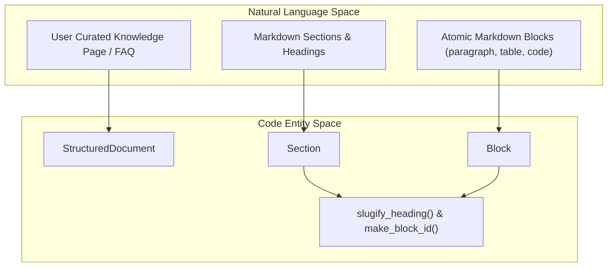
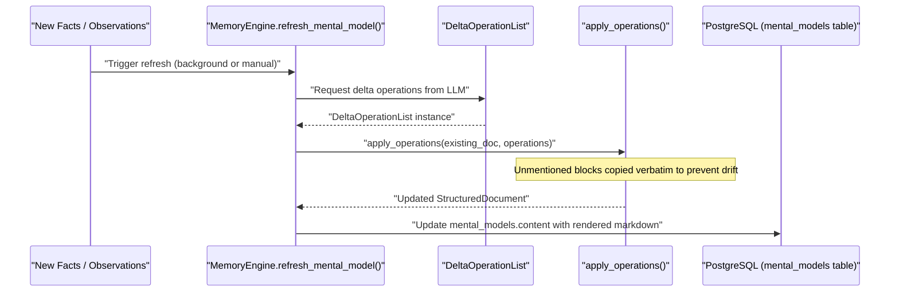

<!-- source: DeepWiki mcp.deepwiki.com · repo vectorize-io/hindsight · page 4.5 Mental Models and Knowledge Pages · fetched 2026-10-26 -->

# Mental Models and Knowledge Pages

Relevant source files

The following files were used as context for generating this wiki page:

- [hindsight-api-slim/tests/test_llm_temperature_env.py](hindsight-api-slim/tests/test_llm_temperature_env.py)
- [hindsight-api-slim/tests/test_mental_model_delta.py](hindsight-api-slim/tests/test_mental_model_delta.py)
- [hindsight-api-slim/tests/test_mental_model_retractions.py](hindsight-api-slim/tests/test_mental_model_retractions.py)
- [hindsight-api-slim/tests/test_mental_models.py](hindsight-api-slim/tests/test_mental_models.py)
- [hindsight-api-slim/tests/test_recall_config.py](hindsight-api-slim/tests/test_recall_config.py)
- [hindsight-docs/docs/developer/api/mental-models.mdx](hindsight-docs/docs/developer/api/mental-models.mdx)
- [hindsight-docs/examples/api/mental-models.go](hindsight-docs/examples/api/mental-models.go)
- [hindsight-docs/examples/api/mental-models.mjs](hindsight-docs/examples/api/mental-models.mjs)
- [hindsight-docs/examples/api/mental-models.py](hindsight-docs/examples/api/mental-models.py)
- [hindsight-docs/examples/api/mental-models.sh](hindsight-docs/examples/api/mental-models.sh)
- [skills/hindsight-docs/references/developer/api/mental-models.md](skills/hindsight-docs/references/developer/api/mental-models.md)

## Purpose and Scope

Mental models (also known as knowledge pages) are user-curated, pre-computed cached reflections of frequent queries within a memory bank [skills/hindsight-docs/references/developer/api/mental-models.md:4-5](). They form a high-performance knowledge synthesis layer, consolidating related memories into reusable markdown or structured JSON documents [hindsight-docs/docs/developer/api/mental-models.mdx:7-8]().

This page details the full technical implementation of mental models, covering their CRUD lifecycle, structured document data model (`structured_doc.py`), delta update operations (`delta_ops.py`), automatic and scheduled refresh triggers, history change tracking with diffs, metadata insights, and their integral role in hierarchical reflect operations. It also clarifies knowledge pages as a stored representation of mental models used for quick retrieval.

Sources: [skills/hindsight-docs/references/developer/api/mental-models.md:4-5](), [hindsight-docs/docs/developer/api/mental-models.mdx:7-8]()

---

## Conceptual Overview

In Hindsight, a **mental model** acts as a saved result of a reflect operation designed to answer a common user query quickly with curated, high-quality summaries [hindsight-docs/docs/developer/api/mental-models.mdx:21-23](). Unlike raw memory units representing ground-truth facts or consolidated observations, mental models embody synthesized knowledge tailored for rapid retrieval.

| Feature | Memory Unit | Observation | Mental Model |
| :---------------- | :---------------------------- | :--------------------------- | :-------------------------------- |
| **Origin** | `retain` pipeline | `consolidate` pipeline | `reflect` operation (cached) |
| **Format** | Atomic fact or raw text | Consolidated markdown | Structured Document / Markdown |
| **Update** | Immutable | Replaced on consolidation | Refreshed full or delta updates |
| **Reflect Priority** | 3 (Lowest - Raw Facts) | 2 (Medium - Observations) | 1 (Highest - Mental Models) |

This priority ordering means reflect queries check mental models first for a fast, reliable answer, falling back to observations and raw facts only if necessary [skills/hindsight-docs/references/developer/api/mental-models.md:44-52]().

Sources: [hindsight-docs/docs/developer/api/mental-models.mdx:44-52](), [skills/hindsight-docs/references/developer/api/mental-models.md:33-41]()

---

## Structured Documents and Schema

To avoid stylistic drift and token re-generation errors during refreshes, mental models are stored as **structured documents** instead of raw markdown strings. This approach ensures that unchanged content remains byte-identical, preventing LLM-generated paraphrasing or accidental content loss.

The key components of the structured document schema (`schema version 2`) are:

- **`StructuredDocument`**: The root container holding an ordered list of `Section` instances and a version number.
- **`Section`**: Represents a document section with a stable, slugified `id` (derived from the heading), heading text without the markdown prefix, ATX heading `level` (1-6), and ordered list of `Block`s.
- **`Block`**: Each block holds an opaque markdown fragment representing a paragraph, list, table, or fenced code block. It includes a deterministic, content-derived stable `id` implemented as an 8-character hash, ensuring blocks preserve identity even if text changes.

This schema allows precise targeting of sections and blocks in delta updates, and guarantees that unchanged content is never rewritten by the LLM, preserving document fidelity.

### Diagram: Natural Language to Code Mapping - Structured Document Architecture

Sources: No direct code citations for `structured_doc.py` were provided in the file contents.

---

## Refresh Pipeline: Full vs. Delta Updates

Mental models support two refresh mechanisms, configurable via the `trigger.mode` parameter:

1.  **Full Refresh Mode (`full`)**: The engine runs a complete `reflect` operation on the model's source query, generating a full new markdown document from scratch and replacing existing content [hindsight-docs/examples/api/mental-models.py:131-134]().
2.  **Delta Refresh Mode (`delta`)**: Rather than regenerating the whole document, the engine requests from the LLM a structured list of **delta operations**. These operations update only parts of the structured document that changed, preserving unchanged sections and blocks verbatim [hindsight-api-slim/tests/test_mental_model_delta.py:1-7]().

### Delta Operations Schema and Execution

Delta operations include types such as:

-   `append_block`: Add a markdown block at the end of a section.
-   `replace_block`: Replace content of an existing block.
-   `remove_block`: Remove a block.
-   `add_section`: Add a new section.
-   `remove_section`: Remove a section.
-   `rename_section`: Rename a section heading and keep its id.

The LLM returns these operations as JSON matching the strict Pydantic schema. Operations referencing unknown sections or blocks are dropped safely to avoid corruption. Unchanged sections and blocks are physically copied through, ensuring the update is surgical and auditable.

### Diagram: Natural Language to Code Mapping - Delta Refresh Execution Flow

Fallback rules for delta refresh include:

-   Falls back to full refresh if no existing content exists [hindsight-api-slim/tests/test_mental_model_delta.py:8-9]().
-   Falls back if source query changed [hindsight-api-slim/tests/test_mental_model_delta.py:10-11]().
-   Falls back if patch application fails to maintain consistency.

Sources: [hindsight-api-slim/tests/test_mental_model_delta.py:1-11](), [hindsight-docs/examples/api/mental-models.py:131-134]()

---

## Auto-Refresh, Triggers, and Recall Configuration

Mental models feature an automatic refresh lifecycle with flexible triggers:

-   **Consolidation-based triggers**: Using `refresh_after_consolidation: true` in the trigger configuration, the mental model observes when observations in its tag scope are updated. It checks if new relevant facts arrived since last refresh and queues an async refresh accordingly [skills/hindsight-docs/references/developer/api/mental-models.md:23-28]().
-   **Scheduled refreshes**: The `refresh_cron` parameter allows a 5-field UTC cron expression (e.g., `"0 3 * * *"`) so scheduled, periodic refreshes are performed to keep content current [hindsight-docs/examples/api/mental-models.py:66]().
-   **Rate limiting**: The `min_refresh_interval_seconds` setting controls minimal interval between automatic refreshes to prevent excessive LLM usage [hindsight-docs/docs/developer/api/mental-models.mdx:119-119]().
-   **Recall parameter overrides**: During refresh (reflect call), internal recall configs like `recall_include_chunks`, `recall_max_tokens`, and `recall_chunks_max_tokens` can be overridden via hierarchical config (global → tenant → bank) or by per-model trigger settings [hindsight-api-slim/tests/test_recall_config.py:1-7]().

These configurations optimize freshness, cost, and token budgets for various models and use cases.

Sources: [skills/hindsight-docs/references/developer/api/mental-models.md:23-28](), [hindsight-docs/examples/api/mental-models.py:66](), [hindsight-docs/docs/developer/api/mental-models.mdx:119-119](), [hindsight-api-slim/tests/test_recall_config.py:1-7]()

---

## Role in Reflect Operations

Mental models form the top layer in the **hierarchical retrieval** used during `reflect` operations (agent queries):

1.  **Mental Models**: Queried first via `search_mental_models`, yielding fast, curated, and consistent answers [skills/hindsight-docs/references/developer/api/mental-models.md:48-48]().
2.  **Observations**: Consolidated observations searched next via `search_observations` for synthesized knowledge [skills/hindsight-docs/references/developer/api/mental-models.md:49-49]().
3.  **Raw Facts**: Finally, ground-truth raw memory facts retrieved via the `recall` endpoint to backfill or supplement answers [skills/hindsight-docs/references/developer/api/mental-models.md:50-50]().

This prioritization allows quick answers when mental models cover the topic and fallback to full recall otherwise, balancing speed and freshness.

Sources: [skills/hindsight-docs/references/developer/api/mental-models.md:44-52]()

---

## Outcome Metadata and History Tracking

### Outcome Metadata

Mental model refresh operations expose rich metadata for auditing, monitoring, and debugging:

-   **`RefreshMentalModelOutcomeMetadata`** contains fields like `content_len`, `populated_content` (a boolean indicating meaningful content presence), counts of grounded memories in `based_on_counts`, and `delta_ops_applied` and `delta_ops_skipped` counters.
-   This metadata allows control planes to differentiate between real model-generated content and placeholder or zero-update refreshes without downloading the full text.

### History Tracking and Diffs

-   Historical versions of mental models are recorded with timestamps, capturing previous content states and edits [hindsight-docs/examples/api/mental-models.py:170-180]().
-   Using delta operations makes diffing between versions precise and meaningful, aiding users or agents in understanding how mental models evolved over time.
-   These history endpoints enable reviewing changes and reverting if needed.

Sources: [hindsight-docs/examples/api/mental-models.py:170-180]()

---

# Summary

Mental models and knowledge pages in Hindsight provide a cache of curated reflect responses that enable fast, consistent, and controlled answers to important questions. Leveraging structured documents and surgical delta refreshes minimizes token usage and style drift. Automatic and scheduled triggers maintain freshness, backed by historical tracking and rich operation metadata. Their priority-first role in reflect retrieval enhances agent performance by serving high-quality precomputation ahead of raw memories.

This architectural design balances flexibility, efficiency, and traceability, making mental models a cornerstone feature of Hindsight’s biomimetic long-term memory system.

# End of Page

Sources summary:
- [hindsight-api-slim/tests/test_mental_model_delta.py:1-178]()
- [hindsight-api-slim/tests/test_recall_config.py:1-179]()
- [hindsight-docs/docs/developer/api/mental-models.mdx:1-128]()
- [hindsight-docs/examples/api/mental-models.go:1-173]()
- [hindsight-docs/examples/api/mental-models.mjs:1-182]()
- [hindsight-docs/examples/api/mental-models.py:1-199]()
- [hindsight-docs/examples/api/mental-models.sh:1-132]()
- [skills/hindsight-docs/references/developer/api/mental-models.md:1-185]()

---

