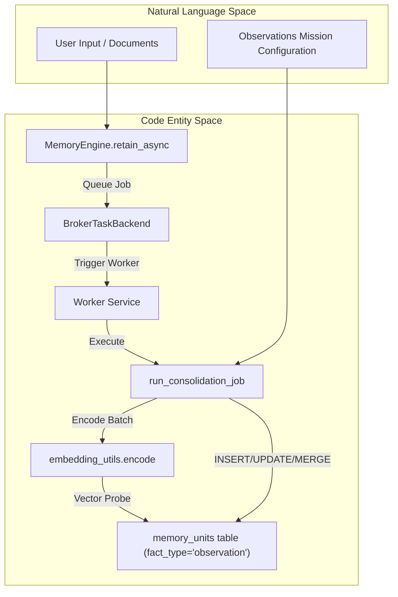
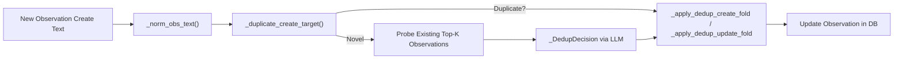
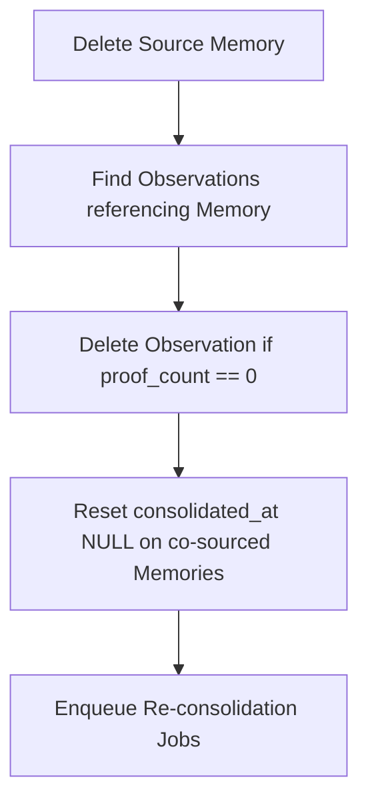
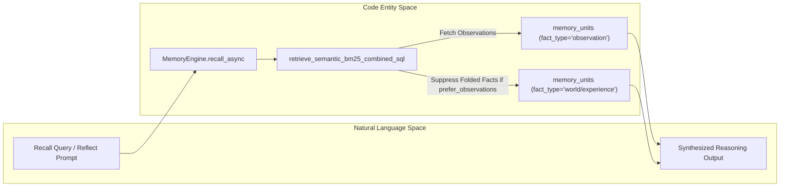

<!-- source: DeepWiki mcp.deepwiki.com · repo vectorize-io/hindsight · page 4.7 Observations and Consolidation · fetched 2026-10-26 -->

# Observations and Consolidation

Relevant source files

The following files were used as context for generating this wiki page:

- [hindsight-api-slim/hindsight_api/engine/consolidation/consolidator.py](hindsight-api-slim/hindsight_api/engine/consolidation/consolidator.py)
- [hindsight-api-slim/hindsight_api/engine/consolidation/prompts.py](hindsight-api-slim/hindsight_api/engine/consolidation/prompts.py)
- [hindsight-api-slim/hindsight_api/engine/prompt_utils.py](hindsight-api-slim/hindsight_api/engine/prompt_utils.py)
- [hindsight-api-slim/tests/test_consolidation.py](hindsight-api-slim/tests/test_consolidation.py)
- [hindsight-api-slim/tests/test_consolidation_batch_failure_visibility.py](hindsight-api-slim/tests/test_consolidation_batch_failure_visibility.py)
- [hindsight-api-slim/tests/test_consolidation_dedup.py](hindsight-api-slim/tests/test_consolidation_dedup.py)
- [hindsight-api-slim/tests/test_consolidation_delete_prompt_llm.py](hindsight-api-slim/tests/test_consolidation_delete_prompt_llm.py)
- [hindsight-api-slim/tests/test_consolidation_delete_schema.py](hindsight-api-slim/tests/test_consolidation_delete_schema.py)
- [hindsight-api-slim/tests/test_consolidation_id_repair.py](hindsight-api-slim/tests/test_consolidation_id_repair.py)
- [hindsight-api-slim/tests/test_consolidation_retry_budget.py](hindsight-api-slim/tests/test_consolidation_retry_budget.py)
- [hindsight-api-slim/tests/test_consolidation_scope_parallelism.py](hindsight-api-slim/tests/test_consolidation_scope_parallelism.py)
- [hindsight-api-slim/tests/test_consolidation_write_scopes.py](hindsight-api-slim/tests/test_consolidation_write_scopes.py)
- [hindsight-api-slim/tests/test_horse_observations.py](hindsight-api-slim/tests/test_horse_observations.py)
- [hindsight-api-slim/tests/test_observation_invalidation.py](hindsight-api-slim/tests/test_observation_invalidation.py)
- [hindsight-clients/go/api_documents.go](hindsight-clients/go/api_documents.go)
- [hindsight-clients/python/hindsight_client_api/api/documents_api.py](hindsight-clients/python/hindsight_client_api/api/documents_api.py)
- [hindsight-docs/docs/developer/api/documents.mdx](hindsight-docs/docs/developer/api/documents.mdx)
- [hindsight-system-evals/evals/test_09_consolidation.py](hindsight-system-evals/evals/test_09_consolidation.py)
- [hindsight-system-tests/hindsight_system_tests/payloads.py](hindsight-system-tests/hindsight_system_tests/payloads.py)
- [hindsight-system-tests/tests/test_22_consolidation_safety_nets.py](hindsight-system-tests/tests/test_22_consolidation_safety_nets.py)
- [hindsight-system-tests/tests/test_25_observation_lifecycle.py](hindsight-system-tests/tests/test_25_observation_lifecycle.py)
- [skills/hindsight-docs/references/developer/api/documents.md](skills/hindsight-docs/references/developer/api/documents.md)

This page details the **consolidation engine** that automatically synthesizes high-level observations from raw memories, and the complete observation lifecycle including creation, semantic deduplication, retry budgets, history tracking, temporal evolution, invalidation, and mission configuration. Observations are distinct from raw facts—they represent consolidated knowledge patterns extracted by an LLM from multiple related memories.

For information about mental models (user-defined cached reflections), see [Mental Models and Knowledge Pages](#4.5). For directives (hard rules applied during reflect), see [Directives](#4.6). For the retain operation that creates the raw memories fed into consolidation, see [Retain - Storing Memories](#4.1).

---

## Purpose and Scope

**Observations** are automatically generated synthetic memories with `fact_type='observation'` that consolidate patterns from raw `world` and `experience` facts [hindsight-api-slim/hindsight_api/engine/consolidation/consolidator.py:8-16](). Unlike mental models (which are user-defined queries cached in a separate table), observations are created bottom-up by the consolidation engine without user intervention [hindsight-api-slim/hindsight_api/engine/consolidation/consolidator.py:13-16]().

**Consolidation** runs as an asynchronous background job after retain operations complete [hindsight-api-slim/hindsight_api/engine/consolidation/consolidator.py:3-4](). It processes un-consolidated memories and either creates new observations from novel facts or updates existing ones when new evidence supports, contradicts, or refines them [hindsight-api-slim/hindsight_api/engine/consolidation/consolidator.py:4-7]().

Key characteristics:

- **Automatic**: Triggered after every retain (async or sync) unless auto-consolidation is disabled [hindsight-api-slim/tests/test_consolidation.py:45-54]().
- **Evidence-Grounded**: Each observation tracks its supporting memories with `proof_count` and `source_memory_ids` [hindsight-api-slim/hindsight_api/engine/consolidation/consolidator.py:8-10]().
- **History Tracking**: Changes are tracked in a `history` JSONB structure to preserve temporal evolution and state transitions [hindsight-api-slim/hindsight_api/engine/consolidation/consolidator.py:11]().
- **Semantic Reconciliation**: Automatically merges near-duplicate observations based on a semantic distance threshold and LLM adjudication [hindsight-api-slim/hindsight_api/engine/consolidation/consolidator.py:154-164]().

Sources: [hindsight-api-slim/hindsight_api/engine/consolidation/consolidator.py:1-16](), [hindsight-api-slim/hindsight_api/engine/consolidation/consolidator.py:72-76]()

---

## Consolidation Architecture

The consolidation process bridges raw data storage and synthesized intelligence. In worker-backed environments, tasks are claimed safely via async workers using `_gather_or_cancel` to prevent detached orphaned tasks from corrupting state [hindsight-api-slim/hindsight_api/engine/consolidation/consolidator.py:79-115](). This ensures serialized access to observation scopes via locks, preserving consistency during parallel runs.

The process involves:

1. **Batching pending facts** since the last consolidation, with configurable batch sizes and parallelism.
2. **Encoding the batch facts** with the embedding encoder for semantic probing.
3. **Fetching candidate existing observations** for semantic deduplication.
4. **Calling the LLM to produce CREATE/UPDATE/DELETE actions** on observations.
5. **Applying these changes atomically** inside transactions.
6. **Marking source facts as consolidated or failed** for progress tracking.

### Diagram: Consolidation Engine Component Flow

Sources: [hindsight-api-slim/hindsight_api/engine/consolidation/consolidator.py:79-115](), [hindsight-api-slim/hindsight_api/engine/consolidation/prompts.py:3-57]()

---

## Semantic Reconciliation (Deduplication)

Because independent consolidation cycles may generate overlapping or duplicate observations, Hindsight performs **semantic reconciliation** to merge such duplicates.

### Deduplication Steps

1. **Text Normalization**: `_norm_obs_text()` collapses runs of whitespace while preserving case-sensitivity to avoid losing information from acronyms or casing variants [hindsight-api-slim/hindsight_api/engine/consolidation/consolidator.py:126-135]().

2. **Exact Duplicate Text Check**: `_duplicate_create_target()` considers a CREATE observation a duplicate if it exactly matches the normalized text of an observation shown to the LLM in the same consolidation response or an UPDATE issued alongside it [hindsight-api-slim/hindsight_api/engine/consolidation/consolidator.py:137-156]().

3. **Semantic Nearest-Neighbour Probe**: The embedding of the new observation probes the top K nearest existing observations in the bank (`_DEDUP_TOP_K = 5`) [hindsight-api-slim/hindsight_api/engine/consolidation/consolidator.py:160-161]().

4. **LLM Adjudication**: The consolidator calls the LLM with CREATE/UPDATE candidates and uses `_DedupDecision` verdicts (keep/merge) to finalize merging decisions based on semantic similarity and logical coherence [hindsight-api-slim/hindsight_api/engine/consolidation/consolidator.py:163-164](), [hindsight-api-slim/tests/test_consolidation_dedup.py:51-56]().

5. **Transactional Fold and Persist**: The merge updates the surviving observation's text, proof counts, source IDs, and history in an atomic fold transaction. The duplicate candidate is discarded, preventing clutter and confusion [hindsight-api-slim/tests/test_consolidation_dedup.py:57-83]().

### Deduplication Workflow Diagram

Sources: [hindsight-api-slim/hindsight_api/engine/consolidation/consolidator.py:126-164](), [hindsight-api-slim/tests/test_consolidation_dedup.py:17-90]()

---

## Observation Data Model, Temporal Evolution, and History

Observations are stored in the `memory_units` table with `fact_type = 'observation'` [hindsight-api-slim/hindsight_api/engine/consolidation/consolidator.py:8-12](). Each observation includes these key fields:

| Field             | Description                                                              | Aggregation Rule                    |
|-------------------|--------------------------------------------------------------------------|-----------------------------------|
| `text`            | The synthesized observation text                                        | Updated on merges and creates     |
| `proof_count`     | Number of supporting source memories attached                           | Summed across source facts         |
| `source_memory_ids`| IDs of facts supporting this observation                               | Union of source IDs                |
| `occurred_start`   | Earliest start datetime across sources                                  | `min` over sources                 |
| `occurred_end`     | Latest end datetime across sources                                      | `max` over sources                 |
| `mentioned_at`     | Most recent mention date among sources                                  | `max` over sources                 |
| `history`          | JSONB array storing serialized previous versions for audit and rollback | Appended snapshot on updates      |

### Temporal Evolution

Temporal bounds (`occurred_start`, `occurred_end`, `mentioned_at`) are automatically aggregated over all source memories contributing to an observation, allowing precise temporal reasoning about the observation's validity and evolution [hindsight-api-slim/hindsight_api/engine/consolidation/consolidator.py:8-12](). History persistence tracks the observation's evolution, supporting debugging and traceability.

Sources: [hindsight-api-slim/hindsight_api/engine/consolidation/consolidator.py:8-12](), [hindsight-api-slim/hindsight_api/engine/consolidation/prompts.py:55-84]()

---

## Consolidation Pipeline, Retry Budgets, and Triggering

### Triggering Modes

- **Automatic**: Consolidation is automatically triggered after each retain operation (sync or async) unless disabled globally or per bank. This is done via the worker service polling for pending memories with `consolidated_at IS NULL` [hindsight-api-slim/hindsight_api/engine/consolidation/consolidator.py:3-4](), [hindsight-api-slim/tests/test_consolidation.py:45-54]().
- **Manual**: A manual trigger (`consolidate_trigger` endpoint or CLI) can start consolidation jobs to reprocess or backfill observations.

### Retry Budgets and Error Handling

Consolidation uses layered retry budgets for robustness against transient errors from the LLM or database:

- **Outer retry loop** capped by `consolidation_max_attempts` governs retrying whole LLM calls on transient failures such as rate limits or connection errors. This prevents indefinite retries [hindsight-api-slim/tests/test_consolidation_retry_budget.py:68-79]().
- **Inner retries** for each LLM `call()` are controlled by `consolidation_llm_max_retries`, limiting fallback attempts at the provider level [hindsight-api-slim/tests/test_consolidation_retry_budget.py:82-93]().
- **Max completion tokens** (`consolidation_max_completion_tokens`) limit LLM response length to avoid runaway usage and timeouts [hindsight-api-slim/tests/test_consolidation_retry_budget.py:138-149]().

The `_consolidate_batch_with_llm` function enforces these settings and gracefully handles retryable exceptions (`OutputTooLongError`, `ProviderRateLimitResetError`) to maintain reliable consolidation progress [hindsight-api-slim/hindsight_api/engine/consolidation/consolidator.py:49-50](), [hindsight-api-slim/tests/test_consolidation_retry_budget.py:12-120]().

### Atomicity Guarantees

All database writes (CREATE/UPDATE/DELETE of observations and source memory stamps) within one consolidation batch are applied **atomically** within a single transaction to prevent partial state and inconsistencies [hindsight-api-slim/tests/test_consolidation_batch_atomicity.py:1-170]().

Sources: [hindsight-api-slim/hindsight_api/engine/consolidation/consolidator.py:49-50](), [hindsight-api-slim/tests/test_consolidation_retry_budget.py:12-168](), [hindsight-api-slim/tests/test_consolidation_batch_atomicity.py:1-170]()

---

## Observation Invalidation and Cascade Cleanup

When source memories or associated documents are deleted or modified, observations dependent on those source facts must be invalidated or removed to maintain correctness [hindsight-api-slim/tests/test_observation_invalidation.py:1-180](), [hindsight-docs/docs/developer/api/documents.mdx:122-129]().

Key behaviors:

- **Deleting a Source Memory**: Removes observations that solely rely on it and reduces the proof counts on others. Observations with zero proof counts are deleted.
- **Reset Consolidation Markers**: Source memories co-sourced with invalidated observations have their `consolidated_at` reset to `NULL` to force re-consolidation, ensuring fresh synthesis under new context.
- **Cascade via Document Tags**: Changing tags on documents triggers invalidation and re-consolidation of dependent observations, as tags influence observation scoping [hindsight-docs/docs/developer/api/documents.mdx:122-129]().

### Diagram: Observation Invalidation Cascade Flow

Sources: [hindsight-api-slim/tests/test_observation_invalidation.py:1-180](), [hindsight-docs/docs/developer/api/documents.mdx:122-129]()

---

## Reflect and Search Integration

The observation facts integrate tightly with the recall and reflect operations, improving both relevance and conciseness of answers:

- When a recall or reflect query sets `prefer_observations`, raw facts folded into observations are suppressed from results to avoid duplication and reduce noise [hindsight-api-slim/hindsight_api/engine/search/retrieval.py:123-139]().
- Observations are returned alongside or instead of source memories depending on configuration, improving response quality and summarization.
- The reflect agent's reasoning tools incorporate observations as first-class structured knowledge to enhance autonomous reasoning [hindsight-api-slim/hindsight_api/engine/memory_engine.py:40-49]().

### Diagram: Recall and Observation Integration Flow

Sources: [hindsight-api-slim/hindsight_api/engine/memory_engine.py:40-49](), [hindsight-api-slim/hindsight_api/engine/search/retrieval.py:123-139]()

---

## Observation Mission Configuration

Observation generation is guided by global and per-bank configurations, allowing curated focus and tailoring of what is synthesized:

- **`observations_mission`**: A directive text prompt governing what the consolidator pays attention to and treats as notable. By default, it covers names, numbers, dates, places, events, decisions, claims, relationships, and recurring patterns [hindsight-api-slim/hindsight_api/engine/consolidation/prompts.py:14-26]().
- **`HINDSIGHT_API_CONSOLIDATION_DEDUP_THRESHOLD`**: Cosine similarity threshold controlling semantic deduplication sensitivity [hindsight-api-slim/hindsight_api/engine/consolidation/consolidator.py:163-164]().
- **Language Settings**: Observations preserve the source language of facts unless overridden, avoiding unwanted translations and mixed-language results [hindsight-api-slim/hindsight_api/engine/consolidation/prompts.py:30-37]().

These settings can be overridden per bank to specialize consolidation missions for particular workflows or domains.

Sources: [hindsight-api-slim/hindsight_api/engine/consolidation/consolidator.py:163-164](), [hindsight-api-slim/hindsight_api/engine/consolidation/prompts.py:14-37]()

---

# Summary Table of Key Consolidation Classes & Functions

| Entity / Function                 | Role / Description                                              | Location |
|---------------------------------|----------------------------------------------------------------|----------|
| `run_consolidation_job`          | Main async entry to process consolidation for a bank           | [hindsight-api-slim/hindsight_api/engine/consolidation/consolidator.py:143-148]() |
| `_DedupDecision`                 | Model representing a keep/merge verdict for duplicates          | [hindsight-api-slim/hindsight_api/engine/consolidation/consolidator.py:163-164]() |
| `_apply_dedup_create_fold`       | Apply merge of a duplicate create with existing observation     | [hindsight-api-slim/tests/test_consolidation_dedup.py:51-61]() |
| `_apply_dedup_update_fold`       | Apply update fold to existing observation                       | [hindsight-api-slim/tests/test_consolidation_dedup.py:64-74]() |
| `_norm_obs_text`                 | Normalize whitespace for duplicate text matching                | [hindsight-api-slim/hindsight_api/engine/consolidation/consolidator.py:126-135]() |
| `_duplicate_create_target`        | Check if a create observation text duplicates existing one       | [hindsight-api-slim/hindsight_api/engine/consolidation/consolidator.py:137-156]() |
| `_consolidate_batch_with_llm`    | Run the LLM call and parse consolidation response with retries  | [hindsight-api-slim/hindsight_api/engine/consolidation/consolidator.py:171-176]() |
| `_gather_or_cancel`               | Helper to avoid orphaned async tasks on errors                  | [hindsight-api-slim/hindsight_api/engine/consolidation/consolidator.py:79-115]() |

Sources: [hindsight-api-slim/hindsight_api/engine/consolidation/consolidator.py:1-170](), [hindsight-api-slim/tests/test_consolidation_dedup.py:10-90]()

---

This concludes the detailed technical explanation of observations and their consolidation lifecycle in Hindsight. The consolidation engine ensures that raw facts from the retain operation are synthesized into coherent, temporal-aware, and deduplicated observations suitable for efficient recall, reflection, and knowledge maintenance.

---

