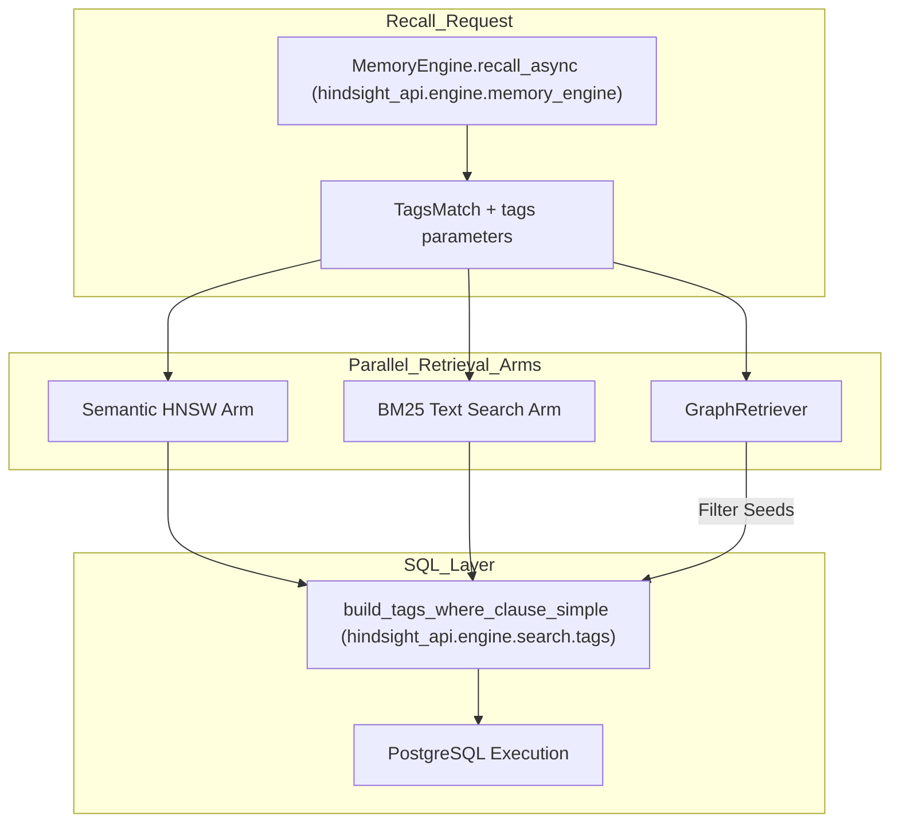
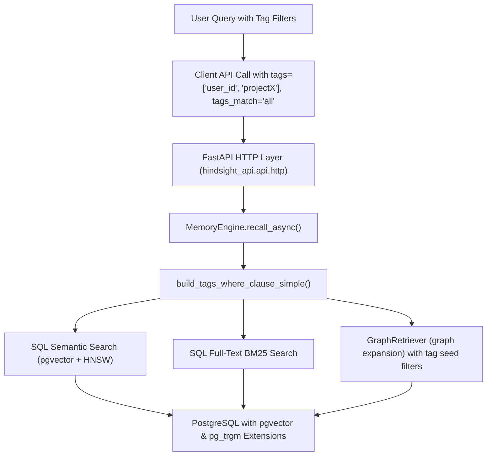

<!-- source: DeepWiki mcp.deepwiki.com · repo vectorize-io/hindsight · page 4.8 Tags and Visibility Scoping · fetched 2026-10-26 -->

# Tags and Visibility Scoping

<details>
<summary>Relevant source files</summary>

The following files were used as context for generating this wiki page:

- [hindsight-api-slim/hindsight_api/engine/memories/pg/retain.py](hindsight-api-slim/hindsight_api/engine/memories/pg/retain.py)
- [hindsight-api-slim/hindsight_api/engine/response_models.py](hindsight-api-slim/hindsight_api/engine/response_models.py)
- [hindsight-api-slim/hindsight_api/engine/retain/entity_labels.py](hindsight-api-slim/hindsight_api/engine/retain/entity_labels.py)
- [hindsight-api-slim/tests/store_seed.py](hindsight-api-slim/tests/store_seed.py)
- [hindsight-api-slim/tests/test_entity_labels.py](hindsight-api-slim/tests/test_entity_labels.py)
- [hindsight-api-slim/tests/test_entity_resolver.py](hindsight-api-slim/tests/test_entity_resolver.py)
- [hindsight-api-slim/tests/test_entity_resolver_pg_trgm.py](hindsight-api-slim/tests/test_entity_resolver_pg_trgm.py)
- [hindsight-api-slim/tests/test_fact_extraction_entities_llm.py](hindsight-api-slim/tests/test_fact_extraction_entities_llm.py)
- [hindsight-api-slim/tests/test_fact_extraction_entities_schema.py](hindsight-api-slim/tests/test_fact_extraction_entities_schema.py)
- [hindsight-api-slim/tests/test_fact_extraction_example_guard.py](hindsight-api-slim/tests/test_fact_extraction_example_guard.py)
- [hindsight-api-slim/tests/test_fact_extraction_fact_type_prompt.py](hindsight-api-slim/tests/test_fact_extraction_fact_type_prompt.py)
- [hindsight-api-slim/tests/test_list_banks_ordered_page.py](hindsight-api-slim/tests/test_list_banks_ordered_page.py)
- [hindsight-api-slim/tests/test_list_banks_pagination.py](hindsight-api-slim/tests/test_list_banks_pagination.py)
- [hindsight-api-slim/tests/test_mental_model_scheduled_refresh.py](hindsight-api-slim/tests/test_mental_model_scheduled_refresh.py)
- [hindsight-api-slim/tests/test_op_cancellation.py](hindsight-api-slim/tests/test_op_cancellation.py)
- [hindsight-api-slim/tests/test_recall_min_score.py](hindsight-api-slim/tests/test_recall_min_score.py)
- [hindsight-api-slim/tests/test_recall_pipeline_toggles.py](hindsight-api-slim/tests/test_recall_pipeline_toggles.py)
- [hindsight-api-slim/tests/test_retain_entity_prune_race.py](hindsight-api-slim/tests/test_retain_entity_prune_race.py)
- [hindsight-api-slim/tests/test_retain_label_tag_projection.py](hindsight-api-slim/tests/test_retain_label_tag_projection.py)
- [hindsight-api-slim/tests/test_retain_tag_change_observations.py](hindsight-api-slim/tests/test_retain_tag_change_observations.py)
- [hindsight-api-slim/tests/test_tag_scope.py](hindsight-api-slim/tests/test_tag_scope.py)
- [hindsight-docs/docs/developer/api/recall.mdx](hindsight-docs/docs/developer/api/recall.mdx)
- [hindsight-docs/docs/developer/observations.mdx](hindsight-docs/docs/developer/observations.mdx)
- [hindsight-system-tests/tests/test_11_replace_document.py](hindsight-system-tests/tests/test_11_replace_document.py)
- [hindsight-system-tests/tests/test_24_observation_scopes.py](hindsight-system-tests/tests/test_24_observation_scopes.py)
- [skills/hindsight-docs/references/developer/api/recall.md](skills/hindsight-docs/references/developer/api/recall.md)
- [skills/hindsight-docs/references/developer/observations.md](skills/hindsight-docs/references/developer/observations.md)

</details>


## Purpose and Overview

Tags provide a core visibility scoping mechanism in Hindsight, controlling which memories, observations, mental models, and directives are accessible during recall and reflect operations. They enable fine-grained access control and security isolation, crucial for multi-user deployments where distinct users or contexts must have isolated views of shared knowledge.

Tags are string labels applied at memory retention time and used as filters during retrieval. While metadata holds unstructured key-value data for user applications, tags are first-class, structured filters deeply integrated into the SQL retrieval queries. Hindsight supports both **simple tag filters** and **compound boolean logic via TagGroups**, enabling complex visibility patterns such as `(TagA AND TagB) OR (TagC AND NOT TagD)`.

Sources: [hindsight-api-slim/hindsight_api/engine/search/tags.py:1-23]()

---

## Tags Match Modes

Hindsight implements multiple tag matching modes under a unified `TagsMatch` literal type, determining how memories with multiple tags are matched and whether untagged (global) content is included.

### Mode Definitions

| Mode | Logic | Includes Untagged? | Usage Example |
|---|---|---|---|
| `any` | OR | Yes | Default mode, permissive: fetch memories matching any of the requested tags or untagged content (global knowledge). |
| `all` | AND | Yes | Requires all tags, but includes untagged content. Useful for conjunction filters with baseline knowledge sharing. |
| `any_strict` | OR | No | Only memories tagged with at least one requested tag; excludes untagged memories. Useful to isolate tag-scoped content strictly. |
| `all_strict` | AND | No | Only memories tagged with *all* the requested tags, no untagged. Strict intersection. |
| `exact` | Set equality | No* | Matches memories whose tag set exactly equals the request tags. Special case: empty or None selects only untagged (global) memories. |

\* In `exact` mode, providing an empty list `[]` or `None` explicitly means the global (untagged) scope, which is the default for shared observations.

### Implementation Details

The modes translate into efficient PostgreSQL array operators on the `tags` column:

- `any` and `any_strict`: Use **overlap** operator `&&`.
- `all` and `all_strict`: Use **contains** operator `@>`.
- `exact`: Combines `@>` and `<@` conditions for set equality.

The key difference between the "strict" variants and the default ones is whether untagged memories are included.

Example (pseudo SQL fragment for `any`):

```sql
WHERE tags IS NULL OR tags && $1 -- include untagged + any overlap
```

Where `$1` is an array of tags.

Sources: [hindsight-api-slim/hindsight_api/engine/search/tags.py:32-50](), [hindsight-api-slim/hindsight_api/engine/search/tags.py:73-90]()

---

## Compound Tag Groups

For more complex visibility scoping requirements beyond simple tag sets, Hindsight exposes **TagGroup** objects, enabling recursive boolean logic on tags.

### Data Model

- `TagGroup` can be either a **leaf** representing a simple tag predicate or a **composite** combining children with boolean operators: `and`, `or`, and `not`.
- Leaves are expressed as simple tags applied on memories.
- Internally, the recursive structure is parsed into boolean SQL predicates.

### SQL Construction

The pivotal function `build_tag_groups_where_clause` recursively transforms nested `TagGroup` objects into a single SQL condition string with bound parameters. This expression can encode arbitrarily complex logical expressions over tags.

### Diagram: Natural Language to SQL Tag Filtering

```mermaid
graph TD
    subgraph "NaturalLanguageSpace"
        NL["\"UserA AND (ProjectX OR ProjectY)\""]
    end

    subgraph "CodeEntitySpace_Models"
        TGA["TagGroup (hindsight_api.engine.search.tags.TagGroup)"]
        TGO["TagGroup (hindsight_api.engine.search.tags.TagGroup)"]
        TGL["Tags (hindsight_api.engine.search.tags.Tags)"]

        TGA -->|"and"| TGL1["Leaf: UserA"]
        TGA -->|"and"| TGO
        TGO -->|"or"| TGL2["Leaf: ProjectX"]
        TGO -->|"or"| TGL3["Leaf: ProjectY"]
    end

    subgraph "SQL_Execution"
        SQLB["build_tag_groups_where_clause (hindsight_api.engine.search.tags)"]
        QUERY["SELECT ... FROM memory_units WHERE (tags @> $1 AND (tags && $2))"]
    end

    NL --> TGA
    TGA --> SQLB
    SQLB --> QUERY
```

Sources: [hindsight-api-slim/hindsight_api/engine/search/tags.py:1-23]()

---

## Retrieval Pipeline Integration

Tags are enforced at the lowest levels of the retrieval pipeline to guarantee efficient performance and airtight visibility enforcement.

### 4-Way Parallel Retrieval (TEMPR)

Recall operations call `recall_unified` and pass tag filters down to all parallel arms:

- **Semantic vector search arm** (HNSW index).
- **BM25 full-text search arm**.
- **Graph traversal arm** (link expansion).

The `build_tags_where_clause_simple` function is invoked by these retrieval components to generate SQL tag filtering predicates injected into their queries, limiting every arm to authorized content only.

### Graph Retriever

For graph retrieval, tags constrain the seed node discovery phase and subsequent traversal expansions, preventing unauthorized access through connections.

### Diagram: Retrieval Scoping Flow



Sources: [hindsight-api-slim/hindsight_api/engine/memories/postgres.py:82-105](), [hindsight-api-slim/hindsight_api/engine/search/tags.py:1-23]()

---

## Observation Scopes and Consolidation

### Scoped Consolidation

Consolidation synthesizes observations from related memories. To ensure consistent visibility and prevent knowledge leakage across tag boundaries, consolidation respects **observation_scopes** defined in bank configuration.

- Memories are partitioned into groups based on their tags before consolidation.
- Each partition triggers an independent observation generation.
- Observations carry `META_OBSERVATION_SCOPES` metadata, a bag of tag scopes, which is preserved in the store and round-trips intact. This allows downstream retrievals to enforce the same scopes [hindsight-api-slim/hindsight_api/engine/memories/base.py:90-120]().
- Reconciliation of near-duplicate observations also respects tag scopes, ensuring that observations from different scopes are not merged [skills/hindsight-docs/references/developer/observations.md:65-66]().

### Tagging Updates and Visibility

Updating a memory's tags stamps its `updated_at` timestamp, a contract that signals to consumers of the memory (e.g. mental model staleness checks or delta refresh processors) that the visibility context changed. This avoids stale stale caches and access violations.

Sources: [hindsight-api-slim/hindsight_api/engine/memories/base.py:90-120](), [hindsight-api-slim/hindsight_api/engine/memories/postgres.py:82-105](), [skills/hindsight-docs/references/developer/observations.md:65-66]()

---

## Multi-User Isolation Patterns

Hindsight's tag system supports common multi-user visibility isolation patterns in agent memory systems:

### Pattern 1: User-specific Conversations

- The agent tags every `retain` call with a `user_id` string tag.
- During retrieval, the agent specifies a filter `tags=[user_id]` with `tags_match="any_strict"`.
- This ensures retrieval only returns memories tagged explicitly for that user, isolating personal conversational history.

### Pattern 2: Global vs Private Knowledge

- Banks distinguish "World" facts (global, untagged) from user-specific "Experience" facts (tagged).
- With `tags_match="any"` filtering, retrieval returns both untagged and relevant tagged memories in one pass.
- Thus, global knowledge is always available alongside personalized facts.

### Pattern 3: Retroactive Re-tagging and Tag Mutations

- Tag edits can be applied retroactively to any document or batch of memories via update APIs.
- The system updates the `tags` column of every `memory_unit` and `chunk` related to that entity, effectively moving knowledge into or out of visibility scopes.
- This supports administrative control and security operations.

Sources: [hindsight-api-slim/hindsight_api/engine/search/tags.py:73-113](), [hindsight-api-slim/hindsight_api/engine/memories/postgres.py:40-80]()

---

## Summary Table of Key Classes and Functions

| Name | Role | File | Lines |
|---|---|---|---|
| `TagsMatch` (type literal) | Enum of tag match modes: any, all, any_strict, all_strict, exact | [hindsight-api-slim/hindsight_api/engine/search/tags.py:32-50]() | 32-50 |
| `build_tags_where_clause_simple()` | Build SQL filter clauses for simple tag sets | [hindsight-api-slim/hindsight_api/engine/search/tags.py:73-90]() | 73-90 |
| `build_tag_groups_where_clause()` | Recursively build SQL filter clause for complex TagGroups | [hindsight-api-slim/hindsight_api/engine/search/tags.py:100-130]() | 100-130 |
| `tool_search_mental_models()` | Reflect tool that applies tag filtering on mental models | [hindsight-api-slim/hindsight_api/engine/reflect/tools.py:118-150]() | 118-150 |
| `recall_async()` | Main recall method passing tags and tag groups into retrieval | [hindsight-api-slim/hindsight_api/engine/memory_engine.py]() | (not shown) |
| `_load_bank_config()` | Loads and caches bank config including `observation_scopes` | [hindsight-api-slim/hindsight_api/config_resolver.py:60-170]() | 60-170 |
| `retain_batch_async()` | Stores memories with tags at retain time | [hindsight-api-slim/hindsight_api/engine/memory_engine.py]() | (not shown) |
| `update_document_tags()` | Bulk update of tags on entire documents & chunks | [hindsight-api-slim/hindsight_api/engine/memories/postgres.py:40-80]() | 40-80 |

---

## Illustrative Flow: Tag Filtering from Natural Language to Retrieval



This flow shows how tags specified at the API layer traverse to engines and finally produce SQL predicates driving retrieval.

Sources: [hindsight-api-slim/hindsight_api/engine/search/tags.py](), [hindsight-api-slim/hindsight_api/engine/memories/postgres.py](), [hindsight-api-slim/hindsight_api/engine/reflect/tools.py]()

---

## Technical Notes

- Tag filters are integral to query formulations throughout recall, reflect, and mental model searches, ensuring that unauthorized content is never surfaced even under parallel or graph retrieval strategies.
- Observation scopes as tag partitions during consolidation ensure synthesized knowledge respects knowledge boundaries.
- Bank configs expose tag scoping options (`observation_scopes`) form part of hierarchical config resolutions via the `ConfigResolver` class.
- Tag mutations update both `memory_units` and their related `chunks` to maintain query consistency.
- Tag scopes are respected in extensions and tenants, enabling multi-tenant and multi-user isolation patterns.

---

## References

- Tag matching and SQL predicate generation: [hindsight-api-slim/hindsight_api/engine/search/tags.py:1-130]()
- Tag filtering in reflect mental model search: [hindsight-api-slim/hindsight_api/engine/reflect/tools.py:118-150]()
- Tag filtering in PG memories pool retrieval: [hindsight-api-slim/hindsight_api/engine/memories/postgres.py:40-105]()
- Observation scope metadata and contract in base memories API: [hindsight-api-slim/hindsight_api/engine/memories/base.py:90-120]()
- Multi-tenant and extension config affecting tag scopes: [hindsight-api-slim/hindsight_api/config_resolver.py:1-174]()

---

---

