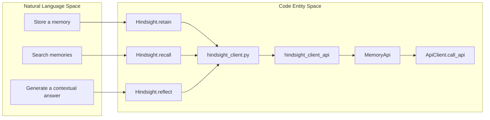
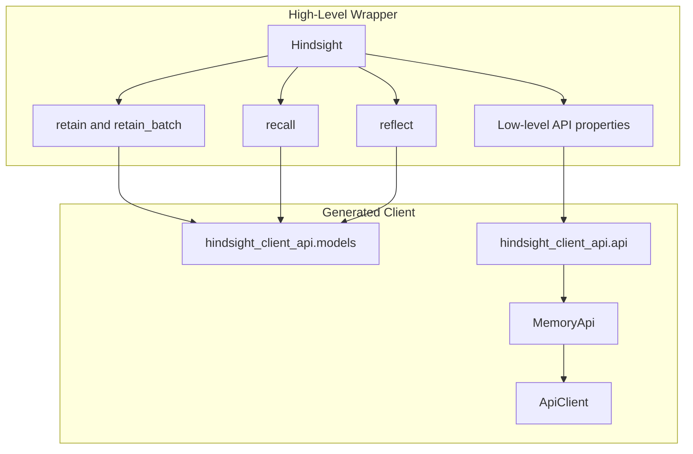
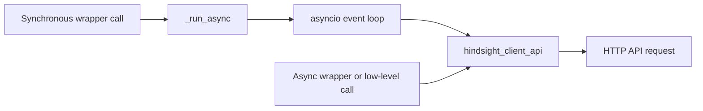
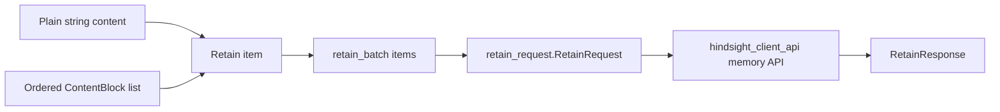
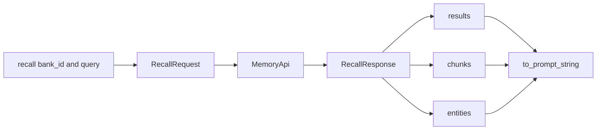

<!-- source: DeepWiki mcp.deepwiki.com · repo vectorize-io/hindsight · page 5.1 Python Client · fetched 2026-10-26 -->

# Python Client

Relevant source files

The following files were used as context for generating this wiki page:

- [hindsight-api-slim/tests/test_format_facts_for_prompt.py](hindsight-api-slim/tests/test_format_facts_for_prompt.py)
- [hindsight-clients/go/api_memory.go](hindsight-clients/go/api_memory.go)
- [hindsight-clients/python/hindsight_client/__init__.py](hindsight-clients/python/hindsight_client/__init__.py)
- [hindsight-clients/python/hindsight_client/hindsight_client.py](hindsight-clients/python/hindsight_client/hindsight_client.py)
- [hindsight-clients/python/hindsight_client_api/api/memory_api.py](hindsight-clients/python/hindsight_client_api/api/memory_api.py)
- [hindsight-clients/python/tests/test_main_operations.py](hindsight-clients/python/tests/test_main_operations.py)
- [hindsight-clients/python/tests/test_prompt_formatting.py](hindsight-clients/python/tests/test_prompt_formatting.py)
- [hindsight-clients/python/tests/test_version.py](hindsight-clients/python/tests/test_version.py)
- [hindsight-clients/typescript/src/index.ts](hindsight-clients/typescript/src/index.ts)
- [hindsight-clients/typescript/tests/prompt_formatting.test.ts](hindsight-clients/typescript/tests/prompt_formatting.test.ts)

## Purpose and Scope

The `hindsight-client` Python package provides the `Hindsight` class, a high-level wrapper for common operations including retain, recall, reflect, bank management, mental models, and directives. It also exposes lower-level generated API clients for operations that do not have convenience methods. This page covers the client’s documented interface and the implementation details supported by the available source excerpts. [hindsight-clients/python/hindsight_client/__init__.py:1-12]()

Sources: [hindsight-clients/python/hindsight_client/__init__.py:1-12]()

## Client Architecture

The Python SDK has a maintained wrapper layer and an auto-generated OpenAPI client layer. The wrapper imports `hindsight_client_api` and its API modules, models, and `ApiException`; the generated `MemoryApi` uses an `ApiClient` to issue requests and deserialize responses. [hindsight-clients/python/hindsight_client/hindsight_client.py:1-6]() [hindsight-clients/python/hindsight_client/hindsight_client.py:22-27]() [hindsight-clients/python/hindsight_client/hindsight_client.py:49-80]() [hindsight-clients/python/hindsight_client_api/api/memory_api.py:40-55]() [hindsight-clients/python/hindsight_client_api/api/memory_api.py:123-131]()

**Diagram: User intent mapped to Python client entities**

Sources: [hindsight-clients/python/hindsight_client/__init__.py:14-30]() [hindsight-clients/python/hindsight_client/hindsight_client.py:1-6]() [hindsight-clients/python/hindsight_client/hindsight_client.py:22-27]() [hindsight-clients/python/hindsight_client_api/api/memory_api.py:40-55]() [hindsight-clients/python/hindsight_client_api/api/memory_api.py:123-131]()

**Diagram: Wrapper-to-generated API boundary**

The wrapper imports API modules for banks, directives, documents, entities, files, knowledge bases, memory, mental models, monitoring, operations, and webhooks, as well as models for the core operation requests and responses. [hindsight-clients/python/hindsight_client/hindsight_client.py:49-80]() The package documentation identifies the generated low-level properties as the route to documents, entities, and operation status, and states that these low-level methods are async. [hindsight-clients/python/hindsight_client/__init__.py:8-12]() The generated `MemoryApi` uses the configured or default `ApiClient`, then awaits its `call_api` operation and deserializes the response. [hindsight-clients/python/hindsight_client_api/api/memory_api.py:52-55]() [hindsight-clients/python/hindsight_client_api/api/memory_api.py:123-131]()

Sources: [hindsight-clients/python/hindsight_client/hindsight_client.py:49-80]() [hindsight-clients/python/hindsight_client/__init__.py:8-12]() [hindsight-clients/python/hindsight_client_api/api/memory_api.py:52-55]() [hindsight-clients/python/hindsight_client_api/api/memory_api.py:123-131]()

## Client Initialization

The client’s documented quick start constructs `Hindsight` with a `base_url`; tests use the same constructor form, optionally passing a URL from `HINDSIGHT_API_URL` (defaulting to `http://localhost:8888`). The available excerpts do not show the `Hindsight.__init__` implementation, so constructor options beyond `base_url` should be verified against the installed package’s signature. [hindsight-clients/python/hindsight_client/__init__.py:14-18]() [hindsight-clients/python/tests/test_main_operations.py:15-23]()

The wrapper derives a default user-agent value from installed package metadata, falling back to version `0.0.0` when package metadata is unavailable. [hindsight-clients/python/hindsight_client/hindsight_client.py:28-33]()

| Concern | Supported detail |
|---|---|
| API address | `base_url` is used in the documented quick start and test fixture. [hindsight-clients/python/hindsight_client/__init__.py:14-18]() [hindsight-clients/python/tests/test_main_operations.py:15-23]() |
| Authentication | The supplied excerpt does not show the Python wrapper’s authentication configuration. |
| User agent | `DEFAULT_USER_AGENT` is built from the `hindsight-client` package version, with `0.0.0` as the metadata fallback. [hindsight-clients/python/hindsight_client/hindsight_client.py:28-33]() |
| Context management | The test fixture uses `Hindsight` in a `with` statement. [hindsight-clients/python/tests/test_main_operations.py:19-24]() |

Sources: [hindsight-clients/python/hindsight_client/__init__.py:14-18]() [hindsight-clients/python/hindsight_client/hindsight_client.py:28-33]() [hindsight-clients/python/tests/test_main_operations.py:15-24]()

## Synchronous and Asynchronous Usage

The wrapper defines `_run_async(coro)`, which obtains the current event loop or creates and installs one when there is no current loop, then runs the coroutine with `run_until_complete`. [hindsight-clients/python/hindsight_client/hindsight_client.py:87-95]() The package documentation describes the convenience operations as available through the high-level `Hindsight` interface and explicitly identifies the low-level API methods as async. [hindsight-clients/python/hindsight_client/__init__.py:1-12]()

The client also contains capacity retry support. `_retry_on_capacity` retries only when an API exception reports status `429` or `503`, up to the configured attempt limit; its documentation limits its intended use to idempotent operations and explains that synchronous retain is excluded because retrying it could duplicate a write. [hindsight-clients/python/hindsight_client/hindsight_client.py:139-166]() [hindsight-clients/python/hindsight_client/hindsight_client.py:167-172]()

**Diagram: Sync bridge and async API path**

Sources: [hindsight-clients/python/hindsight_client/hindsight_client.py:87-95]() [hindsight-clients/python/hindsight_client/__init__.py:8-12]() [hindsight-clients/python/hindsight_client_api/api/memory_api.py:123-131]()

## Core Memory Operations

The package’s documented quick start presents the three core operations as `retain`, `recall`, and `reflect`: store content in a bank, retrieve matching memories, and generate a contextual answer. [hindsight-clients/python/hindsight_client/__init__.py:14-30]()

### Retain and Batch Retain

The wrapper defines `ContentBlock` as a dictionary type for multimodal retain content. Its documentation allows either a plain string or an ordered list of content blocks, including text, image, and file examples. It notes that multimodal attachments require a vision-capable retain LLM server-side; otherwise, the request is refused with HTTP 422 rather than silently dropping the attachments. [hindsight-clients/python/hindsight_client/hindsight_client.py:35-48]()

Tests exercise `retain` with content alone and with timestamp and context, and exercise `retain_batch` with multiple items carrying content, context, and event date. They assert successful responses and, for the batch case, that `items_count` is three. [hindsight-clients/python/tests/test_main_operations.py:46-90]()

A caller-supplied `operation_id` is meaningful for asynchronous retain only. The wrapper warns when one is passed to synchronous retain, because it is ignored there; the retry helper’s documentation likewise says synchronous retain is excluded from capacity retries to avoid duplicate writes. [hindsight-clients/python/hindsight_client/hindsight_client.py:98-109]() [hindsight-clients/python/hindsight_client/hindsight_client.py:151-155]()

**Diagram: Retain inputs and batch mapping**

The generated module imports `RetainRequest` and `RetainResponse` as typed models. [hindsight-clients/python/hindsight_client_api/api/memory_api.py:34-38]() The wrapper imports generated request and response model modules, and the tests demonstrate the high-level single-item and batch call patterns. [hindsight-clients/python/hindsight_client/hindsight_client.py:65-80]() [hindsight-clients/python/tests/test_main_operations.py:49-90]()

Sources: [hindsight-clients/python/hindsight_client/hindsight_client.py:35-48]() [hindsight-clients/python/hindsight_client/hindsight_client.py:98-109]() [hindsight-clients/python/hindsight_client/hindsight_client.py:151-155]() [hindsight-clients/python/tests/test_main_operations.py:46-90]() [hindsight-clients/python/hindsight_client_api/api/memory_api.py:34-38]()

### Recall

The tests show `recall` accepting a `bank_id` and `query`, with optional `max_tokens`, `types`, and `trace` arguments. The response exposes `results`, and the tests check for relevant result text. [hindsight-clients/python/tests/test_main_operations.py:92-146]()

The package patches the generated `RecallResponse` type with convenience behavior: iteration over results, length, indexed access, a concise representation, and `to_prompt_string()`. That formatter emits a `FACTS` section containing result text and available context and temporal fields; it can include a matching source chunk and an `ENTITIES` section containing the first observation text for each entity. [hindsight-clients/python/hindsight_client/__init__.py:61-92]() [hindsight-clients/python/hindsight_client/__init__.py:95-150]()

**Diagram: Recall response into prompt representation**

Sources: [hindsight-clients/python/tests/test_main_operations.py:92-146]() [hindsight-clients/python/hindsight_client/__init__.py:61-92]() [hindsight-clients/python/hindsight_client/__init__.py:95-150]() [hindsight-clients/python/hindsight_client/hindsight_client.py:65-80]()

### Reflect

The tests demonstrate `reflect` with a bank ID and query, optionally adding context or `max_tokens`; they check that the response contains non-empty text. The test setup creates a bank with a mission before retaining memories for the reflect tests. [hindsight-clients/python/tests/test_main_operations.py:148-201]()

The wrapper imports the generated `reflect_request` and `ReflectResponse` types. The available excerpts do not include the full `reflect` method implementation or the generated reflect request fields, so those details are not specified here. [hindsight-clients/python/hindsight_client/hindsight_client.py:65-80]()

Sources: [hindsight-clients/python/tests/test_main_operations.py:148-201]() [hindsight-clients/python/hindsight_client/hindsight_client.py:65-80]()

## Banks and Configuration

The test suite demonstrates `create_bank` with a `bank_id` and `mission`, followed by memory operations using that bank. It also defines a unique bank ID per test and attempts to delete the bank during fixture teardown. [hindsight-clients/python/tests/test_main_operations.py:26-43]() [hindsight-clients/python/tests/test_main_operations.py:151-165]()

The wrapper imports the `banks_api` module and the `BankProfileResponse` model. The package also re-exports `BankProfileResponse` and `DispositionTraits`. The available excerpts establish those client entities but do not show the full bank-configuration method signatures or the configuration fields accepted by the wrapper. [hindsight-clients/python/hindsight_client/hindsight_client.py:49-80]() [hindsight-clients/python/hindsight_client/__init__.py:46-58]() [hindsight-clients/python/hindsight_client/__init__.py:152-164]()

Sources: [hindsight-clients/python/tests/test_main_operations.py:26-43]() [hindsight-clients/python/tests/test_main_operations.py:151-165]() [hindsight-clients/python/hindsight_client/hindsight_client.py:49-80]() [hindsight-clients/python/hindsight_client/__init__.py:46-58]() [hindsight-clients/python/hindsight_client/__init__.py:152-164]()

## Mental Models and Directives

The package documentation lists mental models and directives among the common features handled by the high-level `Hindsight` wrapper. The wrapper imports `mental_models_api` and `directives_api`, and includes generated models for refreshing a mental model and its trigger input. [hindsight-clients/python/hindsight_client/__init__.py:1-6]() [hindsight-clients/python/hindsight_client/hindsight_client.py:49-64]() [hindsight-clients/python/hindsight_client/hindsight_client.py:75-80]()

The `_trigger_input` helper constructs a `MentalModelTriggerInput` using only settings named by the caller. Its documentation explains that this avoids serializing generated model defaults as if they were caller-specified settings, which could overwrite stored trigger configuration. [hindsight-clients/python/hindsight_client/hindsight_client.py:112-136]()

The available excerpts do not show the complete create, list, update, or delete method implementations for mental models or directives. The generated API module names are exposed as client dependencies, but exact convenience-method signatures are not documented here. [hindsight-clients/python/hindsight_client/hindsight_client.py:49-64]()

Sources: [hindsight-clients/python/hindsight_client/__init__.py:1-6]() [hindsight-clients/python/hindsight_client/hindsight_client.py:49-64]() [hindsight-clients/python/hindsight_client/hindsight_client.py:75-80]() [hindsight-clients/python/hindsight_client/hindsight_client.py:112-136]()

## Low-Level API Access: `hindsight_client_api`

For operations without high-level convenience methods—including documents, entities, async operations, webhooks, and monitoring—the package documentation directs callers to low-level API clients exposed as properties on the `Hindsight` instance. It states that all low-level methods are async. [hindsight-clients/python/hindsight_client/__init__.py:8-12]()

The wrapper imports generated API modules for audit, bank transfer, banks, directives, document transfer, documents, entities, files, knowledge bases, memory, mental models, monitoring, operations, and webhooks. It also imports generated model classes for request and response types. [hindsight-clients/python/hindsight_client/hindsight_client.py:49-80]()

The generated `MemoryApi` is marked as OpenAPI Generator output and “Do not edit.” Its constructor accepts an optional `api_client`, falling back to `ApiClient.get_default()` when none is supplied. An endpoint method serializes request parameters, calls `api_client.call_api`, reads the response, and deserializes it into the declared response type. [hindsight-clients/python/hindsight_client_api/api/memory_api.py:8-12]() [hindsight-clients/python/hindsight_client_api/api/memory_api.py:45-55]() [hindsight-clients/python/hindsight_client_api/api/memory_api.py:109-131]()

| API module imported by the wrapper | Area indicated by module name |
|---|---|
| `memory_api` | Memory operations |
| `banks_api` | Bank operations |
| `mental_models_api` | Mental models |
| `directives_api` | Directives |
| `documents_api`, `document_transfer_api`, `files_api` | Documents and files |
| `entities_api` | Entities |
| `operations_api` | Operations |
| `webhooks_api` | Webhooks |
| `monitoring_api`, `audit_api` | Monitoring and audit |
| `knowledge_base_api`, `bank_transfer_api` | Knowledge-base and bank-transfer APIs |

These module names are imported by the wrapper; the table does not imply specific endpoint methods beyond what is shown in the provided excerpts. [hindsight-clients/python/hindsight_client/hindsight_client.py:49-64]()

Sources: [hindsight-clients/python/hindsight_client/__init__.py:8-12]() [hindsight-clients/python/hindsight_client/hindsight_client.py:49-80]() [hindsight-clients/python/hindsight_client_api/api/memory_api.py:8-12]() [hindsight-clients/python/hindsight_client_api/api/memory_api.py:45-55]() [hindsight-clients/python/hindsight_client_api/api/memory_api.py:109-131]()

## Response Types and Package Exports

The package re-exports `Hindsight` and selected response and model types, including `RetainResponse`, `RecallResponse`, `RecallResult`, `ReflectResponse`, `ReflectFact`, `ListMemoryUnitsResponse`, `BankProfileResponse`, `DispositionTraits`, and `VersionResponse`. [hindsight-clients/python/hindsight_client/__init__.py:46-58]() [hindsight-clients/python/hindsight_client/__init__.py:148-164]()

The recall response patches are applied to the generated `RecallResponse` and `RecallResult` types at import time. In addition to prompt formatting, recall responses support iteration, length, indexing, and a representation that can indicate trace, entities, and chunks. [hindsight-clients/python/hindsight_client/__init__.py:61-92]() [hindsight-clients/python/hindsight_client/__init__.py:95-150]()

Sources: [hindsight-clients/python/hindsight_client/__init__.py:46-58]() [hindsight-clients/python/hindsight_client/__init__.py:61-92]() [hindsight-clients/python/hindsight_client/__init__.py:95-150]() [hindsight-clients/python/hindsight_client/__init__.py:148-164]()

## Summary

The Python client provides a high-level `Hindsight` interface for retain, recall, reflect, and related bank and memory features, alongside async access to generated low-level APIs. Its wrapper is maintained separately from `hindsight_client_api`, which contains generated API and model code. [hindsight-clients/python/hindsight_client/hindsight_client.py:1-6]() [hindsight-clients/python/hindsight_client/__init__.py:1-12]()

The available implementation excerpts show the event-loop bridge, capacity retry helper, multimodal retain content type, trigger-input handling, generated API imports, and recall response conveniences. [hindsight-clients/python/hindsight_client/hindsight_client.py:35-48]() [hindsight-clients/python/hindsight_client/hindsight_client.py:87-95]() [hindsight-clients/python/hindsight_client/hindsight_client.py:112-172]() [hindsight-clients/python/hindsight_client/__init__.py:61-150]()

Sources: [hindsight-clients/python/hindsight_client/hindsight_client.py:1-6]() [hindsight-clients/python/hindsight_client/hindsight_client.py:35-48]() [hindsight-clients/python/hindsight_client/hindsight_client.py:87-95]() [hindsight-clients/python/hindsight_client/hindsight_client.py:112-172]() [hindsight-clients/python/hindsight_client/__init__.py:1-12]() [hindsight-clients/python/hindsight_client/__init__.py:61-150]()

---

