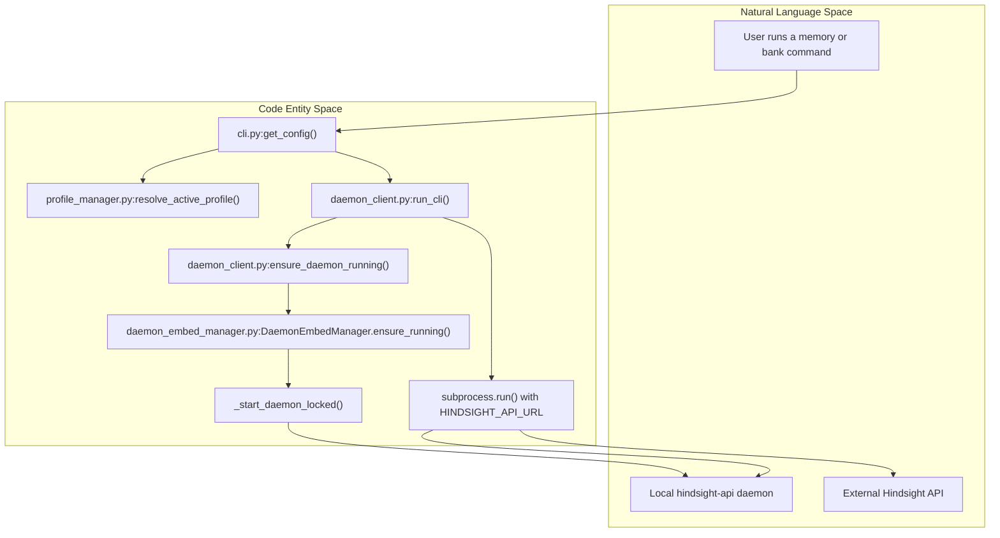
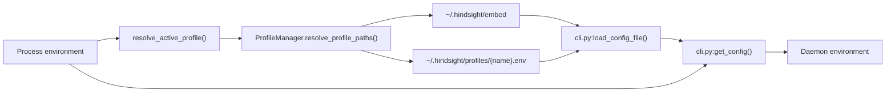
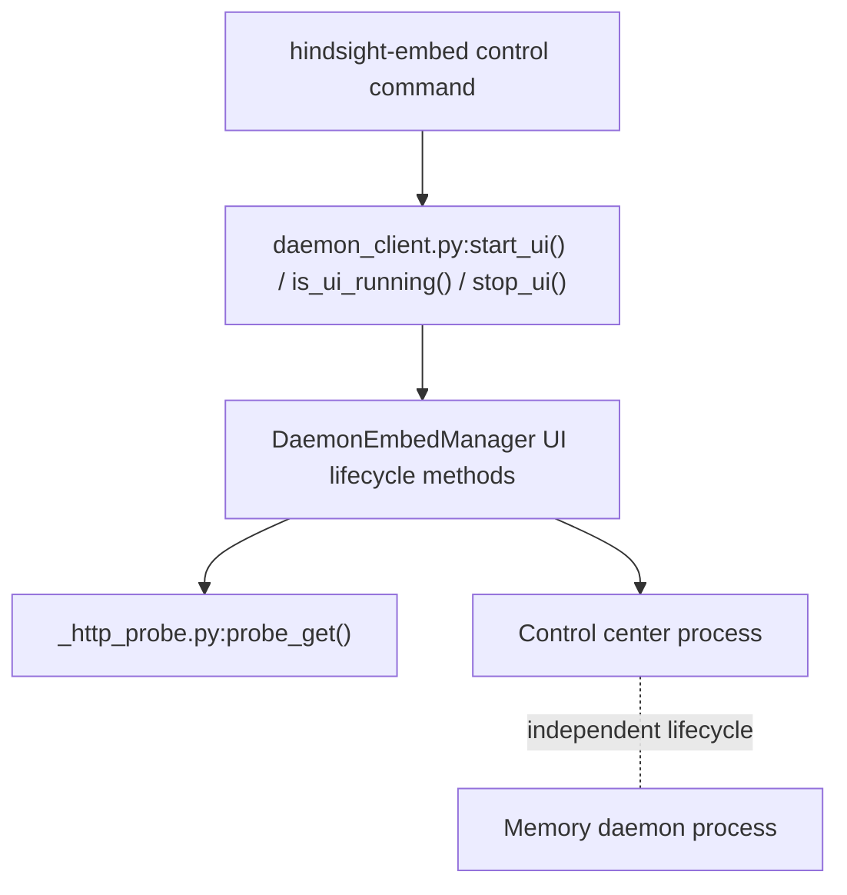
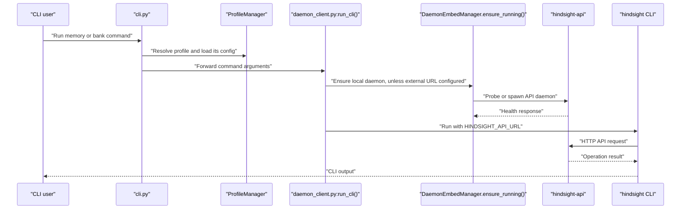

<!-- source: DeepWiki mcp.deepwiki.com · repo vectorize-io/hindsight · page 5.4 Embedded CLI (hindsight-embed) · fetched 2026-10-26 -->

# Embedded CLI (hindsight-embed)

Relevant source files

The following files were used as context for generating this wiki page:

- [hindsight-api-slim/hindsight_api/daemon.py](hindsight-api-slim/hindsight_api/daemon.py)
- [hindsight-api-slim/tests/test_daemonize.py](hindsight-api-slim/tests/test_daemonize.py)
- [hindsight-clients/python/tests/test_retain_async_kwarg.py](hindsight-clients/python/tests/test_retain_async_kwarg.py)
- [hindsight-clients/typescript/tests/deno_setup.ts](hindsight-clients/typescript/tests/deno_setup.ts)
- [hindsight-clients/typescript/tests/main_operations.test.ts](hindsight-clients/typescript/tests/main_operations.test.ts)
- [hindsight-docs/docs/sdks/embed.md](hindsight-docs/docs/sdks/embed.md)
- [hindsight-embed/README.md](hindsight-embed/README.md)
- [hindsight-embed/hindsight_embed/cli.py](hindsight-embed/hindsight_embed/cli.py)
- [hindsight-embed/hindsight_embed/control_center/server.py](hindsight-embed/hindsight_embed/control_center/server.py)
- [hindsight-embed/hindsight_embed/control_center/service.py](hindsight-embed/hindsight_embed/control_center/service.py)
- [hindsight-embed/hindsight_embed/daemon_client.py](hindsight-embed/hindsight_embed/daemon_client.py)
- [hindsight-embed/hindsight_embed/daemon_embed_manager.py](hindsight-embed/hindsight_embed/daemon_embed_manager.py)
- [hindsight-embed/hindsight_embed/embed_manager.py](hindsight-embed/hindsight_embed/embed_manager.py)
- [hindsight-embed/hindsight_embed/env_template.py](hindsight-embed/hindsight_embed/env_template.py)
- [hindsight-embed/hindsight_embed/profile_manager.py](hindsight-embed/hindsight_embed/profile_manager.py)
- [hindsight-embed/test.sh](hindsight-embed/test.sh)
- [hindsight-embed/tests/test_cli_forwarding.py](hindsight-embed/tests/test_cli_forwarding.py)
- [hindsight-embed/tests/test_control_center.py](hindsight-embed/tests/test_control_center.py)
- [hindsight-embed/tests/test_daemon_client.py](hindsight-embed/tests/test_daemon_client.py)
- [hindsight-embed/tests/test_embed_manager.py](hindsight-embed/tests/test_embed_manager.py)
- [hindsight-embed/tests/test_env_template.py](hindsight-embed/tests/test_env_template.py)
- [hindsight-embed/tests/test_profile_daemon_config.py](hindsight-embed/tests/test_profile_daemon_config.py)
- [hindsight-embed/tests/test_profile_integration.py](hindsight-embed/tests/test_profile_integration.py)
- [hindsight-embed/tests/test_profile_manager.py](hindsight-embed/tests/test_profile_manager.py)
- [skills/hindsight-docs/references/sdks/embed.md](skills/hindsight-docs/references/sdks/embed.md)

`hindsight-embed` provides a local command-line interface for Hindsight memory operations. It manages a background API daemon and forwards CLI requests to it, so users can work without setting up a separate server. [hindsight-embed/README.md:1-15]()

## Purpose and Scope

This page describes the embedded CLI’s command flow, configuration and profile handling, control center, and daemon lifecycle. The CLI can start a local daemon automatically or connect to an external Hindsight API server. [hindsight-embed/hindsight_embed/cli.py:4-5](), [hindsight-embed/hindsight-embed/hindsight_embed/cli.py:13-24]()

Sources: [hindsight-embed/README.md:1-15](), [hindsight-embed/hindsight_embed/cli.py:1-24]()

---

## System Architecture & Auto-Daemon Spawning

For commands that use the local API, `hindsight-embed` resolves the active profile, loads that profile’s configuration, checks the daemon, and starts it if needed. The daemon is an `hindsight-api` subprocess; the CLI client is installed or located separately and invoked with the daemon’s API URL in its environment. [hindsight-embed/hindsight_embed/cli.py:67-88](), [hindsight-embed/hindsight_embed/daemon_client.py:17-24](), [hindsight-embed/hindsight_embed/daemon_client.py:28-60]()

If `HINDSIGHT_EMBED_API_URL` is set, `run_cli` uses that external URL rather than ensuring a local daemon is running. An optional `HINDSIGHT_EMBED_API_TOKEN` is passed through for API authentication. [hindsight-embed/hindsight-embed/tests/test_daemon_client.py:43-75](), [hindsight-embed/hindsight-embed/tests/test_daemon_client.py:154-160]()

### Component Interaction (Natural Language Space to Code Entity Space)

The profile manager supplies the active profile; the daemon client delegates local startup to `DaemonEmbedManager` and then invokes the Rust `hindsight` CLI with `HINDSIGHT_API_URL` configured. When an external API URL is configured, the local daemon-start path is skipped. [hindsight-embed/hindsight_embed/cli.py:67-88](), [hindsight-embed/hindsight_embed/daemon_client.py:28-60](), [hindsight-embed/hindsight-embed/tests/test_daemon_client.py:43-75]()

Sources: [hindsight-embed/hindsight_embed/cli.py:67-88](), [hindsight-embed/hindsight_embed/daemon_client.py:28-60](), [hindsight-embed/tests/test_daemon_client.py:43-75]()

---

## CLI Commands and Forwarding

The CLI includes configuration, memory, bank, daemon, control-center, and profile commands. The `memory` operations are forwarded to the Rust CLI; the daemon client locates that binary in standard install locations or on `PATH`. [hindsight-embed/README.md:43-140](), [hindsight-embed/hindsight_embed/daemon_client.py:154-181]()

| Command group | Typical commands | Purpose |
|---|---|---|
| `configure` | `configure`, `configure --profile …`, `configure --env …` | Configure the default or a named profile, interactively or from environment values. [hindsight-embed/README.md:43-66]() |
| `memory` | `memory retain`, `memory recall`, `memory reflect` | Store memories, search memories, and generate contextual answers. [hindsight-embed/README.md:68-98]() |
| `bank` | `bank list` | List memory banks. [hindsight-embed/README.md:100-106]() |
| `profile` | `profile list`, `profile show`, `profile set-active`, `profile delete` | Inspect, select, and manage profiles. [hindsight-embed/README.md:108-127]() |
| `daemon` | `daemon status`, `daemon start`, `daemon stop`, `daemon logs` | Inspect and control the memory daemon and its logs. [hindsight-embed/README.md:129-140]() |
| `control` | `control start`, `control status`, `control logs`, `control stop` | Start, inspect, and stop the browser control center. [hindsight-docs/docs/sdks/embed.md:85-112](), [hindsight-docs/docs/sdks/embed.md:178-191]() |

For local commands, `run_cli` ensures the daemon is running before forwarding the command. If the external API URL is configured, it instead forwards to that URL. [hindsight-embed/hindsight_embed/daemon_client.py:42-60](), [hindsight-embed/tests/test_daemon_client.py:43-109]()

Sources: [hindsight-embed/README.md:43-140](), [hindsight-embed/hindsight_embed/daemon_client.py:42-60](), [hindsight-embed/tests/test_daemon_client.py:43-109](), [hindsight-docs/docs/sdks/embed.md:85-112]()

---

## Profiles and Configuration at `~/.hindsight/embed`

The default profile uses `~/.hindsight/embed`; named profiles store their environment-style configuration under `~/.hindsight/profiles`. `load_config_file()` resolves the active profile and loads only that profile’s file. Values already present in the process environment take precedence over values loaded from the file. [hindsight-embed/hindsight_embed/cli.py:39-42](), [hindsight-embed/hindsight_embed/cli.py:67-88]()

`get_config()` forwards all process environment variables beginning with `HINDSIGHT_`; it does not maintain a whitelist of API settings. It also maps `OPENAI_API_KEY` to `HINDSIGHT_API_LLM_API_KEY` when the selected provider requires an API key and that Hindsight-specific variable is absent. [hindsight-embed/hindsight_embed/cli.py:94-119]()

### Profile Isolation and Configuration Flow

Each profile has its own configuration and daemon-related files, including a lock and log; profile path resolution is handled by `ProfileManager`. Profile metadata is persisted separately. [hindsight-embed/hindsight_embed/profile_manager.py:1-5](), [hindsight-embed/tests/test_profile_manager.py:57-87]()

The active profile can be selected for an invocation, and the CLI supports profile selection through its profile override mechanism. The configuration loader explicitly avoids falling back to the default profile when a named profile is selected. [hindsight-embed/hindsight_embed/cli.py:34-37](), [hindsight-embed/hindsight_embed/cli.py:67-88](), [hindsight-embed/tests/test_profile_daemon_config.py:97-169]()

### Cross-Platform File Locking

`profile_manager.py` implements bounded, exclusive file locking to serialize profile metadata and daemon-start operations. POSIX uses non-blocking `fcntl.flock`; Windows uses non-blocking `msvcrt.locking`. Lock acquisition retries with backoff, can time out through `HINDSIGHT_EMBED_LOCK_TIMEOUT`, and records the holder PID in a sidecar file for diagnostics. [hindsight-embed/hindsight_embed/profile_manager.py:21-53](), [hindsight-embed/hindsight_embed/profile_manager.py:76-108](), [hindsight-embed/hindsight_embed/profile_manager.py:111-182]()

Sources: [hindsight-embed/hindsight_embed/cli.py:34-42](), [hindsight-embed/hindsight_embed/cli.py:67-119](), [hindsight-embed/hindsight_embed/profile_manager.py:1-5](), [hindsight-embed/hindsight_embed/profile_manager.py:21-53](), [hindsight-embed/hindsight_embed/profile_manager.py:76-108](), [hindsight-embed/hindsight_embed/profile_manager.py:111-182](), [hindsight-embed/tests/test_profile_daemon_config.py:97-169]()

---

## Control Center UI Integration

The control center is a separate process from the memory daemon. The CLI exposes commands to start, check, inspect logs for, and stop the UI; its manager methods resolve the active profile and delegate to `DaemonEmbedManager`. Stopping the UI does not stop the memory daemon. [hindsight-embed/hindsight_embed/daemon_client.py:93-136](), [hindsight-docs/docs/sdks/embed.md:85-112]()

The documented default control-center port is `7878`, configurable with `HINDSIGHT_EMBED_CONTROL_PORT` or a per-launch `--port` option. The UI listens on localhost and prints a tokenized URL; the local access token and logs are stored at `~/.hindsight/control.token` and `~/.hindsight/control.log`. [hindsight-docs/docs/sdks/embed.md:85-110](), [hindsight-docs/docs/sdks/embed.md:114-123]()

### UI Lifecycle Flow

The UI and daemon have independent lifecycles: control-center management uses its own start, status, and stop methods, while daemon lifecycle operations are separate. [hindsight-embed/hindsight_embed/daemon_client.py:63-75](), [hindsight-embed/hindsight_embed/daemon_client.py:93-136](), [hindsight-docs/docs/sdks/embed.md:112-112]()

Sources: [hindsight-embed/hindsight_embed/daemon_client.py:93-136](), [hindsight-docs/docs/sdks/embed.md:85-123]()

---

## Daemon Lifecycle, Probing, and Timeouts

`DaemonEmbedManager` owns daemon startup and liveness checks. It probes the daemon over HTTP, uses profile-specific paths and configuration, and starts `hindsight-api` when needed. The manager defines a default startup timeout of 180 seconds and a default daemon idle timeout of `0`, which the code comments identify as disabled. [hindsight-embed/hindsight_embed/daemon_embed_manager.py:68-89]()

| Setting | Variable or constant | Default | Meaning |
|---|---|---:|---|
| Startup timeout | `HINDSIGHT_EMBED_DAEMON_STARTUP_TIMEOUT` | 180 seconds | Maximum startup budget. [hindsight-embed/hindsight_embed/daemon_embed_manager.py:68-74]() |
| Idle timeout | `DEFAULT_DAEMON_IDLE_TIMEOUT` | `0` | `0` means disabled in the manager’s default. [hindsight-embed/hindsight_embed/daemon_embed_manager.py:72-75]() |
| Port health grace | `PORT_HEALTH_GRACE_TIMEOUT` | 30 seconds | Grace period for a listener that has bound its port but is not yet healthy. [hindsight-embed/hindsight_embed/daemon_embed_manager.py:79-89]() |
| Health probe read timeout | `HEALTH_PROBE_TIMEOUT` | 10 seconds | Longer probe budget used where a false negative could cause a listener to be reclaimed. [hindsight-embed/hindsight_embed/daemon_embed_manager.py:90-101]() |
| Liveness probe timeout | `LIVENESS_PROBE_TIMEOUT` | 2 seconds | Short probe budget for routine “is it up?” checks. [hindsight-embed/hindsight_embed/daemon_embed_manager.py:102-109]() |
| Probe connect timeout | `PROBE_CONNECT_TIMEOUT` | 1 second | Connection-time cap applied by `_probe`. [hindsight-embed/hindsight_embed/daemon_embed_manager.py:110-113](), [hindsight-embed/hindsight_embed/daemon_embed_manager.py:143-145]() |
| Daemon log rotation | `HINDSIGHT_EMBED_DAEMON_LOG_MAX_BYTES`, `HINDSIGHT_EMBED_DAEMON_LOG_BACKUP_COUNT` | 10 MiB, 3 backups | Log rotation settings defined by the manager. [hindsight-embed/hindsight_embed/daemon_embed_manager.py:75-78]() |

The manager probes both IPv4 and IPv6 loopback addresses. Before signaling a process that owns a port, it checks command-line markers so an unrelated service is not treated as the Hindsight daemon or control UI. [hindsight-embed/hindsight_embed/daemon_embed_manager.py:115-128]()

On startup, the manager launches the API subprocess and polls for health until it is responsive, exits, or the startup deadline is reached. The tests verify that a startup timeout terminates the spawned process group on POSIX and that an already-exited subprocess fails without waiting through the full startup loop. [hindsight-embed/tests/test_embed_manager.py:52-95]()

The daemon’s runtime idle behavior depends on the configured idle timeout. The manager’s default is disabled; therefore, a fixed five-minute automatic shutdown should not be assumed. The CLI also provides explicit `daemon start`, `daemon status`, `daemon stop`, and log commands. [hindsight-embed/hindsight_embed/daemon_embed_manager.py:72-75](), [hindsight-embed/README.md:129-140]()

### Startup and Forwarding Flow (Natural Language Space to Code Entity Space)

`run_cli` ensures the CLI binary is available, starts or reuses the daemon when using the local API, and forwards the selected API URL to the CLI process. The external-API path skips local daemon startup. [hindsight-embed/hindsight_embed/daemon_client.py:42-60](), [hindsight-embed/tests/test_daemon_client.py:43-109]()

Sources: [hindsight-embed/hindsight_embed/daemon_embed_manager.py:68-145](), [hindsight-embed/hindsight_embed/daemon_client.py:42-90](), [hindsight-embed/hindsight_embed/daemon_client.py:154-181](), [hindsight-embed/tests/test_embed_manager.py:52-95](), [hindsight-embed/tests/test_daemon_client.py:43-109](), [hindsight-embed/README.md:129-140]()

---

## Summary

`hindsight-embed` combines profile-aware configuration, automatic local daemon management, and forwarding to the Hindsight CLI. Profiles keep configuration and daemon resources separate; the control center is managed independently; and users can explicitly manage the daemon or connect commands to an external API. [hindsight-embed/hindsight_embed/cli.py:67-119](), [hindsight-embed/hindsight_embed/daemon_client.py:42-75](), [hindsight-docs/docs/sdks/embed.md:112-112]()

Sources: [hindsight-embed/hindsight_embed/cli.py:67-119](), [hindsight-embed/hindsight_embed/daemon_client.py:42-75](), [hindsight-docs/docs/sdks/embed.md:112-112]()

---

## Important Classes and Functions

| Name | Location | Role |
|---|---|---|
| `DaemonEmbedManager` | `hindsight-embed/hindsight_embed/daemon_embed_manager.py` | Concrete manager for daemon and UI lifecycle, probing, and startup. [hindsight-embed/hindsight_embed/daemon_embed_manager.py:1-6]() |
| `ProfileManager` | `hindsight-embed/hindsight_embed/profile_manager.py` | Profile configuration, paths, metadata, and locking. [hindsight-embed/hindsight_embed/profile_manager.py:1-5]() |
| `load_config_file()` | `hindsight-embed/hindsight_embed/cli.py` | Loads only the active profile’s configuration file. [hindsight-embed/hindsight_embed/cli.py:67-88]() |
| `get_config()` | `hindsight-embed/hindsight_embed/cli.py` | Builds daemon overrides from `HINDSIGHT_*` variables and handles the `OPENAI_API_KEY` alias. [hindsight-embed/hindsight_embed/cli.py:94-119]() |
| `ensure_daemon_running()` | `hindsight-embed/hindsight_embed/daemon_client.py` | Resolves the profile and delegates startup to the manager. [hindsight-embed/hindsight_embed/daemon_client.py:42-60]() |
| `run_cli()` | `hindsight-embed/hindsight_embed/daemon_client.py` | Ensures the CLI is available, selects local or external API routing, and forwards CLI arguments. [hindsight-embed/tests/test_daemon_client.py:43-109]() |
| `lock_file()` / `unlock_file()` | `hindsight-embed/hindsight_embed/profile_manager.py` | Acquire and release bounded cross-platform exclusive locks. [hindsight-embed/hindsight_embed/profile_manager.py:155-182]() |

Sources: [hindsight-embed/hindsight_embed/daemon_embed_manager.py:1-6](), [hindsight-embed/hindsight_embed/profile_manager.py:1-5](), [hindsight-embed/hindsight_embed/cli.py:67-119](), [hindsight-embed/hindsight_embed/daemon_client.py:42-60](), [hindsight-embed/tests/test_daemon_client.py:43-109](), [hindsight-embed/hindsight_embed/profile_manager.py:155-182]()

---

## References

- `hindsight-embed/hindsight_embed/cli.py` [hindsight-embed/hindsight_embed/cli.py:1-24]()
- `hindsight-embed/hindsight_embed/daemon_embed_manager.py` [hindsight-embed/hindsight_embed/daemon_embed_manager.py:68-145]()
- `hindsight-embed/hindsight_embed/daemon_client.py` [hindsight-embed/hindsight_embed/daemon_client.py:28-181]()
- `hindsight-embed/hindsight_embed/profile_manager.py` [hindsight-embed/hindsight_embed/profile_manager.py:21-53]()
- `hindsight-embed/README.md` [hindsight-embed/README.md:43-140]()
- `hindsight-docs/docs/sdks/embed.md` [hindsight-docs/docs/sdks/embed.md:85-123]()
- `hindsight-embed/tests/test_embed_manager.py` [hindsight-embed/tests/test_embed_manager.py:52-95]()
- `hindsight-embed/tests/test_daemon_client.py` [hindsight-embed/tests/test_daemon_client.py:43-109]()

---

