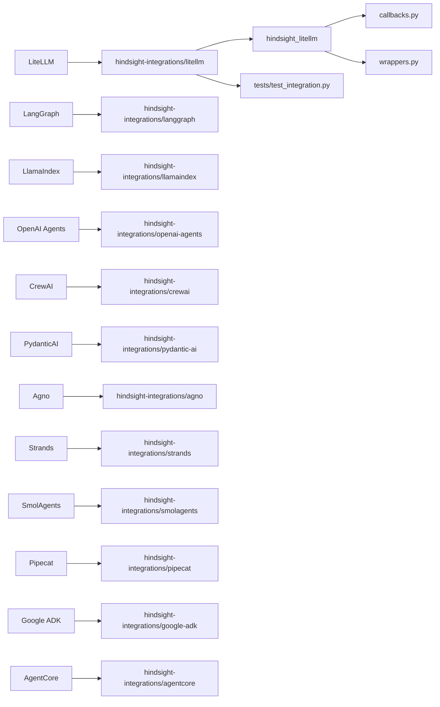
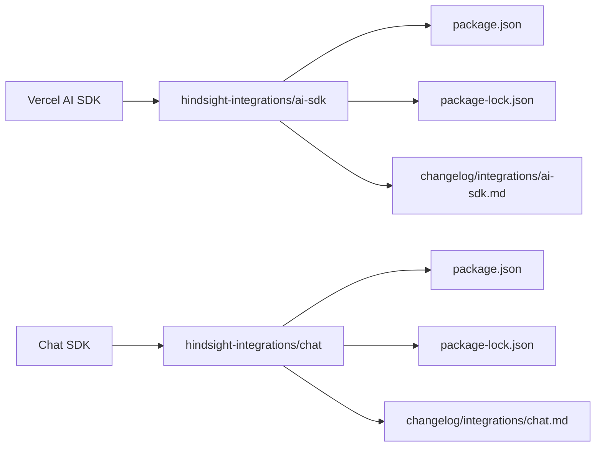
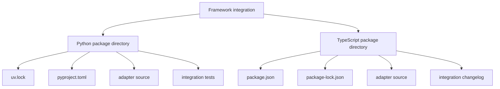

<!-- source: DeepWiki mcp.deepwiki.com · repo vectorize-io/hindsight · page 5.9 Framework Integrations · fetched 2026-10-26 -->

# Framework Integrations

Relevant source files

The following files were used as context for generating this wiki page:

- [hindsight-api-slim/tests/test_validation_result_enrichment.py](hindsight-api-slim/tests/test_validation_result_enrichment.py)
- [hindsight-docs/blog/2026-03-30-llamaindex-agent-memory.md](hindsight-docs/blog/2026-03-30-llamaindex-agent-memory.md)
- [hindsight-docs/docs-integrations/llamaindex.md](hindsight-docs/docs-integrations/llamaindex.md)
- [hindsight-docs/docs-integrations/openai-agents.md](hindsight-docs/docs-integrations/openai-agents.md)
- [hindsight-docs/docs-integrations/pipecat.md](hindsight-docs/docs-integrations/pipecat.md)
- [hindsight-docs/src/pages/changelog/integrations/agentcore.md](hindsight-docs/src/pages/changelog/integrations/agentcore.md)
- [hindsight-docs/src/pages/changelog/integrations/agno.md](hindsight-docs/src/pages/changelog/integrations/agno.md)
- [hindsight-docs/src/pages/changelog/integrations/ai-sdk.md](hindsight-docs/src/pages/changelog/integrations/ai-sdk.md)
- [hindsight-docs/src/pages/changelog/integrations/chat.md](hindsight-docs/src/pages/changelog/integrations/chat.md)
- [hindsight-docs/src/pages/changelog/integrations/crewai.md](hindsight-docs/src/pages/changelog/integrations/crewai.md)
- [hindsight-docs/src/pages/changelog/integrations/langgraph.md](hindsight-docs/src/pages/changelog/integrations/langgraph.md)
- [hindsight-docs/src/pages/changelog/integrations/litellm.md](hindsight-docs/src/pages/changelog/integrations/litellm.md)
- [hindsight-docs/src/pages/changelog/integrations/llamaindex.md](hindsight-docs/src/pages/changelog/integrations/llamaindex.md)
- [hindsight-docs/src/pages/changelog/integrations/nemoclaw.md](hindsight-docs/src/pages/changelog/integrations/nemoclaw.md)
- [hindsight-docs/src/pages/changelog/integrations/openai-agents.md](hindsight-docs/src/pages/changelog/integrations/openai-agents.md)
- [hindsight-docs/src/pages/changelog/integrations/pipecat.md](hindsight-docs/src/pages/changelog/integrations/pipecat.md)
- [hindsight-docs/src/pages/changelog/integrations/pydantic-ai.md](hindsight-docs/src/pages/changelog/integrations/pydantic-ai.md)
- [hindsight-docs/static/img/icons/openai-agents.svg](hindsight-docs/static/img/icons/openai-agents.svg)
- [hindsight-integration-tests/pyproject.toml](hindsight-integration-tests/pyproject.toml)
- [hindsight-integration-tests/uv.lock](hindsight-integration-tests/uv.lock)
- [hindsight-integrations/ag2/uv.lock](hindsight-integrations/ag2/uv.lock)
- [hindsight-integrations/agentcore/pyproject.toml](hindsight-integrations/agentcore/pyproject.toml)
- [hindsight-integrations/agentcore/uv.lock](hindsight-integrations/agentcore/uv.lock)
- [hindsight-integrations/agno/pyproject.toml](hindsight-integrations/agno/pyproject.toml)
- [hindsight-integrations/agno/uv.lock](hindsight-integrations/agno/uv.lock)
- [hindsight-integrations/ai-sdk/package-lock.json](hindsight-integrations/ai-sdk/package-lock.json)
- [hindsight-integrations/ai-sdk/package.json](hindsight-integrations/ai-sdk/package.json)
- [hindsight-integrations/autogen/uv.lock](hindsight-integrations/autogen/uv.lock)
- [hindsight-integrations/chat/package-lock.json](hindsight-integrations/chat/package-lock.json)
- [hindsight-integrations/chat/package.json](hindsight-integrations/chat/package.json)
- [hindsight-integrations/claude-agent-sdk/pyproject.toml](hindsight-integrations/claude-agent-sdk/pyproject.toml)
- [hindsight-integrations/claude-agent-sdk/uv.lock](hindsight-integrations/claude-agent-sdk/uv.lock)
- [hindsight-integrations/crewai/pyproject.toml](hindsight-integrations/crewai/pyproject.toml)
- [hindsight-integrations/crewai/uv.lock](hindsight-integrations/crewai/uv.lock)
- [hindsight-integrations/dify/uv.lock](hindsight-integrations/dify/uv.lock)
- [hindsight-integrations/google-adk/uv.lock](hindsight-integrations/google-adk/uv.lock)
- [hindsight-integrations/langgraph/README.md](hindsight-integrations/langgraph/README.md)
- [hindsight-integrations/langgraph/hindsight_langgraph/__init__.py](hindsight-integrations/langgraph/hindsight_langgraph/__init__.py)
- [hindsight-integrations/langgraph/hindsight_langgraph/_client.py](hindsight-integrations/langgraph/hindsight_langgraph/_client.py)
- [hindsight-integrations/langgraph/hindsight_langgraph/nodes.py](hindsight-integrations/langgraph/hindsight_langgraph/nodes.py)
- [hindsight-integrations/langgraph/hindsight_langgraph/tools.py](hindsight-integrations/langgraph/hindsight_langgraph/tools.py)
- [hindsight-integrations/langgraph/pyproject.toml](hindsight-integrations/langgraph/pyproject.toml)
- [hindsight-integrations/langgraph/tests/test_manual.py](hindsight-integrations/langgraph/tests/test_manual.py)
- [hindsight-integrations/langgraph/tests/test_manual_nodes.py](hindsight-integrations/langgraph/tests/test_manual_nodes.py)
- [hindsight-integrations/langgraph/tests/test_nodes.py](hindsight-integrations/langgraph/tests/test_nodes.py)
- [hindsight-integrations/langgraph/tests/test_recall_context_lifecycle.py](hindsight-integrations/langgraph/tests/test_recall_context_lifecycle.py)
- [hindsight-integrations/langgraph/tests/test_tools.py](hindsight-integrations/langgraph/tests/test_tools.py)
- [hindsight-integrations/langgraph/uv.lock](hindsight-integrations/langgraph/uv.lock)
- [hindsight-integrations/litellm/README.md](hindsight-integrations/litellm/README.md)
- [hindsight-integrations/litellm/hindsight_litellm/__init__.py](hindsight-integrations/litellm/hindsight_litellm/__init__.py)
- [hindsight-integrations/litellm/hindsight_litellm/_async.py](hindsight-integrations/litellm/hindsight_litellm/_async.py)
- [hindsight-integrations/litellm/hindsight_litellm/callbacks.py](hindsight-integrations/litellm/hindsight_litellm/callbacks.py)
- [hindsight-integrations/litellm/hindsight_litellm/config.py](hindsight-integrations/litellm/hindsight_litellm/config.py)
- [hindsight-integrations/litellm/hindsight_litellm/wrappers.py](hindsight-integrations/litellm/hindsight_litellm/wrappers.py)
- [hindsight-integrations/litellm/tests/test_async.py](hindsight-integrations/litellm/tests/test_async.py)
- [hindsight-integrations/litellm/tests/test_config.py](hindsight-integrations/litellm/tests/test_config.py)
- [hindsight-integrations/litellm/tests/test_e2e.py](hindsight-integrations/litellm/tests/test_e2e.py)
- [hindsight-integrations/litellm/tests/test_integration.py](hindsight-integrations/litellm/tests/test_integration.py)
- [hindsight-integrations/litellm/uv.lock](hindsight-integrations/litellm/uv.lock)
- [hindsight-integrations/llamaindex/README.md](hindsight-integrations/llamaindex/README.md)
- [hindsight-integrations/llamaindex/hindsight_llamaindex/__init__.py](hindsight-integrations/llamaindex/hindsight_llamaindex/__init__.py)
- [hindsight-integrations/llamaindex/hindsight_llamaindex/_client.py](hindsight-integrations/llamaindex/hindsight_llamaindex/_client.py)
- [hindsight-integrations/llamaindex/hindsight_llamaindex/memory.py](hindsight-integrations/llamaindex/hindsight_llamaindex/memory.py)
- [hindsight-integrations/llamaindex/hindsight_llamaindex/tools.py](hindsight-integrations/llamaindex/hindsight_llamaindex/tools.py)
- [hindsight-integrations/llamaindex/pyproject.toml](hindsight-integrations/llamaindex/pyproject.toml)
- [hindsight-integrations/llamaindex/tests/test_e2e.py](hindsight-integrations/llamaindex/tests/test_e2e.py)
- [hindsight-integrations/llamaindex/tests/test_memory.py](hindsight-integrations/llamaindex/tests/test_memory.py)
- [hindsight-integrations/llamaindex/tests/test_tools.py](hindsight-integrations/llamaindex/tests/test_tools.py)
- [hindsight-integrations/llamaindex/uv.lock](hindsight-integrations/llamaindex/uv.lock)
- [hindsight-integrations/nemoclaw/package-lock.json](hindsight-integrations/nemoclaw/package-lock.json)
- [hindsight-integrations/nemoclaw/package.json](hindsight-integrations/nemoclaw/package.json)
- [hindsight-integrations/openai-agents/README.md](hindsight-integrations/openai-agents/README.md)
- [hindsight-integrations/openai-agents/hindsight_openai_agents/__init__.py](hindsight-integrations/openai-agents/hindsight_openai_agents/__init__.py)
- [hindsight-integrations/openai-agents/hindsight_openai_agents/_client.py](hindsight-integrations/openai-agents/hindsight_openai_agents/_client.py)
- [hindsight-integrations/openai-agents/hindsight_openai_agents/_version.py](hindsight-integrations/openai-agents/hindsight_openai_agents/_version.py)
- [hindsight-integrations/openai-agents/hindsight_openai_agents/config.py](hindsight-integrations/openai-agents/hindsight_openai_agents/config.py)
- [hindsight-integrations/openai-agents/hindsight_openai_agents/errors.py](hindsight-integrations/openai-agents/hindsight_openai_agents/errors.py)
- [hindsight-integrations/openai-agents/hindsight_openai_agents/py.typed](hindsight-integrations/openai-agents/hindsight_openai_agents/py.typed)
- [hindsight-integrations/openai-agents/hindsight_openai_agents/tools.py](hindsight-integrations/openai-agents/hindsight_openai_agents/tools.py)
- [hindsight-integrations/openai-agents/pyproject.toml](hindsight-integrations/openai-agents/pyproject.toml)
- [hindsight-integrations/openai-agents/tests/test_config.py](hindsight-integrations/openai-agents/tests/test_config.py)
- [hindsight-integrations/openai-agents/tests/test_e2e.py](hindsight-integrations/openai-agents/tests/test_e2e.py)
- [hindsight-integrations/openai-agents/tests/test_tools.py](hindsight-integrations/openai-agents/tests/test_tools.py)
- [hindsight-integrations/openai-agents/uv.lock](hindsight-integrations/openai-agents/uv.lock)
- [hindsight-integrations/pipecat/LICENSE](hindsight-integrations/pipecat/LICENSE)
- [hindsight-integrations/pipecat/README.md](hindsight-integrations/pipecat/README.md)
- [hindsight-integrations/pipecat/examples/basic_pipeline.py](hindsight-integrations/pipecat/examples/basic_pipeline.py)
- [hindsight-integrations/pipecat/examples/interactive_chat.py](hindsight-integrations/pipecat/examples/interactive_chat.py)
- [hindsight-integrations/pipecat/hindsight_pipecat/__init__.py](hindsight-integrations/pipecat/hindsight_pipecat/__init__.py)
- [hindsight-integrations/pipecat/hindsight_pipecat/config.py](hindsight-integrations/pipecat/hindsight_pipecat/config.py)
- [hindsight-integrations/pipecat/hindsight_pipecat/memory.py](hindsight-integrations/pipecat/hindsight_pipecat/memory.py)
- [hindsight-integrations/pipecat/pyproject.toml](hindsight-integrations/pipecat/pyproject.toml)
- [hindsight-integrations/pipecat/tests/test_live_integration.py](hindsight-integrations/pipecat/tests/test_live_integration.py)
- [hindsight-integrations/pipecat/tests/test_memory.py](hindsight-integrations/pipecat/tests/test_memory.py)
- [hindsight-integrations/pipecat/uv.lock](hindsight-integrations/pipecat/uv.lock)
- [hindsight-integrations/pydantic-ai/pyproject.toml](hindsight-integrations/pydantic-ai/pyproject.toml)
- [hindsight-integrations/pydantic-ai/uv.lock](hindsight-integrations/pydantic-ai/uv.lock)
- [hindsight-integrations/smolagents/uv.lock](hindsight-integrations/smolagents/uv.lock)
- [hindsight-integrations/strands/uv.lock](hindsight-integrations/strands/uv.lock)
- [hindsight-integrations/superagent/uv.lock](hindsight-integrations/superagent/uv.lock)
- [skills/hindsight-docs/references/changelog/integrations/agentcore.md](skills/hindsight-docs/references/changelog/integrations/agentcore.md)
- [skills/hindsight-docs/references/changelog/integrations/agno.md](skills/hindsight-docs/references/changelog/integrations/agno.md)
- [skills/hindsight-docs/references/changelog/integrations/ai-sdk.md](skills/hindsight-docs/references/changelog/integrations/ai-sdk.md)
- [skills/hindsight-docs/references/changelog/integrations/chat.md](skills/hindsight-docs/references/changelog/integrations/chat.md)
- [skills/hindsight-docs/references/changelog/integrations/crewai.md](skills/hindsight-docs/references/changelog/integrations/crewai.md)
- [skills/hindsight-docs/references/changelog/integrations/langgraph.md](skills/hindsight-docs/references/changelog/integrations/langgraph.md)
- [skills/hindsight-docs/references/changelog/integrations/litellm.md](skills/hindsight-docs/references/changelog/integrations/litellm.md)
- [skills/hindsight-docs/references/changelog/integrations/llamaindex.md](skills/hindsight-docs/references/changelog/integrations/llamaindex.md)
- [skills/hindsight-docs/references/changelog/integrations/nemoclaw.md](skills/hindsight-docs/references/changelog/integrations/nemoclaw.md)
- [skills/hindsight-docs/references/changelog/integrations/openai-agents.md](skills/hindsight-docs/references/changelog/integrations/openai-agents.md)
- [skills/hindsight-docs/references/changelog/integrations/pipecat.md](skills/hindsight-docs/references/changelog/integrations/pipecat.md)
- [skills/hindsight-docs/references/changelog/integrations/pydantic-ai.md](skills/hindsight-docs/references/changelog/integrations/pydantic-ai.md)

## Purpose and scope

This page surveys Hindsight integrations for Python and TypeScript agent and application frameworks, and describes common integration patterns at the level supported by the supplied repository files. The available file excerpts primarily identify integration packages and their dependency metadata; they do not expose most adapters’ implementation code. Accordingly, package presence and dependency evidence are distinguished from adapter behavior that cannot be verified from these excerpts.

Sources: [hindsight-integrations/litellm/uv.lock:1-7](), [hindsight-integrations/langgraph/uv.lock:1-4](), [hindsight-integrations/llamaindex/uv.lock:1-9]()

## Integration landscape

The repository includes integration directories for LiteLLM, LangGraph, LlamaIndex, OpenAI Agents, AutoGen, AG2, CrewAI, PydanticAI, Agno, Strands, SmolAgents, Pipecat, Google ADK, AgentCore, Vercel AI SDK, and Chat SDK. The visible Python lockfiles establish Python-version constraints for several packages, while the visible Agno lockfile identifies the `agno` dependency. The supplied excerpts do not establish the public APIs, runtime hooks, or memory-operation behavior of most adapters.

Sources: [hindsight-integrations/litellm/uv.lock:1-7](), [hindsight-integrations/langgraph/uv.lock:1-4](), [hindsight-integrations/llamaindex/uv.lock:1-9](), [hindsight-integrations/openai-agents/uv.lock:1-9](), [hindsight-integrations/crewai/uv.lock:1-14](), [hindsight-integrations/pydantic-ai/uv.lock:1-7](), [hindsight-integrations/agno/uv.lock:1-20](), [hindsight-integrations/strands/uv.lock:1-9](), [hindsight-integrations/smolagents/uv.lock:1-9](), [hindsight-integrations/pipecat/uv.lock:1-11]()

### Python framework packages

| Framework | Repository package directory | Evidence in supplied files |
|---|---|---|
| LiteLLM | `hindsight-integrations/litellm` | Python lockfile; integration test path is listed among additional files. |
| LangGraph | `hindsight-integrations/langgraph` | Python lockfile and `pyproject.toml` are listed. |
| LlamaIndex | `hindsight-integrations/llamaindex` | Python lockfile and `pyproject.toml` are listed. |
| OpenAI Agents | `hindsight-integrations/openai-agents` | Python lockfile and `pyproject.toml` are listed. |
| AutoGen | `hindsight-integrations/autogen` | Python lockfile is listed among additional files. |
| AG2 | `hindsight-integrations/ag2` | Python lockfile is listed among additional files. |
| CrewAI | `hindsight-integrations/crewai` | Python lockfile and `pyproject.toml` are listed. |
| PydanticAI | `hindsight-integrations/pydantic-ai` | Python lockfile is present. |
| Agno | `hindsight-integrations/agno` | Lockfile identifies the `agno` package and its dependencies. |
| Strands | `hindsight-integrations/strands` | Python lockfile is present. |
| SmolAgents | `hindsight-integrations/smolagents` | Python lockfile is present. |
| Pipecat | `hindsight-integrations/pipecat` | Python lockfile and `pyproject.toml` are listed. |
| Google ADK | `hindsight-integrations/google-adk` | Python lockfile is listed among additional files. |
| AgentCore | `hindsight-integrations/agentcore` | Python lockfile and `pyproject.toml` are listed. |

The lockfiles show Python-version requirements ranging from `>=3.10` in several packages to `>=3.11` for Pipecat. These are package metadata constraints, not a guarantee that every framework or dependency supports every interpreter listed in a lockfile.

Sources: [hindsight-integrations/litellm/uv.lock:1-7](), [hindsight-integrations/langgraph/uv.lock:1-4](), [hindsight-integrations/llamaindex/uv.lock:1-9](), [hindsight-integrations/openai-agents/uv.lock:1-9](), [hindsight-integrations/crewai/uv.lock:1-14](), [hindsight-integrations/pydantic-ai/uv.lock:1-7](), [hindsight-integrations/agno/uv.lock:1-20](), [hindsight-integrations/strands/uv.lock:1-9](), [hindsight-integrations/smolagents/uv.lock:1-9](), [hindsight-integrations/pipecat/uv.lock:1-11]()

### TypeScript framework packages

The repository includes `hindsight-integrations/ai-sdk` and `hindsight-integrations/chat`. Their `package.json` and lockfile paths are listed in the supplied file inventory. The contents of those manifests and the adapter source code are not included in the excerpts, so exact exports, supported SDK versions, tool schemas, and runtime behavior cannot be documented from the available evidence.

Sources: [hindsight-integrations/ai-sdk/package.json:1-66](), [hindsight-integrations/ai-sdk/package-lock.json:1-1](), [hindsight-integrations/chat/package.json:1-1](), [hindsight-integrations/chat/package-lock.json:1-1]()

## Package organization and integration boundary

The visible package files indicate that integrations are organized as separate directories with their own dependency metadata, rather than as a single framework-neutral adapter file. The LiteLLM package includes a `hindsight_litellm` module and named `wrappers.py` and `callbacks.py` files in the supplied inventory. That inventory also lists a LiteLLM integration test. For other frameworks, the supplied material does not show adapter source or establish whether an integration uses tools, callbacks, state, middleware, or a memory interface.

The general code-entity map below is deliberately limited: directory and file names are searchable identifiers, but edges to unshown framework internals are not inferred.

**Diagram: Framework names mapped to repository package entities**

Sources: [hindsight-integrations/litellm/hindsight_litellm/__init__.py:1-1](), [hindsight-integrations/litellm/hindsight_litellm/callbacks.py:1-1](), [hindsight-integrations/litellm/hindsight_litellm/wrappers.py:1-1](), [hindsight-integrations/litellm/tests/test_integration.py:1-1](), [hindsight-integrations/langgraph/uv.lock:1-4](), [hindsight-integrations/llamaindex/uv.lock:1-9](), [hindsight-integrations/openai-agents/uv.lock:1-9](), [hindsight-integrations/crewai/uv.lock:1-14](), [hindsight-integrations/pydantic-ai/uv.lock:1-7](), [hindsight-integrations/agno/uv.lock:1-20](), [hindsight-integrations/strands/uv.lock:1-9](), [hindsight-integrations/smolagents/uv.lock:1-9](), [hindsight-integrations/pipecat/uv.lock:1-11]()

## LiteLLM

The supplied inventory names the `hindsight_litellm` package and its `__init__.py`, `wrappers.py`, and `callbacks.py` files. It also names `tests/test_integration.py`. These filenames indicate where to inspect the integration module and tests; the excerpts do not show their contents, so the exact configuration functions, callback lifecycle, supported injection modes, and calls to Hindsight operations cannot be verified here.

The lockfile declares Python `>=3.10`. Dependency details beyond the visible initial entries are not used in this description.

Sources: [hindsight-integrations/litellm/uv.lock:1-7](), [hindsight-integrations/litellm/hindsight_litellm/__init__.py:1-1](), [hindsight-integrations/litellm/hindsight_litellm/wrappers.py:1-1](), [hindsight-integrations/litellm/hindsight_litellm/callbacks.py:1-1](), [hindsight-integrations/litellm/tests/test_integration.py:1-1]()

## LangGraph

A `hindsight-integrations/langgraph` package is present, with a Python lockfile requiring `>=3.10`; its `pyproject.toml` is also named in the inventory. The supplied files do not include the adapter’s module source, so the integration’s graph nodes, tool interfaces, state representation, and memory-operation call sites are not established by this excerpt.

Sources: [hindsight-integrations/langgraph/uv.lock:1-4](), [hindsight-integrations/langgraph/pyproject.toml:1-1]()

## LlamaIndex

A `hindsight-integrations/llamaindex` package is present. Its lockfile requires Python `>=3.10`, with a supported marker shown for Python `>=3.11`; a `pyproject.toml` is also listed. The supplied material does not include the package implementation, so it does not verify whether the adapter exposes a memory class, tools, retriever, or index wrapper.

Sources: [hindsight-integrations/llamaindex/uv.lock:1-9](), [hindsight-integrations/llamaindex/pyproject.toml:1-1]()

## OpenAI Agents

The repository includes `hindsight-integrations/openai-agents`, with a Python lockfile requiring `>=3.10` and a `pyproject.toml` listed in the inventory. An additional `README.md` is also listed, but its contents are not present here. The available excerpts therefore establish the package’s presence, not its tool definitions, runner hooks, or operational behavior.

Sources: [hindsight-integrations/openai-agents/uv.lock:1-9](), [hindsight-integrations/openai-agents/pyproject.toml:1-1](), [hindsight-integrations/openai-agents/README.md:1-1]()

## AutoGen and AG2

The supplied inventory lists separate package directories, `hindsight-integrations/autogen` and `hindsight-integrations/ag2`, each with a `uv.lock`. This supports treating them as distinct repository integration packages. Their implementation files are not included, so adapter APIs and any differences between AutoGen and AG2 cannot be described reliably.

Sources: [hindsight-integrations/autogen/uv.lock:1-1](), [hindsight-integrations/ag2/uv.lock:1-1]()

## CrewAI

The repository includes `hindsight-integrations/crewai`, with a Python lockfile and a `pyproject.toml`. The lockfile’s visible metadata requires Python `>=3.10` and indicates support markers beginning at Python `>=3.11`. The supplied files do not show the adapter implementation or the CrewAI version constraints, so no specific hooks or tool behavior can be confirmed.

Sources: [hindsight-integrations/crewai/uv.lock:1-14](), [hindsight-integrations/crewai/pyproject.toml:1-1]()

## PydanticAI

The repository includes `hindsight-integrations/pydantic-ai`; its lockfile declares Python `>=3.10`. The package source and project manifest are not present in the supplied excerpts. Consequently, the adapter’s model, dependency injection, tools, or automatic memory behavior cannot be asserted from the visible files.

Sources: [hindsight-integrations/pydantic-ai/uv.lock:1-7]()

## Agno

The Agno lockfile identifies the `agno` package and version `3.0.5`, and lists its dependencies, including `pydantic`, `pydantic-settings`, and `httpx`. This confirms that the integration’s dependency environment includes Agno-related packages; it does not reveal the Hindsight adapter’s exported classes or runtime flow.

Sources: [hindsight-integrations/agno/uv.lock:1-24]()

## Strands and SmolAgents

The repository contains separate `hindsight-integrations/strands` and `hindsight-integrations/smolagents` directories with Python lockfiles. The visible lockfile metadata declares Python `>=3.10` for Strands and SmolAgents, with supported markers beginning at `>=3.11` in the displayed entries. Adapter source files are not included in the excerpts.

Sources: [hindsight-integrations/strands/uv.lock:1-9](), [hindsight-integrations/smolagents/uv.lock:1-9]()

## Pipecat

A `hindsight-integrations/pipecat` package is present with a lockfile declaring Python `>=3.11`; its `pyproject.toml` is also listed among the supplied files. The lockfile excerpt is dependency metadata only. It does not establish whether the adapter integrates with a particular Pipecat context object, processor, or event hook.

Sources: [hindsight-integrations/pipecat/uv.lock:1-11](), [hindsight-integrations/pipecat/pyproject.toml:1-1]()

## Google ADK and AgentCore

The supplied inventory lists `hindsight-integrations/google-adk` and `hindsight-integrations/agentcore`, including lockfiles for both and a `pyproject.toml` for AgentCore. These entries establish package directories, but the adapter code and configuration details are not provided. The available material therefore does not confirm specific Google ADK tools, AgentCore lifecycle hooks, or memory API mappings.

Sources: [hindsight-integrations/google-adk/uv.lock:1-1](), [hindsight-integrations/agentcore/uv.lock:1-1](), [hindsight-integrations/agentcore/pyproject.toml:1-1]()

## Vercel AI SDK and Chat SDK

The TypeScript integration directories are `hindsight-integrations/ai-sdk` and `hindsight-integrations/chat`. The supplied inventory names each package manifest and lockfile, and names changelog entries for both integrations. The actual TypeScript sources and manifest contents are not included, so this page cannot verify export names, tool schemas, streaming behavior, or how either package uses the TypeScript client.

**Diagram: TypeScript integration package identifiers**

Sources: [hindsight-integrations/ai-sdk/package.json:1-66](), [hindsight-integrations/ai-sdk/package-lock.json:1-1](), [hindsight-integrations/chat/package.json:1-1](), [hindsight-integrations/chat/package-lock.json:1-1](), [hindsight-docs/src/pages/changelog/integrations/ai-sdk.md:1-1](), [hindsight-docs/src/pages/changelog/integrations/chat.md:1-1]()

## Common client and configuration patterns

The adapter source files needed to establish shared client construction, API URL and key configuration, bank selection, tags, budgets, or synchronous versus asynchronous call behavior are not included in the supplied excerpts. Avoid assuming that one integration’s settings or lifecycle apply to another. For implementation-specific guidance, inspect the package’s project metadata, source modules, README, tests, and integration changelog.

The following diagram depicts only a verification path through repository entities. It does not assert an unshown call chain from any framework to a Hindsight API endpoint.

**Diagram: From framework package directories to available inspection artifacts**

Sources: [hindsight-integrations/litellm/uv.lock:1-7](), [hindsight-integrations/langgraph/uv.lock:1-4](), [hindsight-integrations/llamaindex/uv.lock:1-9](), [hindsight-integrations/openai-agents/uv.lock:1-9](), [hindsight-integrations/crewai/uv.lock:1-14](), [hindsight-integrations/pydantic-ai/uv.lock:1-7](), [hindsight-integrations/ai-sdk/package.json:1-66](), [hindsight-integrations/chat/package.json:1-1]()

## Integration directory reference

| Framework | Directory | File evidence available here |
|---|---|---|
| LiteLLM | `hindsight-integrations/litellm` | Lockfile excerpt; source and test paths listed in the inventory. |
| LangGraph | `hindsight-integrations/langgraph` | Lockfile excerpt; project manifest listed. |
| LlamaIndex | `hindsight-integrations/llamaindex` | Lockfile excerpt; project manifest listed. |
| OpenAI Agents | `hindsight-integrations/openai-agents` | Lockfile excerpt; project manifest and README listed. |
| AutoGen | `hindsight-integrations/autogen` | Lockfile listed. |
| AG2 | `hindsight-integrations/ag2` | Lockfile listed. |
| CrewAI | `hindsight-integrations/crewai` | Lockfile excerpt; project manifest listed. |
| PydanticAI | `hindsight-integrations/pydantic-ai` | Lockfile excerpt. |
| Agno | `hindsight-integrations/agno` | Lockfile excerpt identifying `agno`. |
| Strands | `hindsight-integrations/strands` | Lockfile excerpt. |
| SmolAgents | `hindsight-integrations/smolagents` | Lockfile excerpt. |
| Pipecat | `hindsight-integrations/pipecat` | Lockfile excerpt; project manifest listed. |
| Google ADK | `hindsight-integrations/google-adk` | Lockfile listed. |
| AgentCore | `hindsight-integrations/agentcore` | Lockfile and project manifest listed. |
| Vercel AI SDK | `hindsight-integrations/ai-sdk` | Package manifest, lockfile, and changelog listed. |
| Chat SDK | `hindsight-integrations/chat` | Package manifest, lockfile, and changelog listed. |

Sources: [hindsight-integrations/litellm/uv.lock:1-7](), [hindsight-integrations/langgraph/uv.lock:1-4](), [hindsight-integrations/llamaindex/uv.lock:1-9](), [hindsight-integrations/openai-agents/uv.lock:1-9](), [hindsight-integrations/crewai/uv.lock:1-14](), [hindsight-integrations/pydantic-ai/uv.lock:1-7](), [hindsight-integrations/agno/uv.lock:1-20](), [hindsight-integrations/strands/uv.lock:1-9](), [hindsight-integrations/smolagents/uv.lock:1-9](), [hindsight-integrations/pipecat/uv.lock:1-11](), [hindsight-integrations/ai-sdk/package.json:1-66](), [hindsight-integrations/chat/package.json:1-1](), [hindsight-integrations/autogen/uv.lock:1-1](), [hindsight-integrations/ag2/uv.lock:1-1](), [hindsight-integrations/google-adk/uv.lock:1-1](), [hindsight-integrations/agentcore/uv.lock:1-1]()

---

