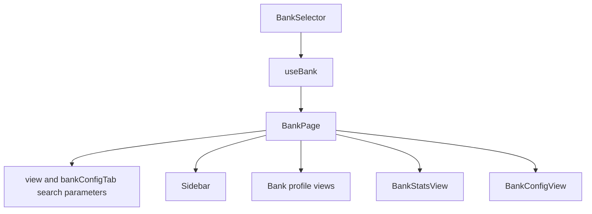
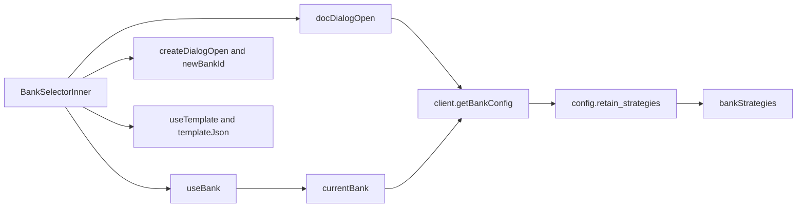
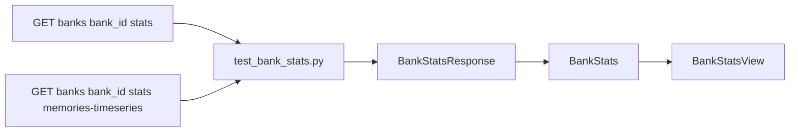
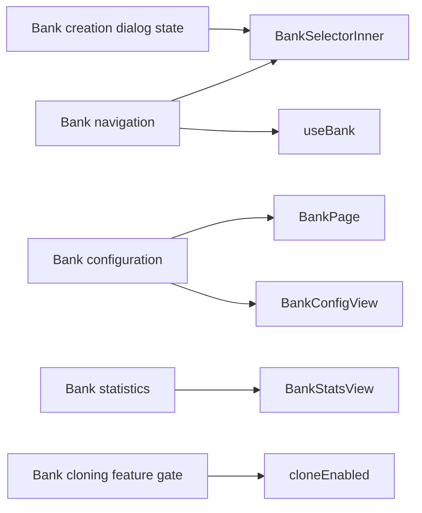

<!-- source: DeepWiki mcp.deepwiki.com · repo vectorize-io/hindsight · page 6.2 Bank Management and Visualization · fetched 2026-10-26 -->

# Bank Management and Visualization

Relevant source files

The following files were used as context for generating this wiki page:

- [hindsight-api-slim/tests/test_bank_stats.py](hindsight-api-slim/tests/test_bank_stats.py)
- [hindsight-clients/go/model_bank_stats_response.go](hindsight-clients/go/model_bank_stats_response.go)
- [hindsight-clients/go/model_operation_response.go](hindsight-clients/go/model_operation_response.go)
- [hindsight-clients/go/model_operation_status_response.go](hindsight-clients/go/model_operation_status_response.go)
- [hindsight-clients/python/hindsight_client_api/models/bank_stats_response.py](hindsight-clients/python/hindsight_client_api/models/bank_stats_response.py)
- [hindsight-clients/python/hindsight_client_api/models/operation_response.py](hindsight-clients/python/hindsight_client_api/models/operation_response.py)
- [hindsight-clients/python/hindsight_client_api/models/operation_status_response.py](hindsight-clients/python/hindsight_client_api/models/operation_status_response.py)
- [hindsight-control-plane/src/app/[locale]/banks/[bankId]/page.tsx](hindsight-control-plane/src/app/[locale]/banks/[bankId]/page.tsx)
- [hindsight-control-plane/src/components/bank-selector.tsx](hindsight-control-plane/src/components/bank-selector.tsx)
- [hindsight-control-plane/src/components/bank-stats-view.tsx](hindsight-control-plane/src/components/bank-stats-view.tsx)
- [hindsight-control-plane/src/components/banks-overview.tsx](hindsight-control-plane/src/components/banks-overview.tsx)
- [hindsight-control-plane/src/components/sidebar.tsx](hindsight-control-plane/src/components/sidebar.tsx)
- [hindsight-control-plane/tests/components/banks-overview.test.tsx](hindsight-control-plane/tests/components/banks-overview.test.tsx)
- [hindsight-control-plane/tests/components/sidebar.test.tsx](hindsight-control-plane/tests/components/sidebar.test.tsx)

## Purpose and scope

This page documents the Control Plane’s bank-management entry points, bank-scoped navigation, configuration access, statistics data model, and bank-list behavior. It focuses on the frontend components and API contracts visible in the supplied code excerpts; implementation details not present in those excerpts are called out rather than inferred. [hindsight-control-plane/src/components/bank-selector.tsx:115-185](), [hindsight-control-plane/src/app/[locale]/banks/[bankId]/page.tsx:103-172](), [hindsight-control-plane/src/components/bank-stats-view.tsx:56-124]()

Sources: [hindsight-control-plane/src/components/bank-selector.tsx:115-185](), [hindsight-control-plane/src/app/[locale]/banks/[bankId]/page.tsx:103-172](), [hindsight-control-plane/src/components/bank-stats-view.tsx:56-124]()

## Bank page navigation structure

`BankPage` reads the selected bank from `useBank()` and derives its active view and subtabs from URL search parameters. The default view is `home`; other main views include `recall`, `reflect`, `data`, `documents`, `entities`, `knowledge`, and `profile`. The profile area has `general`, `memory-defense`, `configuration`, `webhooks`, `audit-logs`, and `llm-requests` configuration tabs. [hindsight-control-plane/src/app/[locale]/banks/[bankId]/page.tsx:73-90](), [hindsight-control-plane/src/app/[locale]/banks/[bankId]/page.tsx:103-124]()

The page imports view components for bank statistics, bank configuration, operations, mental models, webhooks, and other bank features. Feature checks determine whether some areas are enabled: for example, `cloneEnabled` requires both document export and import features, while bank audit-log and observation flags may be resolved from the bank configuration when the configuration API is enabled. [hindsight-control-plane/src/app/[locale]/banks/[bankId]/page.tsx:7-29](), [hindsight-control-plane/src/app/[locale]/banks/[bankId]/page.tsx:124-170]()

The sidebar builds bank-scoped links with `bankRoute(currentBank, ...)`. Left-click navigation updates the selected tab through `onTabChange`; it closes the mobile drawer and dispatches a logo-spin event. The sidebar renders nothing when no bank is selected. [hindsight-control-plane/src/components/sidebar.tsx:61-85](), [hindsight-control-plane/src/components/sidebar.tsx:87-124]()

**Diagram: Bank page navigation mapped to code entities**

Sources: [hindsight-control-plane/src/components/bank-selector.tsx:115-135](), [hindsight-control-plane/src/app/[locale]/banks/[bankId]/page.tsx:7-29](), [hindsight-control-plane/src/app/[locale]/banks/[bankId]/page.tsx:103-124](), [hindsight-control-plane/src/components/sidebar.tsx:61-124]()

## Bank selector and bank creation

`BankSelectorInner` is a client-side component that combines Next.js navigation hooks, translations, bank context, the API client, and UI primitives for menus, dialogs, inputs, and content composition. It reads the current bank and bank-list state from `useBank()`, including loading flags, search, and functions for searching, loading, and loading more banks. [hindsight-control-plane/src/components/bank-selector.tsx:1-19](), [hindsight-control-plane/src/components/bank-selector.tsx:115-138]()

The component maintains local state for the selector popover, the create-bank dialog, the proposed bank ID, creation progress and errors, and optional template JSON input and validation errors. This excerpt shows the state declarations but not the submit handler or API call that creates the bank; those details are therefore not specified here. [hindsight-control-plane/src/components/bank-selector.tsx:139-150]()

The selector also owns state for a document-creation dialog. When that dialog is open and a bank is selected, it calls `client.getBankConfig(currentBank)` and reads the keys of `config.retain_strategies` into `bankStrategies`; failures reset the strategy list to empty. This allows the document flow to expose strategies configured for the current bank. [hindsight-control-plane/src/components/bank-selector.tsx:151-185]()

For list sizing, the component imports `BANKS_PAGE_SIZE` and the `BankInfo` type from the bank context. The excerpt does not show the selector’s list rendering or pagination handlers, so exact scrolling and deduplication behavior cannot be established from the available lines. [hindsight-control-plane/src/components/bank-selector.tsx:87-88](), [hindsight-control-plane/src/components/bank-selector.tsx:123-135]()

**Diagram: Selector state and configuration lookup**

Sources: [hindsight-control-plane/src/components/bank-selector.tsx:87-88](), [hindsight-control-plane/src/components/bank-selector.tsx:115-150](), [hindsight-control-plane/src/components/bank-selector.tsx:151-185]()

## Bank configuration, disposition, and mission

`BankPage` imports `BankConfigView` and `BankProfileView`, and models profile subtabs using the `BankConfigTab` union. It also checks the `bank_config_api` feature before fetching bank configuration for resolved feature flags. The supplied excerpt does not include the `BankConfigView` implementation, so it does not establish the exact configuration fields, patch behavior, disposition slider ranges, or mission-editing controls. [hindsight-control-plane/src/app/[locale]/banks/[bankId]/page.tsx:16-18](), [hindsight-control-plane/src/app/[locale]/banks/[bankId]/page.tsx:84-90](), [hindsight-control-plane/src/app/[locale]/banks/[bankId]/page.tsx:124-164]()

The bank page’s configuration lookup uses `client.getBankConfig(bankId)`. For the visible feature-resolution path, it reads `audit_log_enabled` and `enable_observations`, accepts values only when they are booleans, and falls back to global feature flags when the bank-specific values are unavailable. [hindsight-control-plane/src/app/[locale]/banks/[bankId]/page.tsx:132-165]()

The selector makes a separate configuration request for the current bank when the document dialog opens, specifically to obtain configured retain strategies. This is a distinct UI data flow from the bank page’s feature-flag lookup. [hindsight-control-plane/src/components/bank-selector.tsx:174-185]()

Sources: [hindsight-control-plane/src/app/[locale]/banks/[bankId]/page.tsx:16-18](), [hindsight-control-plane/src/app/[locale]/banks/[bankId]/page.tsx:84-90](), [hindsight-control-plane/src/app/[locale]/banks/[bankId]/page.tsx:132-165](), [hindsight-control-plane/src/components/bank-selector.tsx:174-185]()

## Bank overview and management

`BanksOverview` fetches bank-list pages through `client.listBanks`, using a page size of 50 and an offset derived from the current page. It maps each untyped response row into `BankInfo`, supplying defaults for optional name, mission, counts, aliases, and activity timestamps. [hindsight-control-plane/src/components/banks-overview.tsx:39-64](), [hindsight-control-plane/src/components/banks-overview.tsx:122-140]()

Search is debounced by 250 ms, and changing the query resets pagination to the first page. A request sequence counter prevents stale responses from replacing newer results. Selection is cleared when page or search changes, preventing off-screen rows from remaining selected. [hindsight-control-plane/src/components/banks-overview.tsx:107-120](), [hindsight-control-plane/src/components/banks-overview.tsx:142-150]()

Bulk deletion is intentionally sequential: the component loops over selected bank IDs and awaits each `client.deleteBank` call. It records failures and continues attempting later banks. After completion, the component refreshes the bank context with `loadBanks()`. [hindsight-control-plane/src/components/banks-overview.tsx:171-181](), [hindsight-control-plane/tests/components/banks-overview.test.tsx:87-117](), [hindsight-control-plane/tests/components/banks-overview.test.tsx:119-133]()

The test suite verifies the serial-call behavior, confirms that a failure does not abort the remaining deletes, and checks that page changes clear selection. The test describes the rationale for sequential deletion: concurrent deletion can deadlock while dropping per-bank partial vector indexes on the shared `memory_units` relation. [hindsight-control-plane/tests/components/banks-overview.test.tsx:3-10](), [hindsight-control-plane/tests/components/banks-overview.test.tsx:87-117](), [hindsight-control-plane/tests/components/banks-overview.test.tsx:145-169]()

Sources: [hindsight-control-plane/src/components/banks-overview.tsx:39-69](), [hindsight-control-plane/src/components/banks-overview.tsx:107-150](), [hindsight-control-plane/src/components/banks-overview.tsx:171-181](), [hindsight-control-plane/tests/components/banks-overview.test.tsx:3-10](), [hindsight-control-plane/tests/components/banks-overview.test.tsx:87-133](), [hindsight-control-plane/tests/components/banks-overview.test.tsx:145-169]()

## Statistics dashboard

`BankStatsView` defines the frontend statistics shape as `BankStats`. It includes total nodes, links, and documents; node counts by fact type; link counts by relationship type; operation counts by status; consolidation timestamps and counts; the most recent memory-write timestamp; and total observations. [hindsight-control-plane/src/components/bank-stats-view.tsx:56-84]()

The dashboard supports timeseries periods `1h`, `12h`, `1d`, `7d`, `30d`, and `90d`. Its bucket model contains a timestamp and counts for `world`, `experience`, and `observation`; the available time fields are `created_at`, `mentioned_at`, and `occurred_start`. The component imports Recharts chart primitives, indicating that the view uses charting components, though the supplied excerpt does not include the complete rendering or API-fetching code. [hindsight-control-plane/src/components/bank-stats-view.tsx:46-54](), [hindsight-control-plane/src/components/bank-stats-view.tsx:93-124]()

`getCausalLinkCount` combines `caused_by`, `causes`, `enables`, and `prevents` into one causal-family count. The component also provides compact-number formatting for dashboard values. [hindsight-control-plane/src/components/bank-stats-view.tsx:151-177]()

The generated API model `BankStatsResponse` describes the corresponding server response fields, including `operations_by_status`, `last_memory_write_at`, `pending_consolidation`, `failed_consolidation`, and `total_observations`. Its deserializer defaults missing consolidation and observation counts to zero. [hindsight-clients/python/hindsight_client_api/models/bank_stats_response.py:25-45](), [hindsight-clients/python/hindsight_client_api/models/bank_stats_response.py:98-125]()

The stats tests exercise `GET /v1/default/banks/{bank_id}/stats` and `GET /v1/default/banks/{bank_id}/stats/memories-timeseries`. They verify that an empty bank can have no `last_memory_write_at`, that a synchronous retain contributes a completed operation, and that supported timeseries periods return the expected bucket counts and UTC-aware timestamps. [hindsight-api-slim/tests/test_bank_stats.py:1-7](), [hindsight-api-slim/tests/test_bank_stats.py:57-78](), [hindsight-api-slim/tests/test_bank_stats.py:85-106](), [hindsight-api-slim/tests/test_bank_stats.py:111-154]()

| Dashboard data | Fields visible in the frontend contract |
|---|---|
| Bank totals | `total_nodes`, `total_links`, `total_documents` |
| Memory composition | `nodes_by_fact_type`; timeseries buckets for `world`, `experience`, and `observation` |
| Relationships | `links_by_link_type`, with causal-family aggregation |
| Operations | `pending_operations`, `failed_operations`, `operations_by_status` |
| Consolidation | `pending_consolidation`, `failed_consolidation`, `last_consolidated_at` |
| Activity | `last_memory_write_at` |
| Observations | `total_observations` |

Sources: [hindsight-control-plane/src/components/bank-stats-view.tsx:56-84](), [hindsight-control-plane/src/components/bank-stats-view.tsx:93-124](), [hindsight-control-plane/src/components/bank-stats-view.tsx:151-177](), [hindsight-clients/python/hindsight_client_api/models/bank_stats_response.py:25-45](), [hindsight-clients/python/hindsight_client_api/models/bank_stats_response.py:98-125](), [hindsight-api-slim/tests/test_bank_stats.py:57-78](), [hindsight-api-slim/tests/test_bank_stats.py:85-106](), [hindsight-api-slim/tests/test_bank_stats.py:111-154]()

**Diagram: Statistics contract from API tests to dashboard fields**

Sources: [hindsight-api-slim/tests/test_bank_stats.py:1-7](), [hindsight-api-slim/tests/test_bank_stats.py:57-78](), [hindsight-api-slim/tests/test_bank_stats.py:111-154](), [hindsight-clients/python/hindsight_client_api/models/bank_stats_response.py:25-45](), [hindsight-control-plane/src/components/bank-stats-view.tsx:56-84]()

## Bank cloning

The bank page computes `cloneEnabled` only when both `document_export_api` and `document_import_api` are enabled. Its comment explains that cloning is an export followed by an import and that the server-side endpoint is unavailable otherwise. The supplied page excerpt does not include the clone action handler or its request payload, so those details are not documented here. [hindsight-control-plane/src/app/[locale]/banks/[bankId]/page.tsx:127-131]()

Sources: [hindsight-control-plane/src/app/[locale]/banks/[bankId]/page.tsx:127-131]()

## Natural-language concepts mapped to code entities

**Diagram: Bank management concepts and frontend entities**

Sources: [hindsight-control-plane/src/components/bank-selector.tsx:115-150](), [hindsight-control-plane/src/app/[locale]/banks/[bankId]/page.tsx:16-19](), [hindsight-control-plane/src/app/[locale]/banks/[bankId]/page.tsx:103-131](), [hindsight-control-plane/src/components/bank-stats-view.tsx:56-84]()

## Summary

The bank-management UI is organized around `BankSelectorInner`, bank context, and the bank-scoped `BankPage`. The selector maintains creation and template-dialog state and looks up the current bank’s retain strategies when its document dialog opens. The overview component provides paginated, debounced bank search and sequential bulk deletion. The stats contract covers bank totals, fact and link breakdowns, operation status, consolidation, activity, observations, and timeseries buckets. [hindsight-control-plane/src/components/bank-selector.tsx:115-185](), [hindsight-control-plane/src/app/[locale]/banks/[bankId]/page.tsx:103-170](), [hindsight-control-plane/src/components/banks-overview.tsx:107-150](), [hindsight-control-plane/src/components/banks-overview.tsx:171-181](), [hindsight-control-plane/src/components/bank-stats-view.tsx:56-124]()

The supplied excerpts establish that `BankConfigView` is integrated into the bank page and that cloning is gated by export and import feature flags. They do not show the configuration editor’s controls, disposition sliders, mission-editing implementation, or clone request flow; those UI behaviors require inspection of the corresponding component implementation. [hindsight-control-plane/src/app/[locale]/banks/[bankId]/page.tsx:16-18](), [hindsight-control-plane/src/app/[locale]/banks/[bankId]/page.tsx:127-131]()

Sources: [hindsight-control-plane/src/components/bank-selector.tsx:115-185](), [hindsight-control-plane/src/app/[locale]/banks/[bankId]/page.tsx:16-18](), [hindsight-control-plane/src/app/[locale]/banks/[bankId]/page.tsx:103-170](), [hindsight-control-plane/src/app/[locale]/banks/[bankId]/page.tsx:127-131](), [hindsight-control-plane/src/components/banks-overview.tsx:107-150](), [hindsight-control-plane/src/components/banks-overview.tsx:171-181](), [hindsight-control-plane/src/components/bank-stats-view.tsx:56-124]()

---

