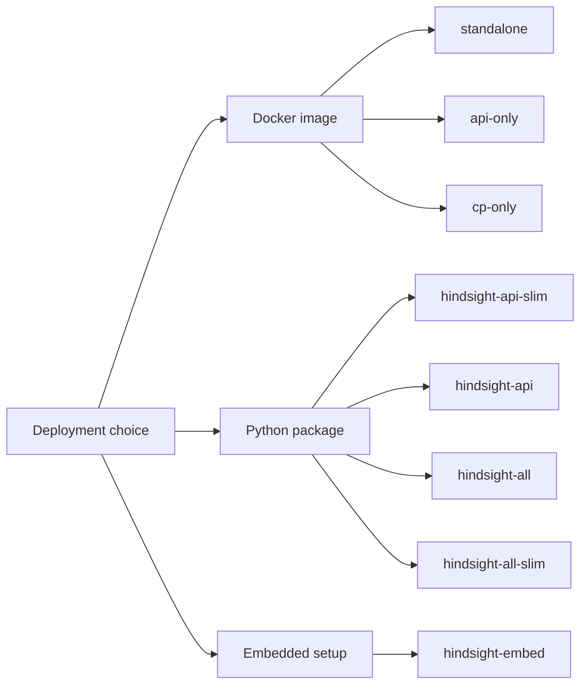
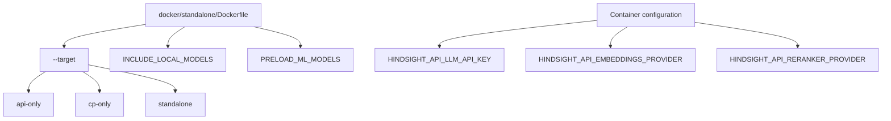

<!-- source: DeepWiki mcp.deepwiki.com · repo vectorize-io/hindsight · page 7 Deployment · fetched 2026-10-26 -->

# Deployment

Relevant source files

The following files were used as context for generating this wiki page:

- [.github/workflows/deploy-docs.yml](.github/workflows/deploy-docs.yml)
- [.github/workflows/release.yml](.github/workflows/release.yml)
- [.github/workflows/security-scan.yml](.github/workflows/security-scan.yml)
- [.github/workflows/test.yml](.github/workflows/test.yml)
- [docker/standalone/Dockerfile](docker/standalone/Dockerfile)
- [docker/test-image.sh](docker/test-image.sh)
- [docker/test-slim-local.sh](docker/test-slim-local.sh)
- [hindsight-api-slim/pyproject.toml](hindsight-api-slim/pyproject.toml)
- [hindsight-dev/hindsight_dev/generate_changelog.py](hindsight-dev/hindsight_dev/generate_changelog.py)
- [hindsight-docs/plugins/github-stars/index.js](hindsight-docs/plugins/github-stars/index.js)
- [hindsight-docs/src/components/HomeBenchmarks.module.css](hindsight-docs/src/components/HomeBenchmarks.module.css)
- [hindsight-docs/src/components/useGitHubStars.ts](hindsight-docs/src/components/useGitHubStars.ts)
- [hindsight-docs/src/data/integrations.json](hindsight-docs/src/data/integrations.json)
- [scripts/release-integration.sh](scripts/release-integration.sh)
- [scripts/smoke-test-slim.sh](scripts/smoke-test-slim.sh)
- [uv.lock](uv.lock)

This page summarizes Hindsight’s deployment choices: Docker images, Kubernetes with Helm, direct Python installation, and embedded use. It compares their broad use cases and infrastructure needs; detailed setup belongs in the child pages [Docker Deployment](#7.1), [Kubernetes and Helm](#7.2), [Configuration Reference](#7.3), and [Database Setup](#7.4).

**Sources:** [docker/standalone/Dockerfile:1-22](), [hindsight-api-slim/pyproject.toml:5-32](), [uv.lock:19-28]()

---

## Deployment Modes

Hindsight’s deployment options span a single local process through to deployments where services and infrastructure are managed separately. The Python workspace includes `hindsight-api-slim`, `hindsight-api`, `hindsight-all`, `hindsight-all-slim`, and `hindsight-embed`; Docker can build the API, Control Plane, or both from one multi-stage Dockerfile. [uv.lock:19-28]() [docker/standalone/Dockerfile:1-22]()

| Mode | Typical fit | Main requirement | Further reading |
|---|---|---|---|
| **Embedded** | Local development or personal use | `hindsight-embed` package; embedded database support is available as a package extra | [Embedded Mode](#embedded-mode), [Configuration Reference](#7.3) |
| **Docker** | Single-host deployment, testing, or a custom container setup | Docker; configure an LLM provider and, for slim images, any external embedding or reranking providers | [Docker Deployment](#7.1) |
| **Kubernetes / Helm** | Orchestrated deployment | Kubernetes and the chart’s configured services and storage | [Kubernetes and Helm](#7.2) |
| **Bare-metal / pip** | Custom environments without a container runtime | Python 3.11 or later and a configured database | [Bare-metal / Manual Pip Install](#bare-metal--manual-pip-install), [Database Setup](#7.4) |

The Dockerfile’s `standalone` target combines API and Control Plane builds, while `api-only` and `cp-only` build those components separately. For Python installations, `hindsight-api-slim` declares Python `>=3.11`; the workspace also includes the full API and all-in-one package variants. [docker/standalone/Dockerfile:1-22]() [hindsight-api-slim/pyproject.toml:5-12]() [uv.lock:19-28]()

**Sources:** [docker/standalone/Dockerfile:1-22](), [hindsight-api-slim/pyproject.toml:5-12](), [uv.lock:19-28]()

---

## Deployment Components at a Glance

This diagram connects deployment concepts to identifiers that help locate their implementation. The Docker targets are explicitly defined in `docker/standalone/Dockerfile`; package names are listed in the workspace lockfile. [docker/standalone/Dockerfile:1-22]() [uv.lock:19-28]()

### Deployment choices and code entities

**Sources:** [docker/standalone/Dockerfile:1-22](), [uv.lock:19-28]()

### Image composition and configuration touchpoints

The Docker build can include or omit local ML dependencies with `INCLUDE_LOCAL_MODELS`; `PRELOAD_ML_MODELS` controls whether those models are pre-downloaded when included. The image smoke-test script identifies `HINDSIGHT_API_LLM_API_KEY` as required for API and standalone image checks, and documents external embedding and reranker settings for slim-image tests. [docker/standalone/Dockerfile:11-22]() [docker/test-image.sh:15-23]() [docker/test-image.sh:100-105]()

**Sources:** [docker/standalone/Dockerfile:1-22](), [docker/test-image.sh:15-23](), [docker/test-image.sh:100-105]()

---

## Image Variants

The project publishes Docker images tagged `latest` and `latest-slim`, including API and combined Hindsight images. The Docker build can also omit local ML dependencies or model preloading through build arguments. Slim-image smoke-test documentation lists external embedding and reranker provider settings; the appropriate image and provider choices depend on whether inference is performed locally or by an external service. [docker/standalone/Dockerfile:11-22]() [docker/test-image.sh:15-23]() [docker/test-image.sh:35-42]() [`.github/workflows/security-scan.yml`:32-36]()

| Choice | Build or image identifier | High-level trade-off |
|---|---|---|
| Local ML included | `INCLUDE_LOCAL_MODELS=true` | Includes local ML dependencies; may also preload models |
| Local ML omitted | `INCLUDE_LOCAL_MODELS=false` | Avoids local ML dependencies; configure external providers where required |
| Model preload disabled | `PRELOAD_ML_MODELS=false` | Skips model pre-download during builds that include local ML |
| API-only | `api-only` | Builds the API without building the Control Plane |
| Control Plane-only | `cp-only` | Builds the Control Plane without building the API |
| Combined | `standalone` | Builds API and Control Plane together |

The Dockerfile documents `INCLUDE_LOCAL_MODELS` and `PRELOAD_ML_MODELS` as build arguments, and notes that model preloading applies only when local models are included. [docker/standalone/Dockerfile:11-22]()

**Sources:** [docker/standalone/Dockerfile:11-22](), [docker/test-image.sh:15-23](), [docker/test-image.sh:35-42](), [.github/workflows/security-scan.yml:32-36]()

---

## Deployment Topologies

### Docker Deployment

Docker is a practical option for single-host setups and for selecting a build that combines or separates the API and Control Plane. The `docker/standalone/Dockerfile` defines `standalone`, `api-only`, and `cp-only` targets. It also supports build arguments to include local ML dependencies and optionally preload models. [docker/standalone/Dockerfile:1-22]()

For image tags, build targets, compose variants, and persistent storage details, see [Docker Deployment](#7.1).

**Sources:** [docker/standalone/Dockerfile:1-22]()

---

### Kubernetes and Helm

Kubernetes with Helm is a deployment option for environments that need orchestration beyond a single Docker host. The repository’s CI workflow includes a `helm` change category, indicating Helm-managed content is part of the project’s deployment surface. The supplied files do not detail chart values or workload topology; consult [Kubernetes and Helm](#7.2) for chart installation and configuration guidance. [`.github/workflows/test.yml`:25-30]()

**Sources:** [.github/workflows/test.yml:25-30]()

---

### Embedded Mode

The workspace includes a `hindsight-embed` package, and the Docker build installs the `embedded-db` extra for `hindsight-api-slim`. These are codebase indicators of embedded deployment support; package-specific lifecycle and configuration details are covered in the embedded-mode documentation and child pages. [uv.lock:19-28]() [docker/standalone/Dockerfile:60-83]()

For deployment choices involving embedded use, see [Configuration Reference](#7.3) and [Database Setup](#7.4). For CLI setup and daemon behavior, refer to the relevant embedded-mode documentation.

**Sources:** [uv.lock:19-28](), [docker/standalone/Dockerfile:60-83]()

---

### Bare-metal / Manual Pip Install

Direct Python installation is an option when operators prefer to manage the runtime themselves rather than use Docker. The workspace includes `hindsight-api-slim`, `hindsight-api`, `hindsight-all`, and `hindsight-all-slim`; the slim API package declares Python `>=3.11` and includes PostgreSQL-related dependencies such as `asyncpg`, `sqlalchemy`, `alembic`, and `pgvector`. [uv.lock:19-28]() [hindsight-api-slim/pyproject.toml:5-32]()

A bare-metal installation still needs a configured database and provider settings appropriate to the chosen package and runtime. For installation procedures and database requirements, see [Configuration Reference](#7.3) and [Database Setup](#7.4).

**Sources:** [uv.lock:19-28](), [hindsight-api-slim/pyproject.toml:5-32]()

---

## Database Setup

The `hindsight-api-slim` package declares PostgreSQL-related drivers and libraries, including `asyncpg`, SQLAlchemy, Alembic, and `pgvector`. The Docker build includes an `embedded-db` extra, while Python workspace packages also include `hindsight-embed`. These package declarations identify database setup as an important deployment concern; they do not by themselves specify a supported PostgreSQL version or production tuning values. [hindsight-api-slim/pyproject.toml:11-32]() [docker/standalone/Dockerfile:60-83]() [uv.lock:19-28]()

For database requirements, extensions, schema migrations, and embedded database details, see [Database Setup](#7.4).

**Sources:** [hindsight-api-slim/pyproject.toml:11-32](), [docker/standalone/Dockerfile:60-83](), [uv.lock:19-28]()

---

## Configuration Strategy

The Docker smoke-test script identifies `HINDSIGHT_API_*` variables for LLM, embedding, and reranker provider configuration. For example, it checks `HINDSIGHT_API_LLM_API_KEY` for API and standalone image tests, and supports optional embedding and reranker settings for slim-image checks. Use secrets management appropriate to the deployment platform rather than embedding credentials in image builds. [docker/test-image.sh:15-23]() [docker/test-image.sh:100-105]() [docker/test-image.sh:155-169]()

For the complete environment-variable reference, including API and Control Plane settings, see [Configuration Reference](#7.3).

**Sources:** [docker/test-image.sh:15-23](), [docker/test-image.sh:100-105](), [docker/test-image.sh:155-169]()

---

## Worker Architecture

The available files do not establish a deployment topology or runtime behavior for worker processes. Worker separation and scaling requirements should therefore be taken from the deployment-specific guidance rather than inferred here. See [Kubernetes and Helm](#7.2) for Kubernetes deployment details.

**Sources:** [.github/workflows/test.yml:25-30]()

---

## Summary

| Deployment option | Best suited to | Key consideration | Details |
|---|---|---|---|
| Embedded | Local or personal deployments | Workspace includes `hindsight-embed`; embedded database support is available as an extra | [Database Setup](#7.4) |
| Docker | Single-host deployment and image-based workflows | Choose `standalone`, `api-only`, or `cp-only`; select local or external ML providers | [Docker Deployment](#7.1) |
| Kubernetes / Helm | Orchestrated deployments | Follow the chart-specific configuration guidance | [Kubernetes and Helm](#7.2) |
| Bare-metal / pip | Operator-managed Python deployments | Choose a package variant and configure its database and providers | [Configuration Reference](#7.3), [Database Setup](#7.4) |

**Sources:** [docker/standalone/Dockerfile:1-22](), [docker/standalone/Dockerfile:60-83](), [hindsight-api-slim/pyproject.toml:5-32](), [uv.lock:19-28]()

---

For detailed instructions, configuration, and infrastructure guidance, see:

- [Docker Deployment](#7.1)
- [Kubernetes and Helm](#7.2)
- [Configuration Reference](#7.3)
- [Database Setup](#7.4)

**Sources:** [docker/standalone/Dockerfile:1-22](), [hindsight-api-slim/pyproject.toml:5-32](), [uv.lock:19-28)

---

