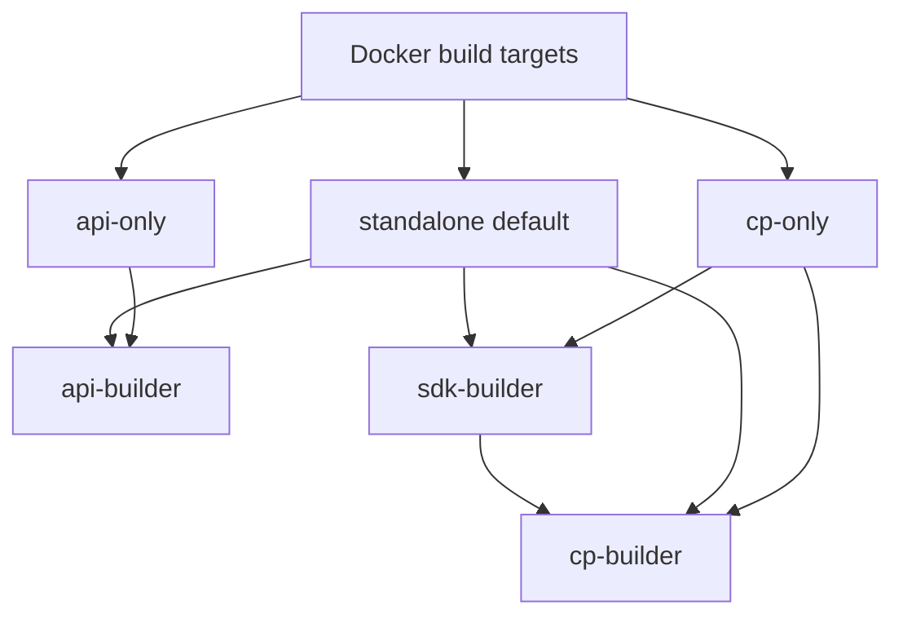
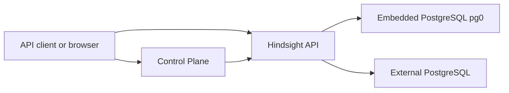
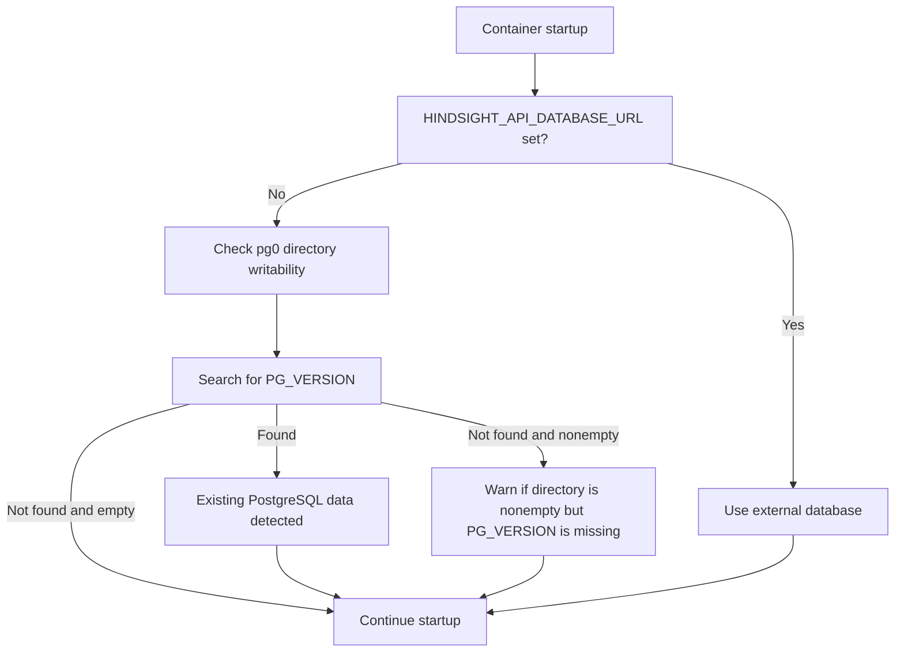

<!-- source: DeepWiki mcp.deepwiki.com · repo vectorize-io/hindsight · page 7.1 Docker Deployment · fetched 2026-10-26 -->

# Docker Deployment

Relevant source files

The following files were used as context for generating this wiki page:

- [.github/workflows/deploy-docs.yml](.github/workflows/deploy-docs.yml)
- [.github/workflows/release.yml](.github/workflows/release.yml)
- [.github/workflows/security-scan.yml](.github/workflows/security-scan.yml)
- [.github/workflows/test.yml](.github/workflows/test.yml)
- [README.md](README.md)
- [docker/standalone/Dockerfile](docker/standalone/Dockerfile)
- [docker/standalone/start-all.sh](docker/standalone/start-all.sh)
- [docker/standalone/test-start-all.sh](docker/standalone/test-start-all.sh)
- [docker/test-image.sh](docker/test-image.sh)
- [docker/test-slim-local.sh](docker/test-slim-local.sh)
- [hindsight-api-slim/hindsight_api/http_probe.py](hindsight-api-slim/hindsight_api/http_probe.py)
- [hindsight-api-slim/pyproject.toml](hindsight-api-slim/pyproject.toml)
- [hindsight-api-slim/tests/test_http_probe.py](hindsight-api-slim/tests/test_http_probe.py)
- [hindsight-control-plane/bin/cli.js](hindsight-control-plane/bin/cli.js)
- [hindsight-control-plane/tests/lib/cli-bind-host.test.ts](hindsight-control-plane/tests/lib/cli-bind-host.test.ts)
- [hindsight-dev/hindsight_dev/generate_changelog.py](hindsight-dev/hindsight_dev/generate_changelog.py)
- [hindsight-docs/docs/developer/api/quickstart.mdx](hindsight-docs/docs/developer/api/quickstart.mdx)
- [hindsight-docs/docs/developer/installation.md](hindsight-docs/docs/developer/installation.md)
- [hindsight-docs/plugins/github-stars/index.js](hindsight-docs/plugins/github-stars/index.js)
- [hindsight-docs/src/components/HomeBenchmarks.module.css](hindsight-docs/src/components/HomeBenchmarks.module.css)
- [hindsight-docs/src/components/useGitHubStars.ts](hindsight-docs/src/components/useGitHubStars.ts)
- [hindsight-docs/src/data/integrations.json](hindsight-docs/src/data/integrations.json)
- [hindsight-docs/versioned_docs/version-0.8/developer/installation.md](hindsight-docs/versioned_docs/version-0.8/developer/installation.md)
- [hindsight-docs/versioned_docs/version-0.9/developer/api/quickstart.mdx](hindsight-docs/versioned_docs/version-0.9/developer/api/quickstart.mdx)
- [hindsight-docs/versioned_docs/version-0.9/developer/installation.md](hindsight-docs/versioned_docs/version-0.9/developer/installation.md)
- [scripts/release-integration.sh](scripts/release-integration.sh)
- [scripts/smoke-test-slim.sh](scripts/smoke-test-slim.sh)
- [skills/hindsight-docs/references/developer/api/quickstart.md](skills/hindsight-docs/references/developer/api/quickstart.md)
- [skills/hindsight-docs/references/developer/installation.md](skills/hindsight-docs/references/developer/installation.md)
- [uv.lock](uv.lock)

## Purpose and scope

This page documents the Docker deployment options supported by Hindsight: the published `latest` and `slim` image variants, the standalone Dockerfile’s build targets and arguments, persistent storage for embedded PostgreSQL (`pg0`), and guidance for choosing a deployment shape. Docker Compose variant names are included where they are requested for this page, but the supplied file excerpts do not include the Compose definitions, so service-level configuration details cannot be verified here.

Sources: [README.md:64-91](), [docker/standalone/Dockerfile:1-25](), [hindsight-docs/docs/developer/installation.md:71-118]()

---

## Image variants

The `latest` image is the full image, which includes local ML dependencies. The `slim` image omits local ML dependencies and is intended for deployments that use external embedding and reranking providers. The installation guide reports approximate image sizes and resource requirements; treat sizes as estimates, since actual image size depends on platform and image build. [hindsight-docs/docs/developer/installation.md:51-67](), [hindsight-docs/docs/developer/installation.md:115-118]()

| Image variant | ML dependency model | Deployment implication |
|---|---|---|
| `ghcr.io/vectorize-io/hindsight:latest` | The full image includes local ML dependencies and supports local embedding and reranking. [hindsight-docs/docs/developer/installation.md:51-58]() | Allows local inference in the container; budget more memory and storage for the image and model runtime. [hindsight-docs/docs/developer/installation.md:55-67]() |
| Slim image | Excludes local ML dependencies. [docker/standalone/Dockerfile:11-15](), [docker/standalone/Dockerfile:60-70]() | Requires external embedding and reranker providers, such as TEI, OpenAI, or Cohere. [hindsight-docs/docs/developer/installation.md:55-65]() |

The repository’s Dockerfile exposes `INCLUDE_LOCAL_MODELS` to choose whether local ML dependencies are installed. When it is `false`, the builder installs the `embedded-db` extra without `local-ml`; when it is `true`, it installs both extras. [docker/standalone/Dockerfile:11-15](), [docker/standalone/Dockerfile:60-83]()

Sources: [docker/standalone/Dockerfile:11-15](), [docker/standalone/Dockerfile:60-83](), [hindsight-docs/docs/developer/installation.md:51-67]()

---

## Multi-stage build targets

The standalone Dockerfile selects the image composition with Docker’s `--target`, rather than with `INCLUDE_API` or `INCLUDE_CP` build arguments. Its documented targets are `standalone` (the default, API plus Control Plane), `api-only`, and `cp-only`. Selecting `api-only` avoids building the Control Plane stages. [docker/standalone/Dockerfile:1-10]()

| Target or stage | Role supported by the supplied Dockerfile excerpt |
|---|---|
| `api-only` | API image target; the Dockerfile identifies it as API-only and notes that the Control Plane build is not run for this target. [docker/standalone/Dockerfile:4-10]() |
| `cp-only` | Control Plane-only target. [docker/standalone/Dockerfile:7-10]() |
| `standalone` | Default combined API and Control Plane target. [docker/standalone/Dockerfile:7-10]() |
| `api-builder` | Builds the Python API environment from `python:3.11-slim`; installs dependencies with `uv`, optionally including local ML dependencies. [docker/standalone/Dockerfile:27-34](), [docker/standalone/Dockerfile:60-83]() |
| `sdk-builder` | Builds the TypeScript client workspace using `node:24-slim`, `npm ci`, and the client build command. [docker/standalone/Dockerfile:85-98]() |
| `cp-builder` | Builds the Next.js Control Plane using `node:24-slim`; the excerpt shows dependency installation and `next build`. [docker/standalone/Dockerfile:100-132]() |

### Build-stage relationships

The API builder prepares the Python environment. The Control Plane build has a separate SDK build stage and a Next.js build stage. Target selection determines which stages Docker needs to build. [docker/standalone/Dockerfile:4-10](), [docker/standalone/Dockerfile:27-34](), [docker/standalone/Dockerfile:85-132]()

**Diagram: Dockerfile build stages and target selection**

Sources: [docker/standalone/Dockerfile:1-10](), [docker/standalone/Dockerfile:27-34](), [docker/standalone/Dockerfile:85-132]()

### Build arguments

The Dockerfile documents two build arguments. `INCLUDE_LOCAL_MODELS` defaults to `true`; set it to `false` when the deployment uses external ML providers. `PRELOAD_ML_MODELS` defaults to `true` and controls model pre-download behavior, but is effective only when local models are included. [docker/standalone/Dockerfile:11-25]()

| Build argument | Default | Effect |
|---|---:|---|
| `INCLUDE_LOCAL_MODELS` | `true` | Controls installation of local ML dependencies. [docker/standalone/Dockerfile:11-15](), [docker/standalone/Dockerfile:60-83]() |
| `PRELOAD_ML_MODELS` | `true` | Controls whether ML models are pre-downloaded during the build; only effective when local models are enabled. [docker/standalone/Dockerfile:11-15]() |
| `NEXT_PUBLIC_BASE_PATH` | Empty string | Sets a Control Plane base path for reverse-proxy deployments. [docker/standalone/Dockerfile:126-132]() |

The Dockerfile’s examples use `--target` for selecting API-only and Control Plane-only builds, and build arguments for selecting local-model behavior. [docker/standalone/Dockerfile:17-25]()

Sources: [docker/standalone/Dockerfile:11-25](), [docker/standalone/Dockerfile:60-83](), [docker/standalone/Dockerfile:126-132]()

---

## Runtime layout and request flow

The documented Docker quick start publishes port `8888` for the API and port `9999` for the Control Plane. The standalone image combines these components; the API can also be built independently with `--target api-only`. [README.md:68-80](), [docker/standalone/Dockerfile:1-10]()

The image can use embedded `pg0` storage or an external database. The startup script’s writability check applies only when `HINDSIGHT_API_DATABASE_URL` is unset; when an external database URL is configured, the script skips the embedded-directory check. [docker/standalone/start-all.sh:60-72]()

**Diagram: Docker deployment components**

Sources: [README.md:68-80](), [docker/standalone/Dockerfile:1-10](), [docker/standalone/start-all.sh:60-72]()

---

## Embedded PostgreSQL (`pg0`) and persistent volumes

The standalone Docker quick start mounts a volume at `/home/hindsight/.pg0` to persist embedded database data. [README.md:68-80](), [hindsight-docs/docs/developer/installation.md:71-87]()

The container runs as the unprivileged `hindsight` user, UID 1000. The startup script checks whether the embedded data directory is writable and prints remediation guidance if it is not. A named volume is recommended; for a host bind mount, the host directory must be writable by UID 1000. The documentation advises against using `--user` to run as a different UID. [docker/standalone/start-all.sh:47-58](), [docker/standalone/start-all.sh:60-90](), [hindsight-docs/docs/developer/installation.md:89-104]()

The startup script also checks for a PostgreSQL `PG_VERSION` file in recognized data-directory layouts. If the mount exists and is nonempty but no `PG_VERSION` file is found, it warns that the directory may be corrupt or incomplete. [docker/standalone/start-all.sh:13-44]()

| Mount approach | Guidance |
|---|---|
| Docker named volume | Recommended for `pg0`; the installation guide notes that Docker initializes the volume with container ownership. [hindsight-docs/docs/developer/installation.md:89-90]() |
| Host bind mount | Ensure the host directory is owned by, or writable to, UID 1000. [hindsight-docs/docs/developer/installation.md:92-104](), [docker/standalone/start-all.sh:47-58]() |
| External database | The embedded `pg0` writability check is skipped when `HINDSIGHT_API_DATABASE_URL` is set. [docker/standalone/start-all.sh:60-72]() |

**Diagram: `pg0` startup checks**

Sources: [docker/standalone/start-all.sh:13-44](), [docker/standalone/start-all.sh:60-90](), [hindsight-docs/docs/developer/installation.md:89-104]()

---

## Docker Compose variants

The requested Compose variant names identify deployment scenarios, but the supplied excerpts do not contain the corresponding Compose files or service definitions. Consequently, exact service names, ports, environment variables, dependency wiring, and profile commands for these variants are not documented here.

| Requested variant | Intended deployment area |
|---|---|
| `tei`, `cuda` | External embedding/reranker service and GPU-oriented configurations. The installation guide identifies TEI as an example of an external provider. [hindsight-docs/docs/developer/installation.md:55-67]() |
| `vchord`, `pg_search` | Vector and text-search backend configurations. The installation guide lists `vchord` as a supported vector extension. [hindsight-docs/docs/developer/installation.md:26-35]() |
| `s3` | Object-storage configuration; the supplied excerpts do not specify its Compose wiring. |
| `local-llm` | Local model-provider configuration; the supplied excerpts do not specify its Compose wiring. |
| `nginx` | Reverse-proxy configuration; the Dockerfile supports a Control Plane base path through `NEXT_PUBLIC_BASE_PATH`. [docker/standalone/Dockerfile:126-132]() |
| `timescale`, `alloydb` | Database-specific deployment configurations; the installation guide names AlloyDB and supported vector extensions, but does not show Compose definitions. [hindsight-docs/docs/developer/installation.md:26-45]() |

Use the repository’s Compose files as the source of truth for actual service configuration and startup commands. The snippets provided for this page do not include those files, so no Compose YAML or commands are reproduced.

Sources: [hindsight-docs/docs/developer/installation.md:26-45](), [hindsight-docs/docs/developer/installation.md:55-67](), [docker/standalone/Dockerfile:126-132]()

---

## Operational notes

- For embedded `pg0`, persist `/home/hindsight/.pg0`; otherwise the database files remain in the container’s writable layer. [README.md:68-80]()
- For production workloads using background tasks, set a stable `HINDSIGHT_API_WORKER_ID`. The installation guide explains that the default container hostname changes on restart and recommends a stable value. [hindsight-docs/docs/developer/installation.md:109-112]()
- For slim deployments, configure external embedding and reranker providers; the slim image does not include local ML dependencies. [hindsight-docs/docs/developer/installation.md:55-65]()
- The Dockerfile’s `NEXT_PUBLIC_BASE_PATH` argument is available when the Control Plane is served behind a reverse proxy under a path prefix. [docker/standalone/Dockerfile:126-132]()

Sources: [README.md:68-80](), [hindsight-docs/docs/developer/installation.md:55-67](), [hindsight-docs/docs/developer/installation.md:109-112](), [docker/standalone/Dockerfile:126-132]()

---

