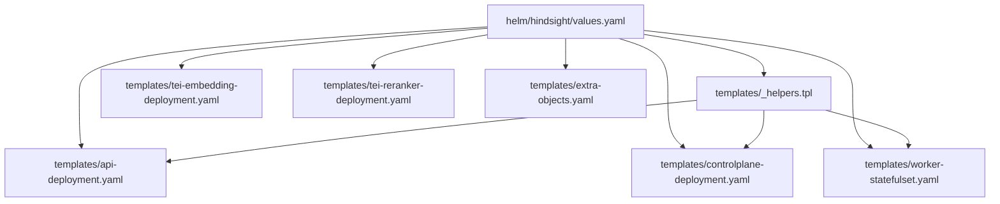
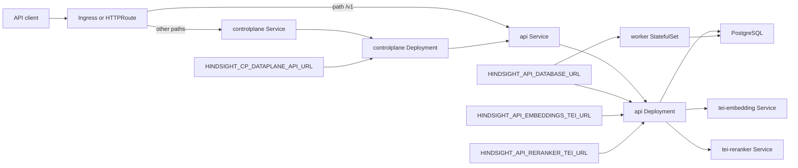
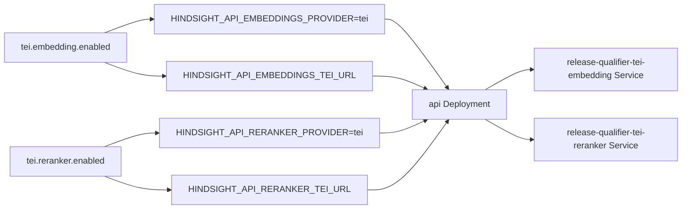
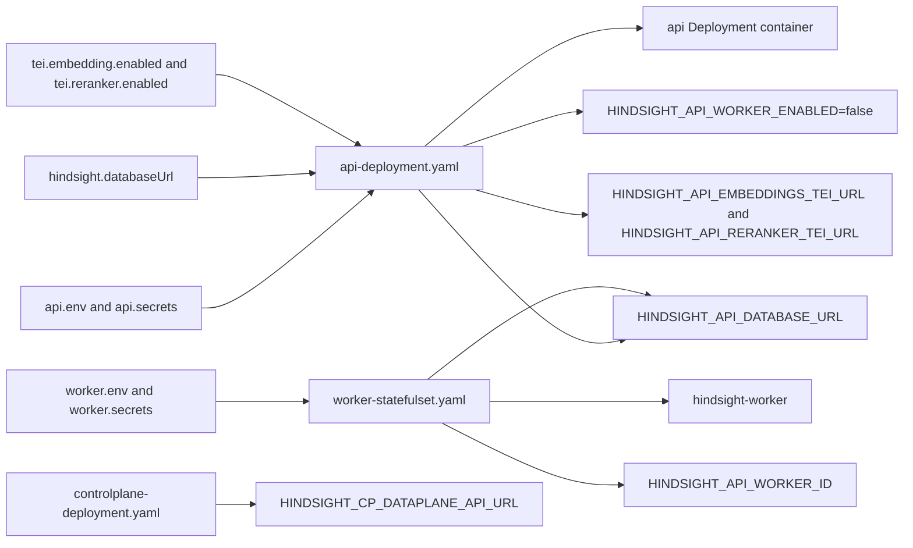

<!-- source: DeepWiki mcp.deepwiki.com · repo vectorize-io/hindsight · page 7.2 Kubernetes and Helm · fetched 2026-10-26 -->

# Kubernetes and Helm

<details>
<summary>Relevant source files</summary>

The following files were used as context for generating this wiki page:

- [helm/hindsight/README.md](helm/hindsight/README.md)
- [helm/hindsight/templates/_helpers.tpl](helm/hindsight/templates/_helpers.tpl)
- [helm/hindsight/templates/api-deployment.yaml](helm/hindsight/templates/api-deployment.yaml)
- [helm/hindsight/templates/controlplane-deployment.yaml](helm/hindsight/templates/controlplane-deployment.yaml)
- [helm/hindsight/templates/extra-objects.yaml](helm/hindsight/templates/extra-objects.yaml)
- [helm/hindsight/templates/httproute.yaml](helm/hindsight/templates/httproute.yaml)
- [helm/hindsight/templates/postgresql-statefulset.yaml](helm/hindsight/templates/postgresql-statefulset.yaml)
- [helm/hindsight/templates/tei-embedding-deployment.yaml](helm/hindsight/templates/tei-embedding-deployment.yaml)
- [helm/hindsight/templates/tei-reranker-deployment.yaml](helm/hindsight/templates/tei-reranker-deployment.yaml)
- [helm/hindsight/templates/worker-statefulset.yaml](helm/hindsight/templates/worker-statefulset.yaml)
- [helm/hindsight/values.yaml](helm/hindsight/values.yaml)

</details>


## Purpose and scope

This page documents Kubernetes deployment through the Helm chart in `helm/hindsight/`: installation, configuration, separate API, Control Plane, and optional Worker workloads, TEI embedding and reranker services, model-cache storage, metrics scraping, secrets, and production considerations. [helm/hindsight/README.md:1-9]()

For Docker-based deployment, see [7.1 Docker Deployment](). For installation options, see [2.1 Installation](). For environment-variable details, see [7.3 Configuration Reference]().

Sources: [helm/hindsight/README.md:1-9]()

---

## Overview

The Helm chart supports separate API and Control Plane workloads, with an optional dedicated Worker workload for distributed task processing. PostgreSQL can be deployed with the chart or configured as an external database. TEI embedding and reranker deployments are optional. [helm/hindsight/README.md:5-9](), [helm/hindsight/README.md:65-88](), [helm/hindsight/values.yaml:135-148]()

The chart also exposes configuration for resource requests and limits, health probes, model-cache persistence, extra containers and init containers, and Prometheus Operator ServiceMonitors. [helm/hindsight/values.yaml:31-63](), [helm/hindsight/values.yaml:74-123](), [helm/hindsight/README.md:196-212]()

Sources: [helm/hindsight/README.md:5-9](), [helm/hindsight/README.md:65-88](), [helm/hindsight/README.md:196-212](), [helm/hindsight/values.yaml:31-63](), [helm/hindsight/values.yaml:74-123](), [helm/hindsight/values.yaml:135-148]()

---

## Helm Chart Architecture

### Chart Structure and Templates

The chart’s `values.yaml` supplies settings consumed by templates. Helpers in `_helpers.tpl` derive resource names, labels, database URLs, API URLs, secret names, and revision-history settings. [helm/hindsight/values.yaml:1-16](), [helm/hindsight/templates/_helpers.tpl:1-40](), [helm/hindsight/templates/_helpers.tpl:110-127](), [helm/hindsight/templates/_helpers.tpl:162-183]()

**Diagram: Helm values and workload templates**



Sources: [helm/hindsight/values.yaml:1-16](), [helm/hindsight/templates/_helpers.tpl:1-40](), [helm/hindsight/templates/_helpers.tpl:110-127](), [helm/hindsight/templates/_helpers.tpl:162-183](), [helm/hindsight/templates/api-deployment.yaml:1-141](), [helm/hindsight/templates/controlplane-deployment.yaml:1-92](), [helm/hindsight/templates/worker-statefulset.yaml:1-152](), [helm/hindsight/templates/tei-embedding-deployment.yaml:1-79](), [helm/hindsight/templates/tei-reranker-deployment.yaml:1-79](), [helm/hindsight/templates/extra-objects.yaml:1-8]()

### Deployed Components and Workloads

The API is rendered as a Kubernetes `Deployment`; the Control Plane is a separate `Deployment`; and enabling `worker.enabled` renders the Worker as a `StatefulSet`. The API service defaults to port `8888`, the Worker metrics/health service port is `8889`, and the Control Plane service port is `3000`. [helm/hindsight/templates/api-deployment.yaml:1-18](), [helm/hindsight/templates/controlplane-deployment.yaml:1-18](), [helm/hindsight/templates/worker-statefulset.yaml:1-18](), [helm/hindsight/values.yaml:17-29](), [helm/hindsight/values.yaml:135-148](), [helm/hindsight/README.md:65-78]()

The Control Plane receives its dataplane URL through `HINDSIGHT_CP_DATAPLANE_API_URL`, constructed from the API service name and port. The API and Worker receive `HINDSIGHT_API_DATABASE_URL`; when dedicated Workers are enabled, the API’s internal Worker is disabled. [helm/hindsight/templates/controlplane-deployment.yaml:54-60](), [helm/hindsight/templates/api-deployment.yaml:63-69](), [helm/hindsight/templates/worker-statefulset.yaml:63-69](), [helm/hindsight/templates/_helpers.tpl:110-127]()

**Diagram: Kubernetes services and Hindsight runtime configuration**



Sources: [helm/hindsight/README.md:145-172](), [helm/hindsight/README.md:174-194](), [helm/hindsight/templates/api-deployment.yaml:63-87](), [helm/hindsight/templates/controlplane-deployment.yaml:54-60](), [helm/hindsight/templates/worker-statefulset.yaml:63-69](), [helm/hindsight/templates/_helpers.tpl:110-127]()

---

## Installation

### Chart Installation

The chart README lists Kubernetes 1.19+, Helm 3.0+, and a PostgreSQL database—external or bundled—as prerequisites. The quick start updates chart dependencies and installs the chart with PostgreSQL enabled by default, supplying an LLM API key through `api.secrets`. [helm/hindsight/README.md:5-20]()

```bash
helm dependency update ./helm/hindsight

export OPENAI_API_KEY="sk-your-openai-key"
helm upgrade hindsight --install ./helm/hindsight -n hindsight --create-namespace \
  --set api.secrets.HINDSIGHT_API_LLM_API_KEY="$OPENAI_API_KEY"
```

The chart can also be installed with a custom values file. [helm/hindsight/README.md:33-61]()

```bash
helm install hindsight ./helm/hindsight -n hindsight --create-namespace \
  -f values-override.yaml
```

### Using External PostgreSQL

To use an external database, disable the bundled PostgreSQL deployment and set its host and password. The chart’s database URL helper uses the external database username, host, port, and database name; the password is supplied through `POSTGRES_PASSWORD` when the bundled database is disabled. [helm/hindsight/README.md:23-31](), [helm/hindsight/README.md:109-122](), [helm/hindsight/templates/api-deployment.yaml:54-64](), [helm/hindsight/templates/worker-statefulset.yaml:54-64](), [helm/hindsight/templates/_helpers.tpl:110-121]()

```bash
helm install hindsight ./helm/hindsight -n hindsight --create-namespace \
  --set postgresql.enabled=false \
  --set postgresql.external.host="your-db-host" \
  --set postgresql.external.password="your-db-password" \
  --set api.secrets.HINDSIGHT_API_LLM_API_KEY="YOUR_LLM_API_KEY"
```

Sources: [helm/hindsight/README.md:5-31](), [helm/hindsight/README.md:33-61](), [helm/hindsight/README.md:109-122](), [helm/hindsight/templates/api-deployment.yaml:54-64](), [helm/hindsight/templates/worker-statefulset.yaml:54-64](), [helm/hindsight/templates/_helpers.tpl:110-121]()

---

## Configuration via values.yaml

### Key Configuration Sections

`values.yaml` configures workload enablement, replicas, images, services, resource requests and limits, probes, environment variables, secrets, and optional persistence. The README summarizes the principal chart values. [helm/hindsight/values.yaml:16-38](), [helm/hindsight/values.yaml:40-63](), [helm/hindsight/values.yaml:125-148](), [helm/hindsight/README.md:63-88]()

| Section | Key examples | Purpose |
|---|---|---|
| `api` | `enabled`, `replicaCount`, `image`, `service`, `resources`, `env`, `secrets` | API workload configuration. [helm/hindsight/values.yaml:16-38](), [helm/hindsight/values.yaml:125-133]() |
| `api.persistence.modelCache` | `enabled`, `size`, `storageClass`, `accessModes` | Optional API model-cache PVC configuration. [helm/hindsight/values.yaml:74-90]() |
| `controlPlane` | `enabled`, `image`, `service`, `env`, `secrets` | Control Plane deployment and service configuration. [helm/hindsight/README.md:73-78](), [helm/hindsight/templates/controlplane-deployment.yaml:39-76]() |
| `worker` | `enabled`, `replicaCount`, `env`, `persistence.modelCache` | Optional dedicated Worker configuration. [helm/hindsight/values.yaml:135-157](), [helm/hindsight/values.yaml:183-215]() |
| `tei.embedding`, `tei.reranker` | `enabled`, `model`, `port`, `replicaCount` | Optional TEI inference workloads. [helm/hindsight/templates/tei-embedding-deployment.yaml:1-60](), [helm/hindsight/templates/tei-reranker-deployment.yaml:1-60]() |
| `postgresql` | `enabled`, `external.host`, `external.port`, `external.database` | Bundled or external PostgreSQL configuration. [helm/hindsight/README.md:78-82](), [helm/hindsight/README.md:109-122]() |
| `metrics.serviceMonitor` | `enabled`, `labels` | ServiceMonitor configuration for Prometheus Operator discovery. [helm/hindsight/README.md:85-88](), [helm/hindsight/README.md:196-212]() |

Sources: [helm/hindsight/values.yaml:16-38](), [helm/hindsight/values.yaml:40-63](), [helm/hindsight/values.yaml:74-90](), [helm/hindsight/values.yaml:125-157](), [helm/hindsight/values.yaml:183-215](), [helm/hindsight/README.md:63-88](), [helm/hindsight/README.md:109-122]()

---

### Persistent Volume for Model Cache

The API and Worker can mount model-cache storage at `/home/hindsight/.cache`. The API’s model-cache PVC is optional; when enabled, its Deployment mounts a claim named from the release. The Worker is a StatefulSet and, when cache persistence is enabled, uses `volumeClaimTemplates` to request a claim per replica. [helm/hindsight/values.yaml:74-90](), [helm/hindsight/values.yaml:203-215](), [helm/hindsight/templates/api-deployment.yaml:105-128](), [helm/hindsight/templates/worker-statefulset.yaml:105-114](), [helm/hindsight/templates/worker-statefulset.yaml:134-151]()

The chart comments note that models are downloaded to `/home/hindsight/.cache` on first use and recommend considering a custom image with models baked in for production. The chart also calls out the storage cost and lifecycle implications of PVC-backed model caches, including `ReadWriteOnce` storage behavior. [helm/hindsight/values.yaml:74-82](), [helm/hindsight/values.yaml:203-207]()

Sources: [helm/hindsight/values.yaml:74-90](), [helm/hindsight/values.yaml:203-215](), [helm/hindsight/templates/api-deployment.yaml:105-128](), [helm/hindsight/templates/worker-statefulset.yaml:105-114](), [helm/hindsight/templates/worker-statefulset.yaml:134-151]()

---

## TEI Embedding and Reranker Services

The chart can deploy separate TEI embedding and reranker workloads. Each deployment starts its configured image with `--model-id` and `--hostname 0.0.0.0`, exposes its configured port, and mounts an `emptyDir` at `/data` for model cache storage. [helm/hindsight/templates/tei-embedding-deployment.yaml:30-66](), [helm/hindsight/templates/tei-reranker-deployment.yaml:30-66]()

When the corresponding TEI value is enabled, the API Deployment sets the provider to `tei` and configures the service URL using the release-qualified TEI service name and configured port. [helm/hindsight/templates/api-deployment.yaml:77-87]()

**Diagram: API-to-TEI configuration mapping**



Sources: [helm/hindsight/templates/api-deployment.yaml:77-87](), [helm/hindsight/templates/tei-embedding-deployment.yaml:30-66](), [helm/hindsight/templates/tei-reranker-deployment.yaml:30-66]()

---

## Secrets Management

### Chart-Managed Secrets

Sensitive values can be supplied under `api.secrets` and `controlPlane.secrets`; the README identifies these as the chart configuration locations for sensitive environment variables. The API and Control Plane templates use `secretKeyRef` entries for chart-managed secrets when `existingSecret` is not set. [helm/hindsight/README.md:90-107](), [helm/hindsight/templates/api-deployment.yaml:89-98](), [helm/hindsight/templates/controlplane-deployment.yaml:61-70]()

When an external PostgreSQL database is configured, the API and Worker templates obtain `POSTGRES_PASSWORD` from the chart’s selected secret, then use it in the database URL environment variable. [helm/hindsight/templates/api-deployment.yaml:54-64](), [helm/hindsight/templates/worker-statefulset.yaml:54-64]()

### Existing Secret Support

Set `existingSecret` to inject every key in a pre-created Kubernetes Secret into a workload through `envFrom`. The chart values describe the expected `postgres-password` key when using external PostgreSQL; other secret keys can be used as environment variables. [helm/hindsight/values.yaml:7-14](), [helm/hindsight/templates/api-deployment.yaml:49-53](), [helm/hindsight/templates/controlplane-deployment.yaml:49-53](), [helm/hindsight/templates/worker-statefulset.yaml:49-53]()

Sources: [helm/hindsight/README.md:90-107](), [helm/hindsight/values.yaml:7-14](), [helm/hindsight/templates/api-deployment.yaml:49-64](), [helm/hindsight/templates/api-deployment.yaml:89-98](), [helm/hindsight/templates/controlplane-deployment.yaml:49-70](), [helm/hindsight/templates/worker-statefulset.yaml:49-64]()

---

## Worker Pods and Background Processing

### Dedicated Workers

Dedicated Workers are disabled by default. When enabled, the chart renders a Worker `StatefulSet` with `worker.replicaCount` replicas and runs the `hindsight-worker` command. Each Worker receives a stable ID from its pod name through the Kubernetes `metadata.name` field reference. [helm/hindsight/values.yaml:135-148](), [helm/hindsight/templates/worker-statefulset.yaml:1-18](), [helm/hindsight/templates/worker-statefulset.yaml:38-47](), [helm/hindsight/templates/worker-statefulset.yaml:63-69]()

Worker-specific settings include polling interval, batch size, maximum retries, and the HTTP port for metrics and health endpoints. The defaults shown in `values.yaml` are `500` ms, `10`, `3`, and `8889`, respectively. [helm/hindsight/values.yaml:183-192]()

### Coordinated API and Worker Behavior

When `worker.enabled` is true, the API Deployment sets `HINDSIGHT_API_WORKER_ENABLED=false`, while the Worker receives the shared database URL. Worker environment settings are merged with API environment settings so Worker values can override matching API values; Worker secrets can likewise override API secrets. [helm/hindsight/templates/api-deployment.yaml:63-69](), [helm/hindsight/templates/worker-statefulset.yaml:63-98]()

The Worker’s liveness probe uses `/health/live`, while readiness uses `/health`. The chart comments explain that liveness avoids database access so a database slowdown does not restart the Worker and cause claimed operations to be requeued. [helm/hindsight/values.yaml:159-181]()

### Persistent Model Cache for Workers

Worker cache persistence is configured independently from API cache persistence. The Worker StatefulSet creates a claim template when `worker.persistence.modelCache.enabled` is true, with size, access modes, storage class, and annotations configurable in values. [helm/hindsight/values.yaml:203-215](), [helm/hindsight/templates/worker-statefulset.yaml:134-151]()

Sources: [helm/hindsight/values.yaml:135-148](), [helm/hindsight/values.yaml:159-192](), [helm/hindsight/values.yaml:203-215](), [helm/hindsight/templates/api-deployment.yaml:63-69](), [helm/hindsight/templates/worker-statefulset.yaml:1-18](), [helm/hindsight/templates/worker-statefulset.yaml:38-98](), [helm/hindsight/templates/worker-statefulset.yaml:134-151]()

---

## Prometheus Monitoring via ServiceMonitor

The API exposes Prometheus-format metrics on port `8888`, and the Worker exposes metrics on port `8889`; both use `/metrics`. The Control Plane does not expose metrics. [helm/hindsight/README.md:196-200]()

On clusters running Prometheus Operator, enable `metrics.serviceMonitor.enabled` and set labels matching the operator’s ServiceMonitor selector. The Worker monitor requires `worker.enabled: true`. Without the operator, the README gives the API and Worker service endpoints to scrape directly. [helm/hindsight/README.md:200-212]()

Sources: [helm/hindsight/README.md:196-212]()

---

## Production Best Practices

| Concern | Recommendation |
|---|---|
| Database | For production, consider an external PostgreSQL database rather than relying on the chart’s bundled database option. The chart supports disabling bundled PostgreSQL and specifying an external host and credentials. [helm/hindsight/README.md:23-31](), [helm/hindsight/README.md:109-122]() |
| Secrets | Put sensitive values in `api.secrets` or `controlPlane.secrets`, or use `existingSecret`; avoid putting credentials in ordinary environment-value configuration. [helm/hindsight/README.md:90-107](), [helm/hindsight/values.yaml:7-14]() |
| Health checks | Keep database-dependent checks in readiness rather than liveness. The API and Worker values document `/health/live` as database-independent and `/health` as database-checking readiness. [helm/hindsight/values.yaml:40-63](), [helm/hindsight/values.yaml:159-181]() |
| Model storage | Consider baking models into a custom image for production. The chart notes that PVCs add storage cost and lifecycle work, and that `ReadWriteOnce` storage can constrain pod placement. [helm/hindsight/values.yaml:74-82]() |
| Workload sizing | Tune CPU and memory requests and limits for API and Worker workloads using their independent resource settings. [helm/hindsight/values.yaml:31-38](), [helm/hindsight/values.yaml:150-157]() |
| Disruption and placement | Configure pod disruption budgets, affinity, node selectors, and tolerations where required by cluster availability and placement policies. [helm/hindsight/values.yaml:65-72](), [helm/hindsight/values.yaml:194-201](), [helm/hindsight/templates/api-deployment.yaml:129-140](), [helm/hindsight/templates/worker-statefulset.yaml:118-128]() |
| Metrics | Enable ServiceMonitor discovery when using Prometheus Operator, with labels matching its selector. [helm/hindsight/README.md:200-212]() |
| Image versions | Use the chart’s global `version` or component image tags to control image versions; the README describes `version` as the default image tag for components. [helm/hindsight/README.md:65-78]() |

The chart supports optional pod disruption budgets and per-component overrides for revision history limits. Configure these according to deployment and rollback requirements. [helm/hindsight/values.yaml:65-69](), [helm/hindsight/README.md:85-85](), [helm/hindsight/templates/_helpers.tpl:173-183]()

Sources: [helm/hindsight/README.md:23-31](), [helm/hindsight/README.md:65-78](), [helm/hindsight/README.md:85-85](), [helm/hindsight/README.md:90-122](), [helm/hindsight/README.md:200-212](), [helm/hindsight/values.yaml:31-82](), [helm/hindsight/values.yaml:150-201](), [helm/hindsight/templates/api-deployment.yaml:129-140](), [helm/hindsight/templates/worker-statefulset.yaml:118-128](), [helm/hindsight/templates/_helpers.tpl:173-183]()

---

## Implementation Mapping: Kubernetes Entities to Code Entities

This diagram maps workload names and Helm values to the environment variables emitted by the chart templates. [helm/hindsight/templates/api-deployment.yaml:63-98](), [helm/hindsight/templates/controlplane-deployment.yaml:54-70](), [helm/hindsight/templates/worker-statefulset.yaml:63-98]()

**Diagram: Helm configuration to container environment**



Sources: [helm/hindsight/templates/api-deployment.yaml:63-98](), [helm/hindsight/templates/worker-statefulset.yaml:38-98](), [helm/hindsight/templates/controlplane-deployment.yaml:54-70](), [helm/hindsight/templates/_helpers.tpl:110-127]()

---

## Summary

The Helm chart separates the API and Control Plane and can optionally run dedicated Worker, TEI embedding, and TEI reranker workloads. It supports bundled or external PostgreSQL configuration, chart-managed or pre-existing secrets, optional model-cache persistence, health probes, and Prometheus Operator ServiceMonitor discovery. [helm/hindsight/README.md:65-88](), [helm/hindsight/values.yaml:74-90](), [helm/hindsight/values.yaml:135-192](), [helm/hindsight/README.md:196-212]()

For production, review the database deployment choice, secret handling, resource sizing, health checks, model-cache strategy, and monitoring configuration against the target cluster. [helm/hindsight/README.md:90-122](), [helm/hindsight/values.yaml:31-82](), [helm/hindsight/README.md:196-212]()

Sources: [helm/hindsight/README.md:65-88](), [helm/hindsight/README.md:90-122](), [helm/hindsight/README.md:196-212](), [helm/hindsight/values.yaml:31-82](), [helm/hindsight/values.yaml:135-192]()

---

