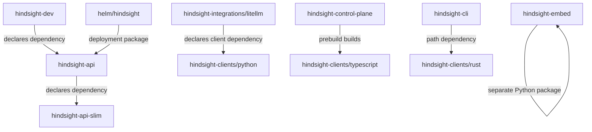
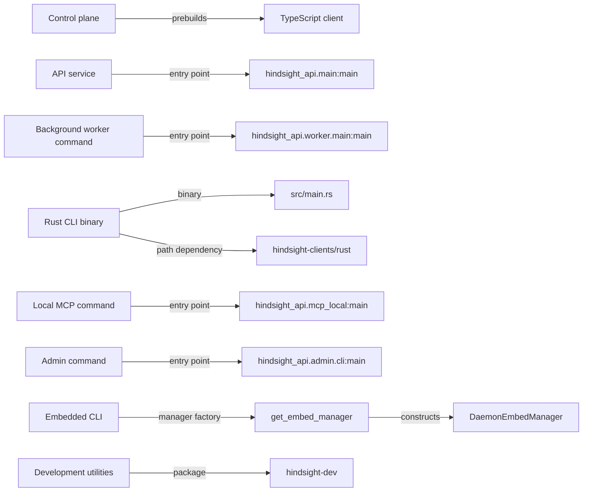
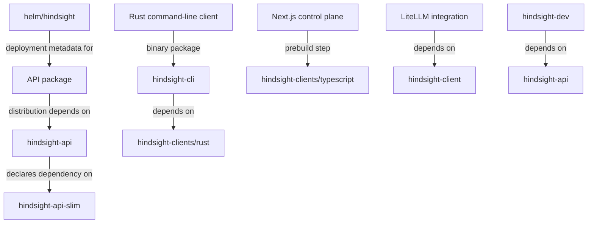

<!-- source: DeepWiki mcp.deepwiki.com · repo vectorize-io/hindsight · page 8.1 Project Structure · fetched 2026-10-26 -->

# Project Structure

Relevant source files

The following files were used as context for generating this wiki page:

- [helm/hindsight/Chart.yaml](helm/hindsight/Chart.yaml)
- [hindsight-api/pyproject.toml](hindsight-api/pyproject.toml)
- [hindsight-cli/Cargo.toml](hindsight-cli/Cargo.toml)
- [hindsight-clients/python/pyproject.toml](hindsight-clients/python/pyproject.toml)
- [hindsight-clients/typescript/package.json](hindsight-clients/typescript/package.json)
- [hindsight-control-plane/package.json](hindsight-control-plane/package.json)
- [hindsight-dev/pyproject.toml](hindsight-dev/pyproject.toml)
- [hindsight-embed/hindsight_embed/__init__.py](hindsight-embed/hindsight_embed/__init__.py)
- [hindsight-embed/pyproject.toml](hindsight-embed/pyproject.toml)
- [hindsight-integrations/litellm/pyproject.toml](hindsight-integrations/litellm/pyproject.toml)

## Purpose and scope

This page maps the repository components evidenced by the supplied package metadata: the Python API packages and development tools, Python and TypeScript clients, the Rust CLI and its client dependency, the control plane, the embedded CLI, an integration package, and the Helm chart. It focuses on package boundaries and declared dependencies; the supplied files do not expose the complete repository tree or implementation-level call flows. [hindsight-api/pyproject.toml:5-26]() [hindsight-dev/pyproject.toml:5-47]() [hindsight-clients/python/pyproject.toml:1-33]() [hindsight-clients/typescript/package.json:1-21]() [hindsight-cli/Cargo.toml:1-25]() [hindsight-control-plane/package.json:1-23]() [hindsight-embed/pyproject.toml:5-23]() [hindsight-integrations/litellm/pyproject.toml:1-36]() [helm/hindsight/Chart.yaml:1-13]()

Sources: [hindsight-api/pyproject.toml:5-26]() [hindsight-dev/pyproject.toml:5-47]() [hindsight-clients/python/pyproject.toml:1-33]() [hindsight-clients/typescript/package.json:1-21]() [hindsight-cli/Cargo.toml:1-25]() [hindsight-control-plane/package.json:1-23]() [hindsight-embed/pyproject.toml:5-23]() [hindsight-integrations/litellm/pyproject.toml:1-36]() [helm/hindsight/Chart.yaml:1-13]()

---

## Monorepo overview

The supplied package definitions show a polyglot repository with Python, TypeScript/JavaScript, and Rust packages, plus Helm packaging. The Python API distribution, `hindsight-api`, declares a dependency on `hindsight-api-slim[all]` at the matching version and defines server, worker, local MCP, and admin command-line entry points. [hindsight-api/pyproject.toml:5-23]()

The Python client package publishes both `hindsight_client` and `hindsight_client_api`; the TypeScript client is published as `@vectorize-io/hindsight-client` and defines build, generation, and test scripts. The Rust CLI depends on the local Rust client crate at `../hindsight-clients/rust`. [hindsight-clients/python/pyproject.toml:1-33]() [hindsight-clients/typescript/package.json:1-21]() [hindsight-cli/Cargo.toml:9-25]()

The control plane is a Next.js package whose build runs the TypeScript client build first. `hindsight-embed` is a separate Python distribution with a `hindsight-embed` executable and bundled control-center static assets. The Helm chart is identified as an application chart named `hindsight`. [hindsight-control-plane/package.json:13-23]() [hindsight-embed/pyproject.toml:5-23]() [helm/hindsight/Chart.yaml:1-6]()

Sources: [hindsight-api/pyproject.toml:5-23]() [hindsight-clients/python/pyproject.toml:1-33]() [hindsight-clients/typescript/package.json:1-21]() [hindsight-cli/Cargo.toml:9-25]() [hindsight-control-plane/package.json:13-23]() [hindsight-embed/pyproject.toml:5-23]() [helm/hindsight/Chart.yaml:1-6]()

### Package relationship map

The diagram distinguishes declared package dependencies and build ordering from higher-level architectural relationships. In particular, the supplied metadata confirms that the control plane builds the TypeScript client, and that the Rust CLI uses the local Rust client crate. [hindsight-control-plane/package.json:13-17]() [hindsight-cli/Cargo.toml:13-25]()

**Diagram: Declared package and build relationships**

The self-reference-style presentation for `hindsight-embed` is not a dependency edge; it is shown as a standalone package. The chart and API relationship is a deployment-oriented map, not a dependency declared in the chart metadata. The integration-to-client edge is explicitly declared by the LiteLLM package. [hindsight-embed/pyproject.toml:5-23]() [helm/hindsight/Chart.yaml:1-6]() [hindsight-integrations/litellm/pyproject.toml:35-36]()

Sources: [hindsight-control-plane/package.json:13-17]() [hindsight-cli/Cargo.toml:13-25]() [hindsight-api/pyproject.toml:5-17]() [hindsight-dev/pyproject.toml:5-30]() [hindsight-embed/pyproject.toml:5-23]() [helm/hindsight/Chart.yaml:1-6]() [hindsight-integrations/litellm/pyproject.toml:35-36]()

---

## Core API packages and developer tooling

### `hindsight-api-slim` and `hindsight-api`

`hindsight-api` is a Python distribution requiring Python 3.11 or newer. Its declared runtime dependency is `hindsight-api-slim[all]==1.1.0`, and its `uv` source configuration resolves that dependency from the workspace. This establishes the package dependency direction: the full API package depends on the slim package. The supplied metadata does not detail the slim package’s internal modules or explain the individual features selected by the `all` extra. [hindsight-api/pyproject.toml:5-17]()

The full package registers four executable entry points: `hindsight-api` maps to `hindsight_api.main:main`, `hindsight-worker` to `hindsight_api.worker.main:main`, `hindsight-local-mcp` to `hindsight_api.mcp_local:main`, and `hindsight-admin` to `hindsight_api.admin.cli:main`. These are package entry points; the supplied files do not show their implementations or the runtime call paths between them. [hindsight-api/pyproject.toml:19-23]()

Sources: [hindsight-api/pyproject.toml:5-23]()

### `hindsight-dev`

`hindsight-dev` is a Python development-utilities package requiring Python 3.11 or newer. It depends on `hindsight-api==1.1.0`, resolved from the workspace, and packages `hindsight_dev`, `benchmarks`, and `upgrade_tests`. [hindsight-dev/pyproject.toml:5-17] [hindsight-dev/pyproject.toml:26-30]()

Its registered commands include OpenAPI and bank-template-schema generation, changelog generation, cookbook synchronization, full-LLM documentation generation, compatibility and coverage checks, performance and micro-benchmark commands, and duplicate-observation discovery. The project configures Ruff and a Python 3.11 type-checking environment. [hindsight-dev/pyproject.toml:32-47] [hindsight-dev/pyproject.toml:55-98]()

Sources: [hindsight-dev/pyproject.toml:5-17]() [hindsight-dev/pyproject.toml:26-47]() [hindsight-dev/pyproject.toml:55-98]()

---

## Client SDKs and integrations

### Client packages

The Python client distribution is named `hindsight-client`, supports Python 3.10 or newer, and packages both `hindsight_client` and `hindsight_client_api`. Its declared dependencies include HTTP libraries, Pydantic, and typing support. The supplied metadata does not identify specific wrapper classes or enumerate the SDK’s operations. [hindsight-clients/python/pyproject.toml:1-19] [hindsight-clients/python/pyproject.toml:28-33]()

The TypeScript client is published as `@vectorize-io/hindsight-client`. Its package exports compiled JavaScript module and type-definition paths under `dist`; `build` uses `tsup`, while `generate` invokes `@hey-api/openapi-ts`. The package includes `src`, `generated`, `dist`, and its README in its published file list. [hindsight-clients/typescript/package.json:1-21] [hindsight-clients/typescript/package.json:46-51]()

The Rust CLI’s manifest declares a path dependency on `hindsight-clients/rust`, identifying that local crate as the client dependency used by the CLI. The supplied Rust client manifest itself was not included, so its generation method and public API cannot be established here. [hindsight-cli/Cargo.toml:13-16]()

Sources: [hindsight-clients/python/pyproject.toml:1-33]() [hindsight-clients/typescript/package.json:1-21]() [hindsight-clients/typescript/package.json:46-51]() [hindsight-cli/Cargo.toml:13-16]()

### Integration package example

The supplied integration metadata covers `hindsight-integrations/litellm`, distributed as `hindsight-litellm`. Its description identifies it as a LiteLLM-based memory integration, and its dependencies include `hindsight-client` and LiteLLM. The manifest does not enumerate the other integrations in the repository, so the total integration count and the names of additional packages are not established by these files. [hindsight-integrations/litellm/pyproject.toml:1-5] [hindsight-integrations/litellm/pyproject.toml:35-43]()

Sources: [hindsight-integrations/litellm/pyproject.toml:1-5]() [hindsight-integrations/litellm/pyproject.toml:35-43]()

---

## Control plane and local embedded CLI

### `hindsight-control-plane`

The control plane package is named `@vectorize-io/hindsight-control-plane`. Its scripts provide a Next.js development server, production build, standalone build, start, lint, test, and i18n-check commands. The `prebuild` script builds the local TypeScript client package before the control-plane build. [hindsight-control-plane/package.json:1-23]()

The package declares Next.js, React, and `next-intl` dependencies, among others. Its standalone build script copies the built server, dependencies, static assets, and public assets into a `standalone` directory. [hindsight-control-plane/package.json:33-75] [hindsight-control-plane/package.json:13-18]()

Sources: [hindsight-control-plane/package.json:1-23]() [hindsight-control-plane/package.json:33-75]()

### `hindsight-embed`

`hindsight-embed` is a separate Python distribution requiring Python 3.11 or newer. Its project script maps the `hindsight-embed` command to `hindsight_embed.cli:main`. The package configuration includes static control-center assets in the wheel. [hindsight-embed/pyproject.toml:5-23]()

The package initializer exports `EmbedManager` and `DaemonEmbedManager`; `get_embed_manager()` constructs and returns a `DaemonEmbedManager`. This is the available implementation-level entry point in the supplied files. [hindsight-embed/hindsight_embed/__init__.py:1-16]()

Sources: [hindsight-embed/pyproject.toml:5-23]() [hindsight-embed/hindsight_embed/__init__.py:1-16]()

---

## Rust CLI

The Rust package is named `hindsight-cli` and builds the `hindsight` binary from `src/main.rs`. Its manifest declares the local Rust client dependency, Tokio as the async runtime, `clap` for command-line parsing, and TUI dependencies including `ratatui` and `crossterm`. [hindsight-cli/Cargo.toml:1-25] [hindsight-cli/Cargo.toml:32-38]()

The manifest also declares serialization, error-handling, filesystem, and terminal-related dependencies. It does not include the CLI source, so command names, configuration paths, and behavioral details are outside the evidence available for this page. [hindsight-cli/Cargo.toml:27-53]()

Sources: [hindsight-cli/Cargo.toml:1-53]()

---

## Distribution and deployment metadata

The supplied Helm metadata defines an application chart named `hindsight`, with chart version and application version both set to `1.1.0`. The chart metadata identifies the package but does not provide its workloads, values, or deployment dependencies. [helm/hindsight/Chart.yaml:1-13]()

The package manifests show version `1.1.0` for the API, development utilities, Python client, TypeScript client, CLI, and embedded CLI; the control plane and Helm chart also declare `1.1.0`. The LiteLLM integration manifest declares version `0.5.4`, so versions are not uniform across every package represented here. [hindsight-api/pyproject.toml:5-8] [hindsight-dev/pyproject.toml:5-8] [hindsight-clients/python/pyproject.toml:1-4] [hindsight-clients/typescript/package.json:1-4] [hindsight-cli/Cargo.toml:1-4] [hindsight-control-plane/package.json:1-4] [hindsight-embed/pyproject.toml:5-8] [helm/hindsight/Chart.yaml:1-6] [hindsight-integrations/litellm/pyproject.toml:1-4]()

Sources: [helm/hindsight/Chart.yaml:1-13]() [hindsight-api/pyproject.toml:5-8]() [hindsight-dev/pyproject.toml:5-8]() [hindsight-clients/python/pyproject.toml:1-4]() [hindsight-clients/typescript/package.json:1-4]() [hindsight-cli/Cargo.toml:1-4]() [hindsight-control-plane/package.json:1-4]() [hindsight-embed/pyproject.toml:5-8]() [hindsight-integrations/litellm/pyproject.toml:1-4]()

---

## Package reference

| Package | Language or packaging | Role evidenced by supplied files | Declared relationship or entry point |
|---|---|---|---|
| `hindsight-api-slim` | Python | Dependency of the full API package | `hindsight-api` depends on `hindsight-api-slim[all]` [hindsight-api/pyproject.toml:12-17]() |
| `hindsight-api` | Python | API distribution with server, worker, MCP, and admin commands | `hindsight_api.main:main`, `hindsight_api.worker.main:main`, `hindsight_api.mcp_local:main`, `hindsight_api.admin.cli:main` [hindsight-api/pyproject.toml:19-23]() |
| `hindsight-dev` | Python | Development utilities, generators, benchmarks, and checks | Depends on `hindsight-api`; registers development commands [hindsight-dev/pyproject.toml:10-17]() [hindsight-dev/pyproject.toml:32-47]() |
| `hindsight-clients/python` | Python | Python client distribution | Packages `hindsight_client` and `hindsight_client_api` [hindsight-clients/python/pyproject.toml:1-4]() [hindsight-clients/python/pyproject.toml:28-33]() |
| `hindsight-clients/typescript` | TypeScript | TypeScript/JavaScript client distribution | `@vectorize-io/hindsight-client`; generation and build scripts [hindsight-clients/typescript/package.json:1-21]() |
| `hindsight-clients/rust` | Rust | Local client crate used by the CLI | Path dependency in `hindsight-cli` [hindsight-cli/Cargo.toml:13-16]() |
| `hindsight-cli` | Rust | `hindsight` command-line binary | Binary entry file `src/main.rs` [hindsight-cli/Cargo.toml:9-11]() |
| `hindsight-control-plane` | TypeScript/React | Next.js control-plane package | Builds the local TypeScript client before its own build [hindsight-control-plane/package.json:13-17]() |
| `hindsight-embed` | Python | Embedded CLI distribution with bundled control-center assets | `hindsight_embed.cli:main`; exports manager classes [hindsight-embed/pyproject.toml:17-23]() [hindsight-embed/hindsight_embed/__init__.py:1-16]() |
| `hindsight-integrations/litellm` | Python | LiteLLM integration package | Depends on `hindsight-client` and LiteLLM [hindsight-integrations/litellm/pyproject.toml:1-5]() [hindsight-integrations/litellm/pyproject.toml:35-43]() |
| `helm/hindsight` | Helm | Kubernetes application chart metadata | Chart and app version `1.1.0` [helm/hindsight/Chart.yaml:1-6]() |

Sources: [hindsight-api/pyproject.toml:5-23]() [hindsight-dev/pyproject.toml:5-47]() [hindsight-clients/python/pyproject.toml:1-33]() [hindsight-clients/typescript/package.json:1-21]() [hindsight-cli/Cargo.toml:9-25]() [hindsight-control-plane/package.json:13-23]() [hindsight-embed/pyproject.toml:5-23]() [hindsight-integrations/litellm/pyproject.toml:1-43]() [helm/hindsight/Chart.yaml:1-6]()

---

## Natural-language systems mapped to code entities

This view associates system-level concepts with concrete package and symbol names present in the supplied metadata. It does not imply unprovided runtime call relationships. [hindsight-api/pyproject.toml:19-23]() [hindsight-embed/hindsight_embed/__init__.py:3-16]() [hindsight-cli/Cargo.toml:9-16]() [hindsight-control-plane/package.json:1-18]()

**Diagram: System concepts and package symbols**

Sources: [hindsight-api/pyproject.toml:19-23]() [hindsight-embed/hindsight_embed/__init__.py:3-16]() [hindsight-cli/Cargo.toml:9-16]() [hindsight-control-plane/package.json:13-17]() [hindsight-dev/pyproject.toml:5-17]()

---

## Natural-language package flow and declared edges

The diagram below bridges user-facing package roles to repository entities while marking only metadata-backed dependency or build relationships. The supplied files do not identify a database request flow, API route names, or server-to-worker dispatch behavior, so those runtime edges are intentionally omitted. [hindsight-api/pyproject.toml:12-23]() [hindsight-control-plane/package.json:13-17]() [hindsight-cli/Cargo.toml:13-25]() [hindsight-integrations/litellm/pyproject.toml:35-43]()

**Diagram: Package roles and supported interdependencies**

The chart-to-API association indicates the chart’s product context, not a dependency declared in `Chart.yaml`; the metadata supplied for the chart contains chart identity and version fields only. [helm/hindsight/Chart.yaml:1-13]()

Sources: [hindsight-api/pyproject.toml:5-23]() [hindsight-cli/Cargo.toml:9-25]() [hindsight-control-plane/package.json:13-17]() [hindsight-integrations/litellm/pyproject.toml:35-43]() [hindsight-dev/pyproject.toml:5-17]() [helm/hindsight/Chart.yaml:1-13]()

---

