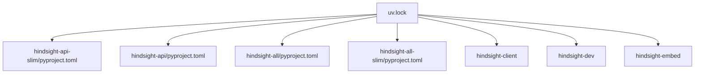
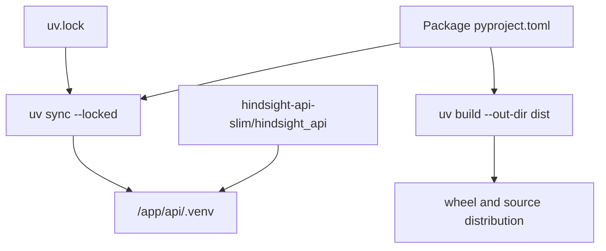
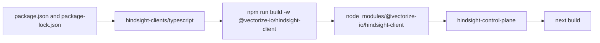
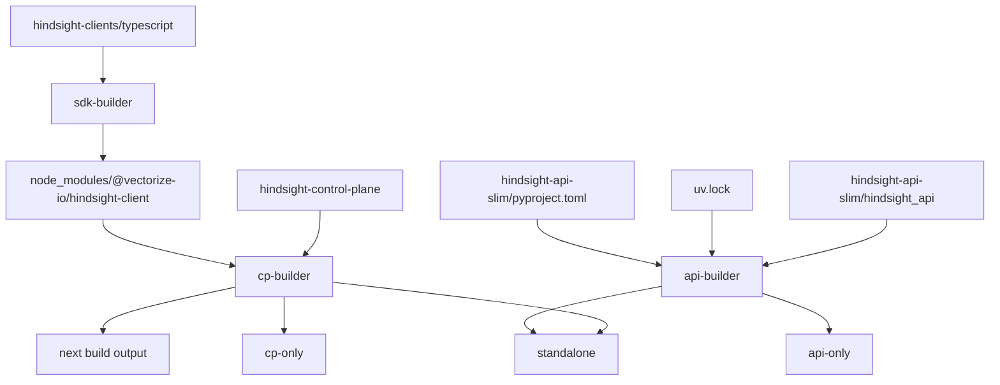
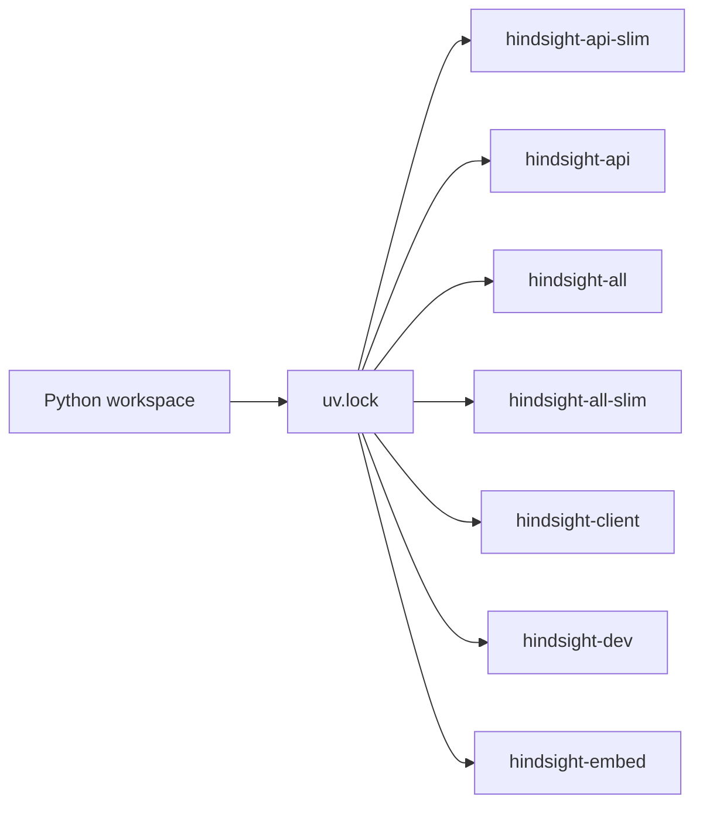
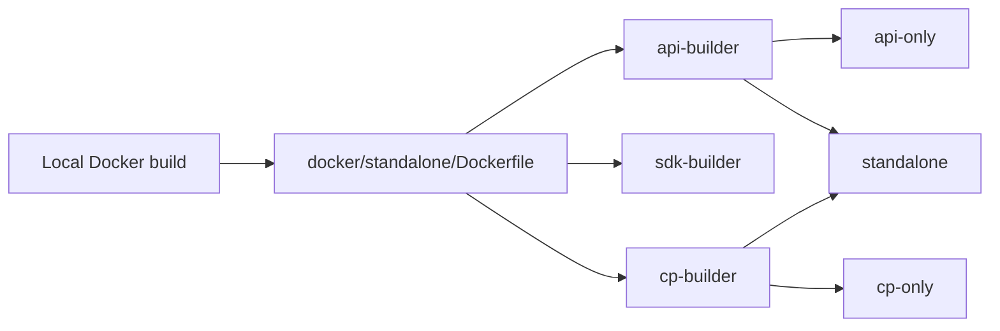

<!-- source: DeepWiki mcp.deepwiki.com · repo vectorize-io/hindsight · page 8.2 Building from Source · fetched 2026-10-26 -->

# Building from Source

Relevant source files

The following files were used as context for generating this wiki page:

- [.github/workflows/deploy-docs.yml](.github/workflows/deploy-docs.yml)
- [.github/workflows/release.yml](.github/workflows/release.yml)
- [.github/workflows/security-scan.yml](.github/workflows/security-scan.yml)
- [.github/workflows/test.yml](.github/workflows/test.yml)
- [docker/standalone/Dockerfile](docker/standalone/Dockerfile)
- [docker/test-image.sh](docker/test-image.sh)
- [docker/test-slim-local.sh](docker/test-slim-local.sh)
- [hindsight-api-slim/pyproject.toml](hindsight-api-slim/pyproject.toml)
- [hindsight-dev/hindsight_dev/generate_changelog.py](hindsight-dev/hindsight_dev/generate_changelog.py)
- [hindsight-docs/plugins/github-stars/index.js](hindsight-docs/plugins/github-stars/index.js)
- [hindsight-docs/src/components/HomeBenchmarks.module.css](hindsight-docs/src/components/HomeBenchmarks.module.css)
- [hindsight-docs/src/components/useGitHubStars.ts](hindsight-docs/src/components/useGitHubStars.ts)
- [hindsight-docs/src/data/integrations.json](hindsight-docs/src/data/integrations.json)
- [hindsight-integration-tests/pyproject.toml](hindsight-integration-tests/pyproject.toml)
- [hindsight-integration-tests/uv.lock](hindsight-integration-tests/uv.lock)
- [hindsight-integrations/ag2/uv.lock](hindsight-integrations/ag2/uv.lock)
- [hindsight-integrations/agentcore/uv.lock](hindsight-integrations/agentcore/uv.lock)
- [hindsight-integrations/agno/uv.lock](hindsight-integrations/agno/uv.lock)
- [hindsight-integrations/autogen/uv.lock](hindsight-integrations/autogen/uv.lock)
- [hindsight-integrations/crewai/pyproject.toml](hindsight-integrations/crewai/pyproject.toml)
- [hindsight-integrations/crewai/uv.lock](hindsight-integrations/crewai/uv.lock)
- [hindsight-integrations/dify/uv.lock](hindsight-integrations/dify/uv.lock)
- [hindsight-integrations/langgraph/uv.lock](hindsight-integrations/langgraph/uv.lock)
- [hindsight-integrations/llamaindex/uv.lock](hindsight-integrations/llamaindex/uv.lock)
- [hindsight-integrations/openai-agents/uv.lock](hindsight-integrations/openai-agents/uv.lock)
- [hindsight-integrations/pipecat/uv.lock](hindsight-integrations/pipecat/uv.lock)
- [hindsight-integrations/pydantic-ai/uv.lock](hindsight-integrations/pydantic-ai/uv.lock)
- [hindsight-integrations/smolagents/uv.lock](hindsight-integrations/smolagents/uv.lock)
- [hindsight-integrations/strands/uv.lock](hindsight-integrations/strands/uv.lock)
- [scripts/release-integration.sh](scripts/release-integration.sh)
- [scripts/smoke-test-slim.sh](scripts/smoke-test-slim.sh)
- [uv.lock](uv.lock)

## Purpose and scope

This page describes the build surfaces supported by the repository: the shared Python `uv` workspace, npm workspace builds used for the TypeScript SDK and Docker Control Plane image, Rust CLI builds, contributor scripts and lint checks, and local Docker image targets. The checked-in Python lockfile requires Python 3.11 or newer and lists the workspace members; the Dockerfile shows how the API and Control Plane build stages consume those packages. [uv.lock:1-28](), [docker/standalone/Dockerfile:47-83](), [docker/standalone/Dockerfile:88-132]()

Sources: [uv.lock:1-28](), [docker/standalone/Dockerfile:47-83](), [docker/standalone/Dockerfile:88-132]()

## Build-system overview

Hindsight uses different tools for different parts of the repository. `uv` manages the Python workspace and its lockfile; npm installs and builds the TypeScript SDK and is used in the Control Plane Docker build; Rust components use Cargo. The CI workflow separates checks by changed paths, including core, TypeScript client, CLI, Docker, and other component categories. [uv.lock:19-29](), [docker/standalone/Dockerfile:47-70](), [docker/standalone/Dockerfile:88-98](), [.github/workflows/test.yml:19-33]()

| Build surface | Tooling and role |
|---|---|
| Python packages | Root `uv.lock` defines workspace members, including `hindsight-api-slim`, `hindsight-api`, `hindsight-all`, `hindsight-all-slim`, `hindsight-client`, `hindsight-dev`, and `hindsight-embed`. [uv.lock:19-28]() |
| TypeScript SDK | The Docker SDK build installs and builds the `@vectorize-io/hindsight-client` npm workspace. [.github/workflows/release.yml:143-155](), [docker/standalone/Dockerfile:88-98]() |
| Rust CLI | The CLI build tool is Cargo; the supplied CI workflow identifies CLI as a separately filtered component. [.github/workflows/test.yml:26-33]() |
| Docker images | `docker/standalone/Dockerfile` defines API-only, Control Plane-only, and combined standalone build targets. [docker/standalone/Dockerfile:1-22]() |

Sources: [uv.lock:19-28](), [.github/workflows/release.yml:143-155](), [.github/workflows/test.yml:26-33](), [docker/standalone/Dockerfile:1-22]()

## Python builds with `uv`

### Workspace and lockfile

The root `uv.lock` declares a workspace with seven members: `hindsight-all`, `hindsight-all-slim`, `hindsight-api`, `hindsight-api-slim`, `hindsight-client`, `hindsight-dev`, and `hindsight-embed`. The lockfile specifies Python `>=3.11`, so local environments should use a compatible interpreter. [uv.lock:1-3](), [uv.lock:19-29]()

The core `hindsight-api-slim` project uses Hatchling as its build backend and declares its runtime requirements in `hindsight-api-slim/pyproject.toml`. Its optional `local-ml` dependencies are separate from the core dependency list, allowing a build environment to include local model support when needed. [hindsight-api-slim/pyproject.toml:1-7](), [hindsight-api-slim/pyproject.toml:109-118]()

**Diagram: Python workspace names mapped to package manifests**

Sources: [uv.lock:1-29](), [hindsight-api-slim/pyproject.toml:1-7]()

### Building and syncing packages

The release workflow builds each Python distribution from its package directory using `uv build --out-dir dist`. Before building, it stages the repository license in each isolated package directory; after building, it verifies that the wheel and source distribution include license metadata and the license file. [ .github/workflows/release.yml:28-40](), [.github/workflows/release.yml:42-83]()

The root lockfile is also used for dependency installation in the Docker API builder. That stage copies the root `pyproject.toml` and `uv.lock`, then copies member metadata before source. It runs `uv sync --locked` for `hindsight-api-slim`, optionally enabling `local-ml`, and performs a second sync after copying the API source so the local package is installed. A final `uv pip check` validates the resulting environment. [docker/standalone/Dockerfile:47-83]()

For local development, use the root workspace lockfile as the dependency source of truth. Avoid treating integration-specific lockfiles as replacements for the root lockfile: the CI change filters explicitly distinguish the root `uv.lock` from integration lockfiles. [.github/workflows/test.yml:104-117]()

Sources: [.github/workflows/release.yml:28-83](), [docker/standalone/Dockerfile:47-83](), [.github/workflows/test.yml:104-117]()

### Python package dependency and build flow

**Diagram: Python package build flow**

Sources: [uv.lock:19-29](), [docker/standalone/Dockerfile:47-83](), [.github/workflows/release.yml:42-65]()

## TypeScript builds with npm workspaces

### SDK build

The release workflow sets up Node.js 20, installs dependencies for the TypeScript client workspace with `npm ci --workspace=hindsight-clients/typescript`, and builds that workspace with `npm run build --workspace=hindsight-clients/typescript`. The Docker SDK builder performs the same install-and-build pattern using the workspace name `@vectorize-io/hindsight-client`. [ .github/workflows/release.yml:136-155](), [docker/standalone/Dockerfile:88-98]()

### Control Plane build in Docker

The Dockerfile builds the Control Plane separately from the SDK. It first builds the SDK in `sdk-builder`; the `cp-builder` stage installs Control Plane dependencies, copies the built SDK into `node_modules/@vectorize-io/hindsight-client`, and runs `next build`. This makes the SDK artifact an input to the Control Plane build without requiring the Control Plane stage to build the SDK itself. [docker/standalone/Dockerfile:86-98](), [docker/standalone/Dockerfile:101-132]()

**Diagram: TypeScript build entities and artifact flow**

Sources: [docker/standalone/Dockerfile:88-98](), [docker/standalone/Dockerfile:101-132](), [.github/workflows/release.yml:143-155]()

## Rust CLI builds with Cargo

Cargo is the build tool for the Rust CLI. The CI workflow tracks CLI changes separately, so CLI modifications can be identified independently from API, client, and Docker changes. The supplied file contents do not include the CLI manifest or its Cargo commands; consult the CLI package’s own `Cargo.toml` and contributor instructions for the exact working directory and supported build targets. [.github/workflows/test.yml:26-33]()

Sources: [.github/workflows/test.yml:26-33]()

## Contributor setup and smoke checks

The repository includes a setup script and a slim API smoke-test script, listed as `scripts/setup.sh` and `scripts/smoke-test-slim.sh`. The provided contents identify these files but do not show their implementations or command-line options. Check the scripts themselves before relying on specific setup side effects, prerequisites, or smoke-test coverage. [scripts/setup.sh](), [scripts/smoke-test-slim.sh]()

CI uses path-based change detection to select relevant suites. For example, changes under `hindsight-api-slim/**`, `hindsight-api/**`, or root Python workspace files such as `uv.lock` and `pyproject.toml` are categorized as core changes; TypeScript client and root npm manifest changes are categorized separately. [.github/workflows/test.yml:100-122]()

Sources: [scripts/setup.sh](), [scripts/smoke-test-slim.sh](), [.github/workflows/test.yml:100-122]()

## Linting and code-quality checks

The requested Ruff rule concerning banned synchronous HTTP calls is a project lint convention, but the supplied file contents do not include the Ruff configuration or the relevant lint command. The API package manifest does declare `httpx` as a dependency; that fact alone does not establish the exact lint rule or how CI enforces it. Check the repository’s Ruff configuration and lint workflow for the authoritative rule identifier and invocation. [hindsight-api-slim/pyproject.toml:37-40]()

Sources: [hindsight-api-slim/pyproject.toml:37-40]()

## Local Docker builds

### Targets and build arguments

`docker/standalone/Dockerfile` provides three targets: `standalone` (the default, with API and Control Plane), `api-only`, and `cp-only`. The Dockerfile documents two ML-related build arguments: `INCLUDE_LOCAL_MODELS`, which controls whether local ML dependencies are included, and `PRELOAD_ML_MODELS`, which controls model preloading when local models are enabled. It also accepts `NEXT_PUBLIC_BASE_PATH` for the Control Plane build. [docker/standalone/Dockerfile:1-25](), [docker/standalone/Dockerfile:126-132]()

| Target or argument | Purpose |
|---|---|
| `standalone` | Combined API and Control Plane image; default target. [docker/standalone/Dockerfile:4-9]() |
| `api-only` | API image; Docker builds only the stages required by this target. [docker/standalone/Dockerfile:4-9]() |
| `cp-only` | Control Plane image. [docker/standalone/Dockerfile:4-9]() |
| `INCLUDE_LOCAL_MODELS` | Selects whether the API dependency sync includes the `local-ml` extra. [docker/standalone/Dockerfile:11-15](), [docker/standalone/Dockerfile:60-70]() |
| `PRELOAD_ML_MODELS` | Controls model preloading; the Dockerfile documents it as effective only when local models are included. [docker/standalone/Dockerfile:11-15]() |
| `NEXT_PUBLIC_BASE_PATH` | Control Plane build argument for deployments behind a reverse-proxy base path. [docker/standalone/Dockerfile:126-128]() |

### Multi-stage build and artifact flow

The Docker build separates dependency and application work into stages. `api-builder` syncs the Python workspace dependencies and installs the API package; `sdk-builder` builds the TypeScript SDK; `cp-builder` builds the Control Plane and copies in the SDK. The selected final target determines which stages Docker needs to build. [docker/standalone/Dockerfile:4-9](), [docker/standalone/Dockerfile:27-83](), [docker/standalone/Dockerfile:85-132]()

**Diagram: Docker stages mapped to repository components**

Sources: [docker/standalone/Dockerfile:4-9](), [docker/standalone/Dockerfile:47-83](), [docker/standalone/Dockerfile:85-132]()

## Build workflow summary

| Component | Build tool | Repository evidence |
|---|---|---|
| Python workspace packages | `uv` | Root workspace members in `uv.lock`; release builds use `uv build`. [uv.lock:19-29](), [.github/workflows/release.yml:42-65]() |
| TypeScript SDK | npm workspaces | SDK workspace install and build in release workflow and Docker builder. [.github/workflows/release.yml:143-155](), [docker/standalone/Dockerfile:88-98]() |
| Rust CLI | Cargo | CLI changes are tracked as a distinct CI category; the supplied contents do not show Cargo invocation details. [.github/workflows/test.yml:26-33]() |
| API and Control Plane images | Docker | Multi-stage Dockerfile supports API-only, Control Plane-only, and combined targets. [docker/standalone/Dockerfile:1-22]() |

Sources: [uv.lock:19-29](), [.github/workflows/release.yml:42-65](), [.github/workflows/release.yml:143-155](), [.github/workflows/test.yml:26-33](), [docker/standalone/Dockerfile:1-22]()

## Natural-language concepts mapped to code entities

**Diagram: “Python workspace” entities developers can locate in the repository**

Sources: [uv.lock:19-28]()

**Diagram: “Docker image build” entities developers can locate in the build file**

Sources: [docker/standalone/Dockerfile:1-9](), [docker/standalone/Dockerfile:27-132]()

## Source references and implementation limits

This page is grounded in the supplied lockfile, package manifest excerpt, release workflow, CI filter excerpt, and Dockerfile excerpt. The setup and smoke-test scripts were named but their contents were not supplied; neither were the Rust manifest or Ruff configuration. Consequently, this page identifies those build surfaces without asserting unverified script behavior, exact Cargo commands, or Ruff rule identifiers. [uv.lock:1-29](), [hindsight-api-slim/pyproject.toml:1-40](), [.github/workflows/test.yml:100-122](), [.github/workflows/release.yml:28-83](), [docker/standalone/Dockerfile:1-132]()

Sources: [uv.lock:1-29](), [hindsight-api-slim/pyproject.toml:1-40](), [.github/workflows/test.yml:100-122](), [.github/workflows/release.yml:28-83](), [docker/standalone/Dockerfile:1-132]()

---

