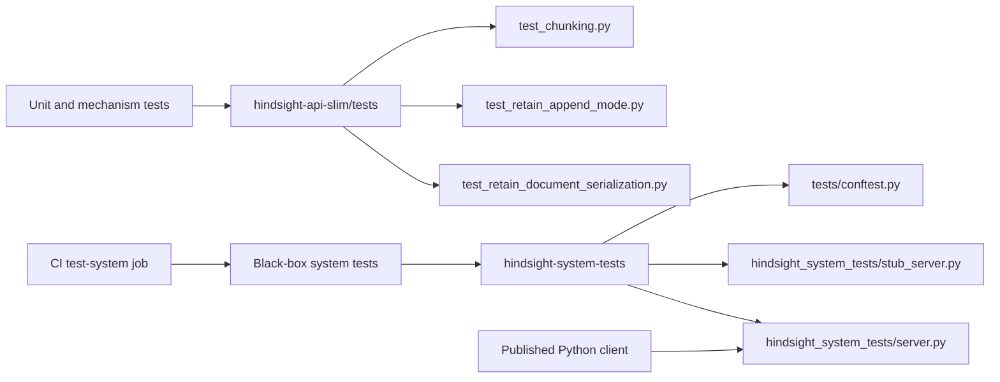
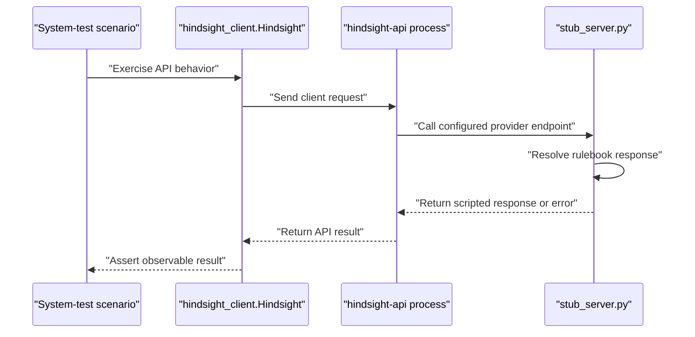

<!-- source: DeepWiki mcp.deepwiki.com · repo vectorize-io/hindsight · page 8.3 Testing · fetched 2026-10-26 -->

# Testing

Relevant source files

The following files were used as context for generating this wiki page:

- [hindsight-api-slim/hindsight_api/engine/retain/fold.py](hindsight-api-slim/hindsight_api/engine/retain/fold.py)
- [hindsight-api-slim/tests/test_chunking.py](hindsight-api-slim/tests/test_chunking.py)
- [hindsight-api-slim/tests/test_claim_bank_serialization.py](hindsight-api-slim/tests/test_claim_bank_serialization.py)
- [hindsight-api-slim/tests/test_mental_model_refresh_pending_dedupe_3487.py](hindsight-api-slim/tests/test_mental_model_refresh_pending_dedupe_3487.py)
- [hindsight-api-slim/tests/test_retain_append_mode.py](hindsight-api-slim/tests/test_retain_append_mode.py)
- [hindsight-api-slim/tests/test_retain_document_serialization.py](hindsight-api-slim/tests/test_retain_document_serialization.py)
- [hindsight-api-slim/tests/test_retain_outbox_session.py](hindsight-api-slim/tests/test_retain_outbox_session.py)
- [hindsight-api-slim/tests/test_structured_chunk_size_retain.py](hindsight-api-slim/tests/test_structured_chunk_size_retain.py)
- [hindsight-system-tests/README.md](hindsight-system-tests/README.md)
- [hindsight-system-tests/hindsight_system_tests/rulebook.py](hindsight-system-tests/hindsight_system_tests/rulebook.py)
- [hindsight-system-tests/hindsight_system_tests/server.py](hindsight-system-tests/hindsight_system_tests/server.py)
- [hindsight-system-tests/hindsight_system_tests/stub_server.py](hindsight-system-tests/hindsight_system_tests/stub_server.py)
- [hindsight-system-tests/hindsight_system_tests/validation.py](hindsight-system-tests/hindsight_system_tests/validation.py)
- [hindsight-system-tests/tests/conftest.py](hindsight-system-tests/tests/conftest.py)
- [hindsight-system-tests/tests/test_12_append_document.py](hindsight-system-tests/tests/test_12_append_document.py)
- [hindsight-system-tests/tests/test_65_provider_outages.py](hindsight-system-tests/tests/test_65_provider_outages.py)

## Purpose and scope

This page summarizes Hindsight’s testing layers: focused tests in `hindsight-api-slim/tests`, broader service-level validation, client smoke checks, and CI gating. It stays at the parent-page level; for details, see [System Tests and Stub Server](#8.3.1) and [Evaluations and Benchmarks](#8.3.2). [hindsight-system-tests/README.md:3-11]()

Sources: [hindsight-system-tests/README.md:3-11]()

---

## Overview

The test strategy combines tests of individual mechanisms with tests of workflows that cross API, provider, and background-processing boundaries. The core API suite covers mechanisms such as chunking, retain behavior, serialization, and task claiming. The system-test suite addresses composition across those mechanisms by running a real server and exercising it through the published Python client. [hindsight-system-tests/README.md:3-11]()[hindsight-api-slim/tests/test_chunking.py:1-13]()[hindsight-api-slim/tests/test_retain_document_serialization.py:1-18]()[hindsight-api-slim/tests/test_claim_bank_serialization.py:1-24]()

Client smoke tests provide a lightweight check of client-facing request and response flows. CI provides a gate for automated test runs; the available system-test documentation specifically notes that its `test-system` job does not require provider secrets and can run on fork pull requests. See the child pages for the detailed system-test and evaluation suites. [hindsight-system-tests/README.md:31-49]()

Sources: [hindsight-system-tests/README.md:3-11](), [hindsight-system-tests/README.md:31-49](), [hindsight-api-slim/tests/test_chunking.py:1-13](), [hindsight-api-slim/tests/test_retain_document_serialization.py:1-18](), [hindsight-api-slim/tests/test_claim_bank_serialization.py:1-24]()

---

## Unit Tests in `hindsight-api-slim/tests`

The API test suite checks engine and data-processing behavior at the level where each mechanism lives. For example, `test_chunking.py` asserts exact splitting behavior for controlled inputs and preservation properties for larger text and structured input. `test_retain_append_mode.py` exercises append behavior through `MemoryEngine`, including document contents and recallable facts. [hindsight-api-slim/tests/test_chunking.py:1-7]()[hindsight-api-slim/tests/test_retain_append_mode.py:1-3]()[hindsight-api-slim/tests/test_retain_append_mode.py:22-88]()

Some tests separate pure logic from database and pipeline behavior, while others exercise concurrency or failure boundaries. `test_retain_document_serialization.py` describes checks at the fold planner, queue, and end-to-end append levels; `test_retain_outbox_session.py` verifies completion-event ordering around commits and failures. [hindsight-api-slim/tests/test_retain_document_serialization.py:1-18]()[hindsight-api-slim/tests/test_retain_outbox_session.py:1-22]()

Sources: [hindsight-api-slim/tests/test_chunking.py:1-7](), [hindsight-api-slim/tests/test_retain_append_mode.py:1-3](), [hindsight-api-slim/tests/test_retain_append_mode.py:22-88](), [hindsight-api-slim/tests/test_retain_document_serialization.py:1-18](), [hindsight-api-slim/tests/test_retain_outbox_session.py:1-22]()

---

## Integration and CI Gating

The system-test suite complements mechanism-level tests with black-box coverage: it starts a real `hindsight-api` process and interacts through the published Python client, without importing engine internals or issuing SQL. Its provider stub is reached through normal configuration, allowing the real provider transport paths to be exercised while keeping responses deterministic. [hindsight-system-tests/README.md:3-20]()[hindsight-system-tests/hindsight_system_tests/server.py:1-6]()

The system-test fixtures start the stub, server, and worker for the suite and reset scripted state between tests. Unmatched provider calls and malformed requests fail tests rather than silently receiving plausible defaults. The suite’s README documents the `test-system` CI job as requiring no provider secrets and being suitable for fork pull requests. For scenario coverage and suite operation, see [System Tests and Stub Server](#8.3.1). [hindsight-system-tests/tests/conftest.py:1-7]()[hindsight-system-tests/hindsight_system_tests/stub_server.py:50-74]()[hindsight-system-tests/README.md:22-29]()[hindsight-system-tests/README.md:41-49]()

Sources: [hindsight-system-tests/README.md:3-20](), [hindsight-system-tests/README.md:22-29](), [hindsight-system-tests/README.md:41-49](), [hindsight-system-tests/tests/conftest.py:1-7](), [hindsight-system-tests/hindsight_system_tests/server.py:1-6](), [hindsight-system-tests/hindsight_system_tests/stub_server.py:50-74]()

---

## Client Smoke Tests

Client smoke tests are the lightweight client-facing layer in the overall strategy: they check that basic SDK interactions remain usable against the API. They complement API mechanism tests and the system suite, which exercises workflows through the Python client. Detailed language-specific client behavior is covered in the client documentation; this page does not enumerate unverified smoke-test commands or CI job definitions. [hindsight-system-tests/README.md:3-5]()

Sources: [hindsight-system-tests/README.md:3-5]()

---

## Test Layers: Concepts and Code Entities

This diagram maps the testing layers to code entities that can be located in the repository.

Sources: [hindsight-api-slim/tests/test_chunking.py:1-13](), [hindsight-api-slim/tests/test_retain_append_mode.py:1-3](), [hindsight-api-slim/tests/test_retain_document_serialization.py:1-18](), [hindsight-system-tests/README.md:3-5](), [hindsight-system-tests/README.md:41-49](), [hindsight-system-tests/tests/conftest.py:19-29](), [hindsight-system-tests/hindsight_system_tests/server.py:1-6](), [hindsight-system-tests/hindsight_system_tests/stub_server.py:1-20]()

---

## From Test Intent to Executed System

The system-test path connects scenario-level assertions to a real Hindsight process and a separately hosted provider stub. The stub’s content-based rules make provider behavior explicit; unmatched calls return an error instead of a generated default response. [hindsight-system-tests/hindsight_system_tests/rulebook.py:5-17]()[hindsight-system-tests/hindsight_system_tests/stub_server.py:50-74]()[hindsight-system-tests/hindsight_system_tests/server.py:1-6]()

Sources: [hindsight-system-tests/tests/conftest.py:19-29](), [hindsight-system-tests/hindsight_system_tests/server.py:1-6](), [hindsight-system-tests/hindsight_system_tests/stub_server.py:50-74](), [hindsight-system-tests/hindsight_system_tests/rulebook.py:5-17]()

---

## Child Pages

- **[System Tests and Stub Server](#8.3.1)** — Covers `hindsight-system-tests`, including its provider stub, rulebook and validation harness, fixtures, numbered end-to-end scenarios, and the `hindsight-integration-tests` E2E suites. [hindsight-system-tests/README.md:3-11]()
- **[Evaluations and Benchmarks](#8.3.2)** — Covers `hindsight-system-evals` and `hindsight-dev/benchmarks`, including evaluation datasets and reporting, coding-agent evaluations, benchmark categories, and the performance-test CI workflow.

Sources: [hindsight-system-tests/README.md:3-11]()

---

## Summary

The testing strategy pairs focused API tests with black-box system validation. The former checks individual mechanisms; the latter checks how those mechanisms compose through a real server and client-facing API path. Client smoke checks and CI gating round out the contributor-facing workflow, while the child pages provide the detailed system-test, evaluation, and benchmark documentation. [hindsight-system-tests/README.md:3-11]()[hindsight-system-tests/README.md:41-49]()

Sources: [hindsight-system-tests/README.md:3-11](), [hindsight-system-tests/README.md:41-49]()

---

