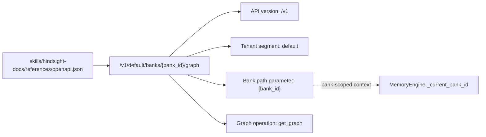
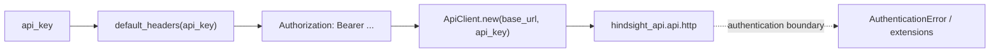
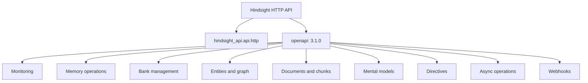

<!-- source: DeepWiki mcp.deepwiki.com · repo vectorize-io/hindsight · page 9 API Reference · fetched 2026-10-26 -->

# API Reference

Relevant source files

The following files were used as context for generating this wiki page:

- [hindsight-api-slim/hindsight_api/api/http.py](hindsight-api-slim/hindsight_api/api/http.py)
- [hindsight-api-slim/hindsight_api/engine/memory_engine.py](hindsight-api-slim/hindsight_api/engine/memory_engine.py)
- [hindsight-cli/src/api.rs](hindsight-cli/src/api.rs)
- [hindsight-clients/go/api/openapi.yaml](hindsight-clients/go/api/openapi.yaml)
- [hindsight-clients/python/.openapi-generator/FILES](hindsight-clients/python/.openapi-generator/FILES)
- [hindsight-clients/python/hindsight_client_api/__init__.py](hindsight-clients/python/hindsight_client_api/__init__.py)
- [hindsight-clients/python/hindsight_client_api/models/__init__.py](hindsight-clients/python/hindsight_client_api/models/__init__.py)
- [hindsight-clients/typescript/generated/sdk.gen.ts](hindsight-clients/typescript/generated/sdk.gen.ts)
- [hindsight-clients/typescript/generated/types.gen.ts](hindsight-clients/typescript/generated/types.gen.ts)
- [hindsight-control-plane/src/lib/api.ts](hindsight-control-plane/src/lib/api.ts)
- [hindsight-docs/static/openapi.json](hindsight-docs/static/openapi.json)
- [skills/hindsight-docs/references/openapi.json](skills/hindsight-docs/references/openapi.json)

## Purpose and scope

This page introduces Hindsight’s HTTP API, its OpenAPI 3.1 specification, URL structure, authentication boundary, and functional organization. It is a parent-page overview: endpoint behavior and individual data models are covered in the linked child pages.

Sources: [skills/hindsight-docs/references/openapi.json:1-23](), [hindsight-api-slim/hindsight_api/api/http.py:1-5]()

## OpenAPI specification as source of truth

The API is described by an OpenAPI 3.1 document titled “Hindsight HTTP API.” Repository copies are available in the docs references and static assets, and the Go client’s OpenAPI file also declares version 3.1. Generated clients and types provide language-specific interfaces to this API; treat the specification as the shared contract and consult it for exact paths, parameters, schemas, and responses. [skills/hindsight-docs/references/openapi.json:1-15](), [hindsight-docs/static/openapi.json:1-15](), [hindsight-clients/go/api/openapi.yaml:1-13]()

The Python package identifies itself as generated from the Hindsight HTTP API OpenAPI document, while the TypeScript generated files identify `@hey-api/openapi-ts` as their generator. [hindsight-clients/python/hindsight_client_api/__init__.py:5-14](), [hindsight-clients/typescript/generated/types.gen.ts:1-5]()

Sources: [skills/hindsight-docs/references/openapi.json:1-15](), [hindsight-docs/static/openapi.json:1-15](), [hindsight-clients/go/api/openapi.yaml:1-13](), [hindsight-clients/python/hindsight_client_api/__init__.py:5-14](), [hindsight-clients/typescript/generated/types.gen.ts:1-5]()

## Base URL and endpoint namespacing

API paths include global endpoints such as `/health`, `/health/ready`, `/health/live`, `/version`, and `/metrics`. Bank-scoped paths use the `/v1/{tenant}/banks/{bank_id}/...` pattern; for example, the graph endpoint appears as `/v1/default/banks/{bank_id}/graph`. The `default` segment is the tenant name in that documented path. [skills/hindsight-docs/references/openapi.json:15-23](), [skills/hindsight-docs/references/openapi.json:36-107](), [skills/hindsight-docs/references/openapi.json:120-136]()

| URL part | Role |
|---|---|
| Host and optional port | Address of the API deployment |
| `/v1` | Versioned API path prefix |
| `{tenant}` | Tenant namespace, shown as `default` in the example path |
| `/banks/{bank_id}` | Bank-scoped resource path |
| Remaining path | Functional resource or operation |

Sources: [skills/hindsight-docs/references/openapi.json:15-23](), [skills/hindsight-docs/references/openapi.json:120-136]()

### Path structure mapped to code and specification

This diagram connects the URL concepts to the actual OpenAPI artifact and the engine’s bank context identifier. The available `memory_engine.py` excerpt establishes `_current_bank_id` as a context variable for bank-scoped operations; it does not establish the full HTTP routing or authentication flow. [hindsight-api-slim/hindsight_api/engine/memory_engine.py:110-118]()

Sources: [skills/hindsight-docs/references/openapi.json:120-136](), [hindsight-api-slim/hindsight_api/engine/memory_engine.py:110-118]()

## Authentication

The Go OpenAPI document declares an optional `authorization` header parameter on the graph endpoint. The Rust CLI’s API client adds an `Authorization: Bearer ...` header when an API key is provided. These references show a Bearer-token client pattern, but do not imply that every endpoint or deployment requires authentication; consult deployment configuration and the relevant API specification for the applicable policy. [hindsight-clients/go/api/openapi.yaml:88-181](), [hindsight-cli/src/api.rs:15-30]()

The HTTP application module imports authentication-related extension interfaces, including `AuthenticationError`, but the cited module excerpt does not show the full authentication implementation. For authentication and tenant behavior, see [HTTP API Overview](#9.1). [hindsight-api-slim/hindsight_api/api/http.py:24-44]()

Sources: [hindsight-clients/go/api/openapi.yaml:88-181](), [hindsight-cli/src/api.rs:15-30](), [hindsight-api-slim/hindsight_api/api/http.py:24-44]()

### Client authentication entities

The diagram maps the client-side Bearer header and API client to the HTTP authentication boundary. It does not assert an internal call sequence beyond what the cited files show. [hindsight-cli/src/api.rs:15-30](), [hindsight-api-slim/hindsight_api/api/http.py:24-44]()

Sources: [hindsight-cli/src/api.rs:15-30](), [hindsight-cli/src/api.rs:161-187](), [hindsight-api-slim/hindsight_api/api/http.py:24-44]()

## Organization of endpoints

The HTTP API groups functionality across memory operations, bank management, entities and graph access, documents, mental models, directives, async operations, webhooks, and monitoring. Generated Python API modules reflect many of these areas, including `MemoryApi`, `BanksApi`, `EntitiesApi`, `DocumentsApi`, `MentalModelsApi`, `OperationsApi`, and `WebhooksApi`. [hindsight-clients/python/hindsight_client_api/__init__.py:19-35]()

The map below is a functional guide, not a complete route listing. Use the OpenAPI specification and the child pages for exact operations and request/response details. [skills/hindsight-docs/references/openapi.json:1-15](), [hindsight-clients/python/hindsight_client_api/__init__.py:19-35]()

### Functional map from API concepts to code entities

Sources: [hindsight-api-slim/hindsight_api/api/http.py:1-5](), [skills/hindsight-docs/references/openapi.json:1-23](), [hindsight-clients/python/hindsight_client_api/__init__.py:19-35]()

| Functional area | What it covers | Details |
|---|---|---|
| HTTP API structure | Versioning, tenant and bank scoping, serialization, errors, pagination, and async tracking | [HTTP API Overview](#9.1) |
| Memory operations | Retain, file retain, recall, reflect, listing, deletion, and curation | [Memory Operations Endpoints](#9.2) |
| Banks | Bank lifecycle, configuration, aliases, stats, and templates | [Bank Management Endpoints](#9.3) |
| Entities, documents, and graph | Entity and document access, chunks, and graph exploration | [Entity, Document and Graph Endpoints](#9.4) |
| Mental models and directives | CRUD, refresh, history, and knowledge-page search | [Mental Models and Directives Endpoints](#9.5) |
| Operations and async tasks | Operation status and controls, consolidation, recovery, and webhook delivery | [Operations and Async Tasks Endpoints](#9.6) |
| MCP server | MCP tool definitions, routing, filtering, and request/response patterns | [MCP Server API](#9.7) |
| Data models | Principal request and response models used across endpoint groups | [Data Models](#9.8) |

Sources: [hindsight-clients/python/hindsight_client_api/__init__.py:19-35](), [hindsight-clients/python/hindsight_client_api/models/__init__.py:16-100]()

## How to use this reference

Start with the OpenAPI contract when you need exact wire-level details, then use the endpoint-area child pages for explanations organized by function. For client implementations, the generated SDKs expose typed API groups and models; for example, the TypeScript SDK includes operation types such as `RecallMemoriesData` and `CreateBankData`. [hindsight-clients/typescript/generated/sdk.gen.ts:10-55](), [hindsight-clients/typescript/generated/sdk.gen.ts:177-243]()

Sources: [hindsight-clients/typescript/generated/sdk.gen.ts:10-55](), [hindsight-clients/typescript/generated/sdk.gen.ts:177-243]()

---

