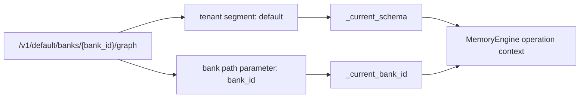
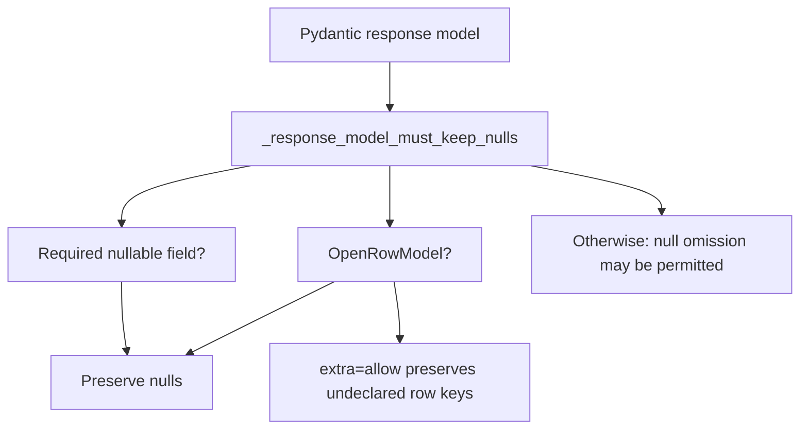
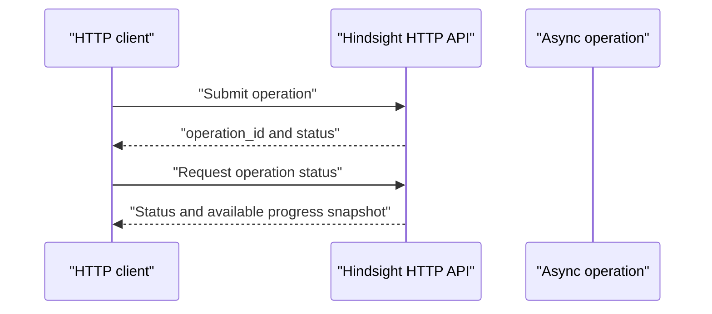
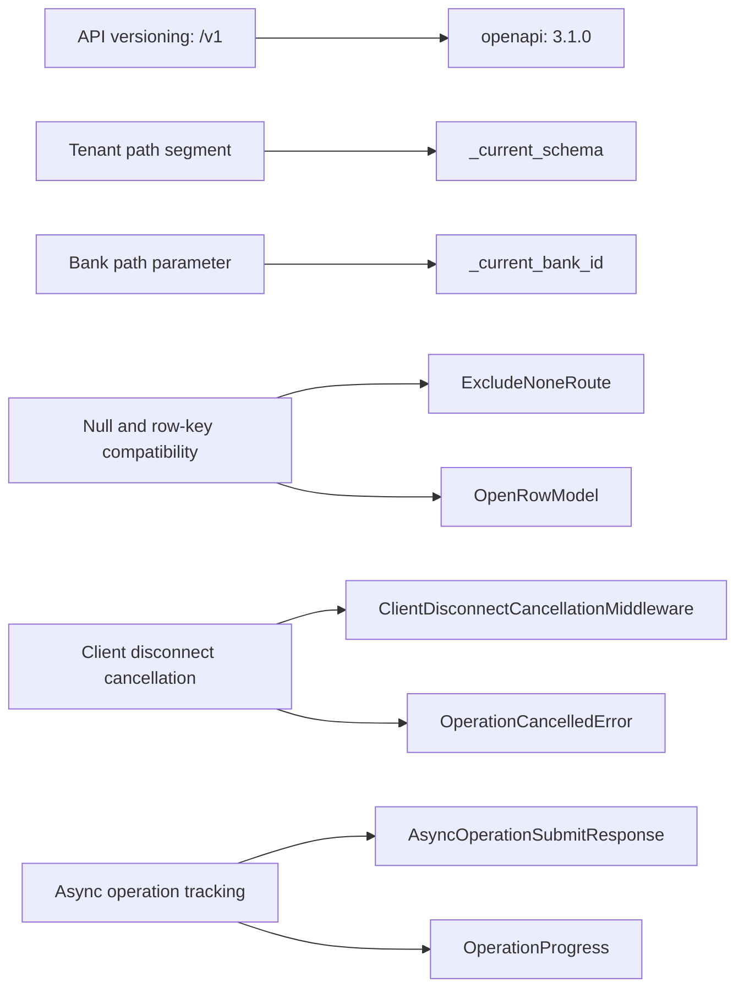
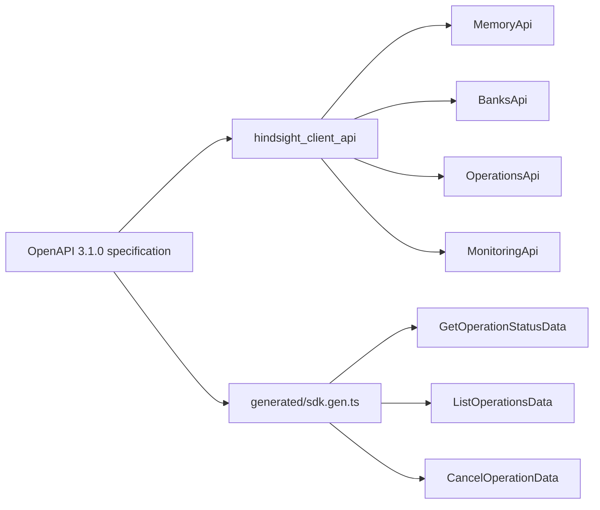

<!-- source: DeepWiki mcp.deepwiki.com · repo vectorize-io/hindsight · page 9.1 HTTP API Overview · fetched 2026-10-26 -->

# HTTP API Overview

Relevant source files

The following files were used as context for generating this wiki page:

- [hindsight-api-slim/hindsight_api/api/http.py](hindsight-api-slim/hindsight_api/api/http.py)
- [hindsight-api-slim/hindsight_api/engine/memory_engine.py](hindsight-api-slim/hindsight_api/engine/memory_engine.py)
- [hindsight-api-slim/hindsight_api/main.py](hindsight-api-slim/hindsight_api/main.py)
- [hindsight-api-slim/hindsight_api/server.py](hindsight-api-slim/hindsight_api/server.py)
- [hindsight-api-slim/tests/test_daemon_host_resolution.py](hindsight-api-slim/tests/test_daemon_host_resolution.py)
- [hindsight-api-slim/tests/test_dotenv_loading.py](hindsight-api-slim/tests/test_dotenv_loading.py)
- [hindsight-api-slim/tests/test_extension_context.py](hindsight-api-slim/tests/test_extension_context.py)
- [hindsight-api-slim/tests/test_main_module.py](hindsight-api-slim/tests/test_main_module.py)
- [hindsight-api-slim/tests/test_server_module.py](hindsight-api-slim/tests/test_server_module.py)
- [hindsight-cli/src/api.rs](hindsight-cli/src/api.rs)
- [hindsight-clients/go/api/openapi.yaml](hindsight-clients/go/api/openapi.yaml)
- [hindsight-clients/python/.openapi-generator/FILES](hindsight-clients/python/.openapi-generator/FILES)
- [hindsight-clients/python/hindsight_client_api/__init__.py](hindsight-clients/python/hindsight_client_api/__init__.py)
- [hindsight-clients/python/hindsight_client_api/models/__init__.py](hindsight-clients/python/hindsight_client_api/models/__init__.py)
- [hindsight-clients/typescript/generated/sdk.gen.ts](hindsight-clients/typescript/generated/sdk.gen.ts)
- [hindsight-clients/typescript/generated/types.gen.ts](hindsight-clients/typescript/generated/types.gen.ts)
- [hindsight-control-plane/src/lib/api.ts](hindsight-control-plane/src/lib/api.ts)
- [hindsight-docs/static/openapi.json](hindsight-docs/static/openapi.json)
- [skills/hindsight-docs/references/openapi.json](skills/hindsight-docs/references/openapi.json)

## Purpose and scope

This page describes the HTTP API’s URL organization, request and response conventions, tenant and bank scoping, serialization compatibility, error surfaces, cancellation, pagination, and asynchronous operation tracking. The API is described by an OpenAPI 3.1.0 specification whose declared version is `1.1.0`. [skills/hindsight-docs/references/openapi.json:1-14]()

This is an overview; endpoint-specific request and response details belong in the other pages in section 9. Sources: [skills/hindsight-docs/references/openapi.json:1-14]()

---

## API structure and versioning

Most API paths use a versioned, tenant-namespaced structure. For example, the graph endpoint is `GET /v1/default/banks/{bank_id}/graph`: `v1` is the API path prefix, `default` is the tenant segment, and `{bank_id}` identifies the bank within that tenant. The OpenAPI description also defines unscoped monitoring routes such as `/health`, `/health/ready`, `/health/live`, `/version`, and `/metrics`. [skills/hindsight-docs/references/openapi.json:15-119]()

| URL part | Example | Role |
|---|---|---|
| API version | `v1` | Version prefix used by the shown bank-scoped route. [skills/hindsight-docs/references/openapi.json:120-137]() |
| Tenant | `default` | Namespace segment in the route. [skills/hindsight-docs/references/openapi.json:120-137]() |
| Bank | `{bank_id}` | Bank identifier supplied as a required path parameter. [skills/hindsight-docs/references/openapi.json:120-137]() |
| Resource | `graph` | Resource-specific endpoint path. [skills/hindsight-docs/references/openapi.json:120-127]() |

The OpenAPI `info.version` value is `1.1.0`, distinct from the `v1` URL prefix. The generated TypeScript types also identify the OpenAPI document version as `1.1.0`. [skills/hindsight-docs/references/openapi.json:1-14](), [hindsight-clients/python/hindsight_client_api/__init__.py:5-17]()

### Global endpoints

The monitoring routes are not nested under the tenant and bank path shown above. The spec describes `/health` as an alias of `/health/ready`; readiness checks database reachability, whereas `/health/live` checks process availability without database access. `/version` reports API version and enabled feature flags, and `/metrics` exports Prometheus metrics. [skills/hindsight-docs/references/openapi.json:15-119]()

**Sources:** [skills/hindsight-docs/references/openapi.json:1-14](), [skills/hindsight-docs/references/openapi.json:15-119](), [skills/hindsight-docs/references/openapi.json:120-137](), [hindsight-clients/python/hindsight_client_api/__init__.py:5-17]()

---

## Tenant and bank scoping

A tenant and bank are represented separately in a bank-scoped URL: the tenant appears in the path before `/banks/`, and the bank identifier appears as `{bank_id}`. For example, the spec’s graph route is `/v1/default/banks/{bank_id}/graph`. [skills/hindsight-docs/references/openapi.json:120-137]()

At the engine layer, `_current_schema` is an async-safe `ContextVar` for the current schema; its comment says the default is resolved through `get_current_schema()`. `_current_bank_id` is a separate async-safe `ContextVar` for the bank associated with an operation, used to attribute downstream provider calls to a bank. These declarations establish distinct schema and bank context; they do not, by themselves, specify the full authentication or database-routing flow. [hindsight-api-slim/hindsight_api/engine/memory_engine.py:110-118]()

The HTTP module imports `ClientDisconnectCancellationMiddleware`, `get_scope_cancellation_token`, and `OperationCancelledError`, as well as authentication-related extension types. These imports identify the HTTP layer’s integration points; the excerpts available here do not show the full request middleware ordering or tenant-authentication implementation. [hindsight-api-slim/hindsight_api/api/http.py:28-45]()

### From URL scope to code context

**Diagram: HTTP path scope and engine context**

The route shape and path parameter are documented in the OpenAPI spec; the two engine context variables are declared separately in `memory_engine.py`. The diagram shows their conceptual correspondence, not an assertion that this specific route sets both variables at a particular call site. [skills/hindsight-docs/references/openapi.json:120-137](), [hindsight-api-slim/hindsight_api/engine/memory_engine.py:110-118]()

**Sources:** [skills/hindsight-docs/references/openapi.json:120-137](), [hindsight-api-slim/hindsight_api/engine/memory_engine.py:110-118](), [hindsight-api-slim/hindsight_api/api/http.py:28-45]()

---

## Request and response formats

The API specification declares OpenAPI 3.1.0 and describes JSON request and response bodies for its operations. The FastAPI module imports Pydantic model utilities and defines `OpenRowModel`, a base model configured with `extra="allow"` so undeclared row fields can be retained. [skills/hindsight-docs/references/openapi.json:1-14](), [hindsight-api-slim/hindsight_api/api/http.py:68-78](), [hindsight-api-slim/hindsight_api/api/http.py:109-125]()

The `OpenRowModel` documentation explains a compatibility constraint: typed list and graph rows must not drop extra keys supplied by a memory store. It also states that these routes preserve nulls because older dictionary-shaped rows emitted null values, and omitting them could change the wire format for clients. [hindsight-api-slim/hindsight_api/api/http.py:109-125]()

### `ExcludeNoneRoute` and null preservation

The HTTP module documents `ExcludeNoneRoute` as leaving nulls alone for routes that need them. The helper `_model_must_keep_nulls` identifies models that must preserve nulls when a required nullable field or an `OpenRowModel` appears in the response model; `_response_model_must_keep_nulls` is the corresponding response-model helper. This conditional behavior protects required nullable fields and preserves the wire format of formerly untyped rows. [hindsight-api-slim/hindsight_api/api/http.py:109-122](), [hindsight-api-slim/hindsight_api/api/http.py:143-171]()

The same module defines `_drop_additional_properties` to remove `additionalProperties: true` from generated schema output. Its documentation distinguishes that schema adjustment from runtime behavior: extra row values remain allowed, while the generated schema avoids a combination that a cited OpenAPI generator version cannot handle. [hindsight-api-slim/hindsight_api/api/http.py:98-107](), [hindsight-api-slim/hindsight_api/api/http.py:109-125]()

**Diagram: response-model compatibility**

The decision points and `OpenRowModel` behavior are documented in the HTTP module. The final “otherwise” node means only that the shown helper does not mark that model as requiring null preservation; it does not assert a universal serialization policy for every route. [hindsight-api-slim/hindsight_api/api/http.py:109-125](), [hindsight-api-slim/hindsight_api/api/http.py:143-171]()

**Sources:** [skills/hindsight-docs/references/openapi.json:1-14](), [hindsight-api-slim/hindsight_api/api/http.py:68-78](), [hindsight-api-slim/hindsight_api/api/http.py:98-125](), [hindsight-api-slim/hindsight_api/api/http.py:143-171]()

---

## Error handling and cancellation

The OpenAPI route definition for graph retrieval lists `404` when a bank does not exist and `422` for validation errors. These are documented examples, not an exhaustive list of statuses returned across the API. [hindsight-clients/go/api/openapi.yaml:182-195]()

The HTTP module imports FastAPI’s `HTTPException` and `JSONResponse`, along with authentication and cancellation-related types. The control plane’s `describeErrorDetails` helper handles error details that may be strings or structured objects; it prefers a string `detail`, then a string `details`, then joins messages from a `violations` array, and otherwise serializes the object as JSON. [hindsight-api-slim/hindsight_api/api/http.py:23-34](), [hindsight-api-slim/hindsight_api/api/http.py:35-45](), [hindsight-control-plane/src/lib/api.ts:12-34]()

The HTTP module imports `ClientDisconnectCancellationMiddleware`, `get_scope_cancellation_token`, and `OperationCancelledError`. The supplied excerpts establish these cancellation integration points, but do not show the middleware’s implementation or the exact response-mapping code for a disconnected client. HTTP `499` is part of this page’s scope, but its precise handling cannot be established from the provided excerpts. [hindsight-api-slim/hindsight_api/api/http.py:28-34]()

**Sources:** [hindsight-api-slim/hindsight_api/api/http.py:23-45](), [hindsight-clients/go/api/openapi.yaml:182-195](), [hindsight-control-plane/src/lib/api.ts:12-34]()

---

## Pagination

List-style API responses can expose pagination metadata. For example, the TypeScript-generated `AuditLogListResponse` includes `total`, `limit`, `offset`, and `items`; the items are summaries without request and response bodies. [hindsight-clients/typescript/generated/types.gen.ts:99-127]()

A generated CLI client demonstrates offset-based traversal for a paginated bank-list endpoint: `ApiClient.list_agents` uses a page size of 100 and loops through pages. This is client behavior for that endpoint, rather than a claim that every list endpoint uses the same defaults or pagination scheme. [hindsight-cli/src/api.rs:169-197]()

| Field or parameter | Meaning |
|---|---|
| `limit` | Page-size value returned in the audit-log list response. [hindsight-clients/typescript/generated/types.gen.ts:104-120]() |
| `offset` | Position value returned in the audit-log list response. [hindsight-clients/typescript/generated/types.gen.ts:104-120]() |
| `total` | Total count reported by the audit-log list response. [hindsight-clients/typescript/generated/types.gen.ts:104-115]() |
| `items` | Page contents; audit-log list entries omit request and response bodies. [hindsight-clients/typescript/generated/types.gen.ts:120-127]() |

**Sources:** [hindsight-clients/typescript/generated/types.gen.ts:99-127](), [hindsight-cli/src/api.rs:169-197]()

---

## Asynchronous operation tracking

The generated TypeScript type `AsyncOperationSubmitResponse` contains an `operation_id` and a `status`. This response shape provides an identifier and a status value for a submitted asynchronous operation. [hindsight-clients/typescript/generated/types.gen.ts:27-41]()

The control plane’s `OperationProgress` interface describes a progress snapshot with a `stage` and timestamp `at`, and optional `processed`, `total`, and `detail` fields. Its documentation describes these as coarse progress checkpoints for long-running operations, including consolidation and batch retain; values remain null until the first checkpoint. [hindsight-control-plane/src/lib/api.ts:209-221]()

The TypeScript generated SDK exposes operation-related API types, including `GetOperationStatusData`, `ListOperationsData`, and `CancelOperationData`. Their presence shows that status, listing, and cancellation operations are represented in the generated client; the excerpts do not specify their complete route paths or lifecycle semantics. [hindsight-clients/typescript/generated/sdk.gen.ts:14-19](), [hindsight-clients/typescript/generated/sdk.gen.ts:168-171](), [hindsight-clients/typescript/generated/sdk.gen.ts:219-221]()

**Diagram: asynchronous operation identifiers and progress**

The submit response fields and progress snapshot fields are defined in generated client types. The diagram summarizes a tracking pattern; it does not assert a specific polling interval or endpoint path. [hindsight-clients/typescript/generated/types.gen.ts:27-41](), [hindsight-control-plane/src/lib/api.ts:209-221](), [hindsight-clients/typescript/generated/sdk.gen.ts:168-171]()

**Sources:** [hindsight-clients/typescript/generated/types.gen.ts:27-41](), [hindsight-control-plane/src/lib/api.ts:209-221](), [hindsight-clients/typescript/generated/sdk.gen.ts:168-171](), [hindsight-clients/typescript/generated/sdk.gen.ts:219-221]()

---

## Natural language concepts mapped to code entities

This diagram maps API concepts to code symbols present in the supplied files. It identifies the HTTP module and its compatibility, cancellation, and validation-related entities, plus engine context variables and generated API types. [hindsight-api-slim/hindsight_api/api/http.py:28-45](), [hindsight-api-slim/hindsight_api/api/http.py:109-171](), [hindsight-api-slim/hindsight_api/engine/memory_engine.py:110-118](), [hindsight-clients/typescript/generated/types.gen.ts:27-41]()

**Diagram: API concepts and implementation symbols**

The diagram associates concepts with names found in the OpenAPI spec, HTTP module, engine, and generated client types. It is a cross-file index, not a call graph. [skills/hindsight-docs/references/openapi.json:1-14](), [hindsight-api-slim/hindsight_api/api/http.py:28-45](), [hindsight-api-slim/hindsight_api/api/http.py:109-171](), [hindsight-api-slim/hindsight_api/engine/memory_engine.py:110-118](), [hindsight-clients/typescript/generated/types.gen.ts:27-41](), [hindsight-control-plane/src/lib/api.ts:209-221]()

**Sources:** [skills/hindsight-docs/references/openapi.json:1-14](), [hindsight-api-slim/hindsight_api/api/http.py:28-45](), [hindsight-api-slim/hindsight_api/api/http.py:109-171](), [hindsight-api-slim/hindsight_api/engine/memory_engine.py:110-118](), [hindsight-clients/typescript/generated/types.gen.ts:27-41](), [hindsight-control-plane/src/lib/api.ts:209-221]()

---

## Client and server boundary

The API specification is used to generate client surfaces. The Python package identifies itself as generated from the Hindsight HTTP API OpenAPI document and exports API classes such as `MemoryApi`, `BanksApi`, `OperationsApi`, and `MonitoringApi`. The TypeScript generated SDK similarly contains operation-specific types, including status, listing, and cancellation operations. [hindsight-clients/python/hindsight_client_api/__init__.py:5-41](), [hindsight-clients/typescript/generated/sdk.gen.ts:14-19](), [hindsight-clients/typescript/generated/sdk.gen.ts:168-171]()

**Diagram: specification and generated client entities**

The Python package exports the listed API classes, while the TypeScript generated SDK imports the listed operation types. The diagram represents the generated-client boundary and does not claim a particular generation command or runtime call sequence. [hindsight-clients/python/hindsight_client_api/__init__.py:19-41](), [hindsight-clients/typescript/generated/sdk.gen.ts:14-19](), [hindsight-clients/typescript/generated/sdk.gen.ts:168-171](), [hindsight-clients/typescript/generated/sdk.gen.ts:219-221]()

**Sources:** [hindsight-clients/python/hindsight_client_api/__init__.py:5-41](), [hindsight-clients/typescript/generated/sdk.gen.ts:14-19](), [hindsight-clients/typescript/generated/sdk.gen.ts:168-171](), [hindsight-clients/typescript/generated/sdk.gen.ts:219-221]()

---

