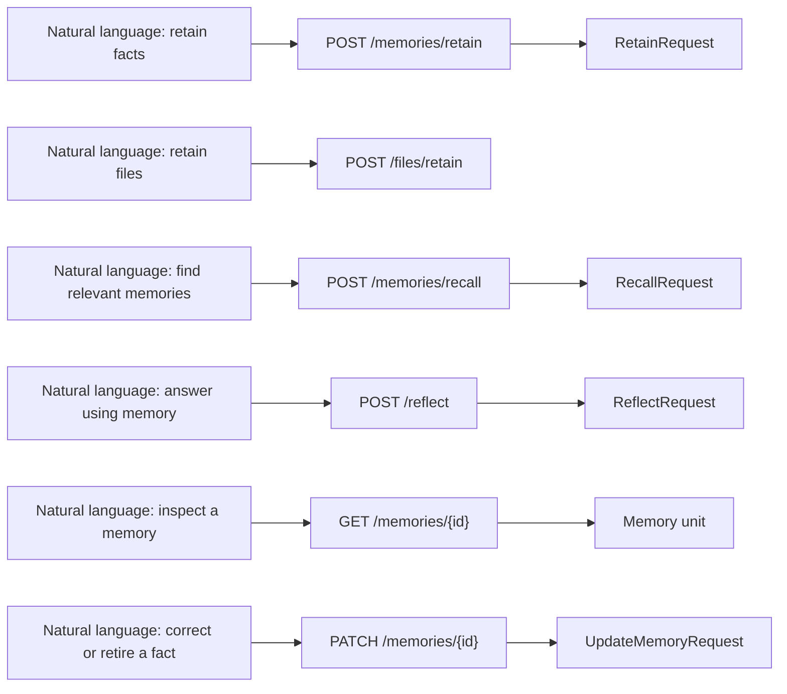
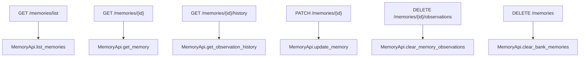

<!-- source: DeepWiki mcp.deepwiki.com · repo vectorize-io/hindsight · page 9.2 Memory Operations Endpoints · fetched 2026-10-26 -->

# Memory Operations Endpoints

Relevant source files

The following files were used as context for generating this wiki page:

- [hindsight-api-slim/tests/test_memory_curation.py](hindsight-api-slim/tests/test_memory_curation.py)
- [hindsight-clients/go/api_memory.go](hindsight-clients/go/api_memory.go)
- [hindsight-clients/python/hindsight_client_api/api/memory_api.py](hindsight-clients/python/hindsight_client_api/api/memory_api.py)
- [hindsight-docs/docs/developer/api/memories.mdx](hindsight-docs/docs/developer/api/memories.mdx)
- [hindsight-docs/examples/api/memories.go](hindsight-docs/examples/api/memories.go)
- [hindsight-docs/examples/api/memories.mjs](hindsight-docs/examples/api/memories.mjs)
- [hindsight-docs/examples/api/memories.py](hindsight-docs/examples/api/memories.py)
- [hindsight-docs/examples/api/memories.sh](hindsight-docs/examples/api/memories.sh)
- [skills/hindsight-docs/references/developer/api/memories.md](skills/hindsight-docs/references/developer/api/memories.md)

## Purpose and scope

This page documents the bank-scoped HTTP endpoints for ingesting and querying memories, generating responses, inspecting memory units, and curating stored facts. A memory unit is an atomic fact; memory listing, detail, history, and curation are distinct from the retain and recall operations. [skills/hindsight-docs/references/developer/api/memories.md:2-16]()

Sources: [skills/hindsight-docs/references/developer/api/memories.md:2-16]()

## Endpoint map

Memory-operation routes are bank-scoped under `/v1/default/banks/{bank}`. The documented memory-unit routes include list, detail, observation history, curation, and clearing observations. The wider operations surface also includes retain, file retain, recall, reflect, dry-run extraction, and bank-wide memory clearing. [skills/hindsight-docs/references/developer/api/memories.md:8-16]()

| Operation | Method and route | Purpose |
|---|---|---|
| Batch retain | `POST /v1/default/banks/{bank}/memories/retain` | Submit memory items for ingestion. |
| File retain | `POST /v1/default/banks/{bank}/files/retain` | Submit files for memory ingestion. |
| Recall | `POST /v1/default/banks/{bank}/memories/recall` | Retrieve relevant memories. |
| Reflect | `POST /v1/default/banks/{bank}/reflect` | Generate a response using bank memories. |
| Dry-run extraction | `POST /v1/default/banks/{bank}/memories/dry-run-extract` | Preview extraction without treating it as a normal retain. |
| List memories | `GET /v1/default/banks/{bank}/memories/list` | List and filter memory units. |
| Memory detail | `GET /v1/default/banks/{bank}/memories/{id}` | Fetch one memory unit. |
| Observation history | `GET /v1/default/banks/{bank}/memories/{id}/history` | Inspect refresh history for a derived observation. |
| Curate memory | `PATCH /v1/default/banks/{bank}/memories/{id}` | Edit, invalidate, or restore a memory. |
| Clear observations | `DELETE /v1/default/banks/{bank}/memories/{id}/observations` | Remove derived observations for a memory and reset it for consolidation. |
| Clear bank memories | `DELETE /v1/default/banks/{bank}/memories` | Delete bank memory units, optionally filtered by fact type. |

The list, detail, history, patch, and clear-observations routes and their purposes are explicitly enumerated in the memory API reference. The generated Python client describes bank-wide clearing as destructive and supports a `type` filter for `world`, `experience`, or `observation`. [skills/hindsight-docs/references/developer/api/memories.md:8-16](), [hindsight-clients/python/hindsight_client_api/api/memory_api.py:58-80]()

Sources: [skills/hindsight-docs/references/developer/api/memories.md:8-16](), [hindsight-clients/python/hindsight_client_api/api/memory_api.py:58-80]()

## Operation flow and code landmarks

At a conceptual level, retain and file retain supply content to the system; recall retrieves relevant memories; reflect uses memory context to answer a prompt; and the list/detail/curation routes support inspection and maintenance of individual memory units. The available API reference distinguishes ingestion and querying from the individual-memory endpoints. [skills/hindsight-docs/references/developer/api/memories.md:2-16]()

### Diagram: Natural-language operations mapped to API entities

Sources: [hindsight-clients/python/hindsight_client_api/api/memory_api.py:22-38](), [skills/hindsight-docs/references/developer/api/memories.md:8-16]()

### Diagram: Memory-unit API routes mapped to generated client entities

Sources: [skills/hindsight-docs/references/developer/api/memories.md:8-16](), [hindsight-clients/python/hindsight_client_api/api/memory_api.py:22-38]()

## Retain, file retain, recall, reflect, and dry-run extraction

The memory API separates ingestion and querying from operations on individual memory units. Retain accepts content for ingestion, while file retain is the file-oriented ingestion route; recall and reflect are query-oriented operations. Dry-run extraction is the preview-oriented extraction operation. [skills/hindsight-docs/references/developer/api/memories.md:2-7]()

The generated Python client defines request and response model imports for `RetainRequest`/`RetainResponse`, `RecallRequest`/`RecallResponse`, and `ReflectRequest`/`ReflectResponse`. It also imports `DryRunExtractRequest` and `DryRunExtractionResult`, which identify the extraction-preview model pair in the client API. [hindsight-clients/python/hindsight_client_api/api/memory_api.py:22-38]()

| Operation | Client model names |
|---|---|
| Retain | `RetainRequest`, `RetainResponse` |
| Recall | `RecallRequest`, `RecallResponse` |
| Reflect | `ReflectRequest`, `ReflectResponse` |
| Dry-run extraction | `DryRunExtractRequest`, `DryRunExtractionResult` |

The supplied source excerpts identify these model names but do not show the route-handler implementations or their detailed request fields. Consult the generated OpenAPI client definitions for the concrete schemas and route-level parameters. [hindsight-clients/python/hindsight_client_api/api/memory_api.py:22-38]()

Sources: [skills/hindsight-docs/references/developer/api/memories.md:2-7](), [hindsight-clients/python/hindsight_client_api/api/memory_api.py:22-38]()

## List, detail, and observation history

### List memory units

`GET /v1/default/banks/{bank}/memories/list` returns memory units for a bank. Each listed unit can include its `fact_type` (`world`, `experience`, or `observation`), `state` (`valid` or `invalidated`), metadata, entities, occurred dates, and an `edited_at` timestamp for edited facts. Invalidated rows are included by default; use `state=` to filter them. [skills/hindsight-docs/references/developer/api/memories.md:18-22]()

Filters include `type`, `q`, `document_id`, and `entity_id`. The `q` filter is a case-insensitive substring search over text and context, intended for browsing rather than production search. `entity_id` performs an exact reverse lookup through stored entity links; combining it with `state=invalidated` returns no rows because entity links exist only for live units. [skills/hindsight-docs/references/developer/api/memories.md:20-22]()

Time filtering uses `start_date`, `end_date`, and `time_field`. The date range is half-open, `[start, end)`. A selected `time_field` also determines sort order and excludes units with no value for that timestamp; omitting the time parameters preserves the default listing behavior. This is an exhaustive filter, unlike recall’s ranking-oriented temporal window. [skills/hindsight-docs/references/developer/api/memories.md:24-37]()

### Fetch a memory and inspect observation history

`GET /v1/default/banks/{bank}/memories/{id}` fetches a memory unit by ID, including content, metadata, entities, timestamps, tags, and curation state. For a derived observation, `GET /v1/default/banks/{bank}/memories/{id}/history` returns its refresh history as source facts arrive. [skills/hindsight-docs/references/developer/api/memories.md:90-92](), [skills/hindsight-docs/references/developer/api/memories.md:130-130]()

Sources: [skills/hindsight-docs/references/developer/api/memories.md:18-37](), [skills/hindsight-docs/references/developer/api/memories.md:90-92](), [skills/hindsight-docs/references/developer/api/memories.md:130-130]()

## Curation and deletion

Memory curation provides an audit-preserving way to correct or retire a fact. The supported individual-memory action is `PATCH /memories/{id}`; curation includes editing, invalidating, and restoring. Only raw `world` and `experience` facts can be curated: observations are derived and regenerate from their sources, so patching an observation returns `400`. [skills/hindsight-docs/references/developer/api/memories.md:101-119]()

Editing can change text, dates, fact type, and entity associations. An edit triggers re-embedding and background re-consolidation; the example also documents that derived observations and links are refreshed. For entity replacement, an empty entity list detaches all entities, while omitting the field leaves it unchanged. [hindsight-docs/examples/api/memories.py:94-125]()

Invalidation retires a fact from recall, consolidation, and the graph while retaining it for audit. Restoring a previously invalidated fact sets its state back to `valid`. [hindsight-docs/examples/api/memories.py:130-154]()

The observation-clearing route deletes observations derived from a particular memory and resets that memory for re-consolidation; it does not delete the source memory. A consolidation job is triggered automatically. [hindsight-clients/go/api_memory.go:160-180]()

Bank-wide clearing is a separate destructive operation. It deletes memory units and may filter by fact type (`world`, `experience`, or `observation`); the generated client documentation states that the bank profile is preserved. [hindsight-clients/python/hindsight_client_api/api/memory_api.py:58-80]()

| Action | Route | Effect |
|---|---|---|
| Edit a fact | `PATCH /memories/{id}` | Correct memory content or supported metadata; derived data is refreshed. |
| Invalidate a fact | `PATCH /memories/{id}` | Remove it from active use while preserving an audit record. |
| Restore a fact | `PATCH /memories/{id}` | Return an invalidated fact to `valid`. |
| Clear derived observations | `DELETE /memories/{id}/observations` | Keep the source memory; reset it for re-consolidation. |
| Clear bank memories | `DELETE /memories` | Destructively remove bank memory units, optionally by fact type. |

Sources: [skills/hindsight-docs/references/developer/api/memories.md:101-119](), [hindsight-docs/examples/api/memories.py:94-154](), [hindsight-clients/go/api_memory.go:160-180](), [hindsight-clients/python/hindsight_client_api/api/memory_api.py:58-80]()

## Client API surface

The generated Python client’s `MemoryApi` class is the API-facing client surface. Its imports identify model classes for retain, recall, reflect, dry-run extraction, memory listing, updates, and deletion. The supplied excerpt also shows `clear_bank_memories` as an async client method that serializes the request, calls the API client, and deserializes a `DeleteResponse`. [hindsight-clients/python/hindsight_client_api/api/memory_api.py:22-38](), [hindsight-clients/python/hindsight_client_api/api/memory_api.py:45-55](), [hindsight-clients/python/hindsight_client_api/api/memory_api.py:58-131]()

The Go client exposes corresponding memory service operations. Its `ClearBankMemories` request supports an optional type filter and executes as an HTTP `DELETE` to the bank memories route. [hindsight-clients/go/api_memory.go:25-49](), [hindsight-clients/go/api_memory.go:70-92]()

Sources: [hindsight-clients/python/hindsight_client_api/api/memory_api.py:22-38](), [hindsight-clients/python/hindsight_client_api/api/memory_api.py:45-55](), [hindsight-clients/python/hindsight_client_api/api/memory_api.py:58-131](), [hindsight-clients/go/api_memory.go:25-49](), [hindsight-clients/go/api_memory.go:70-92]()

---

