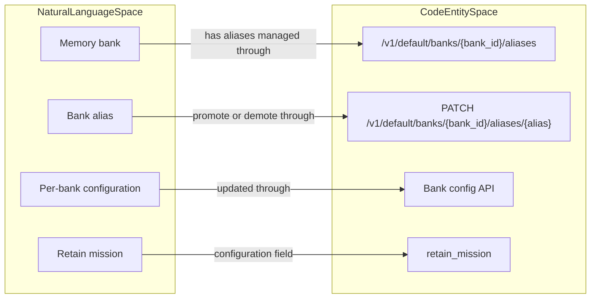
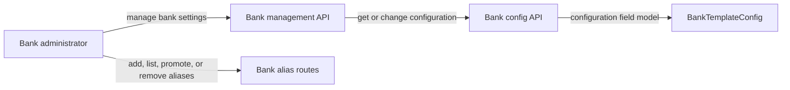

<!-- source: DeepWiki mcp.deepwiki.com · repo vectorize-io/hindsight · page 9.3 Bank Management Endpoints · fetched 2026-10-26 -->

# Bank Management Endpoints

Relevant source files

The following files were used as context for generating this wiki page:

- [hindsight-clients/go/model_bank_template_config.go](hindsight-clients/go/model_bank_template_config.go)
- [hindsight-clients/python/hindsight_client_api/models/bank_template_config.py](hindsight-clients/python/hindsight_client_api/models/bank_template_config.py)
- [hindsight-docs/docs/developer/api/memory-banks.mdx](hindsight-docs/docs/developer/api/memory-banks.mdx)
- [hindsight-docs/static/bank-template-schema.json](hindsight-docs/static/bank-template-schema.json)
- [hindsight-docs/versioned_docs/version-1.0/developer/api/memory-banks.mdx](hindsight-docs/versioned_docs/version-1.0/developer/api/memory-banks.mdx)
- [skills/hindsight-docs/references/developer/api/memory-banks.md](skills/hindsight-docs/references/developer/api/memory-banks.md)

## Purpose and scope

This page documents memory-bank management: bank lifecycle and lookup behavior, aliases, per-bank configuration, statistics, cloning, and bank templates. The available source material describes banks as isolated containers and documents alias routes and template configuration fields; it does not provide the API implementation or endpoint definitions for every lifecycle operation. [hindsight-docs/docs/developer/api/memory-banks.mdx:5-7,23-41,64-99]()

Sources: [hindsight-docs/docs/developer/api/memory-banks.mdx:5-7,23-41,64-99]()

---

## Overview

A memory bank is an isolated container for memory-related data. The documentation lists memories, documents, entities, relationships, and directives as bank contents, and states that memories in one bank are not visible in another. [hindsight-docs/docs/developer/api/memory-banks.mdx:23-33]()

Bank creation is lazy: the documentation says a bank does not need to be created in advance and that writes can create it. Reads of a missing bank return `404`; in particular, a stats read for a nonexistent bank fails rather than returning zero-valued counters. [hindsight-docs/docs/developer/api/memory-banks.mdx:34-41]()

### Natural-language concepts and code-entity mapping

This diagram connects documented bank-management concepts to the concrete routes and configuration field names available in the provided sources. [hindsight-docs/docs/developer/api/memory-banks.mdx:64-75,97-103]()

Sources: [hindsight-docs/docs/developer/api/memory-banks.mdx:64-75,97-110]()

### Bank-management flow and code entities

The sources identify `BankTemplateConfig` as a generated client model for configurable bank-template fields. Its fields include missions, extraction settings, retrieval toggles, disposition traits, and other bank-level options. [hindsight-clients/python/hindsight_client_api/models/bank_template_config.py:29-89]()

Sources: [hindsight-docs/docs/developer/api/memory-banks.mdx:64-75,97-99; hindsight-clients/python/hindsight_client_api/models/bank_template_config.py:29-89]()

---

## Bank lifecycle and lookup

The documentation describes banks as isolated storage units and lists their associated data categories. It also says that writes—such as retaining memories, updating a bank profile, or changing configuration—can create a bank; a read for a bank that does not exist returns `404`. [hindsight-docs/docs/developer/api/memory-banks.mdx:23-41]()

| Operation | Documented behavior |
|---|---|
| List banks | The available source material does not specify the list route or response schema. |
| Create a bank | Banks need not be pre-created; writes can create them. |
| Read bank data or stats | A read for a missing bank returns `404`. |
| Update a bank | Updating a profile or changing configuration is described as a write that can create a bank. |
| Delete a bank | The supplied source says deleting a bank removes its aliases; it does not specify the delete route or all deletion side effects. |
| Clone a bank | The supplied source says aliases are not carried by clone; it does not specify the clone route or operation flow. |

[hindsight-docs/docs/developer/api/memory-banks.mdx:34-41,87-95]()

Sources: [hindsight-docs/docs/developer/api/memory-banks.mdx:34-41,87-95]()

---

## Bank statistics

The documentation specifically notes that requesting stats for a nonexistent bank returns `404`, not a successful response with zeroed counters. This behavior makes a missing or mistyped bank ID distinguishable from an existing but empty bank. [hindsight-docs/docs/developer/api/memory-banks.mdx:37-41]()

The available source material does not enumerate the stats response fields or provide the stats endpoint implementation. [hindsight-docs/docs/developer/api/memory-banks.mdx:37-41]()

Sources: [hindsight-docs/docs/developer/api/memory-banks.mdx:37-41]()

---

## Bank aliases

An alias is an additional ID that resolves to the same bank. It does not copy or move bank data. The documentation describes aliases as a way to migrate callers gradually while both the old and new IDs work. [hindsight-docs/docs/developer/api/memory-banks.mdx:64-68]()

| Method | Route | Purpose |
|---|---|---|
| `POST` | `/v1/default/banks/{bank_id}/aliases` | Add an alias, supplied as an `alias` value. |
| `GET` | `/v1/default/banks/{bank_id}/aliases` | List aliases. |
| `PATCH` | `/v1/default/banks/{bank_id}/aliases/{alias}` | Set whether an alias is primary for display. |
| `DELETE` | `/v1/default/banks/{bank_id}/aliases/{alias}` | Remove an alias. |

[hindsight-docs/docs/developer/api/memory-banks.mdx:70-75]()

Promoting an alias with `primary: true` changes the ID under which the bank is displayed; setting `primary: false` returns display to the bank’s own ID without deleting the alias. This is display-only: the bank’s own ID remains its identity and is what responses report. [hindsight-docs/docs/developer/api/memory-banks.mdx:77-85]()

A bank can have multiple aliases, but a name is unique across banks and aliases. The documentation states that a conflicting name returns `409`, only one alias can be primary at a time, and deleting a promoted alias returns display to the bank’s own ID. Deleting an alias does not delete the bank or its memories. [hindsight-docs/docs/developer/api/memory-banks.mdx:83-93]()

Aliases are deployment-specific: they are not carried by export, import, or clone. Alias changes may take a few seconds to reach every API replica. [hindsight-docs/docs/developer/api/memory-banks.mdx:94-95]()

Sources: [hindsight-docs/docs/developer/api/memory-banks.mdx:64-95]()

---

## Bank configuration

Each bank can have independently configured operation behavior. The documentation says configuration can be set through the bank config API, the Control Plane UI, or server-wide environment variables. [hindsight-docs/docs/developer/api/memory-banks.mdx:97-99]()

### Configuration endpoints

The available source identifies the bank config API but does not include its literal route or request/response implementation. It describes the following operations:

- **Get configuration:** retrieve bank configuration.
- **Patch configuration:** update bank-specific configuration.
- **Delete configuration:** reset bank overrides to server defaults.

[hindsight-docs/docs/developer/api/memory-banks.mdx:97-99]()

Sources: [hindsight-docs/docs/developer/api/memory-banks.mdx:97-99]()

### Configuration fields

The documentation describes `retain_mission` as plain-language guidance for what to focus on during extraction. It is added alongside built-in extraction rules and does not replace them. [hindsight-docs/docs/developer/api/memory-banks.mdx:101-110]()

`retain_extraction_mode` controls extraction behavior. The documented modes are `concise`, `verbose`, `custom`, `verbatim`, and `chunks`; `custom` uses `retain_custom_instructions`, while `chunks` stores each chunk without an LLM call. [hindsight-docs/docs/developer/api/memory-banks.mdx:112-126]()

The generated Python `BankTemplateConfig` model exposes a broader set of optional bank configuration fields. Examples include retrieval switches, disposition traits, observation settings, recall budgets, and memory-defense settings. [hindsight-clients/python/hindsight_client_api/models/bank_template_config.py:29-89]()

| Field group | Example fields in `BankTemplateConfig` |
|---|---|
| Missions and extraction | `reflect_mission`, `retain_mission`, `retain_extraction_mode`, `retain_custom_instructions` |
| Chunking | `retain_chunk_size`, `retain_structured_chunk_size`, `retain_chunk_batch_size` |
| Retrieval and recall | `enable_text_search`, `enable_temporal_retrieval`, `enable_graph_retrieval`, `enable_reranking`, `recall_max_tokens` |
| Observations and consolidation | `enable_observations`, `observations_mission`, `enable_auto_consolidation`, `consolidation_strategies` |
| Disposition | `disposition_skepticism`, `disposition_literalism`, `disposition_empathy` |
| Other options | `entity_labels`, `mcp_enabled_tools`, `audit_log_enabled`, `memory_defense` |

[hindsight-clients/python/hindsight_client_api/models/bank_template_config.py:29-89]()

Sources: [hindsight-docs/docs/developer/api/memory-banks.mdx:97-126; hindsight-clients/python/hindsight_client_api/models/bank_template_config.py:29-89]()

---

## Bank cloning

The documentation states that aliases are not carried by clone. Aliases describe which IDs resolve to a bank on a particular deployment, so they must be added deliberately to the target deployment. [hindsight-docs/docs/developer/api/memory-banks.mdx:87-95]()

The supplied source material does not specify the clone endpoint, payload, response, or execution model. [hindsight-docs/docs/developer/api/memory-banks.mdx:87-95]()

Sources: [hindsight-docs/docs/developer/api/memory-banks.mdx:87-95]()

---

## Bank templates

The static bank-template schema describes `BankTemplateConfig` as the configurable, per-bank portion of a template manifest. It explicitly excludes credential fields such as API keys and base URLs. [hindsight-docs/static/bank-template-schema.json:1-5]()

The schema includes fields for missions, extraction behavior, observation and retrieval settings, decision-model options, and disposition. For example, it defines `retain_mission`, `retain_extraction_mode`, `enable_observations`, retrieval toggles, and disposition values. [hindsight-docs/static/bank-template-schema.json:19-43,84-159,162-227]()

The generated Python model mirrors these optional fields using Pydantic types, including constrained integer ranges for disposition traits. The generated Go model represents the template configuration as a struct with nullable scalar fields and collections for structured settings. [hindsight-clients/python/hindsight_client_api/models/bank_template_config.py:29-89; hindsight-clients/go/model_bank_template_config.go:20-79]()

This model and schema describe the bank configuration portion of templates; the supplied excerpts do not document template import/export endpoints or their application behavior. [hindsight-docs/static/bank-template-schema.json:1-5; hindsight-clients/python/hindsight_client_api/models/bank_template_config.py:29-32]()

Sources: [hindsight-docs/static/bank-template-schema.json:1-5,19-43,84-159,162-227; hindsight-clients/python/hindsight_client_api/models/bank_template_config.py:29-89; hindsight-clients/go/model_bank_template_config.go:20-79]()

---

