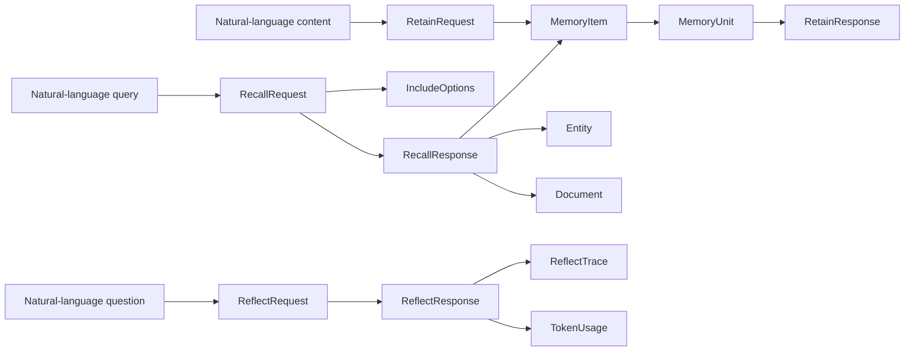
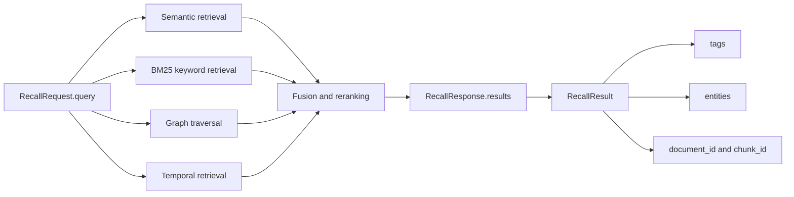
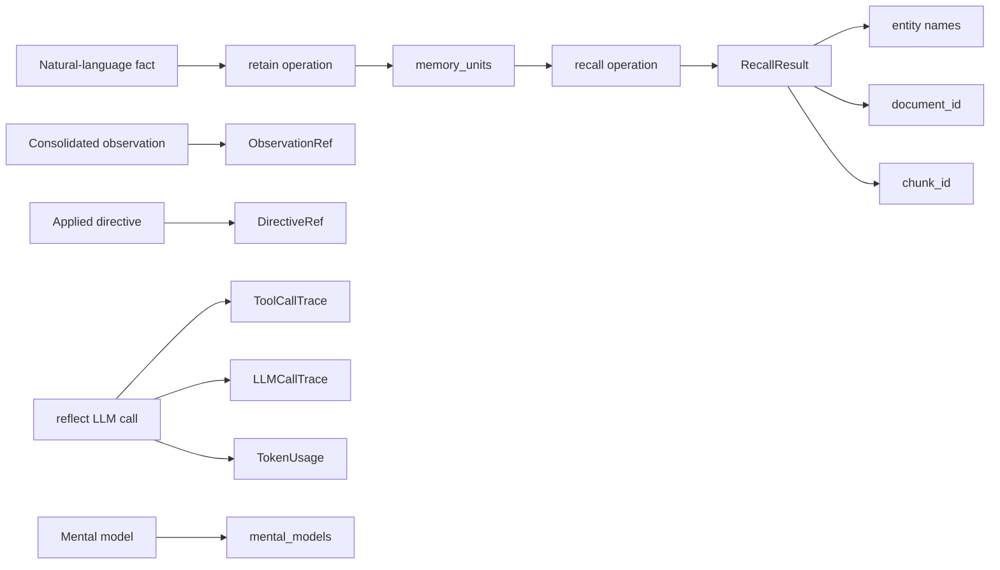

<!-- source: DeepWiki mcp.deepwiki.com · repo vectorize-io/hindsight · page 9.8 Data Models · fetched 2026-10-26 -->

# Data Models

Relevant source files

The following files were used as context for generating this wiki page:

- [hindsight-api-slim/hindsight_api/engine/response_models.py](hindsight-api-slim/hindsight_api/engine/response_models.py)
- [hindsight-api-slim/tests/store_seed.py](hindsight-api-slim/tests/store_seed.py)
- [hindsight-api-slim/tests/test_list_banks_ordered_page.py](hindsight-api-slim/tests/test_list_banks_ordered_page.py)
- [hindsight-api-slim/tests/test_list_banks_pagination.py](hindsight-api-slim/tests/test_list_banks_pagination.py)
- [hindsight-api-slim/tests/test_mental_model_scheduled_refresh.py](hindsight-api-slim/tests/test_mental_model_scheduled_refresh.py)
- [hindsight-api-slim/tests/test_op_cancellation.py](hindsight-api-slim/tests/test_op_cancellation.py)
- [hindsight-api-slim/tests/test_recall_min_score.py](hindsight-api-slim/tests/test_recall_min_score.py)
- [hindsight-api-slim/tests/test_recall_pipeline_toggles.py](hindsight-api-slim/tests/test_recall_pipeline_toggles.py)
- [hindsight-api-slim/tests/test_tag_scope.py](hindsight-api-slim/tests/test_tag_scope.py)
- [hindsight-docs/docs/developer/api/recall.mdx](hindsight-docs/docs/developer/api/recall.mdx)
- [hindsight-docs/docs/developer/observations.mdx](hindsight-docs/docs/developer/observations.mdx)
- [skills/hindsight-docs/references/developer/api/recall.md](skills/hindsight-docs/references/developer/api/recall.md)
- [skills/hindsight-docs/references/developer/observations.md](skills/hindsight-docs/references/developer/observations.md)

## Purpose and scope

This page is a reference for the data models that shape Hindsight’s retain, recall, and reflect operations, plus related memory, provenance, and usage data. It distinguishes internal engine response models from API-facing models: the engine models are intended to remain separate so API response shapes can stay stable as internal representations change. [hindsight-api-slim/hindsight_api/engine/response_models.py:1-7]()

The supplied source excerpts define some internal response and trace models and document recall behavior. They do not include the definitions of every API model named in this page; where field-level details are not available in those excerpts, this page identifies the model’s role without assuming an unverified schema. [hindsight-api-slim/hindsight_api/engine/response_models.py:1-16]()

Sources: [hindsight-api-slim/hindsight_api/engine/response_models.py:1-16]()

## Model layers and operation flow

The models fall into three useful groups: operation inputs and outputs, persisted memory and related records, and supporting options or telemetry. Recall’s documented result is a structured list of facts rather than raw documents; retrieval combines semantic, keyword, graph, and temporal strategies before returning that list. [hindsight-docs/docs/developer/api/recall.mdx:5-9]()

### Data flow: natural-language request to operation models

This diagram connects natural-language inputs with operation and model identifiers used in the API and engine. The request and response class names are shown as model identifiers; the available excerpts do not show the endpoint definitions or all model declarations. [hindsight-docs/docs/developer/api/recall.mdx:5-9]()

**Diagram: Operation models from natural language to engine response**

Sources: [hindsight-docs/docs/developer/api/recall.mdx:5-9](), [hindsight-api-slim/hindsight_api/engine/response_models.py:53-68]()

### Data flow: recall retrieval and result data

Recall accepts a natural-language query, runs four retrieval strategies in parallel, then fuses and reranks candidates into a ranked list of structured facts. A result can expose fact text and related fields such as type, context, metadata, tags, entities, occurrence times, retention time, document ID, and chunk ID. [hindsight-docs/docs/developer/api/recall.mdx:5-9](), [skills/hindsight-docs/references/developer/api/recall.md:20-35]()

**Diagram: Recall pipeline and code-facing model concepts**

Sources: [hindsight-docs/docs/developer/api/recall.mdx:5-9](), [skills/hindsight-docs/references/developer/api/recall.md:20-35]()

## Operation request and response models

### `MemoryItem`

`MemoryItem` is listed as a key retain model, but its definition and field declarations are not present in the supplied source excerpts. The available recall documentation describes returned facts, not the complete retain input schema; retain-specific fields should therefore be checked against the API model definition before relying on a particular field or default. [hindsight-docs/docs/developer/api/recall.mdx:5-9]()

Sources: [hindsight-docs/docs/developer/api/recall.mdx:5-9]()

### `RetainRequest` and `RetainResponse`

`RetainRequest` and `RetainResponse` are key operation models, but their declarations are not included in the supplied excerpts. This page does not assert their field names, validation rules, or whether a particular retain request is processed synchronously or asynchronously. [hindsight-api-slim/hindsight_api/engine/response_models.py:1-7]()

Sources: [hindsight-api-slim/hindsight_api/engine/response_models.py:1-7]()

### `RecallRequest`

`RecallRequest` represents the inputs controlling retrieval. The documented query is the only required recall parameter. The query drives semantic search, BM25 keyword search, graph traversal, and temporal parsing; the raw query is also passed to the cross-encoder reranker. Queries exceeding 500 tokens are rejected. [hindsight-docs/docs/developer/api/recall.mdx:48-56]()

| Parameter | Documented behavior |
|---|---|
| `query` | Natural-language question or statement; required. [hindsight-docs/docs/developer/api/recall.mdx:48-52]() |
| `types` | Selects `world`, `experience`, and/or `observation` facts; if omitted, all three types are searched. [hindsight-docs/docs/developer/api/recall.mdx:54-58]() |
| `prefer_observations` | When enabled with observations and raw fact types, lets observations supersede matching raw facts while backfilling result slots. [hindsight-docs/docs/developer/api/recall.mdx:85-90]() |
| `budget` | Retrieval depth setting: `low`, `mid` (default), or `high`. [hindsight-docs/docs/developer/api/recall.mdx:91-93]() |
| `max_tokens` | Maximum token budget for returned fact text; defaults to `4096`. [hindsight-docs/docs/developer/api/recall.mdx:110-115]() |

Recall types have distinct meanings: `world` represents objective facts, `experience` represents events and conversations, and `observation` represents deduplicated, evidence-grounded beliefs consolidated from multiple memories. [hindsight-docs/docs/developer/api/recall.mdx:54-58]()

Sources: [hindsight-docs/docs/developer/api/recall.mdx:48-58](), [hindsight-docs/docs/developer/api/recall.mdx:85-93](), [hindsight-docs/docs/developer/api/recall.mdx:110-115]()

### `RecallResponse`

The recall documentation describes a response containing structured fact results rather than raw documents. The documented result fields include the fact ID, text, type, context, metadata, tags, linked entity names, occurrence timestamps, retention timestamp, and document and chunk identifiers. [skills/hindsight-docs/references/developer/api/recall.md:20-35]()

The supplied sources do not include the `RecallResponse` class declaration, so they do not establish the complete response schema or the exact types and optionality of all response properties. [hindsight-docs/docs/developer/api/recall.mdx:5-9]()

Sources: [skills/hindsight-docs/references/developer/api/recall.md:20-35](), [hindsight-docs/docs/developer/api/recall.mdx:5-9]()

### `ReflectRequest`, `ReflectResponse`, and `ReflectTrace`

The supplied excerpts identify reflect as a core operation in the existing page context, but do not include the definitions of `ReflectRequest`, `ReflectResponse`, or a model named `ReflectTrace`. The available internal engine models do define `ToolCallTrace` and `LLMCallTrace`, which record individual tool and LLM calls made during reflect. [hindsight-api-slim/hindsight_api/engine/response_models.py:53-68]()

`ToolCallTrace` records a tool name, optional reason, input and output dictionaries, execution duration in milliseconds, and an iteration number. Its documented tool names are `lookup`, `recall`, `learn`, and `expand`. [hindsight-api-slim/hindsight_api/engine/response_models.py:53-61]()

`LLMCallTrace` records a call scope, such as `agent_1`, `agent_2`, or `final`, and its duration in milliseconds. [hindsight-api-slim/hindsight_api/engine/response_models.py:64-68]()

Sources: [hindsight-api-slim/hindsight_api/engine/response_models.py:53-68]()

## Internal engine models and traces

### `TokenUsage`

`TokenUsage` is an internal Pydantic model for per-request LLM usage metrics. Its fields default to zero: `input_tokens`, `output_tokens`, `total_tokens`, `cached_tokens`, and `thoughts_tokens`. Visible output and total tokens exclude reasoning/thought tokens; cached tokens are reported separately. [hindsight-api-slim/hindsight_api/engine/response_models.py:90-120]()

The model implements addition, returning a new `TokenUsage` whose corresponding fields are the sums of both operands. This supports aggregating usage across multiple calls. [hindsight-api-slim/hindsight_api/engine/response_models.py:122-130]()

| Field | Meaning |
|---|---|
| `input_tokens` | Prompt/input tokens consumed. [hindsight-api-slim/hindsight_api/engine/response_models.py:108-108]() |
| `output_tokens` | Visible output/completion tokens, excluding thoughts. [hindsight-api-slim/hindsight_api/engine/response_models.py:109-111]() |
| `total_tokens` | Input plus output tokens, excluding thoughts. [hindsight-api-slim/hindsight_api/engine/response_models.py:112-112]() |
| `cached_tokens` | Cached or cache-read prompt tokens, when reported. [hindsight-api-slim/hindsight_api/engine/response_models.py:113-113]() |
| `thoughts_tokens` | Reasoning/thinking tokens, which may be billed as output but are not part of visible output. [hindsight-api-slim/hindsight_api/engine/response_models.py:114-120]() |

Sources: [hindsight-api-slim/hindsight_api/engine/response_models.py:90-130]()

### `LLMToolCall`, `LLMToolCallResult`, and `LLMCallResult`

`LLMToolCall` represents an LLM-requested tool invocation. It has an identifier, tool name, argument dictionary, and an optional opaque `thought_signature` used by Gemini 3.1+ thinking models to preserve thought context across turns. [hindsight-api-slim/hindsight_api/engine/response_models.py:19-28]()

`LLMToolCallResult` represents the result of an LLM call that may include tool calls. It carries optional text content, a list of tool calls, an optional finish reason, and input, output, cached, and thoughts token counts. The token-count fields default to zero. [hindsight-api-slim/hindsight_api/engine/response_models.py:31-51]()

`LLMCallResult` packages a call’s parsed or textual `content` with a `TokenUsage` value. Its usage field defaults to an empty usage object, allowing callers to receive usage without changing the call’s return shape. [hindsight-api-slim/hindsight_api/engine/response_models.py:133-159]()

Sources: [hindsight-api-slim/hindsight_api/engine/response_models.py:19-51](), [hindsight-api-slim/hindsight_api/engine/response_models.py:133-159]()

### Trace and reference models

`ObservationRef` describes an observation accessed during reflect, with an ID, name, type, subtype, description, and optional full summary. The documented observation types include `entity`, `concept`, and `event`; subtypes include `structural`, `emergent`, and `learned`. [hindsight-api-slim/hindsight_api/engine/response_models.py:71-80]()

`DirectiveRef` describes a directive applied during reflect, with its ID, name, and content. [hindsight-api-slim/hindsight_api/engine/response_models.py:82-88]()

These references are distinct from the API model definitions: the supplied source establishes their internal engine shape, not a complete public response schema. [hindsight-api-slim/hindsight_api/engine/response_models.py:71-88]()

Sources: [hindsight-api-slim/hindsight_api/engine/response_models.py:71-88]()

## Memory and related record models

### `MemoryUnit`

`MemoryUnit` is named as a key model for persisted memory, but its definition is not included in the supplied excerpts. The recall documentation describes returned facts and their provenance fields, while the tests show that PostgreSQL-backed memory rows are stored in a `memory_units` table with fields including `id`, `bank_id`, `text`, `fact_type`, and, in some test paths, `embedding`. These test statements demonstrate specific database usage; they are not a complete `MemoryUnit` model declaration. [hindsight-api-slim/tests/test_recall_min_score.py:43-53](), [hindsight-api-slim/tests/test_mental_model_scheduled_refresh.py:86-103]()

Sources: [hindsight-api-slim/tests/test_recall_min_score.py:43-53](), [hindsight-api-slim/tests/test_mental_model_scheduled_refresh.py:86-103]()

### `Entity`

The recall result documentation says a fact can expose linked entity names. The supplied excerpts do not include the `Entity` model declaration, so fields for entity identity, metadata, links, or history cannot be specified here. [skills/hindsight-docs/references/developer/api/recall.md:20-35]()

Sources: [skills/hindsight-docs/references/developer/api/recall.md:20-35]()

### `Document`

The recall result documentation identifies `document_id` as the document a fact belongs to and `chunk_id` as the chunk from which it was extracted. The supplied excerpts do not include the `Document` model declaration or establish its complete fields. [skills/hindsight-docs/references/developer/api/recall.md:20-35]()

Sources: [skills/hindsight-docs/references/developer/api/recall.md:20-35]()

### `MentalModel` and `Directive`

The available tests show mental models persisted in a `mental_models` table with columns including `id`, `bank_id`, `subtype`, `name`, `source_query`, `content`, `tags`, `trigger`, `last_refreshed_at`, and `last_full_refreshed_at`. This is evidence of fields used by the tested persistence path, not a full public `MentalModel` model definition. [hindsight-api-slim/tests/test_mental_model_scheduled_refresh.py:50-83]()

The same test module constructs `MentalModelTrigger` values with refresh settings, validates cron expressions, and rejects the combination of `refresh_after_consolidation` and `refresh_cron`. [hindsight-api-slim/tests/test_mental_model_scheduled_refresh.py:25-42]()

The internal `DirectiveRef` model records the ID, name, and content of a directive applied during reflect. The supplied sources do not include the full persistent or API-facing `Directive` model. [hindsight-api-slim/hindsight_api/engine/response_models.py:82-88]()

Sources: [hindsight-api-slim/tests/test_mental_model_scheduled_refresh.py:25-42](), [hindsight-api-slim/tests/test_mental_model_scheduled_refresh.py:50-83](), [hindsight-api-slim/hindsight_api/engine/response_models.py:82-88]()

## Options and feature models

### `IncludeOptions`

`IncludeOptions` is a named model for controlling included response data, but its definition and supported fields are not present in the supplied excerpts. The recall documentation confirms that recall has parameters beyond the required query, but does not provide the `IncludeOptions` schema in the lines available here. [hindsight-docs/docs/developer/api/recall.mdx:48-58]()

Sources: [hindsight-docs/docs/developer/api/recall.mdx:48-58]()

### `TagGroup`

Tag groups provide structured tag filtering in the tested scope-resolution path. The test defines a `TagGroupLeaf` with tags and a `match` mode of `any_strict`; its assertions show that a matching tag grants scope, an untagged row does not match that strict scope, and an unrestricted `None` scope accepts tags. This describes the tested leaf behavior, not every supported tag-group form. [hindsight-api-slim/tests/test_tag_scope.py:20-30](), [hindsight-api-slim/tests/test_tag_scope.py:60-66]()

The same test shows that mental-model refresh filtering can combine a model’s own tag filter with the resolved scope. [hindsight-api-slim/tests/test_tag_scope.py:68-88]()

Sources: [hindsight-api-slim/tests/test_tag_scope.py:20-30](), [hindsight-api-slim/tests/test_tag_scope.py:60-88]()

### `FeaturesInfo`

`FeaturesInfo` is named as a key capability model, but its definition and fields are not included in the supplied excerpts. No feature flags or runtime capability behavior are asserted here. [hindsight-api-slim/hindsight_api/engine/response_models.py:1-7]()

Sources: [hindsight-api-slim/hindsight_api/engine/response_models.py:1-7]()

## Observation and recall result semantics

Observations are documented as consolidated, deduplicated beliefs grounded in supporting memories. They retain evidence references and evolve as new evidence arrives; the documentation also notes that reflect treats affected observations as stale when newer memories have not yet been consolidated. [hindsight-docs/docs/developer/observations.mdx:14-35]()

Recall can search observations alongside `world` and `experience` facts. With `prefer_observations`, an observation can replace a raw fact that contributed to it, and the freed result slots are backfilled with the next-best results. The option has no effect unless the requested types include observations and at least one raw fact type. [hindsight-docs/docs/developer/api/recall.mdx:85-90]()

Sources: [hindsight-docs/docs/developer/observations.mdx:14-35](), [hindsight-docs/docs/developer/api/recall.mdx:85-90]()

## Model-to-code reference

The following diagram links concepts described in natural language to identifiers in the supplied code and documentation. `memory_units` and `mental_models` are database table names visible in tests; `TokenUsage`, `ToolCallTrace`, and `LLMCallTrace` are internal Python class names. [hindsight-api-slim/tests/test_recall_min_score.py:43-53](), [hindsight-api-slim/tests/test_mental_model_scheduled_refresh.py:70-83](), [hindsight-api-slim/hindsight_api/engine/response_models.py:53-68]()

**Diagram: Natural-language concepts mapped to code entities**

Sources: [hindsight-api-slim/hindsight_api/engine/response_models.py:53-88](), [hindsight-api-slim/hindsight_api/engine/response_models.py:90-130](), [hindsight-api-slim/tests/test_recall_min_score.py:43-53](), [hindsight-api-slim/tests/test_mental_model_scheduled_refresh.py:70-83](), [skills/hindsight-docs/references/developer/api/recall.md:20-35]()

## Token budget and scoring notes

Recall’s `max_tokens` budget counts only the `text` field of each fact, not metadata, tags, entities, or other fields. Results are considered in relevance order; a fact too large for the remaining budget is skipped so shorter later results can still fit. If a query matched a fact but none fit, the top fact is returned whole and over budget rather than clipped; `max_tokens=0` explicitly requests no facts. [hindsight-docs/docs/developer/api/recall.mdx:110-115]()

Recall result scoring is tested as a structured object with `final`, `reranker`, `semantic`, and `keyword` scores. The tests assert descending `final` ordering and filtering by configured minimum score floors; these tests establish behavior for the tested implementation, not the complete public result model declaration. [hindsight-api-slim/tests/test_recall_min_score.py:1-10](), [hindsight-api-slim/tests/test_recall_min_score.py:101-118]()

Sources: [hindsight-docs/docs/developer/api/recall.mdx:110-115](), [hindsight-api-slim/tests/test_recall_min_score.py:1-10](), [hindsight-api-slim/tests/test_recall_min_score.py:101-118]()

## Source boundary

This reference describes only model fields and behaviors visible in the supplied source excerpts. For complete API schemas of `MemoryItem`, `RetainRequest`, `RetainResponse`, `RecallRequest`, `RecallResponse`, `ReflectRequest`, `ReflectResponse`, `MemoryUnit`, `Entity`, `Document`, `MentalModel`, `Directive`, `IncludeOptions`, `TagGroup`, and `FeaturesInfo`, consult their actual model declarations and the generated OpenAPI schema. The supplied excerpts do not contain enough source to verify those full declarations. [hindsight-api-slim/hindsight_api/engine/response_models.py:1-7]()

Sources: [hindsight-api-slim/hindsight_api/engine/response_models.py:1-7]()

---

