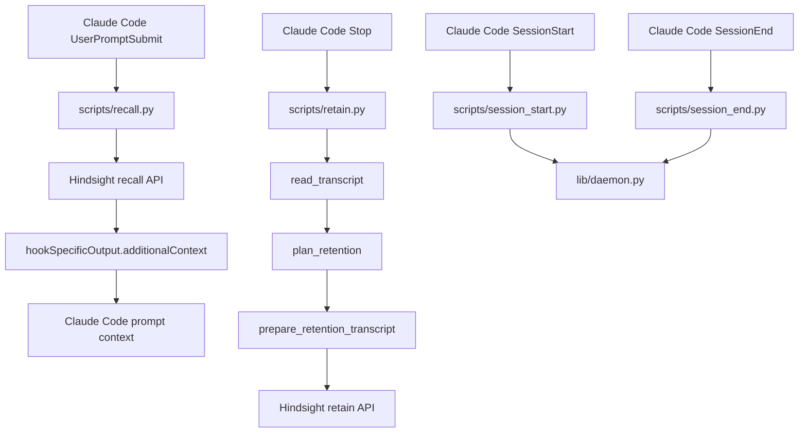
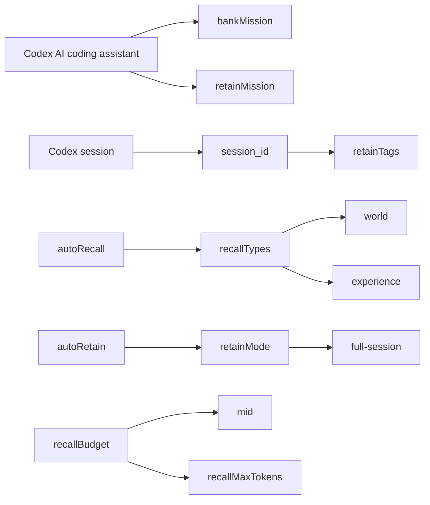
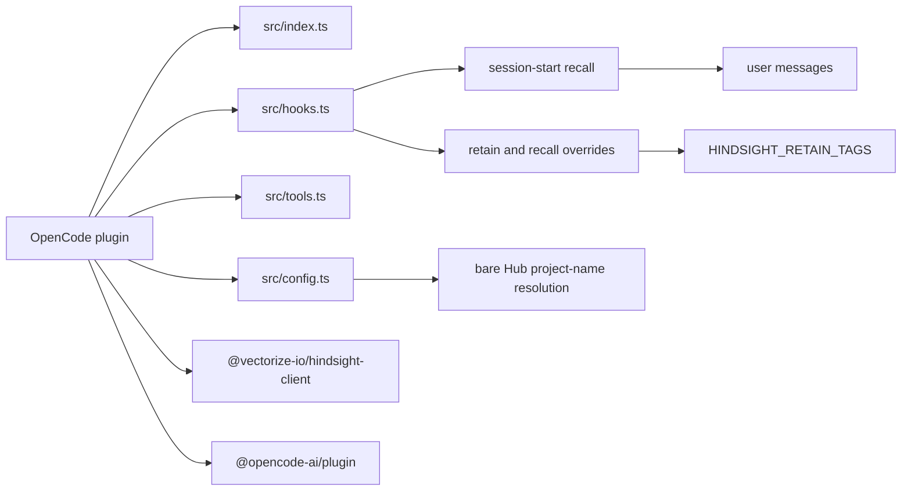

<!-- source: DeepWiki mcp.deepwiki.com · repo vectorize-io/hindsight · extra page Claude Code, Codex and OpenCode Plugins · fetched 2026-10-26 -->

# Claude Code, Codex and OpenCode Plugins

Relevant source files

The following files were used as context for generating this wiki page:

- [.claude-plugin/marketplace.json](.claude-plugin/marketplace.json)
- [hindsight-docs/docs-integrations/opencode.md](hindsight-docs/docs-integrations/opencode.md)
- [hindsight-docs/src/pages/changelog/integrations/claude-code.md](hindsight-docs/src/pages/changelog/integrations/claude-code.md)
- [hindsight-docs/src/pages/changelog/integrations/codex.md](hindsight-docs/src/pages/changelog/integrations/codex.md)
- [hindsight-docs/src/pages/changelog/integrations/opencode.md](hindsight-docs/src/pages/changelog/integrations/opencode.md)
- [hindsight-docs/static/get-codex](hindsight-docs/static/get-codex)
- [hindsight-integrations/claude-code/.claude-plugin/plugin.json](hindsight-integrations/claude-code/.claude-plugin/plugin.json)
- [hindsight-integrations/claude-code/.mcp.json](hindsight-integrations/claude-code/.mcp.json)
- [hindsight-integrations/claude-code/CHANGELOG.md](hindsight-integrations/claude-code/CHANGELOG.md)
- [hindsight-integrations/claude-code/README.md](hindsight-integrations/claude-code/README.md)
- [hindsight-integrations/claude-code/hooks/hooks.json](hindsight-integrations/claude-code/hooks/hooks.json)
- [hindsight-integrations/claude-code/requirements.txt](hindsight-integrations/claude-code/requirements.txt)
- [hindsight-integrations/claude-code/scripts/lib/client.py](hindsight-integrations/claude-code/scripts/lib/client.py)
- [hindsight-integrations/claude-code/scripts/lib/config.py](hindsight-integrations/claude-code/scripts/lib/config.py)
- [hindsight-integrations/claude-code/scripts/lib/state.py](hindsight-integrations/claude-code/scripts/lib/state.py)
- [hindsight-integrations/claude-code/scripts/mcp_server.py](hindsight-integrations/claude-code/scripts/mcp_server.py)
- [hindsight-integrations/claude-code/scripts/recall.py](hindsight-integrations/claude-code/scripts/recall.py)
- [hindsight-integrations/claude-code/scripts/retain.py](hindsight-integrations/claude-code/scripts/retain.py)
- [hindsight-integrations/claude-code/scripts/run_mcp.sh](hindsight-integrations/claude-code/scripts/run_mcp.sh)
- [hindsight-integrations/claude-code/scripts/session_end.py](hindsight-integrations/claude-code/scripts/session_end.py)
- [hindsight-integrations/claude-code/settings.json](hindsight-integrations/claude-code/settings.json)
- [hindsight-integrations/claude-code/skills/create-agent/SKILL.md](hindsight-integrations/claude-code/skills/create-agent/SKILL.md)
- [hindsight-integrations/claude-code/tests/test_client.py](hindsight-integrations/claude-code/tests/test_client.py)
- [hindsight-integrations/claude-code/tests/test_config.py](hindsight-integrations/claude-code/tests/test_config.py)
- [hindsight-integrations/claude-code/tests/test_hooks.py](hindsight-integrations/claude-code/tests/test_hooks.py)
- [hindsight-integrations/claude-code/tests/test_mcp_server.py](hindsight-integrations/claude-code/tests/test_mcp_server.py)
- [hindsight-integrations/claude-code/tests/test_run_mcp.py](hindsight-integrations/claude-code/tests/test_run_mcp.py)
- [hindsight-integrations/claude-code/tests/test_state.py](hindsight-integrations/claude-code/tests/test_state.py)
- [hindsight-integrations/codex/README.md](hindsight-integrations/codex/README.md)
- [hindsight-integrations/codex/scripts/lib/client.py](hindsight-integrations/codex/scripts/lib/client.py)
- [hindsight-integrations/codex/scripts/lib/config.py](hindsight-integrations/codex/scripts/lib/config.py)
- [hindsight-integrations/codex/scripts/lib/content.py](hindsight-integrations/codex/scripts/lib/content.py)
- [hindsight-integrations/codex/scripts/recall.py](hindsight-integrations/codex/scripts/recall.py)
- [hindsight-integrations/codex/scripts/retain.py](hindsight-integrations/codex/scripts/retain.py)
- [hindsight-integrations/codex/settings.json](hindsight-integrations/codex/settings.json)
- [hindsight-integrations/codex/tests/test_content.py](hindsight-integrations/codex/tests/test_content.py)
- [hindsight-integrations/codex/tests/test_hooks.py](hindsight-integrations/codex/tests/test_hooks.py)
- [hindsight-integrations/opencode/README.md](hindsight-integrations/opencode/README.md)
- [hindsight-integrations/opencode/package-lock.json](hindsight-integrations/opencode/package-lock.json)
- [hindsight-integrations/opencode/package.json](hindsight-integrations/opencode/package.json)
- [hindsight-integrations/opencode/src/config.test.ts](hindsight-integrations/opencode/src/config.test.ts)
- [hindsight-integrations/opencode/src/config.ts](hindsight-integrations/opencode/src/config.ts)
- [hindsight-integrations/opencode/src/e2e.test.ts](hindsight-integrations/opencode/src/e2e.test.ts)
- [hindsight-integrations/opencode/src/hooks.test.ts](hindsight-integrations/opencode/src/hooks.test.ts)
- [hindsight-integrations/opencode/src/hooks.ts](hindsight-integrations/opencode/src/hooks.ts)
- [hindsight-integrations/opencode/src/index.ts](hindsight-integrations/opencode/src/index.ts)
- [hindsight-integrations/opencode/src/logger.test.ts](hindsight-integrations/opencode/src/logger.test.ts)
- [hindsight-integrations/opencode/src/logger.ts](hindsight-integrations/opencode/src/logger.ts)
- [hindsight-integrations/opencode/src/plugin.test.ts](hindsight-integrations/opencode/src/plugin.test.ts)
- [hindsight-integrations/opencode/src/test-helpers.ts](hindsight-integrations/opencode/src/test-helpers.ts)
- [hindsight-integrations/opencode/src/tools.ts](hindsight-integrations/opencode/src/tools.ts)
- [skills/hindsight-docs/references/changelog/integrations/claude-code.md](skills/hindsight-docs/references/changelog/integrations/claude-code.md)
- [skills/hindsight-docs/references/changelog/integrations/codex.md](skills/hindsight-docs/references/changelog/integrations/codex.md)
- [skills/hindsight-docs/references/changelog/integrations/opencode.md](skills/hindsight-docs/references/changelog/integrations/opencode.md)

## Purpose and Scope

This page documents three standalone Hindsight integrations for coding-agent harnesses: the Claude Code plugin, Codex hooks and settings, and the OpenCode npm plugin. It focuses on how each integration connects agent sessions to Hindsight memory: configuration, recall and retention behavior, and the plugin surfaces identified in the available code and package metadata. [hindsight-integrations/claude-code/README.md:1-3]() [hindsight-integrations/codex/settings.json:1-53]() [hindsight-integrations/opencode/package.json:1-55]()

Sources: `hindsight-integrations/claude-code/README.md`, `hindsight-integrations/codex/settings.json`, `hindsight-integrations/opencode/package.json`

---

## 1. Claude Code Integration & Plugin Architecture

The Claude Code integration is distributed as the `hindsight-memory` plugin. Its documented integration points include hook scripts for session start, prompt submission, response completion, and session end; an MCP stdio server for knowledge tools; and a skill for creating memory-enabled subagents. [hindsight-integrations/claude-code/.claude-plugin/plugin.json:1-8]() [hindsight-integrations/claude-code/README.md:80-103]()

### Plugin Manifest and Configuration

The plugin manifest identifies the plugin as `hindsight-memory`, version `0.7.6`, and describes its automatic recall, transcript retention, and knowledge-page tools. [hindsight-integrations/claude-code/.claude-plugin/plugin.json:1-8]()

Configuration is merged in this order: built-in defaults, the plugin’s `settings.json`, the user file `~/.hindsight/claude-code.json`, then environment-variable overrides. The defaults include automatic recall and retention, a `mid` recall budget, a `full-session` retention mode, and options for recall tags, bank derivation, knowledge tools, and daemon connection. Environment values are cast according to the target setting type; list and dictionary values accept JSON, and list parsing also has a comma-separated fallback. [hindsight-integrations/claude-code/scripts/lib/config.py:11-67]()` [hindsight-integrations/claude-code/scripts/lib/config.py:69-120]()` [hindsight-integrations/claude-code/scripts/lib/config.py:123-168]()

| Configuration layer | Role |
|---|---|
| Built-in defaults | Baseline values for recall, retention, connection, bank, LLM, and miscellaneous options. [hindsight-integrations/claude-code/scripts/lib/config.py:11-67]() |
| Plugin `settings.json` | Plugin-distributed settings layered over defaults. [hindsight-integrations/claude-code/scripts/lib/config.py:135-155]() |
| `~/.hindsight/claude-code.json` | User settings that remain outside the version-specific plugin directory. [hindsight-integrations/claude-code/scripts/lib/config.py:135-158]() |
| Environment overrides | Typed overrides such as `HINDSIGHT_API_URL`, `HINDSIGHT_BANK_ID`, `HINDSIGHT_AUTO_RECALL`, and `HINDSIGHT_RETAIN_MODE`. [hindsight-integrations/claude-code/scripts/lib/config.py:69-96]() |

Sources: `hindsight-integrations/claude-code/.claude-plugin/plugin.json`, `hindsight-integrations/claude-code/scripts/lib/config.py`

### Hook Execution Flow

The plugin README maps Claude Code events to standalone scripts: `SessionStart` to `session_start.py`, `UserPromptSubmit` to `recall.py`, `Stop` to `retain.py`, and `SessionEnd` to `session_end.py`. Recall injects memories through `hookSpecificOutput.additionalContext`; retention reads the session transcript and sends it to Hindsight. [hindsight-integrations/claude-code/README.md:80-90]() [hindsight-integrations/claude-code/README.md:105-122]()

The `retain.py` entry point reads hook input from standard input, reads the transcript file, applies retention planning, resolves the API URL and bank, prepares the transcript, and posts it to Hindsight. Its documented exit behavior is graceful: it returns success even when an error occurs. [hindsight-integrations/claude-code/scripts/retain.py:1-18]() The transcript reader supports Claude Code’s nested JSONL message format and a flat format used for testing or compatibility. [hindsight-integrations/claude-code/scripts/retain.py:38-73]()

### Claude Code Hook Execution Flow Diagram

This maps Claude Code lifecycle names to the integration’s documented scripts and retention functions. The README describes the hook assignments and the `additionalContext` injection path; `retain.py` defines transcript reading and retention planning. [hindsight-integrations/claude-code/README.md:80-90]() [hindsight-integrations/claude-code/README.md:105-122]() [hindsight-integrations/claude-code/scripts/retain.py:27-35]() [hindsight-integrations/claude-code/scripts/retain.py:38-73]()

Sources: `hindsight-integrations/claude-code/README.md`, `hindsight-integrations/claude-code/scripts/retain.py`

### Retention Planning and Session State

`run_retain` exits early when `autoRetain` is disabled or the transcript contains no messages. When configured to retain every N turns, it increments the turn counter and skips until the configured interval, unless forced. In chunked mode it selects a sliding window based on `retainEveryNTurns` and `retainOverlapTurns`. In full-session mode it calls `plan_retention` to select the not-yet-retained suffix and detect transcript compaction. [hindsight-integrations/claude-code/scripts/retain.py:76-109]() [hindsight-integrations/claude-code/scripts/retain.py:111-146]()

Before submission, the script passes the selected messages, configured roles, and tool-call option to `prepare_retention_transcript`. It uses session-based document IDs for the initial full-session chunk and suffixed IDs for later chunks; chunked mode uses timestamp-based IDs. [hindsight-integrations/claude-code/scripts/retain.py:111-155]()

Sources: `hindsight-integrations/claude-code/scripts/retain.py`

### Knowledge Tools and MCP Server

The plugin README documents a local MCP stdio server, `mcp_server.py`, that exposes `agent_knowledge_*` tools. The listed tools cover knowledge-page listing, reading, creation, updating, and deletion; memory recall; text and file ingestion; and retrieval of the current bank ID. The README states that the bank ID is resolved from plugin configuration rather than supplied as a tool argument. [hindsight-integrations/claude-code/README.md:62-78]()

The plugin also includes the `/hindsight-memory:create-agent` skill for creating specialized subagents with memory, and documents that the workflow can seed content and create initial knowledge pages. [hindsight-integrations/claude-code/README.md:44-60]()

| Surface | Purpose |
|---|---|
| `mcp_server.py` | MCP stdio server for knowledge and memory tools. [hindsight-integrations/claude-code/README.md:80-103]() |
| `agent_knowledge_list_pages`, `agent_knowledge_get_page` | List and read knowledge pages. [hindsight-integrations/claude-code/README.md:62-78]() |
| `agent_knowledge_create_page`, `agent_knowledge_update_page`, `agent_knowledge_delete_page` | Manage knowledge pages. [hindsight-integrations/claude-code/README.md:62-78]() |
| `agent_knowledge_recall`, `agent_knowledge_ingest`, `agent_knowledge_ingest_file` | Search memories and ingest text or files. [hindsight-integrations/claude-code/README.md:62-78]() |
| `agent_knowledge_get_current_bank` | Resolve the active bank from plugin configuration. [hindsight-integrations/claude-code/README.md:62-78]() |

Sources: `hindsight-integrations/claude-code/README.md`

---

## 2. Codex Plugin and Hook Framework

The Codex integration directory contains hook scripts and a default `settings.json`. The provided settings describe the integration’s intended defaults for recall and retention, including automatic operations, full-session retention, Codex-specific bank and mission text, and session-tagged retention. [hindsight-integrations/codex/settings.json:1-53]() The available content does not include the hook implementations, so this section documents the settings schema rather than inferring hook internals.

### Configuration Schema

The default configuration uses `bankId: "codex"` and a bank mission describing a coding assistant focused on technical decisions, code changes, debugging, and project context. Its retention mission emphasizes technical decisions, code patterns, debugging solutions, preferences, project context, and architecture while excluding routine greetings and transient operational details. [hindsight-integrations/codex/settings.json:1-6]()

| Setting | Default | Meaning |
|---|---|---|
| `autoRecall`, `autoRetain` | `true` | Enable automatic recall and retention by default. [hindsight-integrations/codex/settings.json:7-8]() |
| `retainMode` | `"full-session"` | Select the default retention mode. [hindsight-integrations/codex/settings.json:9]() |
| `recallBudget`, `recallMaxTokens` | `"mid"`, `1024` | Set the recall budget and token limit. [hindsight-integrations/codex/settings.json:10-12]() |
| `recallTypes` | `["world", "experience"]` | Include world and experience memories in recall. [hindsight-integrations/codex/settings.json:14-18]() |
| `recallContextTurns`, `recallMaxQueryChars` | `1`, `800` | Bound the turn context and query length. [hindsight-integrations/codex/settings.json:18-19]() |
| `retainToolCalls`, `retainRoles` | `true`, `["user", "assistant"]` | Configure tool-call retention and included roles. [hindsight-integrations/codex/settings.json:25-29]() |
| `retainEveryNTurns`, `retainOverlapTurns` | `10`, `2` | Set the retention interval and overlap window. [hindsight-integrations/codex/settings.json:30-31]() |
| `retainTags` | `["{session_id}"]` | Add the session identifier as a retention tag. [hindsight-integrations/codex/settings.json:32-34]() |
| `retainContext` | `"codex"` | Set the configured retention context. [hindsight-integrations/codex/settings.json:35-36]() |
| `dynamicBankId` | `false` | Disable dynamic bank derivation by default. [hindsight-integrations/codex/settings.json:41-47]() |

Sources: `hindsight-integrations/codex/settings.json`

### Codex Configuration-to-Entity Diagram

This diagram associates Codex-facing configuration names with the code entities and concepts exposed by the supplied settings file. It describes configured behavior, not unprovided hook call paths. [hindsight-integrations/codex/settings.json:4-36]()

Sources: `hindsight-integrations/codex/settings.json`

---

## 3. OpenCode Plugin (`@vectorize-io/opencode-hindsight`)

OpenCode is packaged as the npm module `@vectorize-io/opencode-hindsight`, version `0.2.9`. Its package metadata identifies `dist/index.js` as the runtime entry point, `dist/index.d.ts` as the type entry point, and `hindsight-integrations/opencode/src/index.ts` as the source entry point implied by the package layout. It depends on the OpenCode plugin SDK and the Hindsight TypeScript client, and declares Node.js `>=22`. [hindsight-integrations/opencode/package.json:1-13]() [hindsight-integrations/opencode/package.json:44-55]()

### Package and Build Setup

The package uses `tsup` to build, TypeScript watch mode for development, and Vitest for tests. Its `prepublishOnly` script cleans and builds the distribution output. [hindsight-integrations/opencode/package.json:31-42]()

| Package property | Value |
|---|---|
| Package name and version | `@vectorize-io/opencode-hindsight`, `0.2.9`. [hindsight-integrations/opencode/package.json:1-4]() |
| Runtime and types | `dist/index.js`, `dist/index.d.ts`. [hindsight-integrations/opencode/package.json:5-12]() |
| Plugin SDK | `@opencode-ai/plugin`. [hindsight-integrations/opencode/package.json:44-46]() |
| Hindsight client | `@vectorize-io/hindsight-client`. [hindsight-integrations/opencode/package.json:44-46]() |
| Node engine | `>=22`. [hindsight-integrations/opencode/package.json:54-55]() |
| Build and tests | `tsup`, `tsc --watch`, and Vitest scripts. [hindsight-integrations/opencode/package.json:35-42]() |

Sources: `hindsight-integrations/opencode/package.json`

### Hooks, Tools, Configuration, and Bank Derivation

The OpenCode integration source tree includes `src/index.ts`, `src/hooks.ts`, `src/tools.ts`, and `src/config.ts`, alongside test files for hooks, plugin behavior, configuration, and end-to-end operation. The supplied package metadata confirms that this is a TypeScript plugin package, but the contents of those implementation files were not included here; consequently, exact hook names, tool signatures, configuration fields, and bank-derivation algorithms cannot be specified from the available source excerpts. [hindsight-integrations/opencode/package.json:5-12]() [hindsight-integrations/opencode/package.json:35-52]()

The available changelog records that session-start recall was changed to base its query on user messages, that the integration supports environment overrides for retain/recall behavior and `HINDSIGHT_RETAIN_TAGS`, and that a `shared` observation-scope option was added. It also records a dedicated User-Agent and a fix for bare Hub project-name resolution. [hindsight-docs/src/pages/changelog/integrations/opencode.md:17-23]() [hindsight-docs/src/pages/changelog/integrations/opencode.md:25-40]() [hindsight-docs/src/pages/changelog/integrations/opencode.md:42-50]()

### OpenCode Natural-Language-to-Code Entity Diagram

The diagram links OpenCode integration concepts documented in the package and changelog to source entities named in the integration tree. The changelog establishes the behavior-level concepts; the package metadata establishes the TypeScript package and client dependency. [hindsight-integrations/opencode/package.json:1-13]() [hindsight-integrations/opencode/package.json:44-46]() [hindsight-docs/src/pages/changelog/integrations/opencode.md:17-40]()

Sources: `hindsight-integrations/opencode/package.json`, `hindsight-docs/src/pages/changelog/integrations/opencode.md`

---

## 4. Integration Comparison

The three integrations expose different levels of implementation detail in the supplied files. Claude Code’s documentation and scripts specify its hook lifecycle, transcript retention, configuration precedence, and MCP knowledge tools. Codex’s supplied settings establish its default bank, missions, and recall/retention options. OpenCode’s package metadata establishes its TypeScript/npm packaging and dependencies, while its changelog provides selected behavior and configuration updates. [hindsight-integrations/claude-code/README.md:62-122]() [hindsight-integrations/claude-code/scripts/retain.py:76-155]() [hindsight-integrations/codex/settings.json:1-53]() [hindsight-integrations/opencode/package.json:1-55]() [hindsight-docs/src/pages/changelog/integrations/opencode.md:17-50]()

| Integration | Harness interface documented here | Memory surfaces evidenced by supplied files |
|---|---|---|
| Claude Code | Lifecycle hooks and MCP stdio server. [hindsight-integrations/claude-code/README.md:80-90]() | Prompt recall, transcript retention, knowledge tools, and bank resolution. [hindsight-integrations/claude-code/README.md:62-78]() [hindsight-integrations/claude-code/README.md:105-122]() |
| Codex | Configuration defaults; hook implementation details are not included in the supplied excerpts. [hindsight-integrations/codex/settings.json:1-53]() | Automatic recall/retention settings, Codex bank mission, memory types, and session tagging. [hindsight-integrations/codex/settings.json:4-36]() |
| OpenCode | TypeScript npm plugin package. [hindsight-integrations/opencode/package.json:1-13]() | Changelog evidence for user-message-based session-start recall, retain/recall overrides, tags, and project-name resolution. [hindsight-docs/src/pages/changelog/integrations/opencode.md:17-40]() |

Sources: `hindsight-integrations/claude-code/README.md`, `hindsight-integrations/claude-code/scripts/retain.py`, `hindsight-integrations/codex/settings.json`, `hindsight-integrations/opencode/package.json`, `hindsight-docs/src/pages/changelog/integrations/opencode.md`

---

