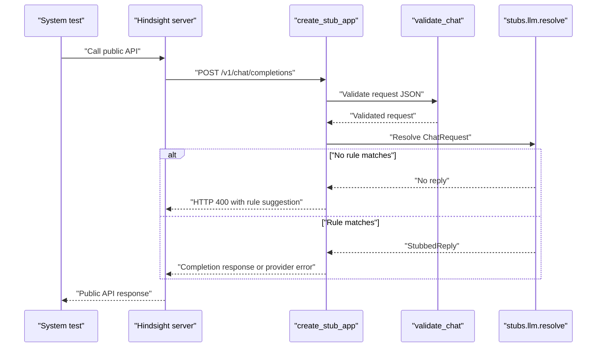
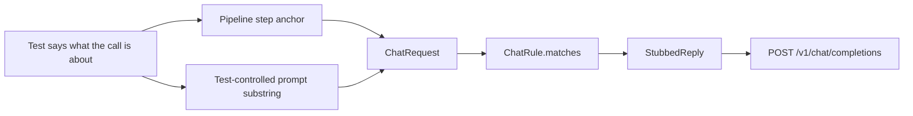
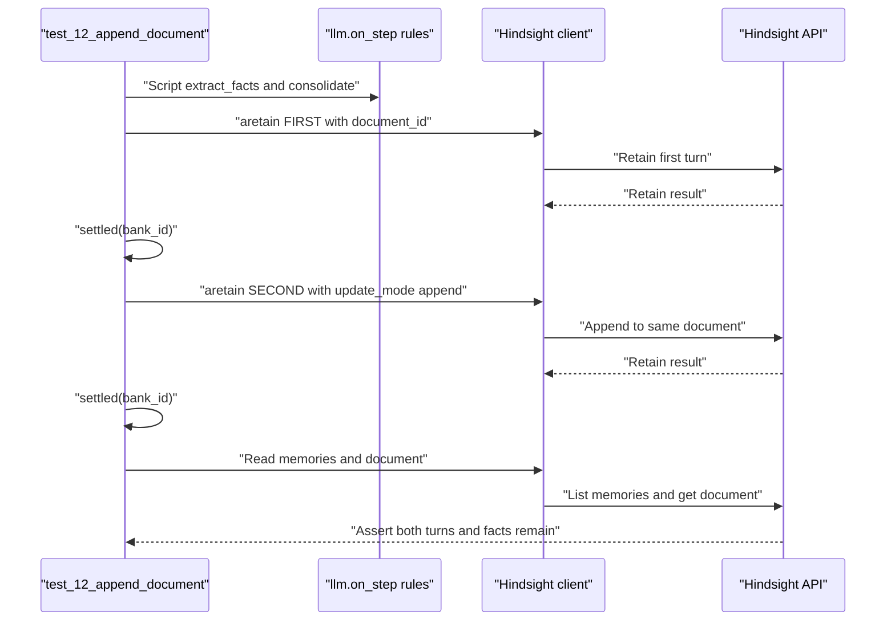
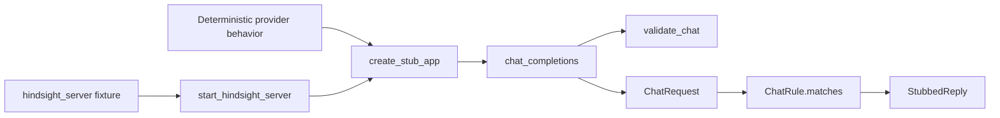

<!-- source: DeepWiki mcp.deepwiki.com · repo vectorize-io/hindsight · extra page System Tests and Stub Server · fetched 2026-10-26 -->

# System Tests and Stub Server

Relevant source files

The following files were used as context for generating this wiki page:

- [hindsight-api-slim/hindsight_api/alembic/versions/e4a7c1b9d2f6_drop_memory_units_access_count.py](hindsight-api-slim/hindsight_api/alembic/versions/e4a7c1b9d2f6_drop_memory_units_access_count.py)
- [hindsight-api-slim/hindsight_api/engine/audit.py](hindsight-api-slim/hindsight_api/engine/audit.py)
- [hindsight-api-slim/hindsight_api/engine/background_writes.py](hindsight-api-slim/hindsight_api/engine/background_writes.py)
- [hindsight-api-slim/hindsight_api/engine/db/optional_routines.py](hindsight-api-slim/hindsight_api/engine/db/optional_routines.py)
- [hindsight-api-slim/hindsight_api/engine/llm_trace.py](hindsight-api-slim/hindsight_api/engine/llm_trace.py)
- [hindsight-api-slim/hindsight_api/engine/retain/fold.py](hindsight-api-slim/hindsight_api/engine/retain/fold.py)
- [hindsight-api-slim/hindsight_api/engine/task_backend.py](hindsight-api-slim/hindsight_api/engine/task_backend.py)
- [hindsight-api-slim/hindsight_api/tracing.py](hindsight-api-slim/hindsight_api/tracing.py)
- [hindsight-api-slim/hindsight_api/worker/main.py](hindsight-api-slim/hindsight_api/worker/main.py)
- [hindsight-api-slim/hindsight_api/worker/poller.py](hindsight-api-slim/hindsight_api/worker/poller.py)
- [hindsight-api-slim/tests/conftest.py](hindsight-api-slim/tests/conftest.py)
- [hindsight-api-slim/tests/test_async_batch_retain.py](hindsight-api-slim/tests/test_async_batch_retain.py)
- [hindsight-api-slim/tests/test_audit_per_bank.py](hindsight-api-slim/tests/test_audit_per_bank.py)
- [hindsight-api-slim/tests/test_background_writes.py](hindsight-api-slim/tests/test_background_writes.py)
- [hindsight-api-slim/tests/test_chunking.py](hindsight-api-slim/tests/test_chunking.py)
- [hindsight-api-slim/tests/test_claim_bank_serialization.py](hindsight-api-slim/tests/test_claim_bank_serialization.py)
- [hindsight-api-slim/tests/test_llm_provider.py](hindsight-api-slim/tests/test_llm_provider.py)
- [hindsight-api-slim/tests/test_llm_trace.py](hindsight-api-slim/tests/test_llm_trace.py)
- [hindsight-api-slim/tests/test_mental_model_refresh_pending_dedupe_3487.py](hindsight-api-slim/tests/test_mental_model_refresh_pending_dedupe_3487.py)
- [hindsight-api-slim/tests/test_migration_drop_access_count.py](hindsight-api-slim/tests/test_migration_drop_access_count.py)
- [hindsight-api-slim/tests/test_retain_append_mode.py](hindsight-api-slim/tests/test_retain_append_mode.py)
- [hindsight-api-slim/tests/test_retain_document_serialization.py](hindsight-api-slim/tests/test_retain_document_serialization.py)
- [hindsight-api-slim/tests/test_retain_outbox_session.py](hindsight-api-slim/tests/test_retain_outbox_session.py)
- [hindsight-api-slim/tests/test_structured_chunk_size_retain.py](hindsight-api-slim/tests/test_structured_chunk_size_retain.py)
- [hindsight-api-slim/tests/test_tracing.py](hindsight-api-slim/tests/test_tracing.py)
- [hindsight-api-slim/tests/test_tracing_context_propagation.py](hindsight-api-slim/tests/test_tracing_context_propagation.py)
- [hindsight-api-slim/tests/test_tracing_task_handoff.py](hindsight-api-slim/tests/test_tracing_task_handoff.py)
- [hindsight-api-slim/tests/test_worker.py](hindsight-api-slim/tests/test_worker.py)
- [hindsight-api-slim/tests/test_worker_main.py](hindsight-api-slim/tests/test_worker_main.py)
- [hindsight-system-tests/README.md](hindsight-system-tests/README.md)
- [hindsight-system-tests/hindsight_system_tests/rulebook.py](hindsight-system-tests/hindsight_system_tests/rulebook.py)
- [hindsight-system-tests/hindsight_system_tests/server.py](hindsight-system-tests/hindsight_system_tests/server.py)
- [hindsight-system-tests/hindsight_system_tests/stub_server.py](hindsight-system-tests/hindsight_system_tests/stub_server.py)
- [hindsight-system-tests/hindsight_system_tests/validation.py](hindsight-system-tests/hindsight_system_tests/validation.py)
- [hindsight-system-tests/tests/conftest.py](hindsight-system-tests/tests/conftest.py)
- [hindsight-system-tests/tests/test_12_append_document.py](hindsight-system-tests/tests/test_12_append_document.py)
- [hindsight-system-tests/tests/test_65_provider_outages.py](hindsight-system-tests/tests/test_65_provider_outages.py)

## Purpose and Scope

This page documents the system-test architecture and test-harness behavior visible in the supplied code: the HTTP provider stub, its rulebook and validation boundary, pytest fixture setup, and the append-document end-to-end scenario. It also describes worker-related test isolation where shown. The supplied excerpts do not include the numbered scenario files for banks, consolidation, disposition, knowledge pages, entity links, or delete concurrency, nor files from `hindsight-integration-tests`; those suites therefore cannot be described in implementation detail here. [hindsight-system-tests/hindsight_system_tests/stub_server.py:1-20]()[hindsight-system-tests/hindsight_system_tests/rulebook.py:1-18]()[hindsight-system-tests/tests/conftest.py:1-7]()[hindsight-system-tests/tests/test_12_append_document.py:1-11]()

**Sources:** [hindsight-system-tests/hindsight_system_tests/stub_server.py:1-20](), [hindsight-system-tests/hindsight_system_tests/rulebook.py:1-18](), [hindsight-system-tests/tests/conftest.py:1-7](), [hindsight-system-tests/tests/test_12_append_document.py:1-11]()

## 1. Stub Server

### Overview

The system-test provider stub is a FastAPI server used over real HTTP by the Hindsight server. Environment variables configure the production provider clients to send requests to the stub’s chat-completions, embeddings, and reranker endpoints. The stub also documents an Anthropic-provider path, including Messages API and OAuth token exchange routes. This setup exercises provider client behavior without monkeypatching provider classes inside `hindsight_api`. [hindsight-system-tests/hindsight_system_tests/stub_server.py:1-20]()

The stub’s purpose is not to fabricate a plausible answer when a test forgets to script one. Instead, it resolves requests against rules and makes an unmatched chat call fail with HTTP 400 and a suggested rule. This makes unexpected provider requests visible in the test that caused them. [hindsight-system-tests/hindsight_system_tests/rulebook.py:5-18]()[hindsight-system-tests/hindsight_system_tests/stub_server.py:63-73]()

**Sources:** [hindsight-system-tests/hindsight_system_tests/stub_server.py:1-20](), [hindsight-system-tests/hindsight_system_tests/rulebook.py:5-18]()

### Request and Response Flow

For chat completions, the route reads the JSON body, calls `validate_chat()`, and constructs a `ChatRequest` containing the model, messages, available tool names, bearer key, and lowercased request headers. It resolves that request through `stubs.llm.resolve()`. If no rule matches, the handler logs a suggested rule and returns a provider-style 400 error; if a rule specifies a provider error, the handler returns that status and any configured `Retry-After`. Otherwise, it constructs an OpenAI-compatible completion response, including usage fields. [hindsight-system-tests/hindsight_system_tests/stub_server.py:50-106]()

The stub can hold a matched request after rule resolution. The route records and matches the call first, then parks it if `hold_for()` returns a hold. This allows a test to synchronize around an already-matched provider step while its response is still outstanding. [hindsight-system-tests/hindsight_system_tests/stub_server.py:75-80]()

**Sources:** [hindsight-system-tests/hindsight_system_tests/stub_server.py:50-106]()

**Diagram: Provider request path through the stub**

**Sources:** [hindsight-system-tests/hindsight_system_tests/stub_server.py:50-106](), [hindsight-system-tests/hindsight_system_tests/rulebook.py:34-46]()[hindsight-system-tests/hindsight_system_tests/rulebook.py:70-94]()

### Routes and Provider Compatibility

The visible stub implementation includes `/health`, `/v1/chat/completions`, `/v1/oauth/token`, and `/v1/messages`. The module’s introductory documentation also identifies `/v1/embeddings`, `/rerank`, and `/v1/systemone` as configured provider endpoints. The supplied excerpt does not show the implementations of those latter routes, so their detailed request and response behavior is not specified here. [hindsight-system-tests/hindsight_system_tests/stub_server.py:1-14]()[hindsight-system-tests/hindsight_system_tests/stub_server.py:38-50]()[hindsight-system-tests/hindsight_system_tests/stub_server.py:108-154]()

`/v1/messages` translates the Anthropic request into the rulebook’s `ChatRequest` shape: a separate `system` value is prepended as a system message, and the handler resolves the result against the same LLM rules. The code comment explicitly notes that tool-use turns are not translated on this route. `/v1/oauth/token` records each exchange and returns a numbered stub access token. [hindsight-system-tests/hindsight_system_tests/stub_server.py:108-154]()

**Sources:** [hindsight-system-tests/hindsight_system_tests/stub_server.py:1-14](), [hindsight-system-tests/hindsight_system_tests/stub_server.py:38-50](), [hindsight-system-tests/hindsight_system_tests/stub_server.py:108-154]()

### Code entities behind the stub

| System-test concept | Code entity | Role |
|---|---|---|
| FastAPI provider stub | `create_stub_app(stubs)` | Builds the stub application and its routes. [hindsight-system-tests/hindsight_system_tests/stub_server.py:38-50]() |
| Parsed rule input | `ChatRequest` | Carries model, messages, offered tools, key, and headers for rule matching. [hindsight-system-tests/hindsight_system_tests/rulebook.py:34-46]() |
| Scripted response | `StubbedReply` | Holds the assistant message, finish reason, optional usage values, or configured provider error. [hindsight-system-tests/hindsight_system_tests/rulebook.py:70-95]() |
| Rule predicate | `ChatRule.matches()` | Filters by tool requirements and prompt substrings. [hindsight-system-tests/hindsight_system_tests/rulebook.py:105-131]() |
| Strict unmatched-call behavior | `stubs.llm.resolve()` result handling | Returns a 400 error and rule suggestion when resolution produces no reply. [hindsight-system-tests/hindsight_system_tests/stub_server.py:63-73]() |

**Sources:** [hindsight-system-tests/hindsight_system_tests/stub_server.py:38-73](), [hindsight-system-tests/hindsight_system_tests/rulebook.py:34-46]()[hindsight-system-tests/hindsight_system_tests/rulebook.py:70-95]()[hindsight-system-tests/hindsight_system_tests/rulebook.py:105-131]()

## 2. Rulebook and Validation Harness

### Rule matching

Rules match on request content rather than the complete serialized request body. The rulebook’s rationale is to avoid making tests brittle when prompts change: tests control the relevant input content and pipeline step, while implementation prompts may evolve. Unmatched calls are errors rather than being answered by a permissive fallback. [hindsight-system-tests/hindsight_system_tests/rulebook.py:5-18]()

A `ChatRequest` exposes `user_text` and `all_text`, extracting textual content from string messages or OpenAI-style content-part lists. A `ChatRule` can require that tools are present, require a particular tool name, and require every configured substring to occur in `all_text`. These tool predicates help distinguish turns that share prompt text but offer different tools. [hindsight-system-tests/hindsight_system_tests/rulebook.py:34-67]()[hindsight-system-tests/hindsight_system_tests/rulebook.py:105-131]()

**Sources:** [hindsight-system-tests/hindsight_system_tests/rulebook.py:5-18](), [hindsight-system-tests/hindsight_system_tests/rulebook.py:34-67](), [hindsight-system-tests/hindsight_system_tests/rulebook.py:105-131]()

### Scripted reply forms

`StubbedReply` represents an assistant message plus its `finish_reason`. It can also specify visible completion tokens, reasoning tokens, a provider error status, and a `Retry-After` value. The `RuleBuilder` offers structured-output replies via a Pydantic model, text replies, request-computed replies, and provider failures. Structured payloads are serialized from the model, so malformed fields fail while the test rule is being built rather than later in the application pipeline. [hindsight-system-tests/hindsight_system_tests/rulebook.py:70-95]()[hindsight-system-tests/hindsight_system_tests/rulebook.py:134-178]()

**Sources:** [hindsight-system-tests/hindsight_system_tests/rulebook.py:70-95](), [hindsight-system-tests/hindsight_system_tests/rulebook.py:134-178]()

### Validation boundary

The chat route calls `validate_chat(body)` before constructing the rulebook request. The stub installs a `RequestRejected` exception handler that records the rejected request in `stubs.rejected_requests` and responds with a provider-shaped invalid-request error. The supplied `validation.py` excerpt is not present, so the specific accepted fields and validation rules are not enumerated here. [hindsight-system-tests/hindsight_system_tests/stub_server.py:31-44]()[hindsight-system-tests/hindsight_system_tests/stub_server.py:50-61]()

**Sources:** [hindsight-system-tests/hindsight_system_tests/stub_server.py:31-44](), [hindsight-system-tests/hindsight_system_tests/stub_server.py:50-61]()

**Diagram: Natural-language test intent mapped to rulebook entities**

**Sources:** [hindsight-system-tests/hindsight_system_tests/rulebook.py:5-18]()[hindsight-system-tests/hindsight_system_tests/rulebook.py:34-46]()[hindsight-system-tests/hindsight_system_tests/rulebook.py:105-131](), [hindsight-system-tests/hindsight_system_tests/stub_server.py:50-106]()

## 3. Pytest Fixtures and Guards

### Session-scoped servers

The system-test `conftest.py` defines a session-scoped `Stubs` instance and starts the stub server from it. The main `hindsight_server` fixture starts a Hindsight server configured with the stub URL, sweeps leftover banks before yielding the server, and stops it after the session. The startup sweep handles banks left behind by a run that ended mid-test. [hindsight-system-tests/tests/conftest.py:33-56]()

Additional server fixtures are process-scoped variants for server-level configuration. The shown `typesafe_server` configures a TypeSafe reranker and reflect decision model, and disables its worker because the servers share a database and a worker could process another server’s queued work with the wrong configuration. `decision_model_server` and `wif_server` similarly disable workers for the shared-database reason described in their fixture comments. [hindsight-system-tests/tests/conftest.py:59-115]()[hindsight-system-tests/tests/conftest.py:124-153]()

**Sources:** [hindsight-system-tests/tests/conftest.py:33-56](), [hindsight-system-tests/tests/conftest.py:59-115](), [hindsight-system-tests/tests/conftest.py:124-153]()

### Test-level state and client setup

The visible fixture excerpt imports the `Hindsight` client and defines `BANK_PREFIX = "systest-"`. It also defines session-scoped server fixtures and a `SettleFn` type for an asynchronous bank-settling callback. The supplied excerpt ends before the remaining fixtures, so it does not establish the implementation details of a per-test client, bank cleanup fixture, rulebook reset, or post-test unmatched-request guard. [hindsight-system-tests/tests/conftest.py:16-34]()

**Sources:** [hindsight-system-tests/tests/conftest.py:16-34]()

### Worker test isolation

The worker unit-test file uses an xdist group because it shares database state with related worker tests. It provisions a private migrated PostgreSQL schema, pins the pool’s `search_path` to that schema, and clears `async_operations` before and after each test. This avoids unrelated pending operations competing for claims and prevents cleanup from deleting another worker’s in-flight rows. [hindsight-api-slim/tests/test_worker.py:35-63]()[hindsight-api-slim/tests/test_worker.py:111-159]()

Async batch-retain tests use the same `worker_tests` xdist group because they submit operations that the engine-owned worker drains; the file comments identify cross-worker task stealing as the reason for serialization. [hindsight-api-slim/tests/test_async_batch_retain.py:12-17]()

**Sources:** [hindsight-api-slim/tests/test_worker.py:35-63]()[hindsight-api-slim/tests/test_worker.py:111-159](), [hindsight-api-slim/tests/test_async_batch_retain.py:12-17]()

## 4. End-to-End Scenarios

The supplied system-test scenario excerpt is `test_12_append_document.py`. It scripts extraction and consolidation responses, retains an initial turn, appends another turn to the same document, and waits for the bank to settle after each operation. The test file explains the contract it protects: append must preserve existing document history rather than applying replacement-style removal to facts absent from the new fragment. [hindsight-system-tests/tests/test_12_append_document.py:1-11]()[hindsight-system-tests/tests/test_12_append_document.py:34-52]()

### Append behavior covered by the scenario

| Assertion area | Behavior checked |
|---|---|
| Earlier turn retained | After appending the cello turn, both the Berlin and cello facts remain valid. [hindsight-system-tests/tests/test_12_append_document.py:55-59]() |
| One accumulated document | The document’s `original_text` contains both turns in order, and its memory-unit count is two. [hindsight-system-tests/tests/test_12_append_document.py:61-68]() |
| Repeated append | Re-sending the same turn does not duplicate the resulting fact. [hindsight-system-tests/tests/test_12_append_document.py:70-76]() |
| Oversized structured append | A large JSON tail preserves the original and appended turns when the document is parsed back as JSON. [hindsight-system-tests/tests/test_12_append_document.py:79-109]() |
| Retain settings | The later portion of the scenario configures a custom retain strategy and documents why append must preserve the settings used for reprocessing. [hindsight-system-tests/tests/test_12_append_document.py:111-145]() |

**Sources:** [hindsight-system-tests/tests/test_12_append_document.py:1-11]()[hindsight-system-tests/tests/test_12_append_document.py:34-109]()[hindsight-system-tests/tests/test_12_append_document.py:111-145]()

The API-level append tests also check that append requires a `document_id`, behaves like a normal retain when the document does not yet exist, concatenates new content with existing document content, and leaves facts from both portions recallable. [hindsight-api-slim/tests/test_retain_append_mode.py:24-88]()[hindsight-api-slim/tests/test_retain_append_mode.py:138-188]()

**Sources:** [hindsight-api-slim/tests/test_retain_append_mode.py:24-88]()[hindsight-api-slim/tests/test_retain_append_mode.py:138-188]()

### Scenario flow

**Sources:** [hindsight-system-tests/tests/test_12_append_document.py:34-68](), [hindsight-system-tests/tests/test_12_append_document.py:70-76]()

### Numbered scenario coverage not present in supplied excerpts

The requested broader list includes bank lifecycle, consolidation, disposition, knowledge pages, entity links, and delete concurrency. The supplied file contents do not include those scenario implementations or their fixture definitions, so their test names, setup, assertions, and call flows cannot be documented reliably from the available evidence. [hindsight-system-tests/tests/test_12_append_document.py:1-11]()

**Sources:** [hindsight-system-tests/tests/test_12_append_document.py:1-11]()

## 5. Worker and Supporting Test Coverage

Worker behavior is exercised separately in `hindsight-api-slim/tests/test_worker.py`. Its module description lists coverage for task submission and storage, `WorkerPoller` claiming with `FOR UPDATE SKIP LOCKED`, concurrent claims, task completion and failure, retries, and worker decommissioning. The shown portion also demonstrates the isolated-schema fixture used to make exact claim-count assertions independent from unrelated pending rows. [hindsight-api-slim/tests/test_worker.py:1-10]()[hindsight-api-slim/tests/test_worker.py:40-63]()

The worker implementation describes database polling and safe concurrent claiming, while `worker/main.py` builds a worker process with health and metrics endpoints. The worker test fixture’s isolation strategy is therefore relevant to deterministic task-claim tests, but it is distinct from the system-test HTTP provider harness. [hindsight-api-slim/hindsight_api/worker/poller.py:1-9]()[hindsight-api-slim/hindsight_api/worker/main.py:77-105]()

**Sources:** [hindsight-api-slim/tests/test_worker.py:1-10]()[hindsight-api-slim/tests/test_worker.py:40-63](), [hindsight-api-slim/hindsight_api/worker/poller.py:1-9](), [hindsight-api-slim/hindsight_api/worker/main.py:77-105]()

## 6. Integration-Test Suites

The requested `hindsight-integration-tests` E2E suites are not represented by a supplied file excerpt. Their suite names, package coverage, fixtures, and execution model cannot be established from the available sources; consult that package’s test files before documenting its behavior. [hindsight-system-tests/tests/conftest.py:1-7]()

**Sources:** [hindsight-system-tests/tests/conftest.py:1-7]()

## Code-Entity Map

The system-test concepts map to these implementation symbols:

**Sources:** [hindsight-system-tests/hindsight_system_tests/stub_server.py:38-61]()[hindsight-system-tests/hindsight_system_tests/stub_server.py:63-106]()[hindsight-system-tests/hindsight_system_tests/rulebook.py:34-46]()[hindsight-system-tests/hindsight_system_tests/rulebook.py:70-95]()[hindsight-system-tests/hindsight_system_tests/rulebook.py:105-131]()[hindsight-system-tests/tests/conftest.py:48-56]()

| Code entity | Responsibility |
|---|---|
| `ChatRequest` | Normalizes the fields used by chat rules, including user text, all text, offered tools, and request headers. [hindsight-system-tests/hindsight_system_tests/rulebook.py:34-67]() |
| `StubbedReply` | Carries a scripted assistant message and completion metadata, or an error status and retry delay. [hindsight-system-tests/hindsight_system_tests/rulebook.py:70-95]() |
| `ChatRule.matches()` | Matches prompt substrings and optional tool constraints. [hindsight-system-tests/hindsight_system_tests/rulebook.py:105-131]() |
| `create_stub_app()` | Creates the FastAPI stub and registers provider-facing routes. [hindsight-system-tests/hindsight_system_tests/stub_server.py:38-50]() |
| `hindsight_server` fixture | Starts the API server against the stub and removes leftover banks before tests begin. [hindsight-system-tests/tests/conftest.py:48-56]() |
| `isolated_ops_schema` fixture | Creates and migrates a worker-test schema, then drops it at teardown. [hindsight-api-slim/tests/test_worker.py:40-109]() |
| `_metric_operation_label()` | Normalizes retain variants to the `retain` metric operation label. [hindsight-api-slim/hindsight_api/worker/poller.py:68-73]()[hindsight-api-slim/hindsight_api/worker/poller.py:143-147]() |

**Sources:** [hindsight-system-tests/hindsight_system_tests/rulebook.py:34-67]()[hindsight-system-tests/hindsight_system_tests/rulebook.py:70-95]()[hindsight-system-tests/hindsight_system_tests/rulebook.py:105-131]()[hindsight-system-tests/hindsight_system_tests/stub_server.py:38-50]()[hindsight-system-tests/tests/conftest.py:48-56]()[hindsight-api-slim/tests/test_worker.py:40-109]()[hindsight-api-slim/hindsight_api/worker/poller.py:68-73]()[hindsight-api-slim/hindsight_api/worker/poller.py:143-147]()

## Summary

The supplied implementation shows a black-box provider-test setup in which a real Hindsight server sends HTTP requests to a scripted FastAPI stub. `ChatRequest` and `ChatRule` make responses depend on controlled prompt content and tools; unmatched calls fail with a suggested rule, while validation rejections are recorded and returned as provider-style errors. Session-scoped fixtures manage the stub and API server, and the append scenario verifies document accumulation and duplicate-turn behavior. Worker tests use a separate private-schema strategy to avoid cross-test task-claim interference. [hindsight-system-tests/hindsight_system_tests/stub_server.py:1-20]()[hindsight-system-tests/hindsight_system_tests/rulebook.py:5-18]()[hindsight-system-tests/tests/conftest.py:33-56]()[hindsight-system-tests/tests/test_12_append_document.py:34-76]()[hindsight-api-slim/tests/test_worker.py:40-63]()

**Sources:** [hindsight-system-tests/hindsight_system_tests/stub_server.py:1-20](), [hindsight-system-tests/hindsight_system_tests/rulebook.py:5-18](), [hindsight-system-tests/tests/conftest.py:33-56](), [hindsight-system-tests/tests/test_12_append_document.py:34-76](), [hindsight-api-slim/tests/test_worker.py:40-63]()

---

