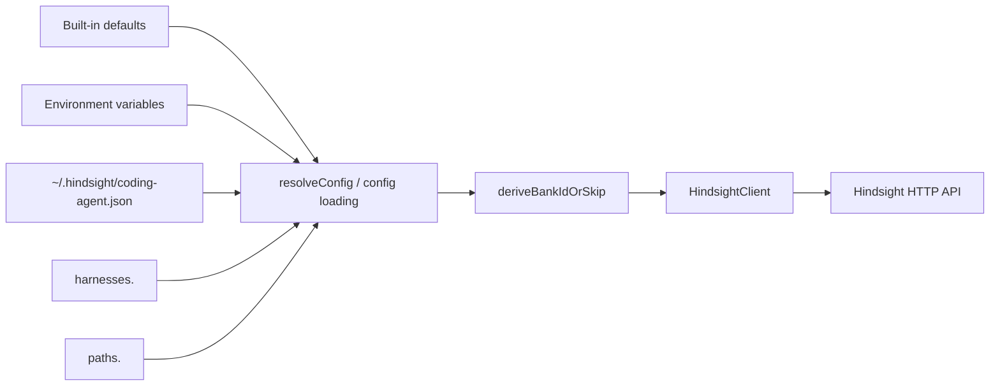
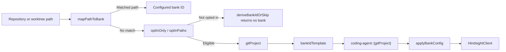
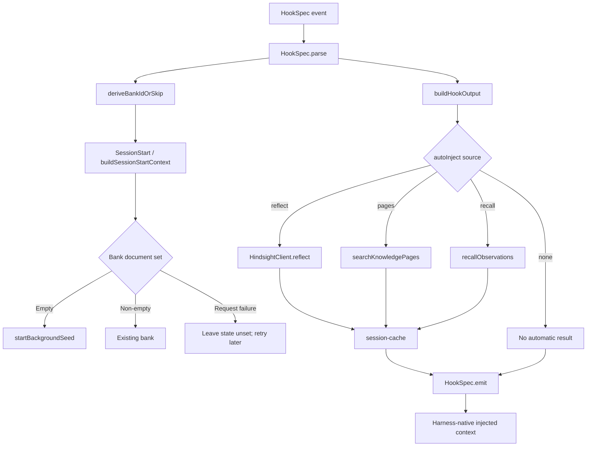
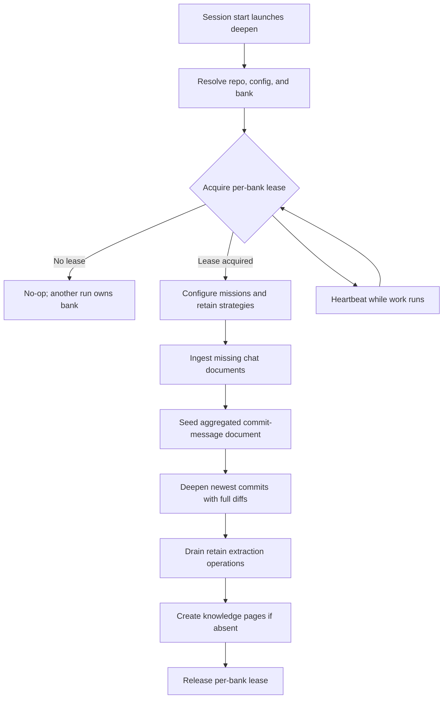
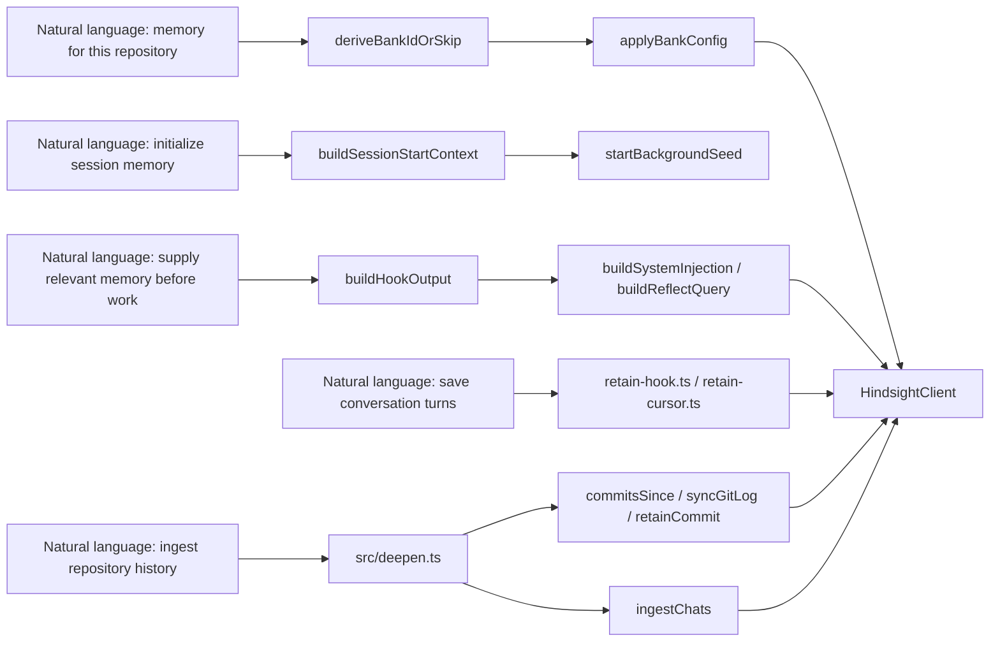
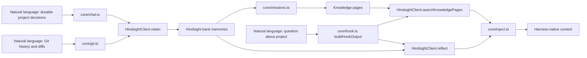

<!-- source: DeepWiki mcp.deepwiki.com · repo vectorize-io/hindsight · extra page hindsight-coding-agents Core · fetched 2026-10-26 -->

# hindsight-coding-agents Core

Relevant source files

The following files were used as context for generating this wiki page:

- [hindsight-docs/docs-integrations/coding-agents.md](hindsight-docs/docs-integrations/coding-agents.md)
- [hindsight-integrations/coding-agents/README.md](hindsight-integrations/coding-agents/README.md)
- [hindsight-integrations/coding-agents/skill/SKILL.md](hindsight-integrations/coding-agents/skill/SKILL.md)
- [hindsight-integrations/coding-agents/src/core/chat.test.ts](hindsight-integrations/coding-agents/src/core/chat.test.ts)
- [hindsight-integrations/coding-agents/src/core/chat.ts](hindsight-integrations/coding-agents/src/core/chat.ts)
- [hindsight-integrations/coding-agents/src/core/config.test.ts](hindsight-integrations/coding-agents/src/core/config.test.ts)
- [hindsight-integrations/coding-agents/src/core/config.ts](hindsight-integrations/coding-agents/src/core/config.ts)
- [hindsight-integrations/coding-agents/src/core/git.gitlog.test.ts](hindsight-integrations/coding-agents/src/core/git.gitlog.test.ts)
- [hindsight-integrations/coding-agents/src/core/git.ts](hindsight-integrations/coding-agents/src/core/git.ts)
- [hindsight-integrations/coding-agents/src/core/hindsight.pages.test.ts](hindsight-integrations/coding-agents/src/core/hindsight.pages.test.ts)
- [hindsight-integrations/coding-agents/src/core/hindsight.test.ts](hindsight-integrations/coding-agents/src/core/hindsight.test.ts)
- [hindsight-integrations/coding-agents/src/core/hindsight.ts](hindsight-integrations/coding-agents/src/core/hindsight.ts)
- [hindsight-integrations/coding-agents/src/core/hook.test.ts](hindsight-integrations/coding-agents/src/core/hook.test.ts)
- [hindsight-integrations/coding-agents/src/core/hook.ts](hindsight-integrations/coding-agents/src/core/hook.ts)
- [hindsight-integrations/coding-agents/src/core/knowledge-injection.test.ts](hindsight-integrations/coding-agents/src/core/knowledge-injection.test.ts)
- [hindsight-integrations/coding-agents/src/core/knowledge-injection.ts](hindsight-integrations/coding-agents/src/core/knowledge-injection.ts)
- [hindsight-integrations/coding-agents/src/core/knowledge-tools.test.ts](hindsight-integrations/coding-agents/src/core/knowledge-tools.test.ts)
- [hindsight-integrations/coding-agents/src/core/knowledge-tools.ts](hindsight-integrations/coding-agents/src/core/knowledge-tools.ts)
- [hindsight-integrations/coding-agents/src/core/missions.test.ts](hindsight-integrations/coding-agents/src/core/missions.test.ts)
- [hindsight-integrations/coding-agents/src/core/missions.ts](hindsight-integrations/coding-agents/src/core/missions.ts)
- [hindsight-integrations/coding-agents/src/core/retain-cursor.test.ts](hindsight-integrations/coding-agents/src/core/retain-cursor.test.ts)
- [hindsight-integrations/coding-agents/src/core/retain-cursor.ts](hindsight-integrations/coding-agents/src/core/retain-cursor.ts)
- [hindsight-integrations/coding-agents/src/core/retain-hook.ts](hindsight-integrations/coding-agents/src/core/retain-hook.ts)
- [hindsight-integrations/coding-agents/src/core/runtime.test.ts](hindsight-integrations/coding-agents/src/core/runtime.test.ts)
- [hindsight-integrations/coding-agents/src/core/runtime.ts](hindsight-integrations/coding-agents/src/core/runtime.ts)
- [hindsight-integrations/coding-agents/src/core/session-cache.test.ts](hindsight-integrations/coding-agents/src/core/session-cache.test.ts)
- [hindsight-integrations/coding-agents/src/core/session-cache.ts](hindsight-integrations/coding-agents/src/core/session-cache.ts)
- [hindsight-integrations/coding-agents/src/core/session-start.test.ts](hindsight-integrations/coding-agents/src/core/session-start.test.ts)
- [hindsight-integrations/coding-agents/src/core/session-start.ts](hindsight-integrations/coding-agents/src/core/session-start.ts)
- [hindsight-integrations/coding-agents/src/core/status.ts](hindsight-integrations/coding-agents/src/core/status.ts)
- [hindsight-integrations/coding-agents/src/core/sync.ts](hindsight-integrations/coding-agents/src/core/sync.ts)
- [hindsight-integrations/coding-agents/src/core/transcript-util.ts](hindsight-integrations/coding-agents/src/core/transcript-util.ts)
- [hindsight-integrations/coding-agents/src/core/transcript.test.ts](hindsight-integrations/coding-agents/src/core/transcript.test.ts)
- [hindsight-integrations/coding-agents/src/deepen.ts](hindsight-integrations/coding-agents/src/deepen.ts)
- [hindsight-integrations/coding-agents/src/mcp-server.test.ts](hindsight-integrations/coding-agents/src/mcp-server.test.ts)
- [hindsight-integrations/coding-agents/src/mcp-server.ts](hindsight-integrations/coding-agents/src/mcp-server.ts)
- [skills/hindsight-docs/references/sdks/integrations/coding-agents.md](skills/hindsight-docs/references/sdks/integrations/coding-agents.md)

## Purpose and scope

This page explains the shared core of `hindsight-coding-agents`: how it resolves configuration and memory banks, talks to the Hindsight API, injects project memory into agent sessions, exposes knowledge tools, and ingests conversations and Git history in the background. Harness-specific installation and adapters are outside this page’s scope; the package’s design is a shared reflect-and-inject core with thin harness entry points. [hindsight-integrations/coding-agents/README.md:1-13]()

Sources: `hindsight-integrations/coding-agents/README.md:1-13()`

---

## 1. Configuration layering and `HindsightClient`

### Configuration layers

The package uses a single user-level JSON configuration file, normally `~/.hindsight/coding-agent.json`; `HINDSIGHT_CONFIG` can override its path. Configuration is resolved in this order, with later layers taking precedence per field:

1. Built-in defaults.
2. Environment variables, which provide fallback values for containers, CI, and secret managers.
3. The config file’s top-level fields.
4. `harnesses.<name>` overrides for the active harness. [hindsight-integrations/coding-agents/src/core/config.ts:1-12]()

The configuration deliberately has no project-local file. The documented rationale is to avoid a repository-controlled configuration surface that could influence memory behavior; per-repository routing is handled through bank resolution, and per-agent variations belong in `harnesses.<name>`. [hindsight-integrations/coding-agents/src/core/config.ts:1-12]()

The visible config shape includes server selection (`serverMode`), API URL and token, daemon settings, bank routing, opt-in controls, session retention, retain concurrency, and separate automatic-reflect timeout settings. For example, `retainSessions` controls transcript write-back without disabling recall or Git ingestion; `disabled` is the broader off-switch. [hindsight-integrations/coding-agents/src/core/config.ts:51-115]()

| Layer or setting | Role |
|---|---|
| Built-in defaults | Baseline behavior when no override is supplied. [hindsight-integrations/coding-agents/src/core/config.ts:1-8]() |
| Environment variables | Fallback configuration for deployment and secret injection. [hindsight-integrations/coding-agents/src/core/config.ts:4-8]() |
| Top-level file fields | User-wide configuration in the single config file. [hindsight-integrations/coding-agents/src/core/config.ts:2-12]() |
| `harnesses.<name>` | Per-agent overrides layered after the file’s top level. [hindsight-integrations/coding-agents/src/core/config.ts:7-12]() |
| `paths.<prefix>` | Per-directory override described by the package skill as applied after bank resolution. [skills/hindsight-docs/references/sdks/integrations/coding-agents.md:106-113]() |

The configuration file path and daemon defaults are defined in `config.ts`: the default config path is under the user’s home directory, the daemon profile defaults to `coding-agent`, and its port defaults to `9077`. [hindsight-integrations/coding-agents/src/core/config.ts:37-48]()

Sources: `hindsight-integrations/coding-agents/src/core/config.ts:1-12()`, `hindsight-integrations/coding-agents/src/core/config.ts:37-48()`, `hindsight-integrations/coding-agents/src/core/config.ts:51-115()`, `skills/hindsight-docs/references/sdks/integrations/coding-agents.md:106-113()`

### `HindsightClient`

`HindsightClient` is the harness-agnostic HTTP client. It uses raw `fetch`, has no SDK dependency, and is shared by harness adapters and the backfill/deepen process. Its responsibilities include configuring a bank, retaining memories, reflecting over memory, draining asynchronous operations, and creating knowledge pages. Harness-specific behavior is intentionally kept out of the client. [hindsight-integrations/coding-agents/src/core/hindsight.ts:1-7]()

The client options include the API URL and optional token, bank ID, optional project identity, retain concurrency, observation scopes, page-search limit, recall-body overrides, a token provider for refreshed credentials, and rate-limit patience. The `USER_AGENT` identifies requests as `hindsight-coding-agents/<package version>`. [hindsight-integrations/coding-agents/src/core/hindsight.ts:28-29](), [hindsight-integrations/coding-agents/src/core/hindsight.ts:103-135]()

The default observation scope is `shared`. This keeps provenance tags on retained facts while consolidating observations into one untagged scope per bank, rather than fragmenting a repository’s beliefs by agent or source tags. The client can also resolve `per_source` locally: it emits the empty scope plus one scope for each distinct `source:` tag, sorted deterministically. [hindsight-integrations/coding-agents/src/core/hindsight.ts:44-85](), [hindsight-integrations/coding-agents/src/core/hindsight.ts:88-101]()

The client’s `KnowledgeNode` shape represents knowledge-base tree nodes, including their kind, name, optional page description, effective refresh trigger, and children. [hindsight-integrations/coding-agents/src/core/hindsight.ts:31-42]()

Sources: `hindsight-integrations/coding-agents/src/core/hindsight.ts:1-7()`, `hindsight-integrations/coding-agents/src/core/hindsight.ts:28-42()`, `hindsight-integrations/coding-agents/src/core/hindsight.ts:44-85()`, `hindsight-integrations/coding-agents/src/core/hindsight.ts:88-135()`

### Configuration-to-client flow

**Diagram: Configuration layers and shared API client**

Sources: `hindsight-integrations/coding-agents/src/core/config.ts:1-12()`, `hindsight-integrations/coding-agents/src/core/config.ts:37-48()`, `hindsight-integrations/coding-agents/src/core/hindsight.ts:1-7()`, `hindsight-integrations/coding-agents/src/core/hindsight.ts:103-135()`, `hindsight-integrations/coding-agents/src/core/hook.ts:24-32()`

---

## 2. Bank derivation and repository routing

The package supports static and dynamic bank selection. An explicit `bankId` selects a static bank; otherwise, the documented default template is `coding-agent::{gitProject}`. The config also exposes `mapPathToBank`, `resolveWorktrees`, and opt-in controls. [hindsight-integrations/coding-agents/src/core/config.ts:80-93]()

`mapPathToBank` maps absolute path prefixes to bank IDs, with the longest matching prefix taking precedence according to the package skill’s configuration reference. `resolveWorktrees` controls whether worktrees resolve to the main repository’s bank. With `optInOnly` enabled, projects not covered by configured opt-in paths or routing are inert: the package does not create a bank, retain data, or seed it. [hindsight-integrations/coding-agents/src/core/config.ts:80-93](), [skills/hindsight-docs/references/sdks/integrations/coding-agents.md:106-113]()

The shared session-start and deepen entry points call `deriveBankIdOrSkip`; they then apply bank configuration before constructing or using the client. [hindsight-integrations/coding-agents/src/core/hook.ts:24-32](), [hindsight-integrations/coding-agents/src/deepen.ts:25-28](), [hindsight-integrations/coding-agents/src/deepen.ts:54-63]()

The bank’s project identity is distinct from the current process’s working directory. The client documentation specifies that `project` should identify the repository the bank represents; when a bank is shared or renamed across repositories, it should not be assigned the name of whichever repository happened to run last. [hindsight-integrations/coding-agents/src/core/hindsight.ts:103-112](), [hindsight-integrations/coding-agents/src/deepen.ts:70-75]()

**Diagram: Repository identity mapped to bank-resolution code**

Sources: `hindsight-integrations/coding-agents/src/core/config.ts:80-93()`, `hindsight-integrations/coding-agents/src/core/hook.ts:24-32()`, `hindsight-integrations/coding-agents/src/deepen.ts:25-28()`, `hindsight-integrations/coding-agents/src/deepen.ts:54-63()`

---

## 3. Session start, prompt hooks, and memory injection

### Session-start lifecycle

`session-start.ts` implements the shared `SessionStart` lifecycle. It performs a tri-state cold-bank check by listing document IDs: a request failure means the server is unreachable and the next session should retry; a non-empty result means the bank is already warm; an empty result means the bank is cold and background seeding should start. This distinguishes an outage from a genuinely empty bank so that a transient failure does not suppress seeding. [hindsight-integrations/coding-agents/src/core/session-start.ts:13-21]()

The session-start path produces a visible banner naming the bank and describing whether it is learning the repository or tracking its history. It can include a concise Git sync status. [hindsight-integrations/coding-agents/src/core/session-start.ts:71-84](), [hindsight-integrations/coding-agents/src/core/session-start.ts:86-127]()

Session startup also starts background seed work and prepares knowledge-page context for the agent. The documented lifecycle says the hook performs seeding itself rather than asking the agent to execute a command, making initialization deterministic and non-blocking. [hindsight-integrations/coding-agents/src/core/session-start.ts:1-11](), [hindsight-integrations/coding-agents/src/core/session-start.ts:23-40]()

### Prompt hook and automatic injection

`hook.ts` provides a shared runtime for hook-based harnesses. A `HookSpec` supplies the harness name, event parser, optional event acceptance gate, native output wrapper, and optional tool-hook behavior. The common logic is separated into `buildHookOutput`, while `runHook` handles event and process plumbing. [hindsight-integrations/coding-agents/src/core/hook.ts:1-22](), [hindsight-integrations/coding-agents/src/core/hook.ts:55-85]()

Automatic injection is controlled by the configured source:

| Source | Behavior |
|---|---|
| `reflect` | Runs a bounded synthesis over the bank and injects the result. [hindsight-integrations/coding-agents/src/core/hook.ts:4-10]() |
| `pages` | Searches knowledge pages for the current prompt. [hindsight-integrations/coding-agents/src/core/hook.ts:4-10]() |
| `recall` | Retrieves observations for the prompt without the reflect synthesis step. [hindsight-integrations/coding-agents/src/core/hook.ts:4-10]() |
| `none` | Injects no automatic memory result, leaving retrieval to explicit tools. [hindsight-integrations/coding-agents/src/core/hook.ts:4-10]() |

The hook caches the automatic result per session. Failed and empty results are kept unresolved for a limited number of attempts so a transient first-prompt failure or an uninformative opener does not permanently deprive the session of memory. The failure budget is two attempts; the empty-result budget for pages and recall is five. [hindsight-integrations/coding-agents/src/core/hook.ts:102-124]()

Knowledge-page handling is separate from automatic memory-result injection. The runtime describes a page set fetched on a cadence and matched locally against the prompt by section-level lexical scoring; a tool-guide/page-roster block is also refreshed on that cadence. [hindsight-integrations/coding-agents/src/core/hook.ts:11-14]()

The session cache prevents repeating a once-per-session reflect result on subsequent turns. Tests verify that the result is injected on the turn it runs and not stacked on later turns. [hindsight-integrations/coding-agents/src/core/hook.test.ts:63-105]()

**Diagram: Hook event to agent context**

Sources: `hindsight-integrations/coding-agents/src/core/hook.ts:1-22()`, `hindsight-integrations/coding-agents/src/core/hook.ts:55-105()`, `hindsight-integrations/coding-agents/src/core/session-start.ts:13-40()`, `hindsight-integrations/coding-agents/src/core/session-start.ts:71-84()`, `hindsight-integrations/coding-agents/src/core/hindsight.ts:88-100()`

---

## 4. Knowledge tools, knowledge pages, and missions

### Knowledge tools

The package exposes harness-agnostic knowledge tools, including knowledge-page search and reading, reflect, document ingestion, and initiative capture. The agent-facing skill describes `hindsight_search_knowledge_pages` as the first stop for project questions; `hindsight_read_knowledge_page` and `hindsight_list_knowledge_pages` provide page access; `hindsight_reflect` is the deeper retrieval path; and `hindsight_ingest_document` and `hindsight_capture_initiative` write durable material. [hindsight-integrations/coding-agents/skill/SKILL.md:29-50]()

The available tool surface is routed through the package’s MCP server or harness-native tools depending on the integration. The README identifies native tools for some harnesses and MCP-backed tools for others; the shared core is intended to keep the underlying memory behavior harness-independent. [hindsight-integrations/coding-agents/README.md:1-7](), [hindsight-integrations/coding-agents/README.md:101-122]()

### Knowledge pages and missions

Knowledge pages are curated project references, such as architecture, conventions, and in-flight initiatives. The package describes them as pages that future sessions can start from, alongside the episodic facts and decisions retained from conversations and Git history. [hindsight-integrations/coding-agents/README.md:9-13]()

`HindsightClient` imports page and mission helpers from `missions.ts`, including `pagesFor`, page-trigger builders, page-scope rules, and retain-extraction types. It represents page tree nodes using `KnowledgeNode`, whose optional `description` is the source query and whose optional `trigger` is the effective refresh policy when the server reports it. [hindsight-integrations/coding-agents/src/core/hindsight.ts:8-23](), [hindsight-integrations/coding-agents/src/core/hindsight.ts:31-42]()

During background ingestion, the package configures the bank’s missions and retain strategies and creates knowledge pages when the bank does not yet have them. The deepening process creates pages after its ingestion and extraction work, so the presence of pages can serve as a completion indicator for that setup. [hindsight-integrations/coding-agents/src/deepen.ts:7-18]()

The agent skill describes the built-in workflow as creating five knowledge pages, refreshing each on an hourly schedule when relevant content has changed. The skill’s tool guidance recommends capturing an initiative after a plan is agreed and updating the same page when that plan materially changes. [skills/hindsight-docs/references/sdks/integrations/coding-agents.md:21-30](), [hindsight-integrations/coding-agents/skill/SKILL.md:29-40]()

Sources: `hindsight-integrations/coding-agents/skill/SKILL.md:29-50()`, `hindsight-integrations/coding-agents/README.md:9-13()`, `hindsight-integrations/coding-agents/src/core/hindsight.ts:8-23()`, `hindsight-integrations/coding-agents/src/core/hindsight.ts:31-42()`, `hindsight-integrations/coding-agents/src/deepen.ts:7-18()`, `skills/hindsight-docs/references/sdks/integrations/coding-agents.md:21-30()`

---

## 5. Retain hooks, transcript cursors, chat, and Git synchronization

### Transcript write-back and retain cursors

Session conversations are retained automatically: the package documentation says users do not need to issue a save command, and the skill describes write-back at session end. The configuration field `retainSessions` can opt out of transcript retention while leaving recall, Git ingestion, seeding, and memory tools available. [hindsight-integrations/coding-agents/skill/SKILL.md:15-27](), [hindsight-integrations/coding-agents/src/core/config.ts:96-100]()

The available core modules include `retain-hook.ts`, `retain-cursor.ts`, `chat.ts`, and `transcript-util.ts`. Their roles in the package’s data flow are consistent with the documented write-back lifecycle: a harness supplies transcript data; the core identifies content not yet written; and the retain path appends that content to Hindsight. The provided file excerpts do not include these modules’ implementations, so their internal cursor format and parsing details are not specified here. [hindsight-integrations/coding-agents/src/core/config.ts:96-100](), [hindsight-integrations/coding-agents/skill/SKILL.md:15-27]()

The integration reference describes the transcript lifecycle as reading the turns not yet written, appending them to the session’s document, tagging them with the writing agent, and allowing the server to extract facts for consolidation. [skills/hindsight-docs/references/sdks/integrations/coding-agents.md:39-44]()

### Chat ingestion

The deepen engine imports `ingestChats` from `core/chat.ts` and ingests conversations that are not already represented in the bank. Chat history is deduplicated by `chat:<id>` document IDs; live sessions arrive through write-back, so deepen’s chat ingestion is history import rather than ongoing transcript synchronization. [hindsight-integrations/coding-agents/src/deepen.ts:7-12]()

The integration reference describes each conversation becoming one document and being skipped if already present. [skills/hindsight-docs/references/sdks/integrations/coding-agents.md:25-30]()

### Git history synchronization

The Git module functions used by deepen include `commitsSince`, `repoNameOf`, `retainCommit`, and `syncGitLog`. Session-start logic uses Git-head and Git-log freshness checks to show a short sync state in the banner. [hindsight-integrations/coding-agents/src/deepen.ts:25-28](), [hindsight-integrations/coding-agents/src/core/session-start.ts:23-28](), [hindsight-integrations/coding-agents/src/core/session-start.ts:86-127]()

The integration reference describes two levels of Git ingestion: an aggregated commit-message history document and progressive per-commit ingestion with full diffs when enabled. Full diffs are opt-in through `gitIngest: "full"`; the session-start sync note distinguishes message-only sync from full-history deepening progress. [skills/hindsight-docs/references/sdks/integrations/coding-agents.md:25-30](), [hindsight-integrations/coding-agents/src/core/session-start.ts:94-127]()

Sources: `hindsight-integrations/coding-agents/src/core/config.ts:96-100()`, `hindsight-integrations/coding-agents/skill/SKILL.md:15-27()`, `skills/hindsight-docs/references/sdks/integrations/coding-agents.md:39-44()`, `hindsight-integrations/coding-agents/src/deepen.ts:7-12()`, `hindsight-integrations/coding-agents/src/deepen.ts:25-28()`, `hindsight-integrations/coding-agents/src/core/session-start.ts:23-28()`, `hindsight-integrations/coding-agents/src/core/session-start.ts:86-127()`

---

## 6. Background deepen ingestion engine

`src/deepen.ts` is the background ingestion engine, not a user-facing CLI. The runtime starts it detached at session start; benchmark and end-to-end paths can also run it directly. The process is designed to be idempotent and resumable, so repeated session-start triggers do only missing work. [hindsight-integrations/coding-agents/src/deepen.ts:1-20]()

The documented workflow is:

1. Configure bank missions and retain strategies without resetting existing bank state.
2. Ingest conversations not already represented in the bank.
3. Seed aggregated commit-message history if it is absent.
4. Progressively ingest individual commits with full diffs, newest first, under a per-run limit.
5. Drain extraction operations and create knowledge pages if the bank has none. [hindsight-integrations/coding-agents/src/deepen.ts:7-18]()

The shown implementation sets `DIFF_BATCH` to 50 and resolves the repository, bank, harness, API URL, and Git-ingestion mode from arguments and configuration before starting the main work. [hindsight-integrations/coding-agents/src/deepen.ts:46-80]()

Concurrency is controlled by a per-bank lease in the operating system’s temporary directory. A heartbeat keeps the lease live during long runs; a run that cannot acquire the lease exits without duplicating ingestion. If a process loses its lease, it exits because another run can complete the resumable work. [hindsight-integrations/coding-agents/src/deepen.ts:99-117]()

A background client is constructed with the resolved bank, optional project identity, retain concurrency, observation scopes, and a longer rate-limit patience than interactive hooks. The reason is operational: no foreground caller is waiting for this work, so abandoning a rate-limited retain can leave history missing until a later run. [hindsight-integrations/coding-agents/src/deepen.ts:122-140]()

**Diagram: Idempotent background ingestion**

Sources: `hindsight-integrations/coding-agents/src/deepen.ts:1-20()`, `hindsight-integrations/coding-agents/src/deepen.ts:46-80()`, `hindsight-integrations/coding-agents/src/deepen.ts:99-117()`, `hindsight-integrations/coding-agents/src/deepen.ts:122-140()`

---

## 7. End-to-end concept-to-code map

The package connects project-memory concepts to code entities through a shared core rather than embedding separate memory logic in each harness. Session-start, hook processing, retention, and background ingestion converge on the same bank and `HindsightClient` abstractions. [hindsight-integrations/coding-agents/README.md:3-7](), [hindsight-integrations/coding-agents/src/core/hindsight.ts:1-7]()

**Diagram: Natural Language Space to Code Entity Space — runtime memory path**

Sources: `hindsight-integrations/coding-agents/README.md:3-7()`, `hindsight-integrations/coding-agents/src/core/hindsight.ts:1-7()`, `hindsight-integrations/coding-agents/src/core/hook.ts:24-43()`, `hindsight-integrations/coding-agents/src/core/session-start.ts:23-40()`, `hindsight-integrations/coding-agents/src/deepen.ts:25-28()`

**Diagram: Natural Language Space to Code Entity Space — knowledge and retrieval path**

Sources: `hindsight-integrations/coding-agents/README.md:9-13()`, `hindsight-integrations/coding-agents/src/core/hindsight.ts:8-23()`, `hindsight-integrations/coding-agents/src/core/hook.ts:31-43()`, `hindsight-integrations/coding-agents/src/deepen.ts:25-38()`

---

## References and source boundaries

The package-level documentation and excerpts establish the shared architecture, configuration order, client options, session cold-check, hook behavior, and deepen workflow described above. Several additional modules are named in the supplied file inventory but their contents were not included; this page therefore does not claim their internal implementation details beyond the documented lifecycle. [hindsight-integrations/coding-agents/src/core/config.ts:1-12](), [hindsight-integrations/coding-agents/src/core/hindsight.ts:1-7](), [hindsight-integrations/coding-agents/src/core/hook.ts:1-22](), [hindsight-integrations/coding-agents/src/deepen.ts:1-20]()

Sources: `hindsight-integrations/coding-agents/src/core/config.ts:1-12()`, `hindsight-integrations/coding-agents/src/core/hindsight.ts:1-7()`, `hindsight-integrations/coding-agents/src/core/hook.ts:1-22()`, `hindsight-integrations/coding-agents/src/deepen.ts:1-20()`

---

