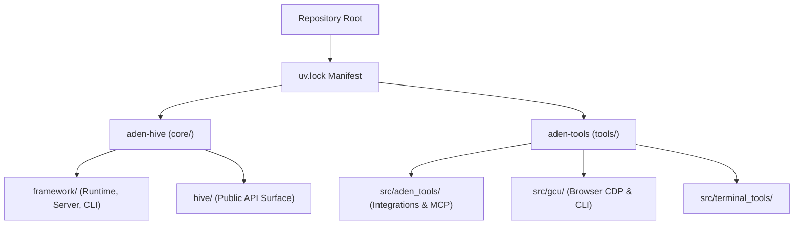
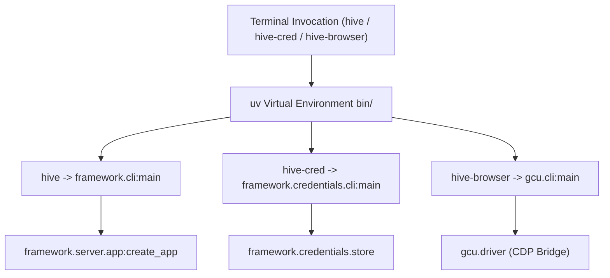
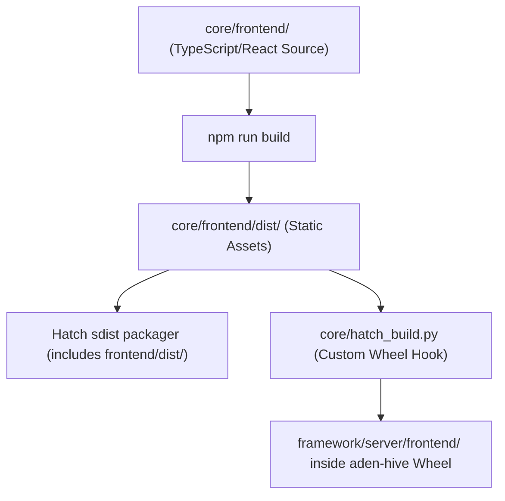

<!-- source: DeepWiki mcp.deepwiki.com · repo aden-hive/hive · page 1.2 Repository Layout and Packaging · fetched 2026-10-26 -->

# Repository Layout and Packaging

Relevant source files

The following files were used as context for generating this wiki page:

- [.github/workflows/ci.yml](.github/workflows/ci.yml)
- [.gitignore](.gitignore)
- [.python-version](.python-version)
- [AGENTS.md](AGENTS.md)
- [CHANGELOG.md](CHANGELOG.md)
- [CLAUDE.md](CLAUDE.md)
- [Makefile](Makefile)
- [core/README.md](core/README.md)
- [core/framework/loader/cli.py](core/framework/loader/cli.py)
- [core/framework/server/tests/test_session_shutdown.py](core/framework/server/tests/test_session_shutdown.py)
- [core/hatch_build.py](core/hatch_build.py)
- [core/pyproject.toml](core/pyproject.toml)
- [docs/releases/v1.0.10.md](docs/releases/v1.0.10.md)
- [docs/releases/v1.0.2.md](docs/releases/v1.0.2.md)
- [docs/releases/v1.0.9.md](docs/releases/v1.0.9.md)
- [tools/README.md](tools/README.md)
- [tools/pyproject.toml](tools/pyproject.toml)
- [uv.lock](uv.lock)

## Purpose and Scope
This page details the repository layout, `uv` workspace structure, package configuration (`aden-hive` and `aden-tools`), command-line entry points, Hatchling build hooks for frontend bundling, Makefile automation targets, and repository conventions. Hive is organized as a multi-package `uv` workspace to cleanly separate the core goal-driven runtime (`aden-hive`) from the broad ecosystem of third-party integrations and tool wrappers (`aden-tools`).

---

## 1. The `uv` Workspace and Package Structure

Hive uses an explicit `uv` workspace configuration defined in the root `uv.lock` file, encompassing two core members: `aden-hive` (located in `core/`) and `aden-tools` (located in `tools/`) [uv.lock:1-21](). 

The `aden-hive` package houses the core runtime primitives, including `AgentLoop`, `ColonyRuntime`, HTTP server handlers, and the public embedding API. The `aden-tools` package provides verified and unverified Model Context Protocol (MCP) servers, browser automation (`gcu`), terminal utilities, memory extensions, and charting modules.

### Workspace Architecture

*Sources: [uv.lock:1-21](), [core/pyproject.toml:1-55](), [tools/pyproject.toml:1-107]()*

---

## 2. Package Definitions and Dependencies

### Core Package (`aden-hive`)
The `aden-hive` package (`core/pyproject.toml`) defines the minimum runtime dependencies required to run the agent loop, manage state, and interact with LLM providers (`pydantic`, `anthropic`, `httpx`, `litellm`, `mcp`, `fastmcp`, `croniter`, `psutil`) [core/pyproject.toml:1-20](). Optional dependencies include `webhook`/`server` (via `aiohttp`), `tools` (pulling in `aden-tools`), and `testing` [core/pyproject.toml:22-31]().

### Tools Package (`aden-tools`)
The `aden-tools` package (`tools/pyproject.toml`) depends on `aden-hive` and pulls in the comprehensive suite of external client libraries, database drivers (`duckdb`, `psycopg2-binary`), web scrapers (`playwright`, `beautifulsoup4`), document processors (`pdfplumber`, `fpdf2`), and cloud integrations [tools/pyproject.toml:19-48]().

---

## 3. Pyproject Entrypoints and CLI Scripts

Both packages expose executable CLI entrypoints via `[project.scripts]` tables in their respective `pyproject.toml` files, enabling global or virtual environment command routing.

| Executable | Target Module | Package | Description |
| :--- | :--- | :--- | :--- |
| `hive` | `framework.cli:main` | `aden-hive` | Main control plane CLI for starting servers, managing queens, colonies, and sessions [core/pyproject.toml:36-37]() |
| `hive-cred` | `framework.credentials.cli:main` | `aden-hive` | Credential retrieval utility for CLI scripts and agent tools [core/pyproject.toml:38-42]() |
| `hive-browser` | `gcu.cli:main` | `aden-tools` | Chrome-native browser control automation utility [tools/pyproject.toml:89-92]() |

### Entrypoint Resolution Flow

*Sources: [core/pyproject.toml:36-42](), [tools/pyproject.toml:89-92](), [core/framework/loader/cli.py:1-79]() *

---

## 4. Hatch Build Frontend Bundling

The `aden-hive` package embeds the React web dashboard directly into Python wheels by leveraging Hatchling build hooks and sdist artifacts.

*   **Sdist Artifacts**: The source distribution includes pre-built frontend files under `frontend/dist/` specified via `artifacts = ["frontend/dist/"]` in `core/pyproject.toml` [core/pyproject.toml:57-59]().
*   **Wheel Bundling Hook**: Custom build hooks (`[tool.hatch.build.targets.wheel.hooks.custom]`) invoke custom build scripts (such as `core/hatch_build.py`) to compile or package the frontend static assets into `framework/server/frontend` inside the generated wheel [core/pyproject.toml:50-56]().

### Build Pipeline Data Flow

*Sources: [core/pyproject.toml:50-61](), [.github/workflows/ci.yml:127-139]() *

---

## 5. Makefile Targets and Development Automation

Development workflows are standardized via the root `Makefile`. The Makefile automatically prepends `~/.local/bin` to `PATH` to support Git Bash environments on Windows [Makefile:1-6]().

### Key Makefile Targets

*   `lint`: Executes `ruff check --fix` and `ruff format` across both `core/` and `tools/` directories [Makefile:14-18]().
*   `check`: Runs CI-safe lint and format checks without modifying files [Makefile:24-28]().
*   `test`: Runs core and tool test suites (excluding live external APIs) [Makefile:30-33]().
*   `test-tools`: Executes isolated mock tool tests under `tools/` [Makefile:34-36]().
*   `test-live`: Runs live integration tests requiring real API credentials (`-m live`) [Makefile:37-39]().
*   `frontend-install`: Installs npm dependencies in `core/frontend/` [Makefile:49-51]().
*   `frontend-build`: Compiles the React dashboard for production distribution [Makefile:55-56]().

*Sources: [Makefile:1-56]*

---

## 6. Gitignore and Editor Conventions

The repository enforces strict change hygiene and artifact exclusion via `.gitignore` [:.gitignore:1-89]().

*   **Dependencies & Build Outputs**: Excludes `node_modules/`, `dist/`, `build/`, `.venv/`, and `tools/src/uv.lock` [:.gitignore:1-19]().
*   **Runtime Scratch Data**: Prevents committing user-generated agent data, workspace files, local databases, and runtime logs under `data/`, `core/data/`, and `workdir/` [:.gitignore:8-64]() & [:.gitignore:87-88]().
*   **IDE Conventions**: Ignores `.idea/`, `.vscode/*` (while preserving recommended settings examples), and system-specific files like `.DS_Store` [:.gitignore:25-36]().

*Sources: [._gitignore:1-89]*

---

