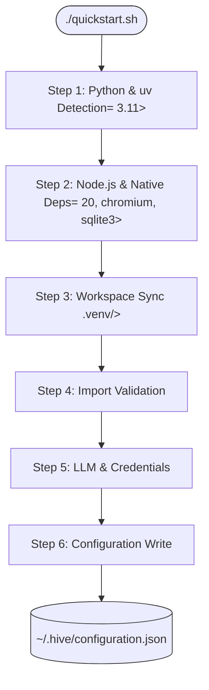
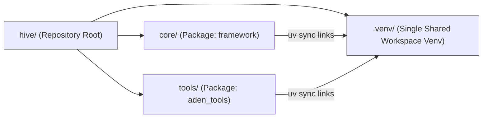

<!-- source: DeepWiki mcp.deepwiki.com · repo aden-hive/hive · page 2.1 Environment Setup (Linux and macOS) · fetched 2026-10-26 -->

# Environment Setup (Linux and macOS)

<details>
<summary>Relevant source files</summary>

The following files were used as context for generating this wiki page:

- [CONTRIBUTING.md](CONTRIBUTING.md)
- [README.md](README.md)
- [SECURITY.md](SECURITY.md)
- [core/framework/config.py](core/framework/config.py)
- [core/framework/llm/key_check.py](core/framework/llm/key_check.py)
- [core/tests/test_key_check_packaged.py](core/tests/test_key_check_packaged.py)
- [docs/configuration.md](docs/configuration.md)
- [docs/developer-guide.md](docs/developer-guide.md)
- [docs/environment-setup.md](docs/environment-setup.md)
- [docs/getting-started.md](docs/getting-started.md)
- [hive.ps1](hive.ps1)
- [quickstart.ps1](quickstart.ps1)
- [quickstart.sh](quickstart.sh)
- [scripts/check_llm_key.py](scripts/check_llm_key.py)
- [scripts/uv-discovery.ps1](scripts/uv-discovery.ps1)

</details>


## Purpose and Scope

This page documents the technical implementation and step-by-step execution flow of `quickstart.sh`, the interactive onboarding wizard for Linux and macOS environments [quickstart.sh:1-10]. It details Python 3.11+ resolution, automatic `uv` binary bootstrapping, Node.js 20+ requirement checks for the frontend dashboard, native dependency checks (SQLite, Playwright Chromium, Tesseract/OCR components), workspace synchronization via `uv sync`, shell RC file detection (`detect_shell_rc`), interactive LLM provider and subscription parsing, and post-setup verification mechanisms (`check_key` in `core/framework/llm/key_check.py`) [quickstart.sh:119-657, core/framework/llm/key_check.py:1-50].

For Windows-specific onboarding (`quickstart.ps1` and `hive.ps1`), see section 2.2. For global configuration layout (`~/.hive/configuration.json`), see section 2.3.

Sources: [quickstart.sh:1-10](), [quickstart.sh:119-657](), [core/framework/llm/key_check.py:1-50]()

---

## Prerequisites and System Requirements

The onboarding script expects a Unix-compatible environment with standard command-line utilities.

| Requirement | Minimum Version | Code Verification / Enforcement |
|---|---|---|
| Python | 3.11+ | `quickstart.sh` candidate loop (`python3.11`, `python3.12`, `python3.13`, `python3`, `python`) [quickstart.sh:135-145]() |
| `uv` | Any (Auto-installed if missing) | Fetched via `curl -LsSf https://astral.sh/uv/install.sh` [quickstart.sh:171-179]() |
| Node.js | 20.0+ | Checked via `node --version` for dashboard builds [quickstart.sh:194-203]() |
| `curl` | Any | Used for fetching `uv` and checking gateway availability [quickstart.sh:42-52](), [quickstart.sh:173-177]() |
| Git | Any | Required for repository cloning [README.md:54]() |

Sources: [quickstart.sh:42-52](), [quickstart.sh:135-145](), [quickstart.sh:171-203](), [README.md:54]()

---

## Wizard Step Map & Code Entity Architecture

The following diagram bridges natural language concepts in the onboarding process to exact code symbols, script functions, and configuration files within the repository.

**`quickstart.sh` Execution and Code Entity Mapping**



Sources: [quickstart.sh:119-657](), [core/framework/config.py:42-49]()

---

## Step-by-Step Walkthrough of `quickstart.sh`

### Python Detection and `uv` Bootstrapping

The wizard initiates execution by scanning for a valid Python interpreter supporting version 3.11 or higher [quickstart.sh:135-165]. It iterates through an explicit list of candidate commands:

```bash
python3.11 python3.12 python3.13 python3 python
```[quickstart.sh:136]

For each candidate, it executes an inline Python snippet to query `sys.version_info.major` and `sys.version_info.minor` [quickstart.sh:138-140]. The first interpreter satisfying `major == 3` and `minor >= 11` is assigned to `PYTHON_CMD` [quickstart.sh:140-143]. If no qualifying interpreter is found, the script terminates with exit status 1 [quickstart.sh:147-165].

Next, the script inspects the host environment for the `uv` package manager via `command -v uv` [quickstart.sh:171]. If absent, it invokes `curl` to download and execute the official Astral installer script, appending `$HOME/.local/bin` to the active `PATH` session variable [quickstart.sh:172-180]:

```bash
curl -LsSf https://astral.sh/uv/install.sh | sh
export PATH="$HOME/.local/bin:$PATH"
```[quickstart.sh:179-180]

Sources: [quickstart.sh:135-192]()

### Node.js and Frontend Dashboard Requirements

The wizard evaluates Node.js availability to ensure the web dashboard frontend can be built or served [quickstart.sh:194-203]. It executes `node --version`, extracts the major version token, and validates that `NODE_MAJOR` is greater than or equal to `20` [quickstart.sh:197-199]. If Node.js is missing or below version 20, a warning is emitted (`NODE_AVAILABLE=false`), allowing backend and CLI operations to proceed while noting that frontend compilation requires an upgrade [quickstart.sh:195-203].

Sources: [quickstart.sh:194-203]()

### Workspace Synchronization (`uv sync`)

Hive utilizes a `uv` workspace layout combining the core framework (`core/`) and tools package (`tools/`) [CONTRIBUTING.md:104-118]. The wizard runs `uv sync` from the repository root [quickstart.sh:186-192]. This constructs a unified virtual environment at `.venv/` containing both packages in editable/workspace linkage mode.

**`uv` Workspace Layout and Virtual Environment Binding**



Sources: [CONTRIBUTING.md:104-118](), [docs/environment-setup.md:247-268]()

### Native Dependencies and Playwright Chromium

Following workspace synchronization, the wizard addresses native execution dependencies:
1. **SQLite**: Relies on Python's built-in `sqlite3` module backed by platform-native SQLite libraries (WAL mode enabled for `tracker.db`) [core/framework/config.py:126-143].
2. **Chromium (Browser Automation)**: Installed via Playwright using `uv run python -m playwright install chromium` [quickstart.sh:210-215]. Playwright failures are caught gracefully as non-fatal warnings [quickstart.sh:215].
3. **Tesseract / OCR**: Utilized by specific document and image-processing tools within `aden_tools` [tools/src/aden_tools/].

Sources: [core/framework/config.py:126-143](), [quickstart.sh:210-215](), [tools/src/aden_tools/]()

### LLM Provider Configuration and Key Validation

The wizard presents interactive menus to configure LLM access and credential storage [quickstart.sh:276-657]. 
- **Subscription Detection**: Inspects existing credential paths such as `~/.claude/.credentials.json` to offer subscription passthrough modes (e.g., Claude Code, ZAI Code) [quickstart.sh:676-710].
- **API Key Prompts**: Prompts for provider-specific keys (Anthropic, OpenAI, OpenRouter, Hive LLM, etc.) [quickstart.sh:279-314].
- **Zero-Token Key Validation**: Validates keys before saving by invoking validation routines defined in `core/framework/llm/key_check.py` (such as `check_anthropic` and `check_openrouter`) to prevent spending tokens during onboarding [scripts/check_llm_key.py:1-69, core/framework/llm/key_check.py:127-187].
- **Shell RC Integration**: `detect_shell_rc()` identifies the user's active shell profile (`~/.zshrc`, `~/.bashrc`, or `~/.profile`) and appends environment export statements [quickstart.sh:532-560].
- **Configuration Output**: Writes the selected provider, model ID, and token parameters into `~/.hive/configuration.json` via `save_configuration()` [quickstart.sh:618-657, docs/configuration.md:15-32].

Sources: [quickstart.sh:276-657](), [scripts/check_llm_key.py:1-68](), [core/framework/llm/key_check.py:127-187](), [docs/configuration.md:15-32]()

---

## Verification and Troubleshooting

### Post-Setup Verification

To manually verify that the environment is correctly initialized, execute the import checks via `uv run` [docs/getting-started.md:26-27]:

```bash
uv run python -c "import framework; print('✓ framework OK')"
uv run python -c "import aden_tools; print('✓ aden_tools OK')"
uv run python -c "import litellm; print('✓ litellm OK')"
uv run python -c "from framework.mcp import agent_builder_server; print('✓ MCP OK')"
```[docs/getting-started.md:26-27, docs/getting-started.md:200-207]

### Common Resolution Steps

| Symptom / Error | Root Cause | Corrective Action |
|---|---|---|
| `Python 3.11+ is required` | System interpreter version is too low | Install Python 3.11+ from official sources or via Homebrew [docs/environment-setup.md:73-76] |
| `uv installation failed` | `curl` utility missing or network block | Install `curl` or manually install `uv` from `astral.sh/uv` [docs/environment-setup.md:174-177] |
| `ModuleNotFoundError: No module named 'framework'` | Workspace dependency sync (`uv sync`) not completed | Run `uv sync` from the repository root [docs/environment-setup.md:180-188] |
| `externally-managed-environment` (PEP 668) | Operating system package manager protection on global python | Use `uv venv` and activate `.venv` before running setup [docs/environment-setup.md:147-156] |

Sources: [docs/environment-setup.md:73-188](), [docs/getting-started.md:26-27]()

---

Sources: [quickstart.sh:1-2398](), [core/framework/config.py:1-1222](), [core/framework/llm/key_check.py:1-367](), [scripts/check_llm_key.py:1-68](), [docs/environment-setup.md:1-457](), [docs/getting-started.md:1-239](), [CONTRIBUTING.md:1-1182]()

---

