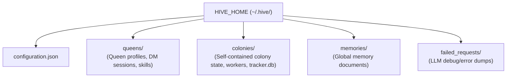
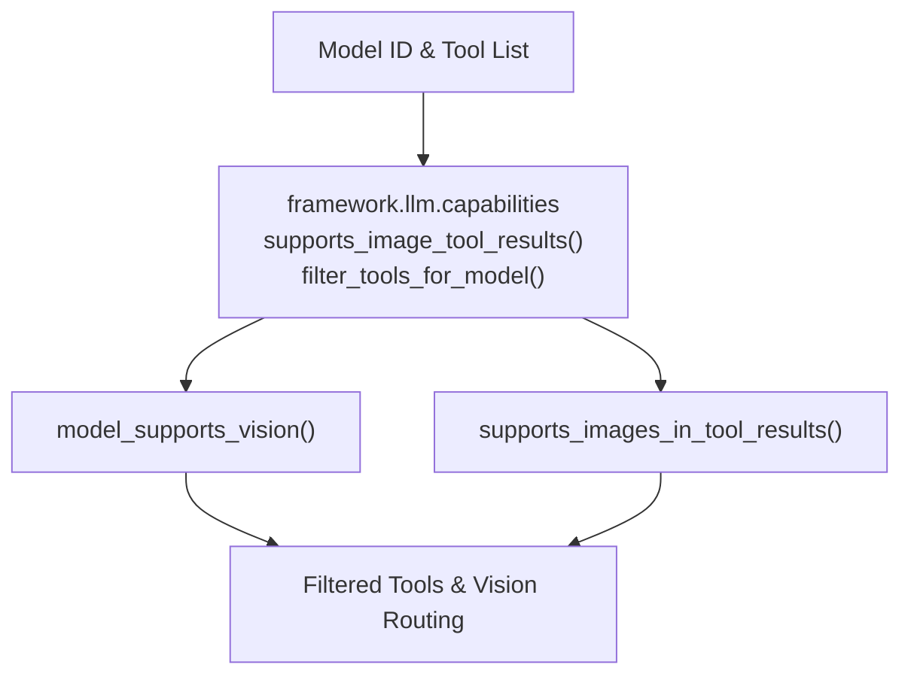
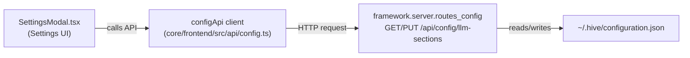

<!-- source: DeepWiki mcp.deepwiki.com · repo aden-hive/hive · page 2.3 Configuration Reference · fetched 2026-10-26 -->

# Configuration Reference

<details>
<summary>Relevant source files</summary>

The following files were used as context for generating this wiki page:

- [core/framework/agent_loop/internals/tool_result_handler.py](core/framework/agent_loop/internals/tool_result_handler.py)
- [core/framework/config.py](core/framework/config.py)
- [core/framework/llm/capabilities.py](core/framework/llm/capabilities.py)
- [core/framework/llm/key_check.py](core/framework/llm/key_check.py)
- [core/framework/llm/model_catalog.json](core/framework/llm/model_catalog.json)
- [core/framework/llm/model_catalog.py](core/framework/llm/model_catalog.py)
- [core/framework/server/routes_config.py](core/framework/server/routes_config.py)
- [core/framework/server/routes_queens.py](core/framework/server/routes_queens.py)
- [core/frontend/src/api/config.ts](core/frontend/src/api/config.ts)
- [core/frontend/src/components/ModelSwitcher.tsx](core/frontend/src/components/ModelSwitcher.tsx)
- [core/frontend/src/components/ProviderManager.tsx](core/frontend/src/components/ProviderManager.tsx)
- [core/frontend/src/components/SettingsModal.tsx](core/frontend/src/components/SettingsModal.tsx)
- [core/tests/test_capabilities.py](core/tests/test_capabilities.py)
- [core/tests/test_colony_runtime_overseer.py](core/tests/test_colony_runtime_overseer.py)
- [core/tests/test_key_check_packaged.py](core/tests/test_key_check_packaged.py)
- [core/tests/test_model_catalog.py](core/tests/test_model_catalog.py)
- [core/tests/test_run_parallel_workers_tool.py](core/tests/test_run_parallel_workers_tool.py)
- [docs/releases/v0.10.2.md](docs/releases/v0.10.2.md)
- [hive.ps1](hive.ps1)
- [quickstart.ps1](quickstart.ps1)
- [quickstart.sh](quickstart.sh)
- [scripts/check_llm_key.py](scripts/check_llm_key.py)
- [scripts/uv-discovery.ps1](scripts/uv-discovery.ps1)

</details>


This page documents the configuration architecture of the Hive runtime, covering the `HIVE_HOME` directory layout, the global configuration file (`~/.hive/configuration.json`) with its provider slots (`queen_llm`, `worker_llm`, `judge`, `vision_fallback`), environment variables, model catalogs and capability detection modules, and UI configuration components.

---

## 1. `HIVE_HOME` Layout and Directory Structure

The Hive runtime stores persistent state, queen identities, colonies, memories, and configuration files under a root directory known as `HIVE_HOME`. By default, this resolves to `~/.hive/`, but it can be overridden via the `HIVE_HOME` environment variable (for example, when spawned by the Electron desktop shell) [core/framework/config.py:42-49]().



### Key Subdirectories
* `configuration.json`: Global configuration storing active providers, model selections, and slot overrides [core/framework/config.py:42-54]().
* `queens/`: Contains independent queen identity directories (`queens/<queen_id>/`), each holding `profile.yaml`, `skills/`, and DM chat sessions (`sessions/<session_id>/`) [core/framework/config.py:86-116]().
* `colonies/`: Contains self-contained colony workspaces (`colonies/<colony_id>/`). Each colony houses its own `metadata.json`, `tracker/tracker.db`, colony-scoped skills, queen overseer sessions, and parallel worker run states (`workers/<session_id>/`) [core/framework/config.py:118-181]().
* `memories/`: Stores global memory documents and vector store indexes [core/framework/config.py:52]().

Sources: [core/framework/config.py:42-181]()

---

## 2. Global Configuration File (`~/.hive/configuration.json`)

The global configuration file dictates default LLM providers, model mappings, provider slots, and credential pools. It is managed via `framework.config` and exposed to the web dashboard via REST API endpoints in `framework.server.routes_config` [core/framework/config.py:1-117](), [core/framework/server/routes_config.py:1-7]().

### Configuration Schema and Provider Slots
`configuration.json` supports multiple model slots to separate roles like reasoning queens, executing workers, judge evaluation, and vision fallback handling:

```json
{
  "llm": {
    "provider": "anthropic",
    "model": "claude-sonnet-4-5-20250929",
    "max_tokens": 8192
  },
  "queen_llm": {
    "provider": "anthropic",
    "model": "claude-opus-4-6"
  },
  "worker_llm": {
    "provider": "openai",
    "model": "gpt-5.4-mini"
  },
  "judge": {
    "provider": "anthropic",
    "model": "claude-haiku-4-5-20251001"
  },
  "vision_fallback": {
    "provider": "openai",
    "model": "gpt-5.4"
  },
  "created_at": "2026-01-15T12:00:00+00:00"
}
```

* `llm`: The default fallback provider and model slot used when specialized slots are omitted.
* `queen_llm`: High-capability reasoning model assigned to Queen orchestration, planning, and task distribution.
* `worker_llm`: Cost-effective or high-throughput model assigned to parallel worker execution.
* `judge`: Evaluator slot used by stall detection and verification loops (`ChannelHost.judge`) [core/framework/server/routes_config.py:84-90]().
* `vision_fallback`: Dedicated vision-capable model invoked when text-only models require image captioning or visual processing [core/frontend/src/api/config.ts:80-82]().

Sources: [core/framework/config.py:1-117](), [core/framework/server/routes_config.py:1-1426](), [core/frontend/src/api/config.ts:80-92]()

---

## 3. Environment Variables

Runtime flags, credentials, and overrides can be supplied via environment variables. These take precedence or supply fallback values when configuration file entries are absent.

| Environment Variable | Scope | Description |
|---|---|---|
| `HIVE_HOME` | Runtime Path | Overrides the default `~/.hive` root directory [core/framework/config.py:42-47]() |
| `HIVE_DESKTOP_MODE` | Runtime Flag | Enables Electron desktop shell mode (skips standalone frontend builds) [core/framework/config.py:21-22]() |
| `ANTHROPIC_API_KEY` | Provider Key | API key for Anthropic Claude models [core/framework/server/routes_config.py:43-58]() |
| `OPENAI_API_KEY` | Provider Key | API key for OpenAI GPT models [core/framework/server/routes_config.py:43-58]() |
| `ZAI_API_KEY` | Subscription | Credential key for ZAI Code subscription plans [core/framework/server/routes_config.py:205-208]() |
| `MOCK_MODE` | Runtime Flag | Skips live LLM calls and executes with mock responses during tests |

Sources: [core/framework/config.py:21-47](), [core/framework/server/routes_config.py:43-208]()

---

## 4. Model Catalog and Capability Detection

Model capabilities, context windows, max output tokens, and vision support are managed via a centralized model catalog JSON file and capability helper modules [core/framework/llm/model_catalog.json:1-662](), [core/framework/llm/model_catalog.py:1](), [core/framework/llm/capabilities.py:1-85]().

### Model Catalog Structure
`core/framework/llm/model_catalog.json` defines supported providers and their respective model parameters:

```json
{
  "schema_version": 1,
  "providers": {
    "anthropic": {
      "default_model": "claude-haiku-4-5-20251001",
      "models": [
        {
          "id": "claude-opus-4-6",
          "label": "Opus 4.6 - Most capable",
          "recommended": true,
          "max_tokens": 128000,
          "max_context_tokens": 872000,
          "supports_vision": true
        }
      ]
    }
  }
}
```

### Capability Detection Architecture
The `framework.llm.capabilities` module inspects model metadata to route tool results and determine vision compatibility [core/framework/llm/capabilities.py:1-85]().



* `supports_image_tool_results(model)`: Verifies if a model can receive image blocks in message payloads [core/framework/llm/capabilities.py:19-30]().
* `filter_tools_for_model(tools, model)`: Strips `produces_image=True` tool definitions from tool schemas when evaluated against text-only models, preventing invalid tool dispatches [core/framework/llm/capabilities.py:32-49]().
* `supports_images_in_tool_results(model)`: Determines whether the target API (e.g. Anthropic/Claude-routed proxies) supports native image payloads directly inside `tool_result` blocks [core/framework/llm/capabilities.py:64-85]().

Sources: [core/framework/llm/model_catalog.json:1-32](), [core/framework/llm/model_catalog.py:1-100](), [core/framework/llm/capabilities.py:1-85]()

---

## 5. Provider and Model Selection in the UI

The web dashboard provides configuration modals and settings panes to inspect and update active provider slots, API keys, and model preferences [core/frontend/src/components/SettingsModal.tsx:1-853](), [core/framework/server/routes_config.py:1-7]().



### API Endpoints
* `GET /api/config/llm`: Returns active provider status, active subscription state, and connected provider keys [core/framework/server/routes_config.py:4-7](), [core/frontend/src/api/config.ts:115]().
* `PUT /api/config/llm`: Hot-swaps running agent sessions with new provider and model configurations [core/framework/server/routes_config.py:4-7](), [core/frontend/src/api/config.ts:174-175]().
* `GET /api/config/llm-sections`: Inspects the independent provider slots (`llm`, `worker_llm`, `vision_fallback`, `judge`) [core/frontend/src/api/config.ts:120-121]().
* `PUT /api/config/llm-sections`: Validates and commits updates to individual provider slots [core/frontend/src/api/config.ts:125-129]().

Sources: [core/framework/server/routes_config.py:1-10](), [core/frontend/src/components/SettingsModal.tsx:47-90](), [core/frontend/src/api/config.ts:114-130]()

---

