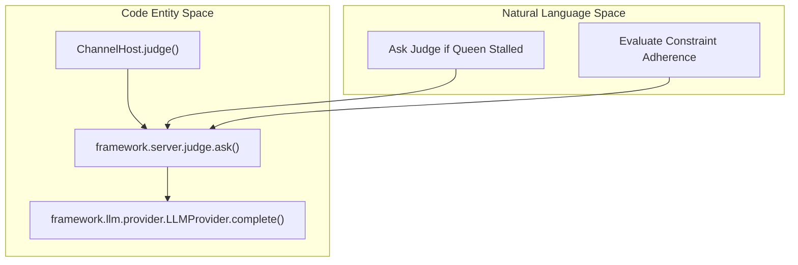
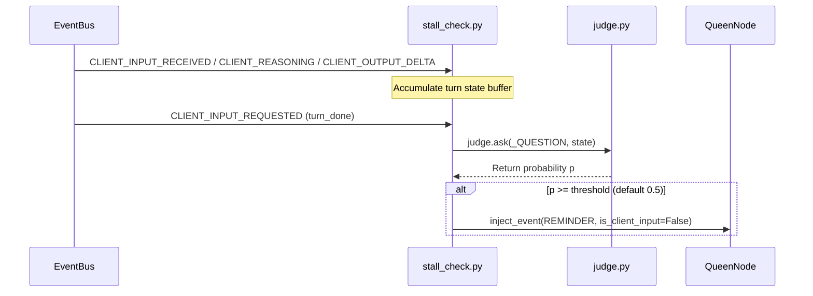
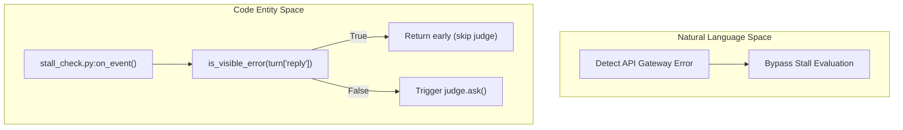
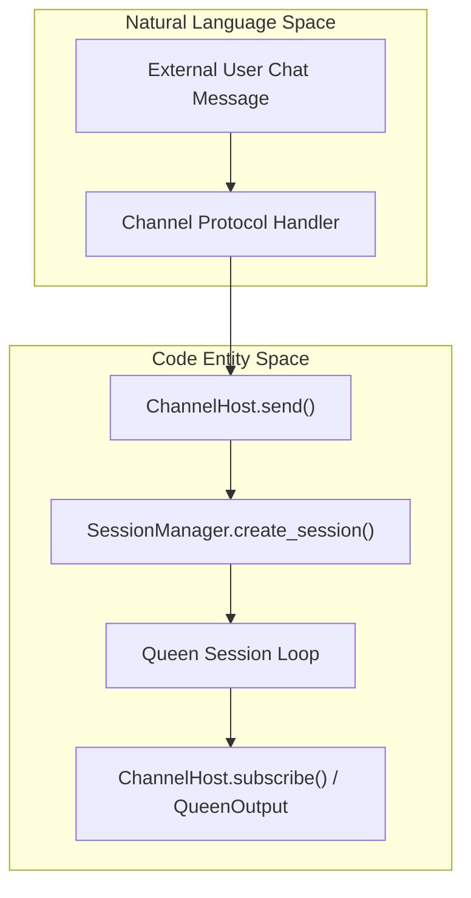

<!-- source: DeepWiki mcp.deepwiki.com · repo aden-hive/hive · page 3.6 Judge, Stall Detection and Channels · fetched 2026-10-26 -->

# Judge, Stall Detection and Channels

Relevant source files

The following files were used as context for generating this wiki page:

- [core/framework/agent_loop/internals/event_publishing.py](core/framework/agent_loop/internals/event_publishing.py)
- [core/framework/agent_loop/visible_error.py](core/framework/agent_loop/visible_error.py)
- [core/framework/host/event_bus.py](core/framework/host/event_bus.py)
- [core/framework/llm/__init__.py](core/framework/llm/__init__.py)
- [core/framework/llm/anthropic.py](core/framework/llm/anthropic.py)
- [core/framework/llm/litellm.py](core/framework/llm/litellm.py)
- [core/framework/llm/mock.py](core/framework/llm/mock.py)
- [core/framework/llm/provider.py](core/framework/llm/provider.py)
- [core/framework/llm/stream_events.py](core/framework/llm/stream_events.py)
- [core/framework/server/channels.py](core/framework/server/channels.py)
- [core/framework/server/judge.py](core/framework/server/judge.py)
- [core/framework/server/stall_check.py](core/framework/server/stall_check.py)
- [core/framework/server/tests/test_channels.py](core/framework/server/tests/test_channels.py)
- [core/framework/server/tests/test_judge.py](core/framework/server/tests/test_judge.py)
- [core/framework/server/tests/test_stall_check.py](core/framework/server/tests/test_stall_check.py)
- [core/framework/testing/llm_judge.py](core/framework/testing/llm_judge.py)
- [core/tests/test_event_bus.py](core/tests/test_event_bus.py)
- [core/tests/test_litellm_provider.py](core/tests/test_litellm_provider.py)
- [core/tests/test_llm_judge.py](core/tests/test_llm_judge.py)
- [core/tests/test_stream_events.py](core/tests/test_stream_events.py)

## Purpose and Scope
This document covers the technical architecture and implementation details for the evaluation judge slot, the stall-detection subsystem, visible error filtering, and external chat channel routing (`ChannelHost`) that connects third-party messaging applications to persistent Queen sessions.

---

## 1. The Judge Slot and Evaluation Infrastructure

The judge slot provides a pluggable semantic evaluation mechanism used by the runtime to verify assistant outputs, assess constraint adherence, and detect conversational anomalies. The judge subsystem is defined in `[core/framework/server/judge.py]()` and is exposed programmatically to external channels via `ChannelHost.judge` (`[core/framework/server/channels.py:114-124]()`).

When configured in `configuration.json`, the judge slot holds parameters specifying the vendor, model name, API key, endpoint, and a probability `threshold` (defaulting to `0.5`). 

### Key Functions and Protocols
- `judge.slot()`: Retrieves the current active judge configuration dictionary from the global configuration store.
- `judge.ask(question, state, criteria)`: Invokes the underlying model provider, passing a structured evaluation prompt and returning a floating-point probability or `None` if the judge is unconfigured or unavailable.
- `ChannelHost.judge(...)`: A thin wrapper method provided to external channels (`[core/framework/server/channels.py:114-124]()`) enabling channel extensions to run arbitrary semantic queries against the configured slot.

*Sources: `[core/framework/server/judge.py:1-50]`, `[core/framework/server/channels.py:114-124]()`*

---

## 2. Stall Detection Heuristics (`stall_check`)

The stall detection subsystem (`[core/framework/server/stall_check.py:1-119]()`) identifies conversational turns where an assistant model announces intentions to perform actions (such as calling a tool, executing a shell command, or looking up external resources) but terminates the turn without invoking any tools.

### Heuristic Lifecycle and Event Subscription
Stall checking subscribes to the session's event bus (`[core/framework/server/stall_check.py:49-119]()`), monitoring specific event transitions:
1. `EventType.CLIENT_INPUT_RECEIVED`: Records the incoming user message string.
2. `EventType.CLIENT_REASONING`: Accumulates the assistant's internal thinking tail (`assistant_reasoning_tail`).
3. `EventType.CLIENT_OUTPUT_DELTA`: Captures snapshots of the visible output reply (`assistant_reply`).
4. `EventType.TOOL_CALL_STARTED`: Tracks tools invoked during the current turn.
5. `EventType.CLIENT_INPUT_REQUESTED` (with `park_reason == "turn_done"`): Triggers the evaluation check when a turn concludes without tool execution.

*Sources: `[core/framework/server/stall_check.py:49-119]()`, `[core/framework/server/event_bus.py:1-170]()`*

### Reminder Guarantees
To prevent infinite retry loops, the implementation ensures:
- At most **one judgment and one reminder** occur per user message (`turn["judged"] = True`).
- If the judge probability $p \ge \text{threshold}$, a system reminder is injected into the node using `node.inject_event(REMINDER, is_client_input=False)` (`[core/framework/server/stall_check.py:83]()`).

---

## 3. Visible Error Filtering

Before submitting a completed turn to the stall detection judge, Hive checks whether the assistant's output constitutes a transport or gateway error. The helper function `is_visible_error` (`[core/framework/agent_loop/visible_error.py:1-18]()`) inspects output strings for API authentication failures, upstream gateway timeouts, or connection dropped messages.

When `is_visible_error(turn["reply"])` evaluates to `True`, the turn is bypassed entirely, avoiding false-positive stall alerts caused by upstream API provider outages or rate limits (`[core/framework/server/stall_check.py:101]()`).

*Sources: `[core/framework/server/stall_check.py:101]`, `[core/framework/agent_loop/visible_error.py:1-18]()`*

---

## 4. External Chat Channel Routing and `ChannelHost`

Hive supports external chat integrations (such as Slack, Telegram, or custom chat servers) via plugins loaded through the `hive.channels` entry-point group (`[core/framework/server/channels.py:1-46]()`). 

### `ChannelHost` Management
The `ChannelHost` class (`[core/framework/server/channels.py:93-161]()`) acts as the isolation and control boundary between third-party channel daemons and internal Hive Queen sessions.

- **State Directory**: Each channel is provisioned with a dedicated isolated storage directory located at `$HIVE_HOME/channels/<name>` via `ChannelHost.state_dir` (`[core/framework/server/channels.py:106-112]()`).
- **Session Resolution**: `ChannelHost.open_session(queen_id, session_id, title)` retrieves an existing conversation session or provisions a new one bound to the specified Queen profile (`[core/framework/server/channels.py:125-153]()`).
- **Message Dispatch**: `ChannelHost.send(session_id, text, images, display_text)` injects external messages into the Queen's execution loop and handles media attachments.

*Sources: `[core/framework/server/channels.py:48-161]()`*

---

