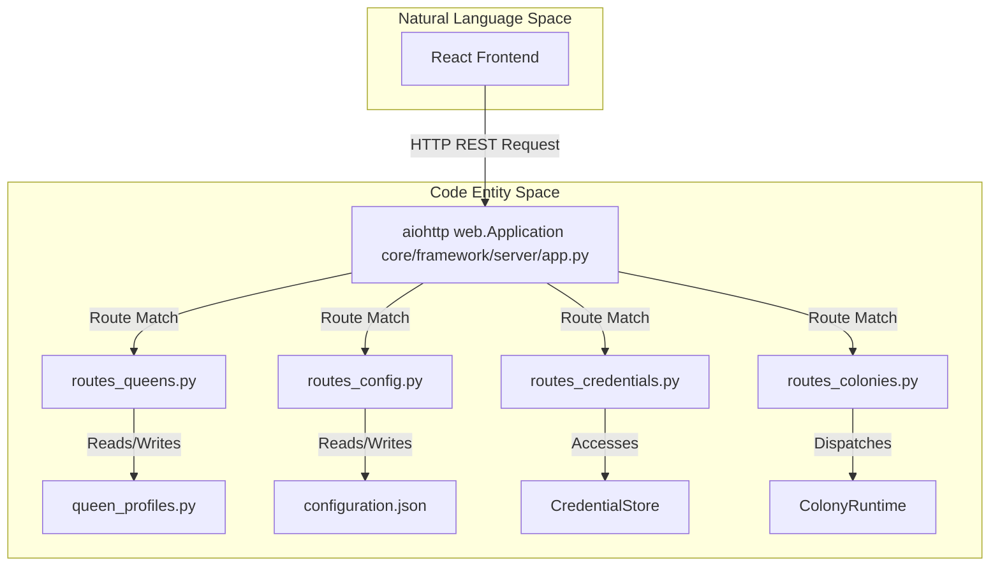
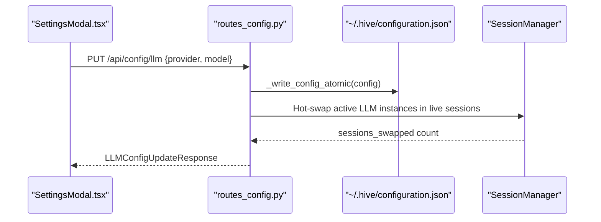

<!-- source: DeepWiki mcp.deepwiki.com · repo aden-hive/hive · page 4.1 REST API Reference · fetched 2026-10-26 -->

# REST API Reference

<details>
<summary>Relevant source files</summary>

The following files were used as context for generating this wiki page:

- [core/framework/agents/queen/queen_tools_defaults.py](core/framework/agents/queen/queen_tools_defaults.py)
- [core/framework/host/colony_metadata.py](core/framework/host/colony_metadata.py)
- [core/framework/host/colony_tools_config.py](core/framework/host/colony_tools_config.py)
- [core/framework/host/worker_profiles.py](core/framework/host/worker_profiles.py)
- [core/framework/server/routes_colonies.py](core/framework/server/routes_colonies.py)
- [core/framework/server/routes_colony_tools.py](core/framework/server/routes_colony_tools.py)
- [core/framework/server/routes_config.py](core/framework/server/routes_config.py)
- [core/framework/server/routes_credentials.py](core/framework/server/routes_credentials.py)
- [core/framework/server/routes_queen_tools.py](core/framework/server/routes_queen_tools.py)
- [core/framework/server/routes_queens.py](core/framework/server/routes_queens.py)
- [core/framework/server/tests/test_api.py](core/framework/server/tests/test_api.py)
- [core/framework/server/tests/test_colonies_import.py](core/framework/server/tests/test_colonies_import.py)
- [core/framework/server/tests/test_colony_tools.py](core/framework/server/tests/test_colony_tools.py)
- [core/framework/server/tests/test_mcp_routes.py](core/framework/server/tests/test_mcp_routes.py)
- [core/framework/server/tests/test_queen_tools.py](core/framework/server/tests/test_queen_tools.py)
- [core/frontend/src/api/agents.ts](core/frontend/src/api/agents.ts)
- [core/frontend/src/api/client.ts](core/frontend/src/api/client.ts)
- [core/frontend/src/api/config.ts](core/frontend/src/api/config.ts)
- [core/frontend/src/api/credentials.ts](core/frontend/src/api/credentials.ts)
- [core/frontend/src/api/queens.ts](core/frontend/src/api/queens.ts)
- [core/frontend/src/components/CredentialsModal.tsx](core/frontend/src/components/CredentialsModal.tsx)
- [core/frontend/src/components/ModelSwitcher.tsx](core/frontend/src/components/ModelSwitcher.tsx)
- [core/frontend/src/components/ProviderManager.tsx](core/frontend/src/components/ProviderManager.tsx)
- [core/frontend/src/components/SettingsModal.tsx](core/frontend/src/components/SettingsModal.tsx)

</details>


## Purpose and Scope
This document specifies the REST API endpoints exposed by the Hive `aiohttp` web server application [core/framework/server/app.py:1-120](). It details HTTP request routes, response shapes, data payloads, backing python handlers, and testing methodologies across all major subsystems: sessions, execution/chat, queen profiles, colonies, colony workers/tools, credentials, configuration, skills, tasks, and system logs.

---

## 1. REST Architecture and Request Routing

Hive's HTTP layer translates web dashboard actions into runtime operations. When an endpoint is invoked, `aiohttp` route tables map requests to specific asynchronous handlers that interact with the active `SessionManager`, `CredentialStore`, or `QueenPhaseState`.


*Diagram 1: Natural Language Space to Code Entity Space mapping web actions to aiohttp routing modules and persistence layers.*

Sources: [core/framework/server/app.py:1-50](), [core/framework/server/routes_queens.py:1-37](), [core/framework/server/routes_config.py:1-35]()

---

## 2. Queen Profiles and Tool Allowlists (`/api/queen/*`)

Queen management routes handle the metadata, personas, avatars, and tool allowlists for persistent Queen agents. These routes are implemented in `core/framework/server/routes_queens.py` and `core/framework/server/routes_queen_tools.py`.

### Endpoints
* `GET /api/queen/profiles` — List all active queen profiles and their metadata [core/framework/server/routes_queens.py:119-124]().
* `POST /api/queen/create` — Create a custom queen from scratch [core/framework/server/routes_queens.py:126-152]().
* `GET /api/queen/{queen_id}/profile` — Retrieve full configuration and traits for a specific queen.
* `PATCH /api/queen/{queen_id}/profile` — Update specific queen profile fields.
* `GET /api/queen/{queen_id}/tools` — Enumerate available lifecycle, synthetic, and MCP tools grouped by category [core/framework/server/routes_queen_tools.py:1-19]().
* `PATCH /api/queen/{queen_id}/tools` — Set or update the MCP tool allowlist sidecar (`tools.json`) [core/framework/server/routes_queen_tools.py:1-19]().

### Request / Response Shapes
The `GET /api/queen/{queen_id}/tools` endpoint returns categorized tool lists containing metadata such as invocation schemas and connection dependencies [core/frontend/src/api/queens.ts:77-97]():

```json
{
  "queen_id": "head_of_legal",
  "enabled_mcp_tools": ["pdf_read", "attach_file"],
  "is_role_default": true,
  "stale": false,
  "lifecycle": [
    { "name": "task_create", "description": "Create a new task", "editable": false }
  ],
  "synthetic": [
    { "name": "ask_user", "description": "Pause and ask user a question", "editable": false }
  ],
  "mcp_servers": [],
  "categories": [
    {
      "name": "file_ops",
      "tools": ["pdf_read", "attach_file"],
      "in_role_default": true
    }
  ]
}
```

Sources: [core/framework/server/routes_queens.py:1-60](), [core/framework/server/routes_queen_tools.py:1-45](), [core/frontend/src/api/queens.ts:77-110]()

---

## 3. LLM Configuration and Subscriptions (`/api/config/*`)

Configuration routes manage Bring-Your-Own-Key (BYOK) providers, model catalogs, feature flags, and LLM roles (`llm`, `worker_llm`, `vision_fallback`, `judge`). These are handled in `core/framework/server/routes_config.py`.

### Endpoints
* `GET /api/config/llm` — Returns the current active provider, model, token limits, and subscription flags [core/framework/server/routes_config.py:1-7]()
* `PUT /api/config/llm` — Hot-swaps the active provider or model across running sessions [core/framework/server/routes_config.py:1-7]()
* `GET /api/config/models` — Retrieves the curated provider-to-models catalog [core/framework/server/routes_config.py:1-7]()
* `GET /api/config/llm-sections` — Returns the three isolated provider role slots [core/frontend/src/api/config.ts:119-122]()
* `PUT /api/config/llm-sections` — Persists settings for a specific role slot (`llm`, `worker_llm`, `vision_fallback`, `judge`) [core/frontend/src/api/config.ts:125-129]()

### Data Flow for Config Hot-Swapping


*Diagram 2: Configuration persistence and live session hot-swapping flow.*

Sources: [core/framework/server/routes_config.py:1-40](), [core/frontend/src/api/config.ts:13-38]()

---

## 4. Credential Management and OAuth (`/api/credentials/*`)

Credential endpoints interface with the encrypted `CredentialStore` and OAuth synchronization layers [core/framework/server/routes_credentials.py:1-20]().

### Endpoints
* `GET /api/credentials/specs` — Lists all registered integration credential requirements, documentation links, and associated tools [core/frontend/src/api/credentials.ts:83-88]()
* `GET /api/credentials` — Lists metadata for stored credentials (excluding secret values) [core/framework/server/routes_credentials.py:155-171]()
* `POST /api/credentials` — Saves or updates credential keys in the Fernet store [core/frontend/src/api/credentials.ts:96-100]()
* `DELETE /api/credentials/{credential_id}` — Removes a stored credential and triggers event bus invalidations [core/framework/server/routes_credentials.py:56-98]()
* `POST /api/credentials/check-agent` — Verifies required credentials for a specific agent path [core/frontend/src/api/credentials.ts:131-135]()
* `POST /api/credentials/validate-key` — Performs a zero-token validation check against a provider's API endpoint [core/frontend/src/api/credentials.ts:143-147]()

Sources: [core/framework/server/routes_credentials.py:1-60](), [core/frontend/src/api/credentials.ts:82-105]()

---

## 5. Testing the REST API

Hive tests HTTP endpoints using `aiohttp` test utilities (`TestClient` and `TestServer`) combined with `pytest` fixtures, avoiding actual network calls or external LLM invocations [core/framework/server/tests/test_api.py:1-30]().

```python
async def test_list_profiles_endpoint(aiohttp_client, app):
    client = await aiohttp_client(app)
    resp = await client.get("/api/queen/profiles")
    assert resp.status == 200
    data = await resp.json()
    assert "queens" in data
```

Tool allowlist filter logic and persistence round-trips are verified in dedicated suites such as `core/framework/server/tests/test_queen_tools.py` [core/framework/server/tests/test_queen_tools.py:1-15]().

Sources: [core/framework/server/tests/test_api.py:1-35](), [core/framework/server/tests/test_queen_tools.py:1-20]()

---

